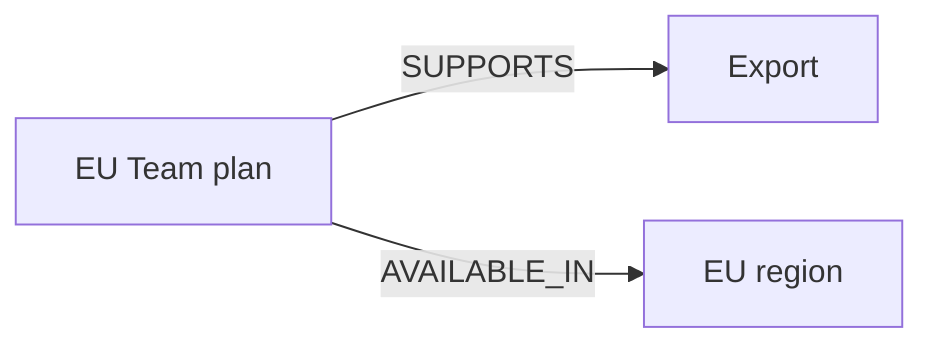
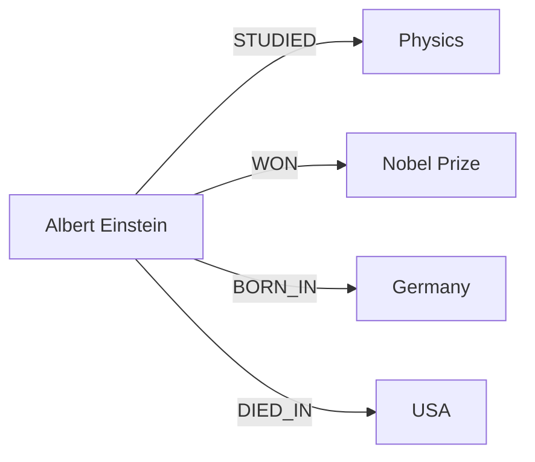
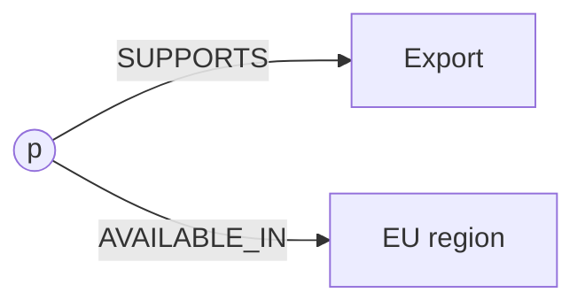
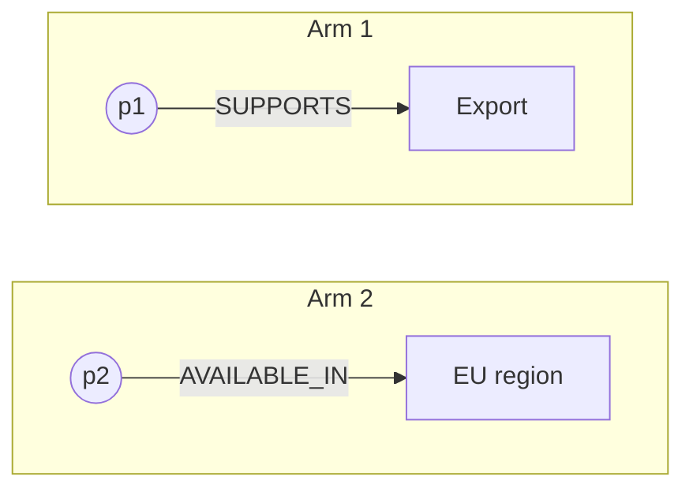

# M43.1 Theory: Graph fundamentals and Cypher

*[M43 theory](../README.md) · Lesson 43.1 · Notebooks: [`01a_kg_simple.ipynb`](../../notebook/01a_kg_simple.ipynb) · [All theory pages](../../../../../THEORY.md)*
<!-- subtitle: How a property graph stores Larkspur's plans, features and regions, and how one Cypher pattern finds a plan that meets two conditions at once -->
<!-- format: approved -->

## Start with a question that is a join

> **What you'll learn**
>
> - **Explain** nodes, relationships and properties, and why identity and direction are modelling decisions.
> - **Read** a Cypher pattern that binds one plan across two relationships.
> - **Diagnose** the cross-product match, where two conditions are met by two different plans.
> - **Separate** a missing edge from a false claim before anyone phrases an answer.

M42 ended with lightweight graph retrieval as one option among summaries and memory. This module builds the graph itself, in Neo4j, and asks it questions that similarity search cannot settle.

A Larkspur support engineer asks: *Which plans support data export in the EU?* A vector index returns two passages that both look relevant. One says a plan supports export. The other says a plan is available in the EU region. Nothing in either passage says they describe the same plan. The question is a **join**: one entity has to satisfy two facts, and text similarity has no notion of "the same entity".

This lesson uses a small teaching catalogue of Larkspur plans (EU Team, EU Enterprise, US Export, Legacy plan), the fixture of the lesson 43.4 lab. It is separate from the handbook's own plan list. The notebook teaches the same ideas on a five-node graph about Albert Einstein.

## Nodes, edges, properties

**A property graph stores entities as nodes, typed and directed relationships between them, and properties (key and value pairs) on either.** A node carries one or more labels, such as `Plan` or `Feature`, which say what kind of thing it is. A relationship has exactly one type, such as `SUPPORTS`, and always points from one node to another.

Larkspur's question needs three nodes and two relationships:

*Figure 1: One plan, two facts. The plan node is shared, which is what makes the question answerable.*

Each part of the model has its own job, and the notebook's graph uses the same parts:

| Part | Larkspur fixture | Notebook graph | What it decides |
|---|---|---|---|
| Label | `Plan`, `Feature`, `Region` | `Person`, `Subject`, `NobelPrize`, `Country` | which kind of entity a pattern can match |
| Identity property | `id: "team"` | `name: "Albert Einstein"` | which node a write or a query lands on |
| Descriptive property | display name, such as "EU Team" | none | what the answer can say about the node |
| Relationship type | `SUPPORTS`, `AVAILABLE_IN` | `STUDIED`, `WON`, `BORN_IN`, `DIED_IN` | which question a path can answer |

*Table 1: The parts of a property graph, in the teaching fixture and in the notebook.*

The notebook writes five nodes (Einstein, Physics, the Nobel Prize in Physics, Germany and the USA) and four relationships, all pointing out of the Einstein node:

*Figure 2: The notebook's graph. Five nodes, four relationships, one shared starting node.*

It writes them with `MERGE`, which matches a node or relationship if it exists and creates it if it does not. Running the build twice therefore leaves five nodes, not ten. The notebook identifies each node by its `name` property. That works for five famous entities; lesson 43.2 shows where a name stops being a safe identity.

### Direction carries meaning

The arrow is part of the fact. `Plan SUPPORTS Feature` and `Feature DEPENDS_ON Service` answer different questions, and reading an edge backwards changes the claim. In Figure 2, `BORN_IN` points from the person to the country; a query that walks it the other way finds who was born in Germany, which is a different question.

Choosing relationship types and directions is part of modelling the handbook, and it happens before any retrieval algorithm runs. A good test is to write each golden question as a path first. If a question has no path in the model, no query can answer it.

### An absent edge is not a no

A graph answers only the relationships you stored or can derive from them. If the EU Team plan has no `AVAILABLE_IN` edge to the EU region, three different things could be true: the plan is not available there, the source never said so, or extraction missed the sentence that did. We call this **silent absence**: an empty match looks the same in all three cases.

The practical rule is to keep the source of each relationship (lesson 43.2) so a missing edge can be traced back to a document, and to phrase empty results as "no matching facts in this graph" rather than "no".

## Cypher

**Cypher is Neo4j's query language: you draw the shape you want with nodes in parentheses and relationships as arrows, and the database returns every way that shape matches the stored graph.** Variables name parts of the shape. When the same variable appears twice, both appearances must be the same node.

The EU export question becomes one pattern with two arms:

| Clause | What it says | Why it matters |
|---|---|---|
| `MATCH` arm 1 | plan `p` has a `SUPPORTS` edge to the feature whose id is the parameter `feature` | finds plans with export |
| `MATCH` arm 2 | the same `p` has an `AVAILABLE_IN` edge to the region whose id is the parameter `region` | keeps only those also in the EU |
| `RETURN DISTINCT p.id` | one row per plan | removes repeated rows from several matching paths |
| `ORDER BY plan` | sorted output | stable results for tests |
| Parameters | `feature = "export"`, `region = "eu"` passed separately from the query text | the query is reused, and values never get spliced into Cypher |

*Table 2: The EU export query, clause by clause.*

### One variable or two

The shared `p` carries the join. Bind one plan variable and both arms must hold for the same node:

*Figure 3: One variable. Both arms meet at the same plan node, so a row needs one plan with both facts.*

Give each arm its own plan variable and the two arms no longer share anything:

*Figure 4: Two variables. Cypher pairs every plan from arm 1 with every node from arm 2.*

Run both against the lab's fixture edges. The fixture also has four guide nodes (Refund, Backup, Billing and Audit guides) with `AVAILABLE_IN` edges to the EU, which matters for the second design:

Choose a design to see what the EU export query returns over the lab's fixture edges.

<button type="button" data-mode="shared" aria-pressed="false" aria-controls="variable-shared">One shared variable</button>
<button type="button" data-mode="separate" aria-pressed="false" aria-controls="variable-separate">Two separate variables</button>

<section id="variable-shared" class="mode-panel" data-announcement="Shared variable selected. Two plans returned."><h4>One shared variable</h4><ul><li>Plans with an export edge: EU Team, EU Enterprise, US Export, Legacy plan.</li><li>Of those, with an EU edge: EU Team and EU Enterprise.</li><li>Result: 2 plans, the right answer.</li></ul></section>
<section id="variable-separate" class="mode-panel" data-announcement="Separate variables selected. Four plans returned."><h4>Two separate variables</h4><ul><li>Arm 1 binds 4 export plans; arm 2 binds 6 nodes with an EU edge, guides included.</li><li>Cypher pairs them: 4 times 6 is 24 rows before <code>DISTINCT</code>.</li><li>Returning the export plan gives all 4 plans, US Export and Legacy plan among them.</li></ul></section>

| Plan | `SUPPORTS` export | `AVAILABLE_IN` eu | Shared `p` | Separate variables |
|---|---|---|---|---|
| EU Team | ✓ | ✓ | returned | returned |
| EU Enterprise | ✓ | ✓ | returned | returned |
| US Export | ✓ | ✗ | not returned | returned |
| Legacy plan | ✓ | ✗ | not returned | returned |

*Table 3: The query over the lesson 43.4 lab's fixture edges, replayed in Python (no server).*

The last column is the **cross-product match**. The query is valid, runs without error and is wrong. Use the shared variable whenever one entity must satisfy several patterns; separate variables fit only when you really want every pairing.

> **Pitfall: DISTINCT is not deduplication.** `DISTINCT` removes repeated result rows. If the import created two EU Team nodes, both come back, because they are different nodes. Fixing duplicate entities is an import problem, covered in lesson 43.2.

### The notebook's queries

The notebook defines two read queries. One lists every node's `name`. The other returns four paths out of the Einstein node, one per relationship type, joined with `UNION`. Each arm of that union names its relationship type explicitly, which means a fifth relationship added later would not appear until someone adds a fifth arm. A single pattern with an untyped relationship would return all of them, at the cost of returning edges you did not ask about.

It writes with `MATCH` followed by `MERGE`: find both endpoints first, then create the relationship between them only if it is missing. If either endpoint is absent, the `MATCH` finds nothing and no edge is written, without an error. That is silent absence again, this time created at write time.

### Sessions and the driver

Read a query's results while its session is still open, because they stream from the database. Keep one driver for the life of the program and close it once at the end. The notebook breaks the second habit in an instructive way. Run it top to bottom:

Step through the 01a notebook run from top to bottom on a fresh database.

<button type="button" data-step="0" aria-pressed="false" aria-controls="nb-step-0">1. Driver</button><button type="button" data-step="1" aria-pressed="false" aria-controls="nb-step-1">2. Build</button><button type="button" data-step="2" aria-pressed="false" aria-controls="nb-step-2">3. Query</button><button type="button" data-step="3" aria-pressed="false" aria-controls="nb-step-3">4. Rerun</button>

<section id="nb-step-0" class="step-panel" aria-labelledby="nb-heading-0"><h4 id="nb-heading-0">1. One shared driver is created</h4><dl><dt>Cell</dt><dd>a module-level <code>driver</code>; helper functions are defined but not run</dd></dl></section><section id="nb-step-1" class="step-panel" aria-labelledby="nb-heading-1"><h4 id="nb-heading-1">2. The build call is commented out</h4><dl><dt>Cell</dt><dd><code>build_knowledge_graph()</code> appears only as a comment</dd><dt>Effect</dt><dd>a fresh database stays empty until you remove the comment</dd></dl></section><section id="nb-step-2" class="step-panel" aria-labelledby="nb-heading-2"><h4 id="nb-heading-2">3. The path query runs</h4><dl><dt>Helper</dt><dd><code>query_graph</code> opens its own driver for this one call and closes it</dd><dt>Result</dt><dd>4 paths on a built graph; on an empty one, nothing at all and no error</dd></dl></section><section id="nb-step-3" class="step-panel" aria-labelledby="nb-heading-3"><h4 id="nb-heading-3">4. A second build after the first</h4><dl><dt>Helper</dt><dd><code>build_knowledge_graph</code> closes the shared driver in its <code>finally</code> block</dd><dt>Result</dt><dd>the next call that uses it prints "Error: Driver closed" and carries on</dd></dl></section>

<button type="button" data-walk="previous">Previous</button>

<button type="button" data-walk="next">Next step</button>

We checked stage 4 against the installed driver (neo4j 6.4.1): a session on a closed driver raises `DriverError: Driver closed`, and the helper's `except` turns that into a printed line. Both quiet stages, the empty query and the printed error, look like a cell that ran.

### Read the paths before the wording

When a model phrases the result ("No plan supports export in the EU"), the sentence can only be as good as the rows behind it. Inspect the returned paths and their source facts first. If the pattern used the wrong label, a reversed direction or the wrong identifier, the rows are empty, and a fluent answer cannot supply the relationship the query failed to match. Lesson 43.2 turns to where those nodes and edges come from.

## Limits of this evidence

- **No Neo4j server ran.** Table 3 and the switcher replay the lab's fixture edges in Python with Cypher's matching rules; the notebook run and the four Einstein paths are read from its cells.
- **The fixture is a teaching catalogue.** Its four plans and four guides come from the lesson 43.4 lab, not from Larkspur's handbook plan list.
- **Driver behaviour is version-specific.** The closed-driver error was checked with neo4j 6.4.1 only; other driver versions may behave differently.

## References

1. Neo4j, [Cypher Manual: MATCH](https://neo4j.com/docs/cypher-manual/current/clauses/match/).
2. Neo4j, [Cypher Manual: MERGE](https://neo4j.com/docs/cypher-manual/current/clauses/merge/).
3. Neo4j, [Cypher Manual: Parameters](https://neo4j.com/docs/cypher-manual/current/syntax/parameters/).
4. Neo4j, [Python Driver Manual](https://neo4j.com/docs/python-manual/current/).

## Key Takeaways

- A property graph stores labelled nodes, typed directed relationships and properties on both. Choose identity keys, relationship types and directions by writing each golden question as a path first.
- An empty match cannot tell "false" from "never stored" from "missed by extraction". Keep each edge's source and phrase empty results as missing facts.
- Reuse one variable when one entity must satisfy several patterns, and pass values as parameters. Separate variables give a cross-product match, and `DISTINCT` does not merge duplicate nodes.

## Check yourself

1. Why are relationship types and directions modelling decisions, and what can it mean when an expected edge is absent?

The arrow is part of the fact: `Plan SUPPORTS Feature` answers a different question from `Feature DEPENDS_ON Service`, and reading an edge backwards changes the claim. A graph answers only what was stored or can be derived. An absent edge can mean the fact is false, the source never stated it, or extraction missed it.

2. The EU export query reuses one variable p in both patterns. What goes wrong over the fixture if each pattern binds its own plan variable?

It becomes a cross-product match: every export plan pairs with every node in the EU. Over the fixture, US Export and Legacy plan come back beside EU Team and EU Enterprise, four plans instead of two. `DISTINCT` would not help, because the rows are different plans.

3. You run the 01a notebook top to bottom on a fresh database and the path query prints nothing. What do you check before blaming the query?

Whether the graph was built at all. The `build_knowledge_graph()` call is commented out, so the database is empty and the query matches nothing without an error. After a build, also check for "Error: Driver closed", because the build helper closes the shared driver.

---
*Previous: [M43 overview](../README.md). Next: [43.2 From CSV to knowledge graph](../02_from_csv_to_knowledge_graph/README.md).*
