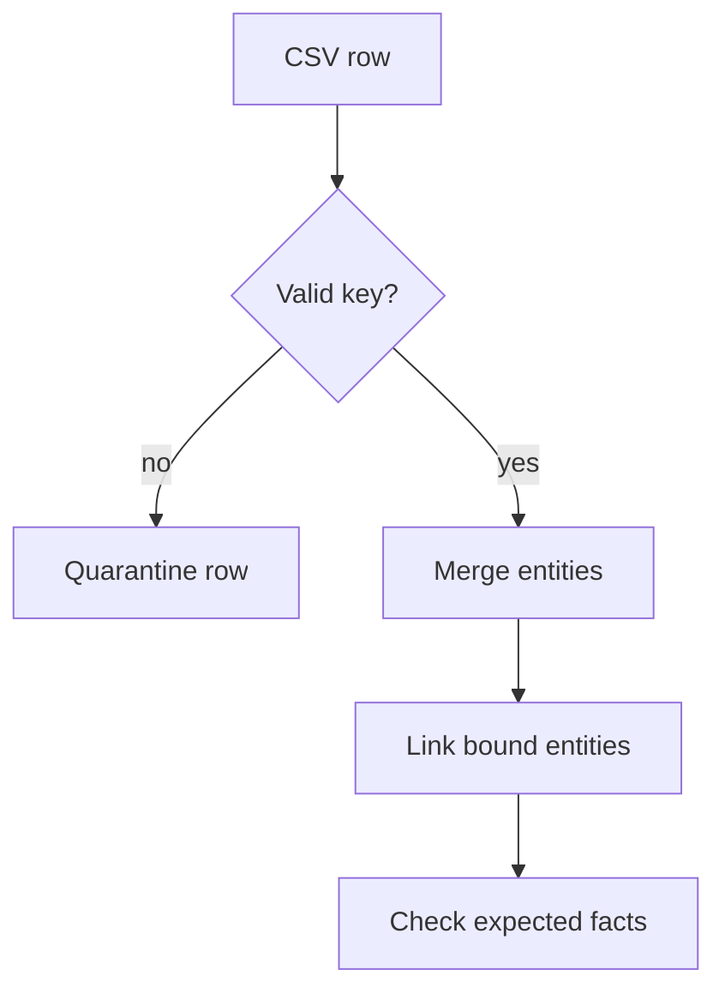

# M43.2 Theory: From CSV to knowledge graph

*[M43 theory](../README.md) · Lesson 43.2 · Notebooks: [`02a_healthcare_kg.ipynb`](../../notebook/02a_healthcare_kg.ipynb) · [All theory pages](../../../../../THEORY.md)*
<!-- subtitle: Why the key you merge on decides how many entities a CSV import creates, and what a row loses when its columns become separate edges -->

## When an import doubles the plans

> **What you'll learn**
>
> - **Explain** how `MERGE` decides identity, and why a stable key beats a set of descriptive properties.
> - **Trace** a 100-row CSV through the notebook's import and count the nodes and edges it creates.
> - **Diagnose** identity by attributes, name fan-out and the flattened row.
> - **Design** import checks: key validation, typed values, endpoint matching and source provenance.

Lesson 43.1 built a graph by hand. Real graphs come from files, and the import code decides which rows become the same entity.

Larkspur loads its plan catalogue from a CSV every night. One morning the graph holds twice as many plans as the catalogue lists. Nothing failed; a product manager had reworded several plan descriptions, and the import treated each reworded plan as a new one. The text-to-Cypher assistant now answers "which plans support export in the EU" with both the old and the new EU Team.

The cause is the identity rule, and the healthcare notebook shows it on real rows.

## Identity before import

**`MERGE` looks for a node that matches the whole pattern you give it, every label and every property, and creates a new node when none matches.** The properties inside the pattern are the identity. Put a description in the pattern and a changed description means a different entity.

The notebook reads `healthcare.csv` row by row and turns each row into nodes and relationships:

| CSV column | Becomes | Merged on |
|---|---|---|
| Provider, Bio | `HealthcareProvider` node | `name` and `bio` |
| Patient, Patient_Age, Patient_Gender, Patient_Condition | `Patient` node | all four values |
| Specialization | `Specialization` node, `SPECIALIZES_IN` edge from the provider | `name` |
| Location | `Location` node, `LOCATED_AT` edge from the provider | `name` |
| Provider and Patient together | `TREATS` edge | provider matched by `name`, patient matched by `name` only |

*Table 1: How the notebook maps each CSV column into the graph.*

The file has 100 rows, 5 provider names, 7 patient names, 5 specialisations and 5 locations. We replayed the notebook's merge rules over the file in Python (no Neo4j server was involved; these are the counts the rules imply for one run on an empty database):

| Element | Distinct in the CSV | Created by the notebook's rules |
|---|---|---|
| Provider nodes | 5 names | 5 |
| Patient nodes | 7 names | 100 |
| Specialisation and location nodes | 5 and 5 | 5 and 5 |
| `TREATS` edges | 32 provider and patient-name pairs | 368 |
| `SPECIALIZES_IN` and `LOCATED_AT` edges | 24 and 24 pairs | 24 and 24 |

*Table 2: The notebook's import replayed over healthcare.csv: 115 nodes and 416 edges.*

Two failures account for the gap.

- **Identity by attributes**: every row gives a patient a different age, gender or condition. Merging on all four values makes each of the 100 rows a new patient. Seven people become 100 nodes.
- **Name fan-out**: the `TREATS` step matches the patient by name alone. A name now points at up to 22 nodes, and the edge is drawn to every one of them that exists so far. 32 real provider and patient pairs become 368 edges.

The provider merge on `name` and `bio` works here only because each provider has one bio in the file. Change one bio between imports and the provider splits in two, which is Larkspur's doubled plan.

### A stable key

The fix is to merge on a key that never changes and set everything else afterwards. For Larkspur's catalogue that means three rules:

1. A uniqueness constraint on `Plan.id`, created once, which the database enforces and which also gives the merge an index to look up.
2. A merge on `id` alone, followed by a `SET` of the display name, description and update time. A reworded description updates the existing node.
3. A key that includes its scope, such as tenant or catalogue, when the identifier is unique only within one of them. A display name alone rarely captures that scope.

These are a proposed Larkspur schema, not cells from the healthcare notebook. Neo4j's [MERGE documentation](https://neo4j.com/docs/cypher-manual/current/clauses/merge/) explains full-pattern matching and how uniqueness constraints interact with it. With identity settled, the next problem is what a row means.

## The flattened row

A CSV row is often an event: one visit, in which this provider saw this patient, in this specialisation, at this location. The notebook turns the row's columns into separate edges on the provider. Once the row is gone, the graph no longer knows which specialisation went with which location. We call this the **flattened row**.

The replay shows how much it costs:

| Question | From the 100 rows | From the imported graph |
|---|---|---|
| Rows pairing Cardiology with Houston | 2 | not stored |
| Providers linked to Cardiology and to Houston | not a row fact | all 5 |
| Specialisations per provider | one per row | 4 or 5 each |
| Dr. Jessica Lee's specialisations | bio says dermatologist | linked to 5, Cardiology among them |

*Table 3: What the rows say against what the provider-level edges say (replayed counts).*

Every provider ends up linked to almost every specialisation and location. A question such as "cardiologists in Houston" returns all five providers. The data in this file is synthetic and noisy, which makes the effect large, but the mechanism is general. When the row is the fact, model it as a node (a `Visit` or an `Assertion`) with edges to each participant, and the pairing survives.

For Larkspur the same choice appears with sources. "The 2026 handbook says EU Team supports export" is a row-level fact. Store the source document and its version with the assertion, and deleting an obsolete edition can remove exactly the capabilities that edition asserted.

## Import checks

An import should prove it did what the file says before anything queries it:

*Figure 1: Validate the key, merge entities, link only endpoints that exist, then check known facts.*

Each step guards against one failure the notebook shows:

| Planted problem | What the notebook does | What a guarded import does |
|---|---|---|
| Row with no key | nothing checks the key before the merge runs | quarantines the row and reports it |
| Age read as text | stores `"66"` as a string, because `DictReader` returns text | casts numbers and dates before writing |
| Relationship endpoint missing | the `MATCH` finds nothing and no edge is written, silently | reports the row whose endpoint is missing |
| Query error | the helper prints the error and carries on with the next row | stops or counts failures, and fails the run above a threshold |
| Description edited | creates a second provider | updates the one node with the same key |

*Table 4: Planted import problems, one guard each.*

The notebook writes all three relationships in one chained query that begins by matching the provider and the patient. If either is missing, none of the three edges is written. That is the silent absence from lesson 43.1, created by the import.

The last box in Figure 1 is a test you can run on every import. Load a small fixture, then load it again, then load it with one description edited. The entity count should stay the same across all three runs while the description changes. Then check a handful of known paths against the file, such as one provider's patients, and compare relationship counts with the distinct pairs in the input. Table 2 is exactly that comparison, and it would have caught both failures on the first run.

## Key Takeaways

- `MERGE` matches the whole pattern, so the properties in it are the identity. Merge on a stable, scoped key backed by a uniqueness constraint, and update descriptions with `SET`.
- Matching by name alone draws edges to every node that shares the name. On the notebook's file, 32 real pairs became 368 `TREATS` edges.
- When a row is the fact, store it as a node. Splitting its columns into separate edges loses which values went together.
- Validate keys, cast types, match both endpoints and count failures. Re-import a fixture with an edited description and keep a source identifier and version on every assertion.

## Check yourself

1. The healthcare notebook merges a provider on both name and bio. Why does that break repeated imports?

`MERGE` matches the whole property pattern. When a bio changes, no existing node matches name and bio together, so the import creates a second provider. Merge on a stable key with a uniqueness constraint, then update the bio with `SET`.

2. The file has 7 patient names, yet the replayed import creates 100 Patient nodes and 368 TREATS edges. What causes each number?

Patients are merged on name, age, gender and condition, and every row has a different combination. Each of the 100 rows makes a new node. The `TREATS` step then matches the patient by name alone, which draws an edge to every node with that name. The 32 real provider and patient pairs fan out to 368 edges.

3. Larkspur deletes an obsolete handbook edition, but some plans still show capabilities that only that edition asserted. What did the import leave out?

A source document identifier and version on each assertion. With them, deleting the edition also removes the assertions it supported; without them, the capabilities stay behind with nothing to support them.

---
*Previous: [43.1 Graph fundamentals and Cypher](../01_graph_fundamentals_and_cypher/README.md). Next: [43.3 Natural-language graph QA (text-to-Cypher)](../03_natural_language_graph_qa_text_to_cypher/README.md).*
