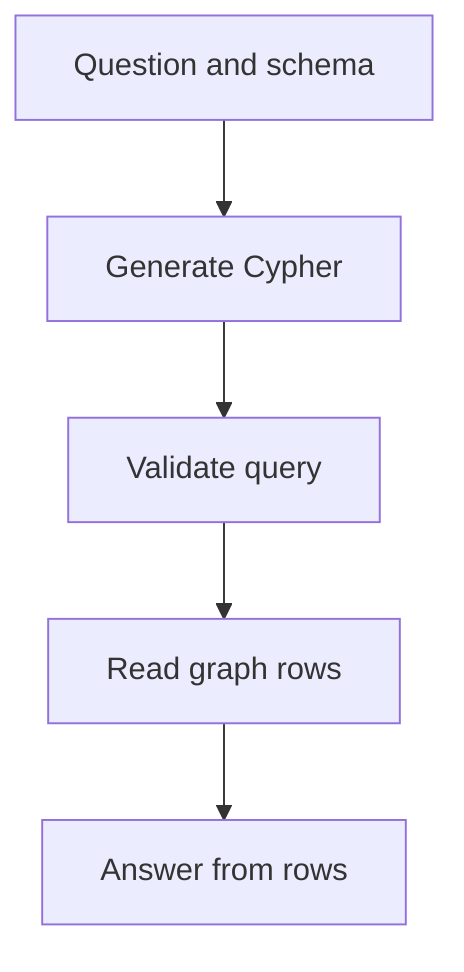

# M43.3 Theory: Natural-language graph QA (text-to-Cypher)

*[M43 theory](../README.md) · Lesson 43.3 · Notebooks: [`03a_query_kg_with_langchain.ipynb`](../../notebook/03a_query_kg_with_langchain.ipynb) · [All theory pages](../../../../../THEORY.md)*
<!-- subtitle: How a model turns a question into a Cypher query, why the hand-written queries are the test set, and where a wrong query hides behind a fluent answer -->

## Users do not write Cypher

> **What you'll learn**
>
> - **Explain** the text-to-Cypher loop: schema in, query out, rows back, answer from rows.
> - **Use** hand-written reference queries as the expected results for generated ones.
> - **Diagnose** the silent empty result and the right query over a wrong graph.
> - **Bound** a generated query with database permissions, not prompt instructions.

Lesson 43.2 loaded a graph from a file. A support engineer at Larkspur will not write a two-arm `MATCH` to ask which plans support export in the EU; they will type the question. Something has to translate.

The failure this page is about looks like success. The assistant answers "No plan currently supports export in the EU" in a confident sentence. The generated query had `AVAILABLE_IN` pointing the wrong way, matched nothing, and the model phrased an empty result as a fact.

## Text-to-Cypher

**Text-to-Cypher is a loop in which a language model reads the user's question and the graph schema, writes a Cypher query, the database runs it, and a second model call phrases the returned rows as an answer.** The schema is the model's only map of the graph: which labels exist, which relationship types connect them, which way they point and which properties they carry. For Larkspur's question the model has to find both `SUPPORTS` and `AVAILABLE_IN` and bind them to the same plan.

<!-- animated: diagrams/cypher-query.anim.html -->

*Figure 1: The text-to-Cypher loop. The answer can only restate what the rows contain.*

Each stage hands the next one a different artefact, and each can fail on its own:

| Stage | Input | Output | Typical failure |
|---|---|---|---|
| Generate | question, schema | Cypher text and parameters | wrong relationship, direction or property |
| Validate | Cypher text | accepted or rejected query | a write clause slips through |
| Read | accepted query | rows | empty or truncated result |
| Answer | question, rows | sentence | rows restated as a stronger claim |

*Table 1: What moves between the stages of Figure 1.*

The schema goes stale when the graph changes. Add a `REQUIRES_APPROVAL` relationship and a model working from yesterday's schema cannot use it. Refresh the schema used for generation after every schema change, and re-run the questions that touch the changed labels and properties.

### What the notebook runs, and what it leaves out

The lesson notebook is narrower than its title. It connects to the healthcare graph from lesson 43.2 and runs 13 hand-written Cypher queries; no model writes a query. The [LangChain Neo4j integration](https://docs.langchain.com/oss/python/integrations/graphs/neo4j_cypher) documents `GraphCypherQAChain`, which adds the generation and answer steps, and schema refresh. That chain is the extension beyond the checked-in notebook, and the module lab uses it.

The 13 queries are still the most useful part of the lesson, because they are the expected answers for a translation test. Here is what they return on the graph that lesson 43.2's import builds, replayed in Python from the CSV (no Neo4j server was used; the healthcare examples are data-query exercises, not medical guidance):

| Question | Pattern | Rows | Distinct names |
|---|---|---|---|
| How many nodes? | all nodes | 1 (count 115) | n/a |
| How many providers? | one label | 1 (count 5) | n/a |
| List patients | one label, limit 10 | 10 | at most 7 |
| Dr. Smith's patients | provider `TREATS` patient | 89 | 7 |
| Dr. Smith's specialisations | provider `SPECIALIZES_IN` | 5 | 5 |
| Providers in Houston | provider `LOCATED_AT` Houston | 5 | 5 |
| Patients of cardiologists | `TREATS` and `SPECIALIZES_IN` Cardiology, shared provider | 368 | 7 |
| Cardiologists in Houston | `LOCATED_AT` and `SPECIALIZES_IN`, shared provider | 5 | 5 |
| Cardiology patients in Houston | three arms, shared provider | 368 | 7 |
| Patients with migraine | property filter | 4 | 3 |

*Table 2: Ten of the notebook's 13 reference queries and their replayed results. The other three list names of specialisations, locations and providers.*

Two things stand out. None of the queries uses `DISTINCT`, and the 368 rows repeat seven names. And every multi-arm query returns everyone, because the import flattened its rows (lesson 43.2). These queries are written correctly. They return wrong answers because the graph is wrong.

We call this the **right query, wrong graph** failure. A text-to-Cypher test that only compares generated rows with reference rows passes here, since both queries return the same 368 rows. Grade some answers against the source data as well, or the test certifies the import's mistakes.

## Debug the query before the answer

When an answer is wrong, the bug is usually in the query, and the answer hides it. Save five fields for every request: the original question, the generated Cypher, its parameters, the returned rows, and the final answer. Then compare the generated pattern with the hand-written reference before reading the prose.

Small mistakes in the pattern return nothing without raising an error:

| Planted mistake in the EU export query | What the database returns | Error raised |
|---|---|---|
| `SUPPORT` instead of `SUPPORTS` | no rows | none |
| `AVAILABLE_IN` pointing from region to plan | no rows | none |
| Region condition dropped | every export plan, EU or not | none |
| `name: "EU"` where the stored key is `id: "eu"` | no rows | none |
| Two plan variables instead of one | the cross-product match from lesson 43.1 | none |

*Table 3: Planted generation mistakes. Each produces a valid query and a misleading result.*

This is the **silent empty result**: Cypher treats an unknown relationship type or property as a pattern that matches nothing (at most with a warning notification), which is a valid answer to the query that was written. The answer step then sees zero rows and phrases them. An empty result should say "no matching facts under this schema and data version"; it cannot establish that a capability is impossible.

### A test set for translation

Build the test set from question types, not from one phrasing. For Larkspur:

- **Paraphrase**: "Which EU plans can export data?" should produce the same rows as the reference.
- **Unknown entity**: a plan that does not exist should return no rows and say so.
- **Ambiguous name**: "Team" could be several plans, which needs a clarifying answer rather than a guess.
- **Multi-relationship**: export and EU together, the join that a single arm gets wrong.
- **Empty result**: a feature no plan has, which checks the wording of a "nothing found" answer.

Grade the rows against the reference query as well as grading the answer.

### The database is the guard

A generated query runs with whatever authority its database user has. A prompt that says "generate read-only queries" restricts nothing; a model can still emit a `DELETE`. Give the chain a read-only database user, a query timeout and a result limit. Then a bad query fails at the database.

> **Key distinction:** LangChain's chain requires an explicit `allow_dangerous_requests` opt-in. Its [security note](https://reference.langchain.com/python/langchain-community/chains/graph_qa/cypher/GraphCypherQAChain/allow_dangerous_requests) explains that the flag records that you accept the risk; it does not enforce any permission.

Lesson 43.4 adds the case where the user does not know the exact entity name, and the graph needs a vector index to find a starting point.

## Key Takeaways

- Text-to-Cypher generates a query from the question and the schema, runs it and phrases the rows. Refresh the schema after every schema change and re-run the questions it affects.
- Log question, Cypher, parameters, rows and answer separately. A wrong relationship name, direction or property key returns no rows and no error.
- Hand-written queries are the expected results for generated ones, but a correct query over a flawed graph still returns wrong rows. Enforce safety with a read-only user, timeouts and result limits.

## Check yourself

1. Why must Text-to-Cypher generation see the graph schema, and when must that schema be refreshed?

The schema tells the model which labels, relationship types, directions and properties exist, which it needs to write a pattern that matches, such as `SUPPORTS` and `AVAILABLE_IN` bound to one plan. After a schema change, refresh the schema used for generation and re-run the questions that use the changed parts.

2. The generated query and the reference query both return 368 rows for cardiology patients in Houston. Does that mean the system answered correctly?

No. It means the generated query matches the reference, and both run over a graph whose import flattened its rows. In the CSV only 2 rows pair Cardiology with Houston. Grade some answers against the source data, or the test certifies the import's mistakes.

3. A team relies on a prompt that says generate read-only queries, plus the allow_dangerous_requests flag. Is the database protected?

No. A prompt does not restrict database authority, and the flag only records that the risk was accepted. Use a read-only database user, a query timeout and result limits, so a bad query fails at the database.

---
*Previous: [43.2 From CSV to knowledge graph](../02_from_csv_to_knowledge_graph/README.md). Next: [43.4 Vector indexes on graph nodes](../04_vector_indexes_on_graph_nodes/README.md).*
