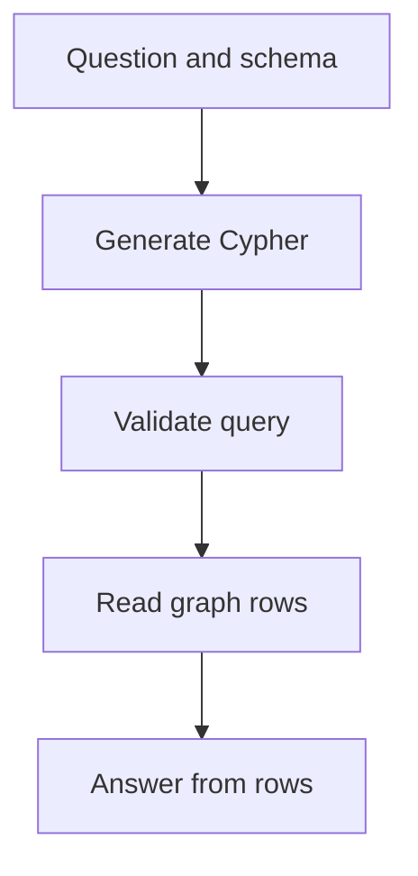
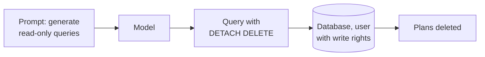
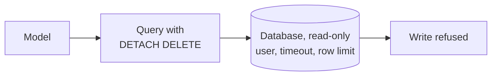

# M43.3 Theory: Natural-language graph QA (text-to-Cypher)

*[M43 theory](../README.md) · Lesson 43.3 · Notebooks: [`03a_query_kg_with_langchain.ipynb`](../../notebook/03a_query_kg_with_langchain.ipynb) · [All theory pages](../../../../../THEORY.md)*
<!-- subtitle: How a model turns a question into a Cypher query, why the hand-written queries are the test set, and where a wrong query hides behind a fluent answer -->
<!-- format: approved -->

## Start with an answer that looks like success

> **What you'll learn**
>
> - **Explain** the text-to-Cypher loop: schema in, query out, rows back, answer from rows.
> - **Use** hand-written reference queries as the expected results for generated ones.
> - **Diagnose** the silent empty result and the right query over a wrong graph.
> - **Bound** a generated query with database permissions, not prompt instructions.

Lesson 43.2 loaded a graph from a file. A support engineer at Larkspur will not write a two-arm `MATCH` to ask which plans support export in the EU; they will type the question. Something has to translate.

The failure this page is about looks like success. The assistant answers "No plan currently supports export in the EU" in a confident sentence. The generated query had `AVAILABLE_IN` pointing the wrong way, matched nothing, and the model phrased an empty result as a fact.

## Text-to-Cypher

**Text-to-Cypher is a loop in which a language model reads the user's question and the graph schema, writes a Cypher query, the database runs it, and a second model call phrases the returned rows as an answer.** The schema is the model's only map of the graph: which labels exist, which relationship types connect them, which way they point and which properties they carry. For Larkspur's question the model has to find both `SUPPORTS` and `AVAILABLE_IN` and bind them to the same plan.

<!-- animated: diagrams/cypher-query.anim.html -->

*Figure 1: The text-to-Cypher loop. The answer can only restate what the rows contain.*

Each stage hands the next one a different artefact, and each can fail on its own:

| Stage | Input | Output | Typical failure |
|---|---|---|---|
| Generate | question, schema | Cypher text and parameters | wrong relationship, direction or property |
| Validate | Cypher text | accepted, corrected or emptied query | a write clause slips through |
| Read | accepted query | rows | empty or truncated result |
| Answer | question, rows | sentence | rows restated as a stronger claim |

*Table 1: What moves between the stages of Figure 1.*

The schema goes stale when the graph changes. LangChain's `Neo4jGraph` reads it once, when the object is created. Add a `REQUIRES_APPROVAL` relationship afterwards and the generator keeps working from the old map until someone calls `refresh_schema()`. Refresh after every schema change, and re-run the questions that touch the changed labels and properties.

### One request through the chain

LangChain's `GraphCypherQAChain` (langchain-neo4j 0.11.0) runs the loop. Follow the EU export question through it with the planted reversed edge. The generated query is scripted; the chain's handling of it was checked against the installed source:

Step through one question in the chain, with a generated query that points the EU edge the wrong way.

<button type="button" data-step="0" aria-pressed="false" aria-controls="chain-step-0">1. Schema</button><button type="button" data-step="1" aria-pressed="false" aria-controls="chain-step-1">2. Generate</button><button type="button" data-step="2" aria-pressed="false" aria-controls="chain-step-2">3. Validate</button><button type="button" data-step="3" aria-pressed="false" aria-controls="chain-step-3">4. Read</button><button type="button" data-step="4" aria-pressed="false" aria-controls="chain-step-4">5. Answer</button>

<section id="chain-step-0" class="step-panel" aria-labelledby="chain-heading-0"><h4 id="chain-heading-0">1. The schema goes into the prompt</h4><dl><dt>Source</dt><dd>the schema text read when the graph object was created</dd><dt>Holds</dt><dd>Plan, Feature and Region; SUPPORTS and AVAILABLE_IN, both pointing out of Plan</dd></dl></section><section id="chain-step-1" class="step-panel" aria-labelledby="chain-heading-1"><h4 id="chain-heading-1">2. The model writes a query</h4><dl><dt>Arm 1</dt><dd>plan p SUPPORTS the export feature</dd><dt>Arm 2</dt><dd>the EU region AVAILABLE_IN p, the planted mistake</dd></dl></section><section id="chain-step-2" class="step-panel" aria-labelledby="chain-heading-2"><h4 id="chain-heading-2">3. Validation is off by default</h4><dl><dt>Default</dt><dd><code>validate_cypher=False</code>: the query runs exactly as written</dd><dt>If switched on</dt><dd>the corrector cannot repair this two-arm query and replaces it with an empty string</dd></dl></section><section id="chain-step-3" class="step-panel" aria-labelledby="chain-heading-3"><h4 id="chain-heading-3">4. The database returns rows</h4><dl><dt>Rows</dt><dd>0, and no error; an empty query is not run at all</dd><dt>Cap</dt><dd>the chain keeps at most <code>top_k</code> rows, 10 by default</dd></dl></section><section id="chain-step-4" class="step-panel" aria-labelledby="chain-heading-4"><h4 id="chain-heading-4">5. The model phrases the rows</h4><dl><dt>Context</dt><dd>an empty list</dd><dt>Answer</dt><dd>whatever the model makes of nothing, often a confident "no"</dd></dl></section>

<button type="button" data-walk="previous">Previous</button>

<button type="button" data-walk="next">Next step</button>

Stage 4 has a second trap. On a query that returns 368 rows, the answer model sees only the first 10. A count or a "list all" question gets answered from a sample, and nothing in the answer says so.

### What the notebook runs, and what it leaves out

The lesson notebook is narrower than its title. It connects to the healthcare graph from lesson 43.2 through `Neo4jGraph` and runs 13 hand-written Cypher queries; no model writes a query. The [LangChain Neo4j integration](https://docs.langchain.com/oss/python/integrations/graphs/neo4j_cypher) documents the chain that adds the generation and answer steps. That chain is the extension beyond the checked-in notebook, and the module lab uses it.

The 13 queries are still the most useful part of the lesson, because they are the expected answers for a translation test. Here is what they return on the graph that lesson 43.2's import builds, replayed in Python from the CSV (no Neo4j server was used; the healthcare examples are data-query exercises, not medical guidance):

| Question | Pattern | Rows | Distinct names |
|---|---|---|---|
| How many nodes? | all nodes | 1 (count 115) | n/a |
| How many providers? | one label | 1 (count 5) | n/a |
| List patients | one label, limit 10 | 10 | at most 7 |
| Dr. Smith's patients | provider `TREATS` patient | 89 | 7 |
| Dr. Smith's specialisations | provider `SPECIALIZES_IN` | 5 | 5 |
| Providers in Houston | provider `LOCATED_AT` Houston | 5 | 5 |
| Patients of cardiologists | `TREATS` and `SPECIALIZES_IN` Cardiology, shared provider | 368 | 7 |
| Cardiologists in Houston | `LOCATED_AT` and `SPECIALIZES_IN`, shared provider | 5 | 5 |
| Cardiology patients in Houston | three arms, shared provider | 368 | 7 |
| Patients with migraine | property filter | 4 | 3 |

*Table 2: Ten of the notebook's 13 reference queries and their replayed results. The other three list names of specialisations, locations and providers.*

Two things stand out. None of the queries uses `DISTINCT`, and the 368 rows repeat seven names. And every multi-arm query returns everyone, because the import flattened its rows (lesson 43.2). These queries are written correctly. They return wrong answers because the graph is wrong.

We call this the **right query, wrong graph** failure. A text-to-Cypher test that only compares generated rows with reference rows passes here, since both queries return the same 368 rows. Grade some answers against the source data as well, or the test certifies the import's mistakes.

## Debug the query before the answer

When an answer is wrong, the bug is usually in the query, and the answer hides it. Save five fields for every request: the original question, the generated Cypher, its parameters, the returned rows, and the final answer. Then compare the generated pattern with the hand-written reference before reading the prose.

Small mistakes in the pattern return nothing without raising an error. We also ran each planted query through the chain's corrector, the step `validate_cypher=True` adds, with the Larkspur schema:

| Planted mistake in the EU export query | What the database returns | Error raised | With `validate_cypher=True` |
|---|---|---|---|
| `SUPPORT` instead of `SUPPORTS` | no rows | none | query emptied, no rows |
| `AVAILABLE_IN` pointing from region to plan | no rows | none | query emptied, no rows |
| Region condition dropped | every export plan, EU or not | none | unchanged |
| `name: "EU"` where the stored key is `id: "eu"` | no rows | none | unchanged |
| Two plan variables instead of one | the cross-product match from lesson 43.1 | none | unchanged |
| A `DETACH DELETE` clause | deletes plans | none | unchanged |

*Table 3: Planted generation mistakes. Each produces a valid query and a misleading result, and the corrector changes none of the outcomes.*

The corrector checks relationship types and directions against the schema. It flips a reversed edge in a single simple pattern, but in both two-arm versions we tried it gave up and returned an empty query, which the chain treats as zero rows. It never looks at properties, at missing conditions or at writes.

This is the **silent empty result**: Cypher treats an unknown relationship type or property as a pattern that matches nothing (at most with a warning notification), which is a valid answer to the query that was written. The answer step then sees zero rows and phrases them. An empty result should say "no matching facts under this schema and data version"; it cannot establish that a capability is impossible.

### A test set for translation

Build the test set from question types, not from one phrasing. For Larkspur:

- **Paraphrase**: "Which EU plans can export data?" should produce the same rows as the reference.
- **Unknown entity**: a plan that does not exist should return no rows and say so.
- **Ambiguous name**: "Team" could be several plans, which needs a clarifying answer rather than a guess.
- **Multi-relationship**: export and EU together, the join that a single arm gets wrong.
- **Empty result**: a feature no plan has, which checks the wording of a "nothing found" answer.

Grade the rows against the reference query as well as grading the answer.

### The database is the guard

A generated query runs with whatever authority its database user has. One design puts the guard in the prompt:

*Figure 2: A prompt guard. The instruction shapes what the model usually writes, and nothing stops the query it actually writes.*

The other puts it in the database:

*Figure 3: A database guard. The same query fails at the database, whatever the model wrote.*

Give the chain a read-only database user, a query timeout (`Neo4jGraph` has none unless you set `timeout`) and a result limit. Then a bad query fails at the database.

> **Key distinction:** LangChain's chain refuses to start without an explicit `allow_dangerous_requests=True`. Its [security note](https://reference.langchain.com/python/langchain-community/chains/graph_qa/cypher/GraphCypherQAChain/allow_dangerous_requests) explains that the flag records that you accept the risk; it does not enforce any permission.

Lesson 43.4 adds the case where the user does not know the exact entity name, and the graph needs a vector index to find a starting point.

## Limits of this evidence

- **No model and no Neo4j server ran.** The chain trace uses a scripted query; Table 2 replays the notebook's queries over the CSV in Python; Table 3's database column applies Cypher's matching rules by hand.
- **The corrector column is real but narrow.** It comes from langchain-neo4j 0.11.0's `CypherQueryCorrector` on six hand-written queries with a two-relationship schema; other versions and schemas may correct more or less.
- **The 10-row cap and the schema read are defaults** in the installed versions; both are parameters you can change.

## References

1. LangChain, [Neo4j integration: GraphCypherQAChain](https://docs.langchain.com/oss/python/integrations/graphs/neo4j_cypher).
2. LangChain, [GraphCypherQAChain: allow_dangerous_requests](https://reference.langchain.com/python/langchain-community/chains/graph_qa/cypher/GraphCypherQAChain/allow_dangerous_requests).
3. Neo4j, [Operations Manual: Authentication and authorisation](https://neo4j.com/docs/operations-manual/current/authentication-authorization/).
4. Neo4j, [Cypher Manual: MATCH](https://neo4j.com/docs/cypher-manual/current/clauses/match/).

## Key Takeaways

- Text-to-Cypher generates a query from the question and the schema, runs it and phrases the rows. `Neo4jGraph` reads the schema once: refresh it after every schema change and re-run the questions it affects.
- Log question, Cypher, parameters, rows and answer separately. A wrong relationship name, direction or property key returns no rows and no error, and the optional corrector empties or passes such queries rather than fixing them.
- Hand-written queries are the expected results for generated ones, but a correct query over a flawed graph still returns wrong rows. Enforce safety with a read-only user, timeouts and result limits.

## Check yourself

1. Why must Text-to-Cypher generation see the graph schema, and when must that schema be refreshed?

The schema tells the model which labels, relationship types, directions and properties exist, which it needs to write a pattern that matches, such as `SUPPORTS` and `AVAILABLE_IN` bound to one plan. `Neo4jGraph` reads it once at creation, so after a schema change call `refresh_schema()` and re-run the questions that use the changed parts.

2. The generated query and the reference query both return 368 rows for cardiology patients in Houston. Does that mean the system answered correctly?

No. It means the generated query matches the reference, and both run over a graph whose import flattened its rows. In the CSV only 2 rows pair Cardiology with Houston. The chain would also pass only the first 10 rows to the answer model. Grade some answers against the source data.

3. A team relies on a prompt that says generate read-only queries, plus the allow_dangerous_requests flag. Is the database protected?

No. A prompt does not restrict database authority, the flag only records that the risk was accepted, and the corrector passes a `DETACH DELETE` unchanged. Use a read-only database user, a query timeout and result limits, so a bad query fails at the database.

---
*Previous: [43.2 From CSV to knowledge graph](../02_from_csv_to_knowledge_graph/README.md). Next: [43.4 Vector indexes on graph nodes](../04_vector_indexes_on_graph_nodes/README.md).*
