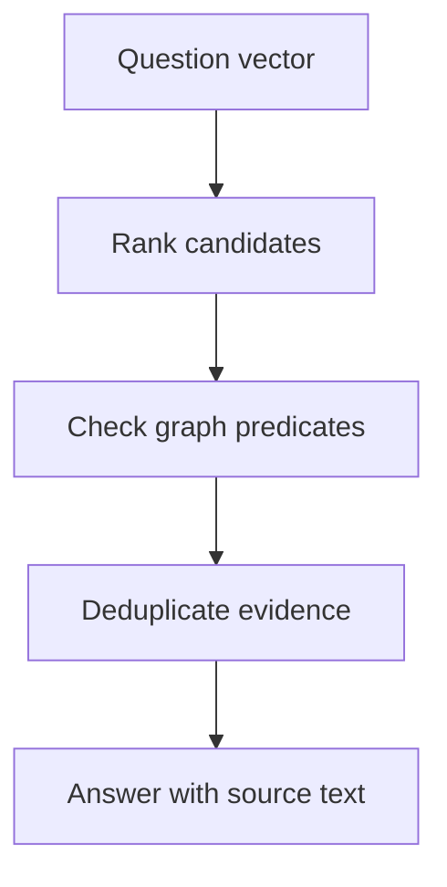
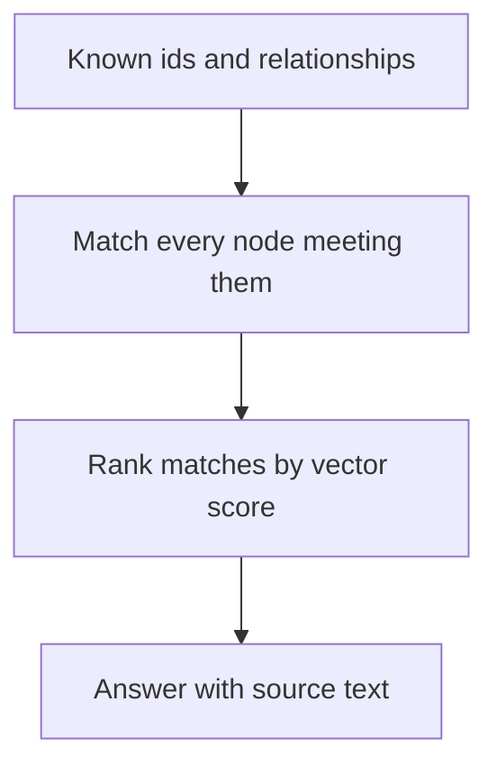

# M43.4 Theory: Vector indexes on graph nodes

*[M43 theory](../README.md) · Lesson 43.4 · Notebooks: [`04a_vector_indexing_and_embedding.ipynb`](../../notebook/04a_vector_indexing_and_embedding.ipynb) · [All theory pages](../../../../../THEORY.md)*
<!-- subtitle: How a vector index on graph nodes finds candidates for a vague question, and why every candidate still has to pass the graph's exact relationship checks -->
<!-- format: approved -->

## Start with a question that names nothing

> **What you'll learn**
>
> - **Explain** graph plus vector retrieval as two stages: similar candidates, then exact checks.
> - **Trace** the candidate budget in the lab, and why recall jumps at `k=3` and `k=5`.
> - **Diagnose** the similar-but-ineligible candidate and per-row embedding calls.
> - **Choose** vector-first or graph-first retrieval from what the question pins down.

Lesson 43.3 assumed the question names its entities. A Larkspur customer writes *I need a plan that lets me pull my data out from the Frankfurt side*. No label, no plan id, no "export" and no "EU". A Cypher pattern has nothing to bind.

Vector search can find a starting point for wording like this. The failure is that it finds text that sounds right. A refund guide linked to the EU region can rank above every plan that actually supports export there.

## Graph + vector hybrid

**Graph plus vector retrieval uses a vector index to rank nodes whose text resembles the question, then uses graph relationships to keep only the candidates that meet the question's exact constraints.** The vector stage handles vague wording; the graph stage handles facts such as "supports export" and "available in the EU". Keep the two stages visible: a candidate dropped at either stage then has a recorded reason.

*Figure 1: Vector-first retrieval. Ranking proposes; the graph predicates decide.*

### How the notebook builds the index

The notebook adds a vector index to the healthcare graph from lesson 43.2. The pieces, in the order it creates them:

| Piece | Notebook setting | What it decides |
|---|---|---|
| Index | `health_providers_embeddings` on `HealthcareProvider.comprehensiveEmbedding` | which nodes and which property are searchable |
| Dimensions | 1536 | must equal the embedding model's output size |
| Similarity | cosine | how closeness between vectors is scored |
| Stored vectors | each provider's `bio`, embedded inside the database and written to the node | what text the ranking sees |
| Query | the question embedded the same way, top 3 nodes | the candidate budget `k` |

*Table 1: The notebook's vector index, piece by piece.*

The 1536 dimensions belong to the notebook's embedding model, not to every model. Query vectors and stored vectors must come from the same model with the same dimensionality, or the scores mean nothing. Follow one run of the notebook from an empty index to three ranked providers:

Step through the notebook's index build and search on the healthcare graph.

<button type="button" data-step="0" aria-pressed="false" aria-controls="index-step-0">1. Create</button><button type="button" data-step="1" aria-pressed="false" aria-controls="index-step-1">2. Wait</button><button type="button" data-step="2" aria-pressed="false" aria-controls="index-step-2">3. Embed bios</button><button type="button" data-step="3" aria-pressed="false" aria-controls="index-step-3">4. Embed question</button><button type="button" data-step="4" aria-pressed="false" aria-controls="index-step-4">5. Rank</button>

<section id="index-step-0" class="step-panel" aria-labelledby="index-heading-0"><h4 id="index-heading-0">1. Create the index</h4><dl><dt>Declared</dt><dd>label, property, 1536 dimensions and cosine similarity</dd><dt>Stored vectors</dt><dd>none yet</dd></dl></section><section id="index-step-1" class="step-panel" aria-labelledby="index-heading-1"><h4 id="index-heading-1">2. Wait until it is online</h4><dl><dt>Check</dt><dd>list the vector indexes and read the state</dd><dt>Rule</dt><dd>search only once this index reports <code>ONLINE</code></dd></dl></section><section id="index-step-2" class="step-panel" aria-labelledby="index-heading-2"><h4 id="index-heading-2">3. Embed each provider's bio</h4><dl><dt>Rows matched</dt><dd>368, one per <code>TREATS</code> edge</dd><dt>Distinct bios</dt><dd>5</dd><dt>Written to</dt><dd><code>comprehensiveEmbedding</code> on each provider node</dd></dl></section><section id="index-step-3" class="step-panel" aria-labelledby="index-heading-3"><h4 id="index-heading-3">4. Embed the question</h4><dl><dt>Question</dt><dd>"give me a list of healthcare providers in the area of dermatology"</dd><dt>Model</dt><dd>the same one that embedded the bios</dd></dl></section><section id="index-step-4" class="step-panel" aria-labelledby="index-heading-4"><h4 id="index-heading-4">5. Rank the nodes</h4><dl><dt>Budget</dt><dd>top 3 providers by cosine score</dd><dt>Returned</dt><dd>name, bio and score; no relationship is checked</dd></dl></section>

<button type="button" data-walk="previous">Previous</button>

<button type="button" data-walk="next">Next step</button>

Step 5 is where the notebook stops: it returns the vector stage alone. The graph checks of Figure 1 are what this lesson adds on top.

Both database calls the notebook uses are now old forms. Neo4j's [vector-index documentation](https://neo4j.com/docs/cypher-manual/current/indexes/search-indexes/vector-indexes/) names the Cypher `SEARCH` clause as the preferred query from Neo4j 2026.01 and marks `db.index.vector.queryNodes` deprecated as of 2026.04. The GenAI plugin's [embedding page](https://neo4j.com/docs/genai/plugin/current/embeddings/) marks `genai.vector.encode` deprecated in 2025.11, superseded by `ai.text.embed`. Check the deployed database version before copying either form.

### Planted failure: one embedding call per row

The embedding step starts by matching every provider that `TREATS` a patient, then embeds the provider's bio. A `MATCH` returns one row per matching path, not one per provider. On the graph that lesson 43.2's import builds there are 368 `TREATS` edges, which means 368 embedding calls for 5 distinct bios (replayed from the CSV; no database or embedding call was run). We call this **row multiplication**. Reduce to distinct providers before calling anything that costs money.

### Text and edges can disagree

The notebook's question asks for providers "in the area of dermatology". Only one bio mentions dermatology, Dr. Jessica Lee's. The graph links four providers to the Dermatology node, because the import flattened its rows. The vector stage and the graph stage would give different answers, and neither is the truth: one reads a bio, the other reads edges that lost their row context. Hybrid retrieval inherits the quality of both sources, which is why the next section measures them separately.

## Candidate budget and constraints

The [interactive lab](interactive/graph-filter-lab.html) runs Figure 1 on Larkspur's teaching catalogue: eight records, hand-placed two-dimensional vectors and a question vector of [1, 0]. It ranks every record by exact cosine similarity, keeps the top `k`, and checks each kept record for an outgoing `SUPPORTS` edge to export and an `AVAILABLE_IN` edge to the EU. These are illustrative vectors and invented records, not model embeddings and not a benchmark of Neo4j's approximate index.

<!-- lab: interactive/graph-filter-lab.html -->

At `k = 8` the lab's ledger shows every record with its score and its graph check:

| Rank | Record | Cosine | Graph check |
|---|---|---|---|
| 1 | Refund guide | 0.995 | Missing export |
| 2 | US Export | 0.976 | Missing EU |
| 3 | EU Team | 0.936 | Eligible |
| 4 | Backup guide | 0.868 | Missing export |
| 5 | EU Enterprise | 0.768 | Eligible |
| 6 | Billing guide | 0.640 | Missing export |
| 7 | Audit guide | 0.496 | Missing export |
| 8 | Legacy plan | 0.351 | Missing EU |

*Table 2: The lab's candidate ledger at k = 8. The two most similar records both fail a graph check.*

The top two records are the **similar-but-ineligible** failure. The refund guide is linked to the EU and ranks first, but has no export edge. US Export supports export but is not in the EU. Moving the budget shows what that costs:

| `k` | Checked | Eligible found | Recall |
|---|---|---|---|
| 2 | 2 | 0 / 2 | 0% |
| 3 | 3 | 1 / 2 | 50% |
| 4 | 4 | 1 / 2 | 50% |
| 5 | 5 | 2 / 2 | 100% |
| 8 | 8 | 2 / 2 | 100% |

*Table 3: Recall against the candidate budget, as the lab prints it.*

The lab's recall divides surviving eligible records by every eligible record in a complete toy catalogue. A production system has no complete list; its recall needs independently labelled questions and answers.

Each unit of `k` is one more candidate scored and one more set of graph checks. At `k = 5` the lab checks 5 records to find 2; at `k = 8` it checks 8 and finds the same 2. The last 3 checks add work and no answer. When an eligible plan is missing, move the budget before changing the schema. Raise `k` until recall stops changing on labelled questions, then stop.

### What a bigger budget cannot fix

The graph check is a post-filter: it can return fewer than `k` results, including none. A larger `k` gives the graph more candidates. It cannot fix a missing `AVAILABLE_IN` edge, an entity that was never resolved to the right plan, or an eligible plan whose text ranks below every budget you can afford. Authorisation is a separate constraint again: apply it to every branch of retrieval, and never treat it as a relevance filter that a bigger budget might relax.

## Choosing the order

Vector-first, Figure 1, is one of two orders. When the question names its constraints exactly, the graph can go first and the vectors only order what it returns:

*Figure 2: Graph-first retrieval. The match decides membership; the vectors only order the members.*

The same question shows the difference. Take "EU plans with export" on the lab's catalogue:

Compare the two orders on the question "EU plans with export". Graph-first is worked by hand from the lab's edges; the lab itself runs only vector-first.

<button type="button" data-mode="vector" aria-pressed="false" aria-controls="order-vector">Vector-first, k = 3</button>
<button type="button" data-mode="graph" aria-pressed="false" aria-controls="order-graph">Graph-first</button>

<section id="order-vector" class="mode-panel" data-announcement="Vector-first selected. 3 candidates checked, 1 of 2 eligible plans found."><h4>Vector-first, k = 3: 1 of 2 plans</h4><ul><li>Ranks all eight records, keeps Refund guide, US Export and EU Team.</li><li>The graph checks reject the first two.</li><li>EU Enterprise, at rank 5, never reaches the checks.</li></ul></section>
<section id="order-graph" class="mode-panel" data-announcement="Graph-first selected. Both eligible plans found, no budget to tune."><h4>Graph-first: 2 of 2 plans</h4><ul><li>Matches every plan with an export edge and an EU edge: EU Team and EU Enterprise.</li><li>Scores only those two, so ranking changes their order and nothing else.</li><li>Finds nothing if the question names no constraint the graph can bind.</li></ul></section>

| | Vector-first (Figure 1) | Graph-first (Figure 2) |
|---|---|---|
| Starts from | vague wording | known ids and relationships |
| Finds | candidates similar to the question | every node meeting the constraints |
| Main risk | eligible answer outside the top `k` | no match for a vague question |
| Cost driver | `k` times the graph checks | graph degree and indexes |
| Larkspur example | "pull my data out from the Frankfurt side" | "EU plans with export" |

*Table 4: The two orders for combining vectors and graph constraints.*

For "EU plans with export" the exact two-arm Cypher from lesson 43.1 returns both eligible plans over the whole graph, with no budget to tune. Use the vector stage when there is no exact starting point, and compare its recall curve with that exact match on the questions where both apply. Lesson 43.5 turns to where the graph's relationships come from when there is no CSV, only text.

## Limits of this evidence

- **The lab is a toy.** Eight records, two-dimensional hand-placed vectors and exact cosine ranking. Neo4j's index is approximate and model embeddings have hundreds of dimensions, so real rankings shift between runs and models.
- **No database or embedding call ran.** The 368 rows, 5 bios and the Dermatology edges come from replaying lesson 43.2's import rules on its CSV in Python.
- **Scores compare within one result set.** Neo4j's documentation says vector scores are meaningful inside a single vector query; rank each source separately before combining vector hits with full-text or other scores.
- **Syntax dates are Neo4j's.** The `SEARCH` clause and the deprecations are quoted from the current documentation; an older server needs the procedure form.

## References

1. Neo4j, [Vector indexes](https://neo4j.com/docs/cypher-manual/current/indexes/search-indexes/vector-indexes/), Cypher Manual.
2. Neo4j, [Create and store embeddings](https://neo4j.com/docs/genai/plugin/current/embeddings/), GenAI Plugin documentation.
3. LangChain, [Neo4j vector index integration](https://docs.langchain.com/oss/python/integrations/vectorstores/neo4jvector).

## Key Takeaways

- Vector search ranks text that resembles the question; graph checks confirm explicit relationships. Keep both stages visible so each dropped candidate has a reason.
- Query and stored vectors need the same model and dimensionality. Check the database version for the current search and embedding syntax, wait for the index to be `ONLINE`, and embed distinct nodes, not matched rows.
- In the lab, recall is 0% at `k = 2`, 50% at `k = 3` and 100% at `k = 5`. A bigger budget cannot fix a missing edge or an unresolved entity, and authorisation applies to every branch.

## Check yourself

1. Why keep vector candidate selection and graph relationship checks as separate stages?

Vector search finds text that resembles the question, and graph matching checks explicit relationships. In the lab the refund guide ranks first and US Export second, yet neither supports export in the EU. Separate stages record why each candidate was dropped.

2. In the graph filter lab, how many eligible plans survive at k = 2, 3 and 5, and what does raising k past 5 buy?

None at `k = 2`, EU Team at `k = 3`, and both EU Team and EU Enterprise at `k = 5`. Past that, each extra candidate is scored and checked without adding an answer on this fixture. A bigger `k` also cannot fix a missing relationship or an unresolved entity.

3. The notebook's embedding step matches every provider that treats a patient, then embeds the bio. What does that cost on the imported graph, and how do you fix it?

The match returns one row per `TREATS` edge, so the embedding runs once per row: 368 times for 5 distinct bios on the replayed graph. Reduce the rows to distinct providers before the embedding call.

---
*Previous: [43.3 Natural-language graph QA (text-to-Cypher)](../03_natural_language_graph_qa_text_to_cypher/README.md). Next: [43.5 LLM entity and relationship extraction](../05_llm_entity_and_relationship_extraction/README.md).*
