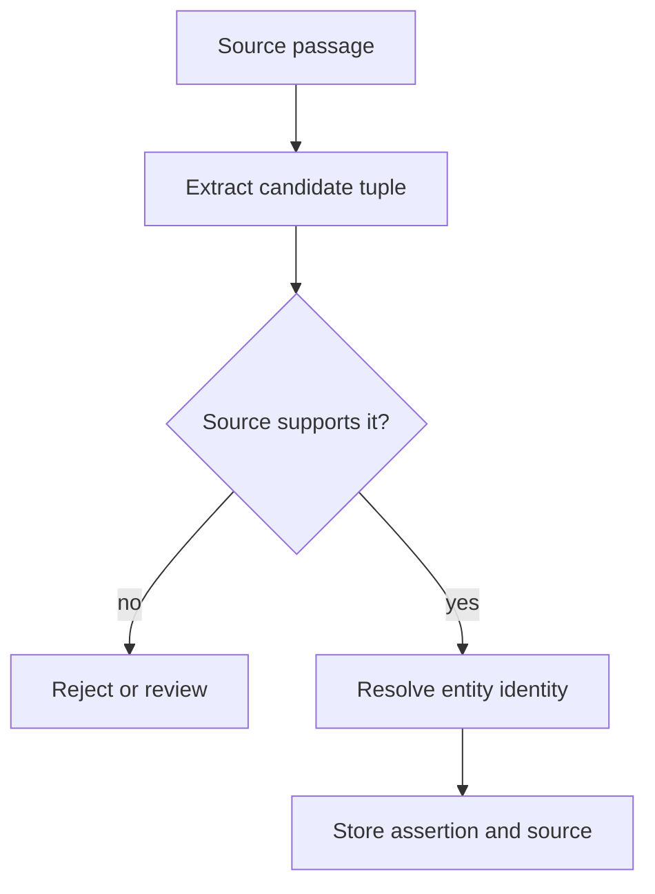

# M43.5 Theory: LLM entity and relationship extraction

*[M43 theory](../README.md) · Lesson 43.5 · Notebooks: [`05a_entity_relationship_extraction.ipynb`](../../notebook/05a_entity_relationship_extraction.ipynb), [`05b_create_kg_from_text.ipynb`](../../../optional/notebook/05b_create_kg_from_text.ipynb) (optional) · [All theory pages](../../../../../THEORY.md)*
<!-- subtitle: Why every tuple an LLM extracts from the handbook is a candidate fact that needs a source check, an identity and a place for its conditions before it becomes an edge -->

## Extraction produces candidate facts

> **What you'll learn**
>
> - **Explain** LLM extraction as a producer of candidate tuples, not of verified edges.
> - **Trace** the notebook's chunk, extract, parse and plot pipeline, and where each step can fail.
> - **Diagnose** the dropped condition, the brittle parser, string deduplication and the overwritten edge.
> - **Design** the checks between a tuple and the graph: support, types, identity and provenance.

Lessons 43.2 to 43.4 started from a CSV, where every column already had a meaning. Most of Larkspur's knowledge is prose: the handbook, policy updates, incident notes. To get a graph from prose, a model reads the text and proposes entities and relationships.

The failure is quiet. The handbook says *EU Team may support exports after approval*. The extractor returns `(EU Team, supports, Export)`. Lesson 43.3's assistant now tells customers that EU Team supports exports, with no approval step, and the graph looks clean.

**LLM extraction asks a model to read a passage and return the entities it names and relationship tuples of the form (subject, relation, object).** Each tuple is a **candidate fact**: the model's reading of the passage, which may be right, partial or invented. Nothing in the output proves the passage supports it.

### What the notebook does

The extraction notebook runs four steps over a text file:

| Step | What it does | What it does not do |
|---|---|---|
| Chunk | groups whole lines until a word threshold of 2,665 | split inside a line |
| Extract | asks the model for an `Entities:` list and a `Relationships:` list of tuples, with one worked example in the prompt | check any tuple against the text |
| Parse | splits the reply on those two headers and reads each list as a Python literal | recover from any other reply shape |
| Aggregate and plot | removes exact duplicate entity names, draws a directed graph with NetworkX | resolve aliases, or write anything to Neo4j |

*Table 1: The notebook's extraction pipeline.*

The input file is not prose. It is a tab-separated question and answer set: 402 rows about eight subjects such as Abraham Lincoln, Finland and Calvin Coolidge, 6,090 words in all, and the same question often appears twice with answers like "yes" and "Yes.". At a threshold of 2,665 words the chunker makes 3 chunks of 2,659, 2,657 and 774 words (run in the scratchpad on the notebook's own function).

That input carries a planted failure of its own. Some rows are questions whose answer is "no", such as whether Lincoln's mother died of pneumonia. A tuple taken from the question text asserts exactly what the answer denies. We call this the **negated fact**, and only a check against the full row catches it.

### From candidate to edge

A candidate becomes an edge only after it passes the checks the notebook leaves out:

*Figure 1: The path from a passage to a stored assertion. The support check comes before identity, and the source travels with the edge.*

Each check has a reason:

- **Support**: the passage states the tuple, conditions included. A schema-valid tuple can still be unsupported.
- **Types**: the subject and object have allowed labels, and the relation is an allowed type between them, such as `Plan SUPPORTS Feature`.
- **Identity**: each name resolves to one existing entity, or to a new one on purpose.
- **Provenance**: the stored assertion keeps the passage identifier, the source version and the extraction configuration (model and prompt), so it can be audited and deleted with its source.

### Names are not identities

The notebook removes duplicate entities by putting the names in a set. That merges only exact repeats. "EU Team" and "EU team" stay two entities; "Team" and "EU Team" stay two as well, and here they might really be two products. A string set cannot tell an alias from a different thing.

Resolve names with identifiers and context: the plan id from the catalogue, the document the name appears in, the region it is linked to. When a name could be two entities, send it to review rather than guessing. The next section covers the tuple itself.

## Preserve relations and conditions

The approval example is the **dropped condition**. Two sentences produce the same tuple:

| Handbook sentence | Naive tuple | What the graph needs |
|---|---|---|
| EU Team supports exports. | (EU Team, supports, Export) | a `SUPPORTS` edge |
| EU Team may support exports after approval. | (EU Team, supports, Export) | a conditional assertion: `SUPPORTS` with an approval condition, or a separate `REQUIRES_APPROVAL_FOR` edge |

*Table 2: Two policies, one flattened tuple. Flattening the second sentence changes the policy.*

Ask the extractor for conditions as a field, and store them on the assertion. A query that answers "which plans support export" can then exclude, or flag, the conditional ones.

### Planted failure: the brittle parser

The notebook's parser expects the literal headers `Entities:` and `Relationships:` and Python-literal lists after them. We ran it on five replies:

| Model reply | Parser result |
|---|---|
| Both headers, clean lists | entities and tuples parsed |
| A note after the relationships list | `SyntaxError` |
| No `Relationships:` header | `IndexError` |
| Reply wrapped in a code fence | `SyntaxError` |
| Headers in lower case | `IndexError` |

*Table 3: The notebook's parser on planted replies (its own function, run in the scratchpad).*

Models add commentary and fences often enough that this matters. Structured output, where the model must return a schema-shaped object, removes these shape errors. It does not make a tuple true; the support check still applies. Treat any parse failure as a failed extraction, and keep the input chunk for review instead of dropping it.

### Chunk boundaries

The chunker adds whole lines until the next line would reach the threshold. A chunk reaches the threshold only when one line reaches it on its own. With the notebook's 2,665 words that never happens on this file; at a 50-word threshold it makes 148 chunks and 2 of them reach or pass 50 words, because the longest line has 75. Test the boundary before treating the threshold as a hard maximum.

Boundaries also split references. A pronoun at the top of a chunk points to a name in the chunk before it. The optional notebook lays out the stages that handle this as separate tasks: named entity recognition, coreference clustering and resolution, then relationship extraction and graph building. Its cells are empty scaffolding for you to fill. When you evaluate those stages, inspect pronouns and aliases at chunk boundaries specifically.

### Planted failure: the overwritten edge

The notebook draws its graph as a NetworkX directed graph, which holds at most one edge per ordered pair of nodes. We added two tuples between the same pair:

| Tuples added | Edges in the graph | Label kept |
|---|---|---|
| (EU Team, SUPPORTS, Export) then (EU Team, REQUIRES_APPROVAL_FOR, Export) | 1 | `REQUIRES_APPROVAL_FOR` |

*Table 4: The **overwritten edge**. The second assertion replaces the first (run in the scratchpad).*

The edge-label map used for drawing has the same one-per-pair key. When a pair can hold several predicates, versions or sources, use a representation that keeps each assertion, such as a multigraph or Neo4j relationships, which allow several between the same nodes.

### Evaluate the stages separately

A graph that looks plausible in a plot can still answer the wrong question. Score entity resolution errors apart from relation extraction errors, because they have different fixes. Then check the paths your golden questions use: for Larkspur, does EU Team reach Export and the EU region, with its approval condition intact? Lesson 43.6 assembles extraction, the graph and text retrieval into one system.

## Key Takeaways

- LLM extraction produces candidate facts. Check each tuple against its passage, validate types, resolve identity and store the passage identifier, source version and extraction configuration with it.
- Keep conditions such as "after approval" as part of the assertion. Flattening them into an unconditional edge changes the policy.
- A string set does not resolve aliases, and a one-edge-per-pair graph overwrites a second predicate. Use identifiers and context for identity and a representation that keeps every assertion.
- Treat malformed model output as a failed extraction: the notebook's parser fails on a trailing note, a code fence or a missing header.

## Check yourself

1. Why does the page treat every extracted tuple as a candidate fact rather than an edge ready for the graph?

Nothing in the model's output proves the passage supports the tuple. Each one needs a support check, type validation and identity resolution before it is stored with its passage identifier and source version. Even a schema-valid tuple from structured output still needs the support check.

2. The handbook says EU Team may support exports after approval. What must extraction keep, and what happens if it does not?

It must keep the approval condition as part of the assertion. Flattened into an unconditional `SUPPORTS` edge, the sentence becomes identical to "EU Team supports exports", which changes the policy.

3. A plan and a feature have two different extracted predicates, but the plotted graph shows only one. What caused the loss?

The notebook's directed graph holds one edge per ordered pair of nodes, so the second tuple overwrote the first. Use a multigraph or Neo4j relationships, which keep several assertions between the same pair.

---
*Previous: [43.4 Vector indexes on graph nodes](../04_vector_indexes_on_graph_nodes/README.md). Next: [43.6 End-to-end knowledge-graph RAG](../06_end_to_end_knowledge_graph_rag/README.md).*
