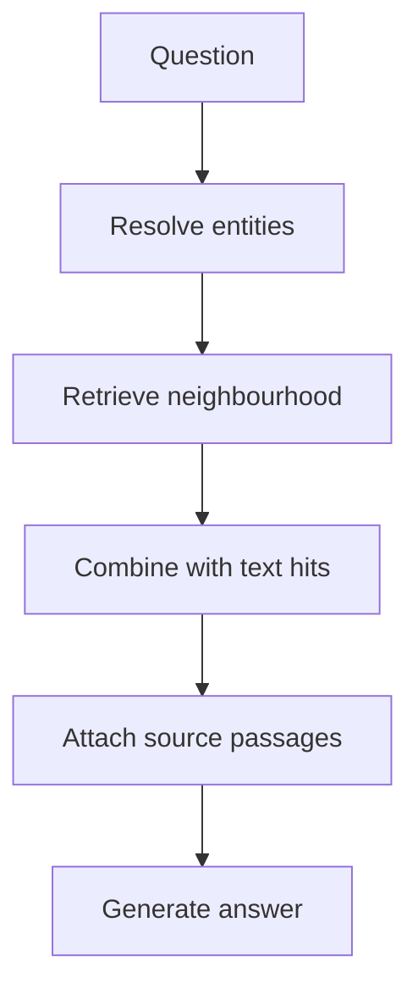

# M43.6 Theory: End-to-end knowledge-graph RAG

*[M43 theory](../README.md) · Lesson 43.6 · Notebooks: [`06a_roman_empire_graph_rag.ipynb`](../../notebook/06a_roman_empire_graph_rag.ipynb) · [All theory pages](../../../../../THEORY.md)*
<!-- subtitle: How one system extracts a graph from documents, retrieves graph facts and text side by side, and carries each fact's source passage into the answer -->

## Assemble retrieval with source evidence

> **What you'll learn**
>
> - **Trace** a question through both retrieval branches: hybrid text search and the entity neighbourhood.
> - **Explain** what the entity and row caps limit, and what they cannot guarantee.
> - **Diagnose** the neighbourhood budget, run-on facts and the uncited fact.
> - **Plan** an evaluation that compares vector-only, graph-only and combined retrieval.

Lessons 43.1 to 43.5 built the pieces one at a time: a model, a query language, an import, a vector index and extraction. This lesson runs all of them in one pipeline, on documents in and answers out.

A Larkspur customer asks *Can EU Team export my data, and where does it say so?* The system answers "Yes, EU Team supports export in the EU." The graph had the edge. Nobody can check the answer, because the passage that asserted the edge never reached the model, and the approval condition from lesson 43.5 was in that passage.

The notebook builds the system on Wikipedia pages about the Roman Empire. Larkspur would substitute versioned handbook passages and keep the links from every extracted entity back to its source text.

### Building the graph

Ingestion has four steps, each with a notebook setting:

| Step | Notebook setting | What it produces |
|---|---|---|
| Load | Wikipedia search for "The Roman empire", first 3 documents kept | raw pages |
| Split | 512-token chunks with 24 tokens of overlap | `Document` text chunks |
| Extract | a model-driven graph transformer over every chunk | nodes and relationships per chunk |
| Store | graph documents written with their sources, every entity also given a shared base label | entities, relationships, and `MENTIONS` edges from each chunk to its entities |

*Table 1: The notebook's ingestion settings. These are its choices, not measured optimums.*

The overlap is small: 24 of 512 tokens is about 4.7%. A sentence longer than 24 tokens that straddles a boundary is whole in neither chunk. The shared base label matters later, because the full-text index that resolves question entities covers every entity through it.

### Two retrieval branches

Retrieval runs two branches side by side and joins their output:

*Figure 1: The graph branch, joined to text hits. The notebook stops at "Combine"; attaching source passages is the step this lesson adds.*

- **Text branch**: hybrid search over the `Document` chunks, combining keyword and vector scores, as described in the [Neo4jVector integration](https://docs.langchain.com/oss/python/integrations/vectorstores/neo4jvector).
- **Graph branch**: a model extracts the person and organisation names in the question, a full-text index finds matching entities, and the branch returns each match's incoming and outgoing relationships, leaving out `MENTIONS` edges.

The final context is two labelled blocks, "Structured data" with the relation lines and "Unstructured data" with the retrieved chunks. The answer prompt says to answer only from that context.

### What the graph branch actually sends

The full-text query is built word by word: each word becomes a fuzzy term that tolerates two character edits, and the terms are joined with AND. We ran the notebook's builder:

| Name extracted from the question | Full-text query |
|---|---|
| EU Team | `EU~2 AND Team~2` |
| Larkspur EU-Team (2026) | `Larkspur~2 AND EU~2 AND Team~2 AND 2026~2` |
| Octavian | `Octavian~2` |

*Table 2: The notebook's full-text query builder, run in the scratchpad. Punctuation is stripped before the terms are built.*

For each extracted name the branch keeps at most **2** matching entities and returns at most **50** relationship rows. These are caps, not relevance rules. Nothing orders the 50 rows by how useful they are, which means a highly connected entity can fill the budget before the needed relationship appears. We call this the **neighbourhood budget** failure. Log which entity each name matched, its score, and whether the 50-row cap was hit.

There is a smaller planted failure in how the branch joins its output. It joins each name's rows with line breaks, then appends the next name's rows with no separator:

| Rows for name 1 | Rows for name 2 | Text sent to the model |
|---|---|---|
| `EU Team - SUPPORTS -> Export` and `EU Team - AVAILABLE_IN -> EU` | `Export - REQUIRES -> Approval` | `EU Team - AVAILABLE_IN -> EUExport - REQUIRES -> Approval` as one line |

*Table 3: **Run-on facts**, reproduced with the notebook's join logic in the scratchpad. Two relations become one garbled line.*

## Check the evidence contract

Ingestion with sources keeps the `MENTIONS` link from each chunk to the entities it names. The graph branch then excludes `MENTIONS` and returns bare relation strings. The answer model sees "EU Team SUPPORTS Export" with no passage behind it. We call this the **uncited fact**: the graph knows where the fact came from, and retrieval throws that away.

The contract that fixes it is one rule: every graph assertion travels with its supporting passage identifier and text. In practice that means following each relationship back to the chunk that mentions both endpoints, and putting the passage beside the relation line in the context. Larkspur's answer can then quote the approval sentence, or the reviewer can see that it was missing.

### Follow-up questions

The notebook also handles conversation. When a chat history is present, a model first rewrites the follow-up into a standalone question ("When did he become emperor?" becomes a question naming the person), and both branches retrieve with the rewrite. If the rewrite resolves "he" to the wrong person, both branches go to the wrong entity together.

Record the rewritten question beside the original. The notebook passes the original input to the answer step, which keeps the user's words available for judging the final answer.

### An evaluation plan

No notebook output shows that the combined system beats either branch alone on Larkspur. That needs a comparison on fixed questions:

| Question type | Larkspur example | What it tests |
|---|---|---|
| Local entity | What does EU Team include? | entity resolution and one hop |
| Relationship join | Which plans support export in the EU? | the shared-plan pattern from lesson 43.1 |
| Paraphrase | Which plan lets me pull data out of Frankfurt? | the vector branch finding a start |
| Unsupported claim | Does EU Team include phone support? | an honest "not found" |
| Changed version | Export policy after the handbook update | provenance and deletion of old assertions |

*Table 4: Five question types for comparing vector-only, graph-only and combined retrieval.*

Run each type through vector-only, graph-only and combined retrieval. Report retrieved evidence, answer correctness, unsupported claims, latency and indexing work as separate columns; one blended score hides which branch failed. The module lab runs a version of this comparison on Larkspur's team and incident records.

## Key Takeaways

- Knowledge-graph RAG runs hybrid keyword and vector search over text beside an entity neighbourhood from the graph, and joins both into the context.
- The limits of 2 entities and 50 rows per name are caps, not relevance guarantees. Log the matched entity and whether the cap was hit, since a highly connected entity can fill the budget.
- Carry each graph assertion's passage identifier and text into the prompt, record rewritten follow-up questions, and compare vector-only, graph-only and combined retrieval on the same questions.

## Check yourself

1. The end-to-end notebook combines two kinds of retrieval. What does each one contribute to the context?

The text branch runs hybrid keyword and vector search over the `Document` chunks and contributes passages. The graph branch extracts names from the question, resolves them through a full-text index and contributes their incoming and outgoing relationships as relation lines. The context holds both, in two labelled blocks.

2. A question about a highly connected entity misses the relationship it needs. Which caps in the graph branch could explain it?

Each extracted name keeps at most 2 matching entities and 50 relationship rows, and nothing orders those rows by usefulness. A highly connected entity can use up the 50 rows before the needed relationship appears. Log the matched entity and whether the cap was hit.

3. Ingestion stored sources, yet the answer model cannot cite a passage for any graph claim. Why not, and what fixes it?

The graph branch excludes `MENTIONS` edges and returns bare relation strings, so the passages never reach the prompt. Retrieve the supporting passage identifier and text with each graph assertion and put them beside the relation line in the context.

---
*Previous: [43.5 LLM entity and relationship extraction](../05_llm_entity_and_relationship_extraction/README.md). Next: [M43 interview questions](../README.md#interview-spotlight-5-questions-you-might-get-asked).*
