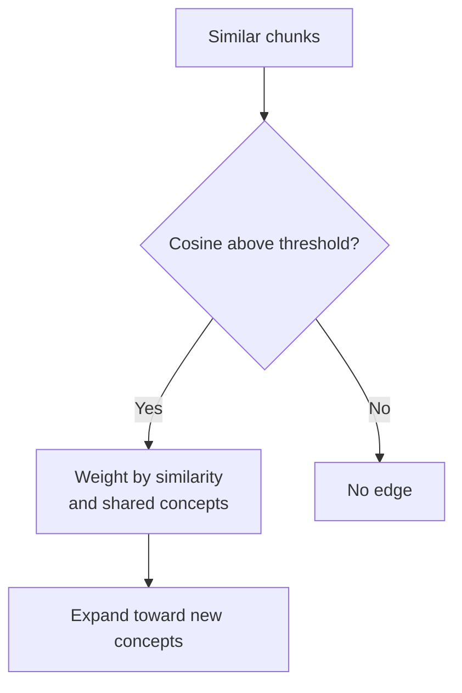
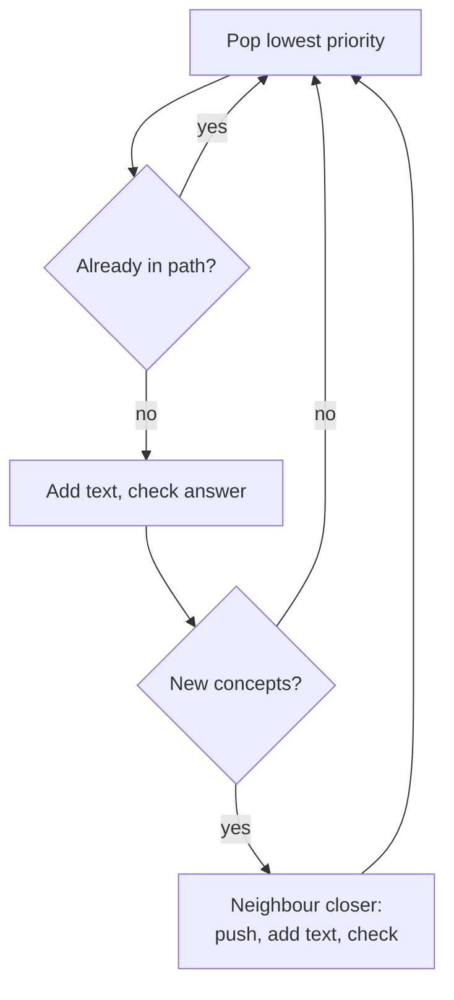

# M44.1 Theory: Concept-graph traversal

*[M44 theory](../README.md) · Lesson 44.1 · Notebooks: [`01a_graph_rag.ipynb`](../../notebook/01a_graph_rag.ipynb) · [All theory pages](../../../../../THEORY.md)*
<!-- subtitle: How a graph of similar chunks extends flat retrieval, and why a traversal that looks like Dijkstra can stop one hop short of the passage it needs -->
<!-- format: approved -->

## Start with a passage two hops away

> **What you'll learn**
>
> - **Explain** how a chunk graph is built from cosine similarity and shared concepts, and what its edge weight means.
> - **Trace** the notebook's priority-queue traversal and the completeness check that stops it.
> - **Diagnose** two traversal faults: an inverted seed priority and neighbours that are discovered but never expanded.
> - **Choose** the budgets and logs that make a traversal auditable.

[M43](../../../../m43_knowledge_graphs_neo4j/mandatory/theory/README.md) stored facts as typed nodes and relationships and queried them with Cypher. This module asks a different question: how can graph structure decide which passages reach the answer model?

A Larkspur Cloud customer asks which export mechanism remains available after cancellation. The answer needs three passages: the cancellation policy, the export options and the snapshot retention rule. Flat top-k retrieval scores each chunk against the question on its own, and the retention passage barely mentions cancellation. It can rank below a billing chunk that shares more words with the question. A graph of chunks offers a way round: start from the passages that do match, then follow links to the ones that do not.

## Chunk graphs and traversal

A **chunk graph** is a graph whose nodes are text chunks and whose edges join chunks that are similar enough to be read together. Retrieval finds a few seed chunks, then walks the edges to collect neighbours that the question alone would not rank. The first notebook builds one over the first 10 pages of a climate-change PDF and walks it to answer a question.

The build runs in four stages:

| Stage | What the notebook does | What it produces |
|---|---|---|
| Split | Recursive splitter, 1,000 characters with 200 of overlap | 30 chunks from the 10 pages |
| Concepts | A structured LLM call per chunk, plus spaCy named entities (people, organisations, places, works) | A concept list per node |
| Embed and compare | One embedding per chunk, cosine similarity for every pair | 435 pair scores (30 × 29 / 2) |
| Link | An edge when cosine is strictly above 0.8 | Weighted, undirected edges |

*Table 1: The chunk-graph build. Chunk and pair counts come from running the notebook's loader and splitter in the scratchpad; no model was called.*

The comparison is quadratic. Doubling the corpus to 60 chunks would mean 1,770 pairs, and the concept stage costs one model call per chunk on top of the embeddings.

*Figure 1: Edge creation. The threshold decides whether an edge exists; shared concepts only change its weight.*

Once a pair passes the threshold, the notebook weights the edge as 0.7 × cosine + 0.3 × the shared-concept fraction. The fraction divides the number of shared concepts by the size of the smaller concept set, and is zero when that set is empty. We ran the notebook's own weight function on four illustrative Larkspur chunk pairs:

| Edge | Cosine | Shared concepts | Smaller set | Weight |
|---|---|---|---|---|
| Cancellation policy, Export options | 0.86 | 1 | 3 | 0.702 |
| Cancellation policy, Billing cycle | 0.84 | 1 | 2 | 0.738 |
| Export options, Snapshot retention | 0.88 | 1 | 2 | 0.766 |
| Billing cycle, Outage status | 0.82 | 0 | 2 | 0.574 |

*Table 2: Edge weights from the notebook's weight function. Cosine scores and concept lists are illustrative inputs.*

The billing edge outweighs the export edge despite a lower cosine, because the billing chunk has a smaller concept list. The weight mixes two signals the notebook author chose. It has no calibrated meaning as a probability that one chunk supports the other.

> **Pitfall: the edge as evidence.** A cancellation chunk and an export chunk can share a product name while describing different dates or account states. An edge is a retrieval lead; read both passages before turning it into a policy statement.

At query time the notebook retrieves 5 chunks from FAISS and compresses each with an LLM extractor that keeps only the question-relevant sentences. To find each compressed span's place in the graph, it runs a second nearest-neighbour search with the compressed text and takes the closest stored chunk. That chunk may not be the one the span came from, and two chunks with identical text map to whichever node comes first. Stable chunk IDs carried through compression remove the guess.

## How the traversal runs

The notebook describes its walk as Dijkstra-like. Each seed enters a min-heap with priority 1 / score, where the score comes from the seed lookup. Popping a node adds its text to the context and asks the model whether the context now answers the question. If not, and the node brings concepts not seen yet, each neighbour gets a distance of the current priority plus 1 / edge weight.

The loop has one detail that changes its reach:

*Figure 2: The traversal loop. A neighbour joins the path when it is discovered, so the pop that later reaches it is skipped.*

Read the right-hand branch closely. A neighbour's text is added, and the neighbour is recorded as visited, at the moment it is discovered. When the heap later pops that neighbour, the "already in path" test skips it, and its own neighbours are never examined. We call this **discovered but never expanded**: the walk reaches the seeds and their direct neighbours, and stops.

The seed priority has a second problem. LangChain's FAISS store returns L2 distance by default, where a lower score means a closer match. Dividing 1 by a distance gives the closest seed the largest priority, and the min-heap pops it last. We call this the **inverted seed priority**. A distance of exactly zero would also divide by zero.

We ran the notebook's traversal code on the five illustrative chunks from Table 2, with a stub vector store and a stub completeness check that answers "complete" once cancellation, export and retention are all in context. Step through the run:

Step through the notebook's traversal on the five Larkspur chunks. Seeds are Cancellation policy (L2 0.40) and Billing cycle (L2 0.70).

<button type="button" data-step="0" aria-pressed="false" aria-controls="walk-step-0">1. Seed</button><button type="button" data-step="1" aria-pressed="false" aria-controls="walk-step-1">2. Billing</button><button type="button" data-step="2" aria-pressed="false" aria-controls="walk-step-2">3. Cancellation</button><button type="button" data-step="3" aria-pressed="false" aria-controls="walk-step-3">4. Skipped pops</button><button type="button" data-step="4" aria-pressed="false" aria-controls="walk-step-4">5. Fall through</button>

<section id="walk-step-0" class="step-panel" aria-labelledby="walk-heading-0"><h4 id="walk-heading-0">1. Seeds enter the heap</h4><dl><dt>Priorities</dt><dd>Billing cycle 1 / 0.70 = 1.43; Cancellation policy 1 / 0.40 = 2.50</dd><dt>Effect</dt><dd>the farther seed has the lower priority; the min-heap pops it first</dd></dl></section><section id="walk-step-1" class="step-panel" aria-labelledby="walk-heading-1"><h4 id="walk-heading-1">2. Billing cycle pops first</h4><dl><dt>Context</dt><dd>Billing cycle; completeness check 1: incomplete</dd><dt>Neighbours</dt><dd>Outage status at 1.43 + 1 / 0.574 = 3.17 is pushed, added and checked (check 2: incomplete); Cancellation at 2.79 is not closer than 2.50 and is not pushed</dd></dl></section><section id="walk-step-2" class="step-panel" aria-labelledby="walk-heading-2"><h4 id="walk-heading-2">3. Cancellation policy pops</h4><dl><dt>Context</dt><dd>Billing, Outage, Cancellation; check 3: incomplete</dd><dt>Neighbours</dt><dd>Export options at 2.50 + 1 / 0.702 = 3.92 is pushed, added and checked (check 4: incomplete)</dd></dl></section><section id="walk-step-3" class="step-panel" aria-labelledby="walk-heading-3"><h4 id="walk-heading-3">4. The neighbours pop and are skipped</h4><dl><dt>Pops</dt><dd>Outage status at 3.17, then Export options at 3.92</dd><dt>Test</dt><dd>both are already in the path and neither is expanded; Snapshot retention, Export's neighbour, is never pushed</dd></dl></section><section id="walk-step-4" class="step-panel" aria-labelledby="walk-heading-4"><h4 id="walk-heading-4">5. The heap empties</h4><dl><dt>Calls</dt><dd>4 completeness checks over contexts of 1, 2, 3 and 4 chunks</dd><dt>Result</dt><dd>the loop falls through to generating an answer without the retention passage</dd></dl></section>

<button type="button" data-walk="previous">Previous</button>

<button type="button" data-walk="next">Next step</button>

The farther seed went first, and Snapshot retention, two hops from the cancellation seed, never entered the context. With the cancellation chunk as the only seed, the path was cancellation, export, billing: the same one-hop limit.

| Planted case | What the traversal did | Why |
|---|---|---|
| Two seeds at L2 0.40 and 0.70 | Expanded the farther seed first | 1 / distance inverts the order |
| Retention two hops from the seed | Never reached | Discovered neighbours are never expanded |
| A node whose concepts were all seen | No neighbours pushed | The new-concept test gates expansion |

*Table 3: Planted cases and their causes. The first two come from the run above; the third is the gate in Figure 2.*

None of this makes the notebook useless as a teaching build. It shows the moving parts of graph-guided retrieval. It should not be described as an unmodified shortest-path search, and its reach should be measured before it is trusted with multi-hop questions.

## Budgets and stopping

The query engine sets a maximum context length of 4,000, but no branch of the traversal reads it. A variable named as a budget supplies no protection until code checks it. Count the accumulated context with the answer model's tokenizer and stop before an explicit limit. Cap visited nodes and completeness calls separately, since each check is a model call over the whole context so far.

The cost of checking grows with the walk:

| Nodes added | Completeness calls | Context sent per call |
|---|---|---|
| 1 | 1 | 1 chunk |
| 4 | 4 | 1, 2, 3, then 4 chunks |
| n | n | 1 + 2 + … + n chunks in total |

*Table 4: Completeness calls in the notebook's loop. The traced run made four calls over contexts of 1, 2, 3 and 4 chunks.*

At 1,000-character chunks, a walk that adds 10 nodes resends 55 chunks of text across its checks. That is the price of asking after every node.

An LLM saying "complete" is a stopping heuristic. For the cancellation question, check that the context holds the cancellation condition, the available export mechanism and the retention condition. If the graph has no path to one of those passages, report the missing evidence. More context cannot create a relation absent from the index.

For each query, log the seed IDs, the edges followed, the source spans retrieved, the context size and the stopping reason. Then compare against flat retrieval on the same golden questions. A longer traversal can add work while leaving the answer's supporting evidence unchanged, and lesson 44.2 turns that evidence into explicit citations.

## Limits of this evidence

- **No model was called.** The traversal ran the notebook's code with a stub vector store and a stub completeness check; a live model may call a context complete earlier or later.
- **The Larkspur graph is illustrative.** Cosine scores and concept lists in Table 2 are chosen inputs, not embeddings of real handbook pages.
- **The chunk counts come from the notebook's loader and splitter only.** Edge counts on the climate PDF depend on the embedding model and were not measured.

## References

1. Nir Diamant, [RAG Techniques: Graph RAG notebook](https://github.com/NirDiamant/RAG_Techniques/blob/main/all_rag_techniques/graph_rag.ipynb), the source of the notebook's code.
2. Edge et al., [From Local to Global: A Graph RAG Approach to Query-Focused Summarization](https://arxiv.org/abs/2404.16130), arXiv 2404.16130.
3. Meta, [Faiss documentation](https://faiss.ai/), the library behind the notebook's vector store; its flat index scores by L2 distance.

## Key Takeaways

- A chunk graph joins chunks whose cosine passes a threshold and weights each edge by similarity and shared concepts. The weight is a retrieval lead, never a calibrated probability.
- Measure a traversal's reach before trusting it: the notebook's walk inverts its seed order on L2 distances and never expands the neighbours it discovers; it stops one hop out.
- A budget variable protects nothing until code checks it. Count context with the answer model's tokenizer, cap nodes and completeness calls separately, and treat "complete" as a heuristic.

## Check yourself

1. Two chunks have cosine similarity 0.85 and share 2 concepts, with 4 in the smaller concept set. What weight does their edge get, and what does that weight mean?

The edge exists because 0.85 is above the 0.8 threshold, and its weight is 0.7 × 0.85 + 0.3 × 0.5 = 0.745. The weight combines two signals the notebook author chose and is not a calibrated probability that either chunk supports the other. Treat the edge as a retrieval lead and read both passages.

2. The traversal sets max_context_length=4000. Does that stop the context from growing past 4000?

No. No branch of the traversal checks that attribute, so it supplies no protection. Count the accumulated context with the answer model's tokenizer and stop before an explicit budget, and cap visited nodes and completeness-check calls separately.

3. The snapshot retention chunk sits two edges from the cancellation seed, yet it never reaches the context. What in the traversal explains that?

The loop adds a neighbour to the path the moment it discovers it, and later skips that neighbour when it is popped. Its own neighbours are never examined. The walk reaches the seeds and their direct neighbours only. Log the path and measure reach on a question whose evidence is two hops away before relying on the traversal.

---
*Previous: [M44 overview](../README.md). Next: [44.2 Local GraphRAG with source attribution](../../../optional/theory/02_local_graphrag_with_source_attribution/README.md).*
