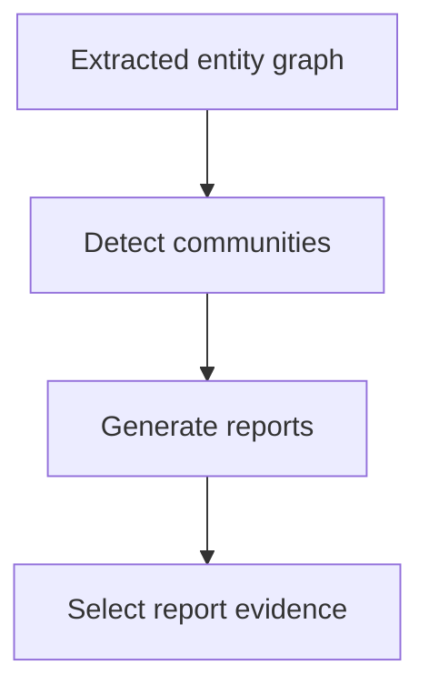
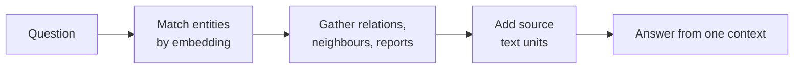
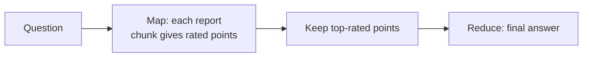

# M44.3 Theory: Microsoft GraphRAG: communities, global vs local search

*[M44 theory](../README.md) · Lesson 44.3 · Notebooks: [`03a_microsoft_graphrag.ipynb`](../../notebook/03a_microsoft_graphrag.ipynb) · [All theory pages](../../../../../THEORY.md)*
<!-- subtitle: How community reports let one index answer corpus-wide questions, when to route to local search instead, and what the extra indexing work costs -->
<!-- format: approved -->

## Start with a question no single seed holds

> **What you'll learn**
>
> - **Explain** the difference between a community, which comes from graph structure, and its report, which a model writes.
> - **Compare** global search over community reports with local search around entities.
> - **Diagnose** an overview answer that omits a region of the corpus or repeats an extraction mistake.
> - **Count** the indexing and query calls a graph pipeline adds before you compare it with flat retrieval.

Lessons 44.1 and 44.2 started from a few seeds and walked outwards. That works when a question names something. A Larkspur support lead asks a different kind of question: which operational dependencies recur across cancellation, exports and outages? No single seed holds the answer. A walk from the cancellation node returns cancellation's neighbours and nothing about outage recovery.

## Community detection

**Community detection** partitions a graph into groups of nodes that are more densely connected to each other than to the rest. A **community report** is a summary a model writes for one group, from the entities and relations inside it. The two are separate artefacts. Changing the summary prompt changes the report without changing the partition, and a bad partition produces a fluent report about the wrong grouping.

Microsoft GraphRAG builds both during indexing. Its pipeline extracts entities and relations from text chunks, detects communities with the hierarchical Leiden algorithm (clustering recursively until communities fall under a size threshold), writes a report per community at each level, and embeds text for later lookup. Those artefacts are reused by every later query.

*Figure 1: The community half of indexing. Detection is a graph algorithm; report generation is a model call per community.*

A partition is only as stable as the structure underneath it. We ran NetworkX's Louvain algorithm, a close relative of Leiden and the one this module's lab uses, on the eight-entity Larkspur fixture from lesson 44.4's lab. That fixture is a single ring of eight relations, with no dense region:

| Random seed | Communities found |
|---|---|
| 0, 2, 3 | {Cancellation, Export}, {Billing, Refund}, {Snapshot, Storage}, {Account, Outage} |
| 1 | {Billing, Cancellation}, {Export, Snapshot}, {Account, Refund}, {Outage, Storage} |
| 4 | {Billing, Cancellation, Export}, {Outage, Snapshot, Storage}, {Account, Refund} |

*Table 1: Louvain partitions of the lab fixture across five random seeds (NetworkX 3.7, scratchpad run). Three seeds agree; two give different groupings.*

Whether Cancellation and Export share a community, and therefore a report, depends on the random seed. We call this the **unstable partition**. Real handbooks have denser regions than a ring, which helps, but the lesson holds: review extracted edges and group membership before reading a report as a reliable account of a product area. Fix the seed in evaluation runs, so that a change in the answers traces back to a change in the data.

## Global vs local search

Microsoft GraphRAG answers from the same index in two ways, and each reads different artefacts.

**Local search** starts from entities related to the question and combines their relations, nearby graph material and the source text units they came from:

*Figure 2: Local search. One context window is built around the matched entities, and the original text units travel with it.*

**Global search** answers from community reports at a chosen level of the hierarchy, in a map and reduce pass over all of them:

*Figure 3: Global search as map and reduce. Every report chunk costs a model call before any point is filtered out.*

The map stage splits the reports into chunks of a set size, and each chunk yields a list of points, each with an importance rating. The reduce stage keeps the most important points and writes the answer from them. Lower levels of the hierarchy hold more, smaller reports: answers get more thorough and the map stage makes more calls.

Send both Larkspur questions through each mode:

Choose a search mode to see what evidence it gathers for each Larkspur question.

<button type="button" data-mode="local" aria-pressed="false" aria-controls="mode-local">Local search</button>
<button type="button" data-mode="global" aria-pressed="false" aria-controls="mode-global">Global search</button>

<section id="mode-local" class="mode-panel" data-announcement="Local search selected. Strong on the export question, blind to themes."><h4>Local search</h4><ul><li>Export after cancellation: matches Cancellation and Export, adds their relations and the policy text units. A good fit; check the original spans are in the context.</li><li>Recurring dependencies: starts from whichever entities match the words and misses regions no matched entity touches.</li><li>Calls: one answer call per question in the lab.</li></ul></section>
<section id="mode-global" class="mode-panel" data-announcement="Global search selected. Strong on themes, loses exact wording."><h4>Global search</h4><ul><li>Recurring dependencies: every report chunk is mapped, and cancellation, export and outage regions all get a say. A good fit; inspect which reports contributed.</li><li>Export after cancellation: answers from summaries, which can drop the qualification the policy states.</li><li>Calls: a map call per report chunk plus the reduce call.</li></ul></section>

A fluent global answer can still omit a small community or repeat an extraction mistake. We call the first failure the **missing community**.

| Question | Evidence to require | Failure to inspect |
|---|---|---|
| A named product's cancellation condition | Entity relations and original policy spans | Wrong identity or stale version |
| Themes across product areas | Reports covering the relevant corpus regions | Omitted communities |
| Exact retention wording | The current source passage | Summary dropping a qualification |

*Table 2: Route each question by the evidence it needs, and inspect the failure that route invites.*

The notebook indexes one article and asks one local question and one global question against it, through the package's command-line interface. Its command names and settings structure match the release it was written for. Check the installed package's interface and configuration schema before adapting them; this page concerns retrieval behaviour, which outlasts any one release.

Answers from the package carry inline annotations that name the reports, entities and sources behind each statement. The notebook strips them before display with a small helper. Here is its effect on an illustrative response:

| Stage | Text |
|---|---|
| Raw answer | Exports remain available after cancellation [Data: Reports (3, 7); Entities (12)]. Snapshots are kept for 30 days [Data: Sources (4)]. |
| Displayed | Exports remain available after cancellation . Snapshots are kept for 30 days . |

*Table 3: The notebook's annotation-stripping helper, run on an illustrative answer.*

The displayed text reads better and has lost its only route back to evidence. Keep the unmodified response and the artefact IDs in an evidence record whenever an answer has to be traced through reports to sources.

## Indexing cost

Flat RAG pays to split, embed and store passages. A graph pipeline adds entity and relation extraction, identity resolution and relation storage. Community retrieval adds detection and one report per community. When a source page changes, the derived records change too, including every report whose community contains an affected entity.

The module lab makes the arithmetic concrete. Its GraphRAG build indexes 20 documents split into 38 chunks, and answers 10 global and 5 multi-hop questions. Counting model calls from its code:

| Work | Model calls | Count in the lab |
|---|---|---|
| Extraction | 1 per chunk | 38 |
| Community reports | 1 per community | known only after a run |
| Global question | 8 report maps + 1 answer | 10 × 9 = 90 |
| Local question | 1 answer | 5 × 1 = 5 |

*Table 4: Model calls in the lab's GraphRAG build. Chunk and question counts come from running its loader and splitter in the scratchpad; the per-question calls are read from its search functions.*

Before any report is written, indexing already costs 38 extraction calls, against zero model calls for a flat index. Each global question makes nine times the model calls of a local one. Those ratios are what amortisation has to beat.

Record each stage separately: model and prompt version, input and output tokens, call count, retries, elapsed time, stored artefact size and changed source IDs. At query time record report selections, expansion candidates, reranking calls and answer context. The notebook sets a maximum of 10,000 context tokens for global search and asks for answers of at most 300 tokens. The first is a configured ceiling, not a measured bill. The second is an instruction in the prompt, which nothing enforces.

The lab brief compares GraphRAG, RAPTOR and a hybrid on that shared question set. Hold source versions, answer model and evaluation criteria constant. Report indexing and update work beside answer quality, and derive any break-even point from measured indexing work, measured query work and the expected query volume. The architecture alone implies no break-even figure. Lesson 44.4 keeps the entity graph but moves it into a vector database, where expansion is a matrix product.

## Limits of this evidence

- **The package was not run.** Indexing needs model calls; the search descriptions come from Microsoft's documentation and the notebook's settings, not from a fresh index.
- **The partition test uses a ring.** Eight entities in one cycle show that seeds matter; a real handbook graph has denser regions and may vary less.
- **Report counts are unknown until a run.** Table 4 counts only what the lab's code fixes; the number of communities, and their reports, depends on extraction.

## References

1. Edge et al., [From Local to Global: A Graph RAG Approach to Query-Focused Summarization](https://arxiv.org/abs/2404.16130), arXiv 2404.16130.
2. Microsoft GraphRAG, [Indexing dataflow](https://microsoft.github.io/graphrag/index/default_dataflow/).
3. Microsoft GraphRAG, [Local search](https://microsoft.github.io/graphrag/query/local_search/) and [Global search](https://microsoft.github.io/graphrag/query/global_search/).
4. Traag, Waltman and van Eck, [From Louvain to Leiden: guaranteeing well-connected communities](https://arxiv.org/abs/1810.08473), arXiv 1810.08473.

## Key Takeaways

- A community comes from graph structure and its report is a generated summary of it. Partitions can change with the random seed, so review edges and membership before trusting a report about a product area.
- Route questions about named entities to local search and corpus-wide themes to global search, then inspect which reports contributed; a fluent overview can miss a community.
- Count the work a graph pipeline adds (an extraction call per chunk, a report per community, a map call per report at query time) and derive cost from measured runs.

## Check yourself

1. How does a community differ from its community report, and why does the difference matter when you debug?

The community is a group derived from graph structure; the report is a generated summary of the material in that group. Changing the summary prompt changes the report without changing the partition, and on the lab's ring fixture the partition itself changed with the Louvain random seed. Review the extracted edges and the group membership before trusting a report as an account of a product area.

2. Which search mode fits a question about the export mechanism left after cancellation, and which fits one about dependencies that recur across the handbook?

Local search fits the first: the evidence centres on specific entities and their conditions; check that the context includes the original policy spans. Global search fits the second, because the evidence is spread across the corpus and answered from community reports. Inspect which reports contributed, since a fluent answer can omit a small community.

3. A teammate says global search costs at most 10000 tokens per query because that is what the notebook configures. Is that a sound cost figure?

No. 10,000 is a configured maximum context setting, neither a measured bill nor proof that every run uses the whole allowance. Global search also makes a map call per report chunk before the final answer. Record each stage's tokens, calls, retries and time, and derive cost from measured indexing and query work.

---
*Previous: [44.2 Local GraphRAG with source attribution](../../../optional/theory/02_local_graphrag_with_source_attribution/README.md). Next: [44.4 Graph expansion inside a vector database (Milvus)](../../../optional/theory/04_graph_expansion_inside_a_vector_database_milvus/README.md).*
