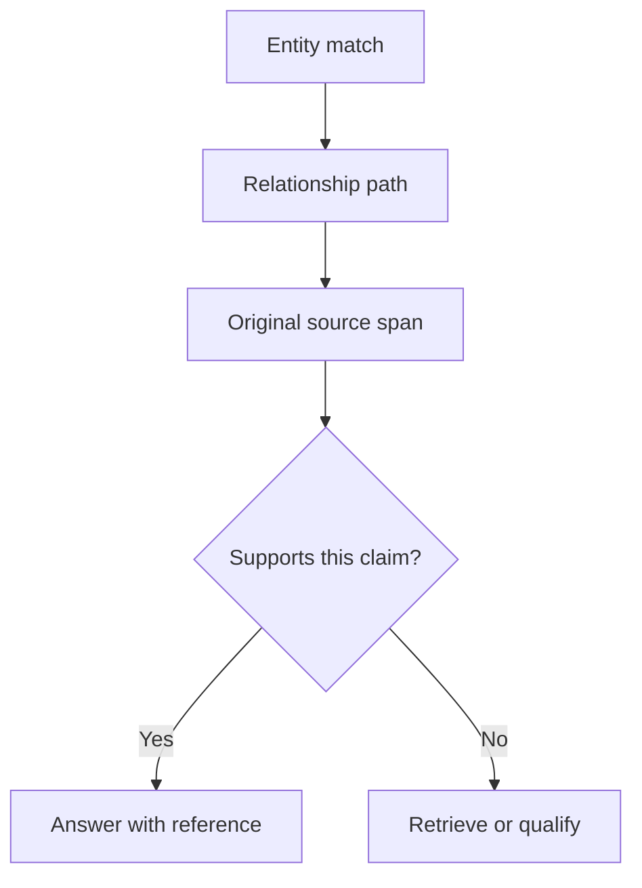

# M44.2 Theory: Local GraphRAG with source attribution

*[M44 theory](../../../mandatory/theory/README.md) · Lesson 44.2 · Notebooks: [`02a_graph_rag_local_attribution.ipynb`](../../notebook/02a_graph_rag_local_attribution.ipynb) (optional) · [All theory pages](../../../../../THEORY.md)*
<!-- subtitle: Why a resolved citation marker is not evidence, and where an entity graph quietly overwrites the source it claims to keep -->

## Source attribution

> **What you'll learn**
>
> - **Explain** the difference between the route that found evidence and the passage that supports a claim.
> - **Trace** how the notebook turns `[N]` markers into citations, and what that check leaves out.
> - **Diagnose** provenance lost to overwrites and results hidden by a shared visited set.
> - **Choose** what to report when a local extraction model fails.

Lesson 44.1 walked a graph of similar chunks and ended on a log of seeds, edges and source spans. This lesson makes the last item explicit: every claim in the answer should point at the sentence that supports it.

Suppose the Larkspur assistant answers that exports stay available for 30 days after cancellation, and tags the claim `[1]`. Marker 1 resolves to a real handbook sentence. The sentence says that cancelling ends billing at the end of the period, which says nothing about exports. The answer looks cited and is unsupported. We call this **citation without support**.

**Source attribution** links each generated claim to the exact source span that supports it, and keeps that link separate from the graph path that found the span. The optional notebook builds a local version: Ollama runs extraction and generation, `all-MiniLM-L6-v2` embeds entities, and a directed NetworkX graph holds the relationships.

Each record the notebook stores carries its provenance:

| Record | Fields that carry provenance | What it decides |
|---|---|---|
| Entity | source document, source sentence | Which sentence a node description came from |
| Relationship | relation type, source document, source sentence | Which sentence asserted the edge |
| Citation | claim, source document, source sentence, confidence, graph path | What the answer points at |

*Table 1: The notebook's data model, read from its dataclasses.*

At query time the notebook embeds the question, takes the 3 most similar entities as entry points, and follows outgoing edges breadth-first for up to 2 hops. For Larkspur, a path might run from Cancellation to Export to Snapshot. That path explains why retrieval reached the snapshot document. The policy claim still needs a passage that states when a snapshot export remains available.

*Figure 1: Route and support are separate checks. The path finds a span; only the span can support the claim.*

Keep two records for each generated claim: the route by which retrieval found evidence, and the exact passage used to support the claim. A traversable relation can be stale, wrongly extracted, or cut off from the conditions in the original text. Inspecting the source is how a reviewer rejects that relation.

## What the notebook verifies

The answer prompt lists the retrieved entities as numbered lines of name and description, and asks the model to cite with `[N]`. After generation, a regular expression finds the markers, and each valid number is mapped back to the stored source document and sentence. The source sentence never enters the prompt; it is attached afterwards from the map.

We ran the notebook's ingestion, traversal and citation code with a scripted extraction (four Larkspur entities, four relations) and a scripted answer, so no model was called:

| Marker | Claim in the answer | Resolved sentence | Supports the claim |
|---|---|---|---|
| `[1]` | Exports stay available for 30 days | Cancelling ends billing at period end. | no |
| `[3]` | Snapshots last 30 days | Exports use the latest snapshot. | no |
| `[9]` | (see also) | none: dropped without a warning | not checked |

*Table 2: Citation resolution on a scripted run. Both resolved markers become citations with confidence 0.9.*

Both valid markers became citation records. Each has a confidence of 0.9, a fixed constant in the code, and a claim field that holds the label "Reference [N]" rather than the sentence of the answer it supports. Marker 9 pointed past the three context items and vanished. Nothing in the run noticed that neither resolved sentence supports its claim.

The code therefore demonstrates provenance storage and citation resolution. It does not check entailment, that is, whether the cited sentence actually implies the claim. A useful check splits the answer into claims, resolves each marker to a span, and asks whether the span supports the claim with its conditions and dates intact. Until that check passes, call the answer cited, not verified.

## Where provenance is lost

The graph keeps one source record per entity and one edge per ordered pair of entities. Both rules overwrite data silently. We call the pattern **last write wins**, and the same scripted run planted two cases:

| Planted case | What the graph kept | Why |
|---|---|---|
| An old FAQ re-extracts "export" after the policy page | The node now cites the old FAQ: "Exports are removed at cancellation." | Entity IDs hash the lowercased name, and a later write replaces the node's fields |
| Two relations from Export to Snapshot (uses, related to) | One edge, typed "related to"; 4 relations extracted, 3 edges stored | A directed graph allows one edge per ordered pair |
| A relation whose endpoint was never extracted as an entity | No edge | Edges are added only when both endpoints exist |

*Table 3: Overwrites and drops in the notebook's graph. The first two rows come from a scratchpad run of its ingestion code; the third is the guard in that code.*

The first row is the dangerous one. A stale FAQ sentence now contradicts the policy, and the traversal will cite it as the export node's source. Keep a list of source spans per entity, and a multigraph or a relation list when distinct relations between the same pair carry separate claims.

## Local execution boundaries

When Ollama is not installed, the notebook's extraction helper returns an empty result rather than an error. An empty graph from that branch does not show that the documents contain no relationships. Report model availability and extraction failures separately from a legitimate zero-result retrieval.

The traversal has a subtler boundary. It shares one visited set across all seeds and processes them in order. A node already reached from an earlier seed is skipped when a later seed starts from it, along with everything beyond it. We ran the notebook's traversal over the same four entities with 2 hops:

| Seeds, in order | Entities returned (depth) | Retention returned |
|---|---|---|
| Cancellation, then Snapshot | Cancellation 0, Export 1, Snapshot 2 | no |
| Snapshot, then Cancellation | Snapshot 0, Retention 1, Cancellation 0, Export 1 | yes |

*Table 4: Seed order changes the result of the notebook's multi-seed traversal (scratchpad run).*

Retention is one hop from the Snapshot seed, well inside the budget, and still missing in the first row. We call this **seed-order shadowing**. When the required meaning is "within this many hops of any seed", store the best depth per node or run a true multi-source breadth-first search, which starts every seed at depth 0 together. Apply source access filters during traversal and again when building the context.

Lesson 44.3 moves from entity neighbourhoods to the whole corpus, where the evidence for an answer is a set of community summaries rather than a path.

## Key Takeaways

- Keep two records per claim: the graph route that found the evidence, and the exact passage that supports the claim. A traversable relation can be stale or wrongly extracted.
- Resolving `[N]` markers to sources proves provenance storage, not entailment. A fixed confidence of 0.9 is a constant; add a claim-to-span review before calling an answer verified.
- Report extraction failures separately from empty results, keep every source span and relation the graph would otherwise overwrite, and check that seed order cannot hide a result.

## Check yourself

1. A graph path runs from Cancellation to Export to Snapshot. Why record both that path and the exact passage behind each claim?

The path explains how retrieval reached the snapshot document; it does not support the policy claim. A traversable relation can be stale, wrongly extracted or cut off from the conditions in the original text. The source passage is what lets a reviewer check the claim, or reject the relation.

2. Each citation the notebook produces carries confidence 0.9. What does that number tell you about the answer?

Nothing measured: it is a fixed constant, and the claim field holds a reference label rather than the answer's claim. The code finds `[N]` markers and maps valid IDs back to source records, but it never checks that the cited sentence supports the claim. Add a claim-to-span review before treating an answer as verified.

3. After an old FAQ is ingested, answers about exports start citing it instead of the current policy. What in the graph caused that?

Entity IDs come from the lowercased name, so the FAQ's "export" maps to the same node as the policy's Export, and the later write replaces its description and source. This is last write wins. Keep a list of source spans per entity, with document versions, so a stale source can be filtered rather than silently substituted.

---
*Previous: [44.1 Concept-graph traversal](../../../mandatory/theory/01_concept_graph_traversal/README.md). Next: [44.3 Microsoft GraphRAG: communities, global vs local search](../../../mandatory/theory/03_microsoft_graphrag_communities_global_vs_local_search/README.md).*
