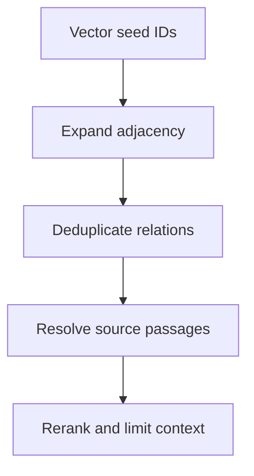

# M44.4 Theory: Graph expansion inside a vector database (Milvus)

*[M44 theory](../../../mandatory/theory/README.md) · Lesson 44.4 · Notebooks: [`04a_graphrag_with_milvus.ipynb`](../../notebook/04a_graphrag_with_milvus.ipynb) (optional) · [All theory pages](../../../../../THEORY.md)*
<!-- subtitle: How an incidence matrix turns vector hits into a neighbourhood of relations, what each extra degree costs, and where identity errors break the walk -->

## Graph expansion

> **What you'll learn**
>
> - **Explain** how powers of an incidence matrix expand vector-search seeds into candidate relations.
> - **Trace** the candidate set and source passages at each expansion degree.
> - **Diagnose** a hub that floods the candidates, and an entity split across spellings.
> - **Choose** separate budgets for seeds, degree, reranking and final passages.

Lesson 44.3 answered corpus-wide questions from community reports. This lesson goes back to multi-hop questions, with no graph database at all: the graph lives in a few arrays beside a vector store.

The notebook's question is "What contribution did the son of Euler's teacher make?" Answering it takes three hops: Euler's teacher was Johann Bernoulli, Johann's son was Daniel, and Daniel's contributions are in a passage that never mentions Euler. A flat search on the question scores passages against Euler and contributions, and the Daniel passage has little reason to rank. Larkspur has the same shape: cancellation leads to export, export to snapshot, and the snapshot passage holds the retention rule.

**Graph expansion** grows a set of retrieved entities or relations into their graph neighbourhood, a fixed number of steps at a time, before reranking picks what reaches the answer. The Milvus notebook stores three collections and two adjacency maps:

| Store | What it holds | Used for |
|---|---|---|
| Entity collection | One vector per entity name | Seeds from entities named in the question |
| Relation collection | One vector per relation sentence (subject, predicate and object joined) | Seeds from the whole question |
| Passage collection | One vector per passage | The flat baseline |
| Entity to relations map | Which relations each entity takes part in | Building the incidence matrix |
| Relation to passages map | Which passages each relation came from | Resolving relations to text |

*Table 1: The notebook's stores. Traversal runs in application memory; Milvus supplies vector search and stored records.*

Its four-passage Bernoulli dataset yields 26 entities and 22 relations, counted by running the notebook's preparation cells in the scratchpad.

Let `B` be the entity-by-relation incidence matrix: `B[e,r]=1` when entity `e` takes part in relation `r`. Then `B Bᵀ` connects entities that share a relation, and `Bᵀ B` connects relations that share an entity. The notebook raises these to the target degree, multiplies the entity side by `B` to land on relations, takes the nonzero entries, and merges the candidates from the entity and relation seeds ([Milvus Graph RAG tutorial](https://milvus.io/docs/graph_rag_with_milvus.md)).

*Figure 1: Expansion inside the retrieval pipeline. Only the first step touches the vector store.*

Matrix products count walks. A nonzero entry says a path exists, and does not certify that the relation helps answer the question. The diagonal of `B Bᵀ` is nonzero too (each entity shares a relation with itself). A higher degree therefore keeps every earlier candidate and adds new ones. Direction and relation type need separate handling: an undirected incidence matrix forgets which way a predicate points.

The [interactive lab](interactive/expansion-lab.html) computes the entity-side row of `(B Bᵀ)^d B` on an eight-entity Larkspur fixture. Degree 0 shows the relations touching the seed and serves as a teaching baseline; the notebook's target degree starts at 1. The fixture has no embedding or model output, and choosing a seed stands in for the vector search.

<!-- lab: interactive/expansion-lab.html -->

With Cancellation selected, degree 0 reaches the cancellation-to-export and cancellation-to-billing relations. Each degree then adds two:

| Degree | Candidate relations | Distinct passages | Relations added |
|---|---|---|---|
| 0 | 2 | 2 | Cancellation enables Export; Cancellation stops Billing |
| 1 | 4 | 3 | Export uses Snapshot; Billing links Refund |
| 2 | 6 | 4 | Snapshot needs Storage; Refund needs Account |
| 3 | 8 | 5 | Storage restored after Outage; Account affected by Outage |

*Table 2: Expansion from the Cancellation seed, as the lab prints it.*

Starting from Outage gives the same relation counts and different passages: 1, 2, 4 and then all 5. The export question needs the degree 1 snapshot relation. The billing branch arrives at the same degree, reachable and irrelevant. Rerank relations against the question, then fetch and deduplicate their passages, and compare the candidate set before and after reranking against the golden evidence set. Keep the route for debugging; cite the passage.

The notebook's own data shows how fast a hub fills the set. We ran its expansion cells from three seed entities:

| Seed entity | Degree 1 relations | Degree 2 relations | Passages at degree 1 |
|---|---|---|---|
| Leonhard Euler | 10 | 18 of 22 | all 4 |
| Euler | 1 | 1 | 1 |
| leonhard Euler | 1 | 1 | 1 |

*Table 3: Expansion on the notebook's Bernoulli data (scratchpad run of its pure cells; no embedding calls).*

From "Leonhard Euler", one degree passes through Johann Bernoulli, who takes part in nine relations, and pulls in all four passages. We call this the **hub flood**. The candidate set now holds every passage in the corpus, and only the reranker and the final limit decide what the model reads.

## Keeping expansion bounded

The notebook's budgets sit at different stages:

| Stage | Setting | What it bounds |
|---|---|---|
| Seeds | 3 entity hits and 3 relation hits | Where expansion starts |
| Expansion | target degree 1 | How far it reaches |
| Rerank | One model call; its one-shot example selects 3 relations | Which relations survive |
| Context | 2 final passages | What the answer model reads |

*Table 4: The notebook's budgets, read from its code.*

These control different things. Raising the seed count can enlarge the candidate set and the reranker's prompt while the final context stays at two passages. Bound the degree, the candidate relation count and the passage count before an expensive reranker runs. When a hub connects many unrelated policies, filter by product, relation type, version and access rights before following it. Record which budget stopped the expansion, so a missing passage can be traced to a stage.

Treat identity mapping as part of retrieval correctness. The notebook's entities are raw strings from its triplets. "Euler", "Leonhard Euler" and "leonhard Euler" are three separate nodes, as are "the Bernoulli theorem" and "The Bernoulli theorem". Table 3 shows the cost: a seed that lands on the wrong spelling reaches one relation instead of ten. We call this the **split identity**. Normalise names and resolve aliases to stable IDs at indexing time.

The same stable IDs keep vectors and adjacency in step. An operational index needs explicit updates to both on every source change. A fresh vector record with stale adjacency retrieves the right entity and still traverses the wrong policy graph.

## Key Takeaways

- Vector search picks seed entities and relations; powers of the incidence matrix expand them. Products count walks and do not show that a relation answers the question.
- Each degree adds candidates, and a hub can pull in the whole corpus at degree 1. Bound degree, relation count and passages before the reranker, and rerank against the question.
- Resolve entity spellings to stable IDs and update vectors and adjacency together. A split identity or stale adjacency sends a correct vector hit down the wrong path.

## Check yourself

1. With B the entity-by-relation incidence matrix, what do B Bᵀ and Bᵀ B connect, and what do their powers not tell you?

`B Bᵀ` connects entities that share a relation, and `Bᵀ B` connects relations that share an entity. Their powers count walks and expand the seed sets, but they do not certify that a relation supports the question. An undirected incidence matrix also loses a predicate's direction.

2. In the expansion lab with Cancellation as the seed, how many candidate relations and source passages do degrees 1 and 2 reach?

Degree 1 reaches 4 relations across 3 distinct passages, adding export-to-snapshot and billing-to-refund. Degree 2 reaches 6 relations across 4 passages, and degree 3 all 8 across 5. The billing branch is reachable but irrelevant to an export question. Rerank relations against the question before fetching passages.

3. Entity search for Euler returns the node spelled "leonhard Euler", and expansion finds one relation instead of ten. What went wrong, and how do you prevent it?

The notebook stores entities as raw strings, so three spellings of Euler became three nodes, and only one of them is linked to Johann Bernoulli. This is a split identity. Normalise names and resolve aliases to stable IDs at indexing time, and update vectors and adjacency mappings together.

---
*Previous: [44.3 Microsoft GraphRAG: communities, global vs local search](../../../mandatory/theory/03_microsoft_graphrag_communities_global_vs_local_search/README.md). Next: [M44 interview questions](../../../mandatory/theory/README.md#interview-spotlight-5-questions-you-might-get-asked).*
