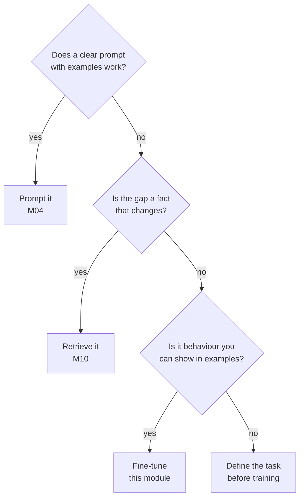
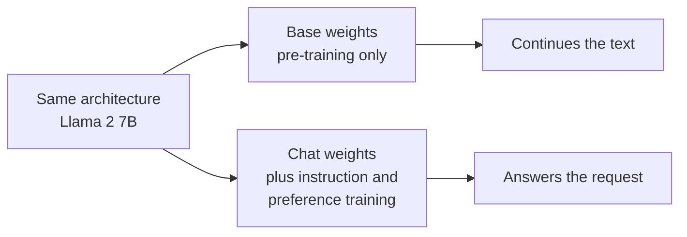

# M45.1 Theory: Why fine-tune

*[M45 theory](../README.md) · Lesson 45.1 · Notebooks: [`01a_why_finetuning_lab.ipynb`](../../notebook/01_why_finetune/01a_why_finetuning_lab.ipynb), [`01b_why_finetuning_lecture.ipynb`](../../../optional/notebook/01_why_finetune/01b_why_finetuning_lecture.ipynb) (optional) · [All theory pages](../../../../../THEORY.md)*
<!-- subtitle: Prompting changes the instructions, RAG changes the evidence, fine-tuning changes the weights, and each one suits a different gap -->

## When to fine-tune

> **What you'll learn**
>
> - **Compare** prompting, RAG and fine-tuning by what each one changes, what a change costs and how each one fails.
> - **Choose** between them for a Larkspur request with a three-question decision chain.
> - **Explain** why a base model continues text while a chat model with the same architecture answers it.
> - **Diagnose** the format mismatch that appears when a model is prompted without the wrapper it was trained on.

The modules before this one never touched a model's weights. [M04](../../../../../p02_prompt_engineering/m04_prompt_engineering_patterns/mandatory/theory/README.md) shaped behaviour with instructions and examples, and M10 put the Larkspur Cloud handbook in an index so each answer could quote it. This module changes the weights themselves, and the first job is knowing when that is the right tool.

The Larkspur support lead brings two complaints to one meeting. The assistant's answers wander before they reach the point, and it cheerfully discusses *What do you think of Mars?* when it should decline. The same week, the policy team shortens the refund window. A team that reaches for fine-tuning to fix all three ends up with a model that opens crisply, declines Mars, and quotes the old refund window until someone retrains it. We call that **baked-in staleness**: a fact trained into the weights that the world has since changed.

**Fine-tuning updates the model's weights with your own examples.** Prompting changes only the input, and RAG changes only what evidence the input contains. Each one closes a different gap:

| | Prompting | RAG | Fine-tuning |
|---|---|---|---|
| What changes | The instructions and examples in each call | The evidence pasted into each call | The weights |
| Good for | Format and tone you can describe in a few lines | Facts that change, private documents, citations | Behaviour too long or subtle to describe: a house style, a narrow task, consistent refusals |
| Cost of a change | Edit the prompt | Re-index a document | Rebuild the dataset and retrain |
| Per-call cost | Grows with every instruction and example | Retrieval plus a few chunks | Lowest: the behaviour is in the weights |
| Main risk | Long prompts, drift between calls | Retrieval misses the evidence | Stale facts, lost general ability, no citations |

*Table 1: Three ways to change what a model does, and what each one costs.*

For Larkspur the split follows the rows. *How long does a refund take?* has an answer the policy team will change, so it stays in the index. Leading every answer with *Yes* or *No* and declining Mars is behaviour, and a fine-tune can carry it on a smaller, cheaper model. Most production systems that fine-tune also retrieve.

The decision runs as a chain of three questions, each "no" moving one step down:

*Figure 1: Prompt first, retrieve facts that change, and fine-tune only behaviour you can show in examples.*

The last question carries the most weight. If you cannot write a few hundred examples of the behaviour you want, you cannot fine-tune for it, and you cannot evaluate it either. Run the three Larkspur complaints through the chain and they land in different boxes:

| Complaint | Where the chain stops | Where the fix lives |
|---|---|---|
| Answers wander before the point | Prompt, if two examples of the style hold; fine-tune if they do not | The prompt, or the weights |
| Discusses *What do you think of Mars?* | Behaviour shown in refusal examples | The weights, through refusal rows (lesson 45.4) |
| Refund window changed | A fact that changes | The M10 index, re-indexed |

*Table 2: The Larkspur complaints routed through Figure 1.*

Fine-tuning a behaviour starts from what the model already does before any of your examples arrive, and the notebook shows that starting point directly.

## Base and chat models

A **base model** is the network straight out of pre-training: it predicts the next token of whatever text it is given. A **chat model** is the same network after further training on requests paired with good responses, plus preference training. The notebook sends the same prompts to `meta-llama/Llama-2-7b-hf`, a base model, and `meta-llama/Llama-2-7b-chat-hf`, its chat version. The outputs it prints are recorded in the notebook's `llama.py`:

| Prompt | Base model | Chat model |
|---|---|---|
| Tell me how to train my dog to sit | "Tell me how to train my dog to stay. Tell me how to teach my dog to come. …" | "on command. Training your dog to sit is a basic obedience command …" followed by numbered steps |
| `[INST]`Tell me how to train my dog to sit`[/INST]` | Echoes the prompt unchanged | The numbered steps, without the "on command" fragment |
| What do you think of Mars? | "I think it's a great planet. I think it's a good planet. …" for 30 lines | A paragraph about Mars |

*Table 3: Llama 2 base and chat outputs on the same prompts, as recorded in the notebook's `llama.py`.*

The base model does what pre-training taught it: continue the text with something that looks like more of the same, here a list of similar questions. We call this **continuation instead of an answer**. The chat model treats the same text as a request.

The `[INST]` row shows a second, quieter failure. The chat model was trained with that wrapper around every request. With it, the answer starts cleanly; without it, the model first completes the sentence ("on command.") and only then answers. We call this **format mismatch**: the model sees a prompt shaped differently from its training text and spends its first tokens repairing the shape. A Larkspur model fine-tuned on one template will show the same symptom when the serving code sends another, which lesson 45.3 takes up.

The architecture did not change between the two columns. Everything that separates them came from training data:

*Figure 2: One architecture, two sets of weights. The behaviour gap comes from the training data alone.*

That is why the rest of this module is about data: what a training example looks like, how it becomes tokens, how many of them the run sees, and how to tell whether the result beat the prompt it replaces.

## Key Takeaways

- Prompting changes the instructions, RAG changes the evidence and fine-tuning changes the weights. Keep facts that change in the index, and fine-tune for behaviour too long or subtle to describe.
- Try a clear prompt with examples first. Fine-tune only when you can write a few hundred examples of the behaviour, since you need them to train and to evaluate.
- A base model continues text and a chat model answers requests, with the same architecture. The difference comes from training data, and a fine-tuned model expects the format it was trained on.

## Check yourself

1. Why does the refund-time answer stay in the Larkspur index while opening every answer with Yes or No can go into a fine-tune?

The refund time is a fact the policy team will change: RAG picks up a change with a re-index, while a fine-tuned model would need a rebuilt dataset and a retrain, and until then it shows baked-in staleness. Leading with Yes or No, and declining off-topic questions, is behaviour, which a fine-tune can carry in the weights on a smaller, cheaper model.

2. You send Tell me how to train my dog to sit, without any wrapper, to the Llama 2 base and chat models. What does each return, and why?

The base model continues with similar questions ("Tell me how to train my dog to stay. …"), because pre-training taught it to continue text. The chat model treats it as a request but first finishes the sentence ("on command."), a format mismatch, because it was trained with the `[INST]` wrapper. With the wrapper its answer starts cleanly.

3. A team wants to fine-tune for a behaviour but cannot write a few hundred examples of it. What should they do?

Not fine-tune: without the examples they can neither train for the behaviour nor evaluate it. The decision chain says to prompt it if a clear prompt with examples works (M04), retrieve it if the gap is a fact that changes (M10), and otherwise define the task before training.

---
*Previous: [M45 overview](../README.md). Next: [45.2 Where fine-tuning fits](../../../optional/theory/02_where_fine_tuning_fits/README.md).*
