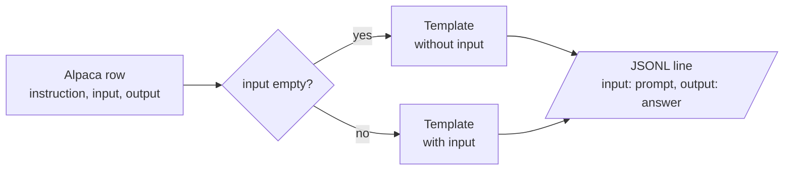

# M45.3 Theory: Instruction tuning

*[M45 theory](../README.md) · Lesson 45.3 · Notebooks: [`03a_instruction_tuning_lab.ipynb`](../../notebook/03_instruction_tuning/03a_instruction_tuning_lab.ipynb), [`03b_instruction_tuning_lecture.ipynb`](../../../optional/notebook/03_instruction_tuning/03b_instruction_tuning_lecture.ipynb) (optional) · [All theory pages](../../../../../THEORY.md)*
<!-- subtitle: A prompt template turns each request and response into training text, and the serving prompt has to match that text exactly -->
<!-- format: approved -->

## Start with answers that begin mid-sentence

> **What you'll learn**
>
> - **Explain** what instruction tuning teaches a base model, and why the lesson is a pattern rather than a set of facts.
> - **Trace** an Alpaca row through a prompt template into one line of training data.
> - **Diagnose** template drift, where the serving prompt no longer matches the training text.
> - **Apply** three rules that keep training and inference in step.

Lesson 45.2 stored each example as a prompt field and an answer field. What sits between and around those fields, the headers, blank lines and end marker, is the part this lesson is about. A Larkspur engineer who fine-tunes on rows that read `### Question:` … `### Answer:` and then serves the bare customer question gets answers that start mid-sentence. It is the same **format mismatch** the Llama 2 chat model showed in lesson 45.1 without its `[INST]` wrapper.

## Instruction tuning

**Instruction tuning is fine-tuning on pairs of a request and a good response.** It is the first step that turned the base Llama 2 of lesson 45.1 into the chat model. What it teaches is a pattern: text shaped like a request is followed by text shaped like an answer, and then the answer ends.

The notebook streams the first five rows of `tatsu-lab/alpaca`, an instruction dataset where every row has three fields:

| Field | Holds | In the five rows shown |
|---|---|---|
| `instruction` | The request | Five different tasks, from "Give three tips for staying healthy." to "Describe a time when you had to make a difficult decision." |
| `input` | Optional context for the request | Empty in all five |
| `output` | The answer | One response per row |

*Table 1: The fields of an Alpaca row.*

A **prompt template** turns each row into training text, and the notebook keeps two. Both open with a one-sentence preamble and use `###` headers to mark the parts:

| Part of the template | With input | Without input |
|---|---|---|
| Preamble | "Below is an instruction that describes a task, paired with an input that provides further context. Write a response that appropriately completes the request." | "Below is an instruction that describes a task. Write a response that appropriately completes the request." |
| `### Instruction:` | The row's `instruction` | The row's `instruction` |
| `### Input:` | The row's `input` | Left out |
| `### Response:` | Where the answer begins | Where the answer begins |

*Table 2: The notebook's two Alpaca templates, part by part.*

Filling a template with a row's values is what the notebook calls **hydrating** the prompt. The row's `input` field picks the template:

*Figure 1: Hydrating an Alpaca row. All five rows in the notebook take the upper branch.*

Follow the first Alpaca row from the stream to the line the notebook writes.

<button type="button" data-step="0" aria-pressed="false" aria-controls="hydrate-step-0">1. Read the row</button><button type="button" data-step="1" aria-pressed="false" aria-controls="hydrate-step-1">2. Pick a template</button><button type="button" data-step="2" aria-pressed="false" aria-controls="hydrate-step-2">3. Fill it</button><button type="button" data-step="3" aria-pressed="false" aria-controls="hydrate-step-3">4. Write the line</button>

<section id="hydrate-step-0" class="step-panel" aria-labelledby="hydrate-heading-0"><h4 id="hydrate-heading-0">1. Read the row</h4><dl><dt><code>instruction</code></dt><dd>"Give three tips for staying healthy."</dd><dt><code>input</code></dt><dd>Empty</dd><dt><code>output</code></dt><dd>Three numbered tips, beginning "1.Eat a balanced diet"</dd></dl></section><section id="hydrate-step-1" class="step-panel" aria-labelledby="hydrate-heading-1"><h4 id="hydrate-heading-1">2. Pick a template</h4><dl><dt>Test</dt><dd>Is <code>input</code> empty? Yes</dd><dt>Choice</dt><dd>The template without input: shorter preamble, no <code>### Input:</code> block</dd></dl></section><section id="hydrate-step-2" class="step-panel" aria-labelledby="hydrate-heading-2"><h4 id="hydrate-heading-2">3. Fill the template</h4><dl><dt>Prompt</dt><dd>The preamble, a blank line, <code>### Instruction:</code>, the instruction, a blank line and <code>### Response:</code></dd><dt>Left out</dt><dd>The answer: it is stored separately</dd></dl></section><section id="hydrate-step-3" class="step-panel" aria-labelledby="hydrate-heading-3"><h4 id="hydrate-heading-3">4. Write one JSON line</h4><dl><dt>File</dt><dd><code>alpaca_processed.jsonl</code></dd><dt><code>input</code></dt><dd>The hydrated prompt from stage 3</dd><dt><code>output</code></dt><dd>The row's answer, unchanged</dd></dl></section>

<button type="button" data-walk="previous">Previous</button>

<button type="button" data-walk="next">Next step</button>

The written keys collide with Alpaca's own `input` field: read them as "model input" and "model output". The same shape works for Larkspur:

| Larkspur field | Value |
|---|---|
| `instruction` | *Does a reboot change my server IP address?* |
| `input` | Empty, so the template without input applies |
| `output` | An answer that opens with *Yes* or *No* and states the policy in a sentence |

*Table 3: A Larkspur support exchange mapped onto the Alpaca fields (illustrative).*

The notebook ends by asking the first `lamini/lamini_docs` test question, *Can Lamini generate technical documentation or user manuals for software projects?*, to two models with the same architecture and tokenizer: the base `EleutherAI/pythia-70m`, and `lamini/lamini_docs_finetuned`, which is pythia-70m after fine-tuning on that dataset. Any difference between the two answers comes from the training rows alone. The notebook ships without saved outputs; the two answers appear only when you run it.

One detail of its `inference` helper changes what you see. It passes `max_output_tokens=100` to `generate` as `max_length`, which counts the prompt as well as the answer. The test question is 15 tokens, so each model can add at most 85.

A model trained on hydrated rows learns their exact characters, which makes the serving prompt part of the training contract.

## The template at inference

A model learns the exact surface form of its training text, and the prompt at inference has to match it. When it does not, we call it **template drift**: the training rows used one shape and the serving code sends another. Lesson 45.1 showed the cost on Llama 2, which finished the user's sentence ("on command.") before answering.

The M45 notebooks hold a quiet example. Lesson 45.4 builds `### Question:` / `### Answer:` prompts, but the `lamini/lamini_docs` copy that lesson 45.5 trains on carries none of them. Every one of its 1,260 training rows decodes to the bare question followed immediately by the bare answer (`…from Lamini models?There are several metrics…`), with no separator and no end token. The inference helper then sends the bare question, which matches that training text, so the two stay consistent by accident.

Changing either side alone breaks that accident. The planted cases below each change one side:

| Training text | Serving prompt | What the model sees |
|---|---|---|
| Bare question + bare answer | Bare question | A match by accident: the answer follows directly |
| Bare question + bare answer | `### Question:` … `### Answer:` | Headers it never saw; template drift |
| `### Question:` … `### Answer:` + answer | Bare question | No cue that an answer should start; it may continue the question |
| Template + answer + end token | Same template | A clean start and a learned stop |

*Table 4: Planted template drift. Only the last row is a match by design.*

Three rules keep training and inference in step:

- **One template, in code, used by both.** Write the formatting function once and import it in the data script and the serving code. Many tokenizers now ship such a function as a chat template.
- **Mark where the answer starts and where it ends.** A header such as `### Answer:` tells the model to start answering; an end token (`<|endoftext|>` for Pythia) tells it, and your decoder, that the answer is over.
- **Check the tokenized row, not the string.** Decode a few prepared rows before training; [the lab in lesson 45.4](../04_data_preparation/README.md#data-preparation) shows what to look for.

The end token is the rule the M45 data breaks, and it is the one with the loudest consequence. Lesson 45.4 shows where it has to be added, and lesson 45.6 shows what a model trained without it does.

## Limits of this evidence

- The Alpaca rows were streamed from the Hub, and the `lamini/lamini_docs` rows were decoded with the Pythia tokenizer from the local cache. Neither model was run: the pythia-70m and fine-tuned answers are not quoted.
- The planted cases in Table 4 are reasoned from the training text, not measured on a model.
- The notebook's Llama 2 cells use the same recorded outputs as lesson 45.1.

## References

- Taori et al. (2023), [Alpaca: A Strong, Replicable Instruction-Following Model](https://crfm.stanford.edu/2023/03/13/alpaca.html), and the [tatsu-lab/alpaca](https://huggingface.co/datasets/tatsu-lab/alpaca) dataset.
- Wei et al. (2021), [Finetuned Language Models Are Zero-Shot Learners](https://arxiv.org/abs/2109.01652): instruction tuning across many tasks.
- Wang et al. (2022), [Self-Instruct: Aligning Language Models with Self-Generated Instructions](https://arxiv.org/abs/2212.10560): the method behind Alpaca's data.
- Biderman et al. (2023), [the Pythia model suite](https://arxiv.org/abs/2304.01373), which includes pythia-70m.
- Hugging Face, [Chat templates](https://huggingface.co/docs/transformers/chat_templating): one formatting function shared by training and serving.

## Key Takeaways

- Instruction tuning trains on request and response pairs. A prompt template turns each row into training text, with a variant for rows that have no `input`.
- A model learns the exact surface form of its training text, and the inference prompt must match it. Changing the training format or the serving prompt alone causes template drift.
- Write one formatting function that the data script and the serving code both import, mark where the answer starts and ends, and decode a few tokenized rows before training.

## Check yourself

1. What pattern does instruction tuning teach a base model?

That text shaped like a request is followed by text shaped like an answer, and then the answer ends. It is fine-tuning on pairs of a request and a good response, and it was the first step that turned base Llama 2 into the chat model.

2. An Alpaca row has an empty input field. Which template does the notebook fill, and what does the output line look like?

The template without input, which has a shorter preamble and no `### Input:` block, filled with the row's `instruction`. The notebook writes one object per line to `alpaca_processed.jsonl`: the hydrated prompt as `input` and the answer as `output`. A Larkspur row has the same shape, with the customer's question as the instruction.

3. The lesson 45.5 model trained on the bare question followed by the bare answer. You add a ### Answer: header to the serving prompt only. What goes wrong?

Template drift: the model now sees headers it was never trained on. Training and inference matched only by accident, and changing either side alone breaks that. Keep one formatting function in code that both the data script and the serving code import, and mark where the answer starts and ends.

---
*Previous: [45.2 Where fine-tuning fits](../../../optional/theory/02_where_fine_tuning_fits/README.md). Next: [45.4 Data preparation](../04_data_preparation/README.md).*
