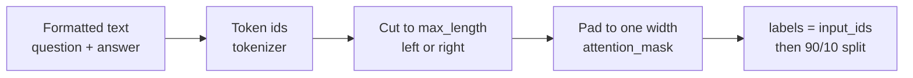

# M45.4 Theory: Data preparation

*[M45 theory](../README.md) · Lesson 45.4 · Notebooks: [`04a_data_preparation_lab.ipynb`](../../notebook/04_data_preparation/04a_data_preparation_lab.ipynb), [`04b_data_preparation_lecture.ipynb`](../../../optional/notebook/04_data_preparation/04b_data_preparation_lecture.ipynb) (optional) · [All theory pages](../../../../../THEORY.md)*
<!-- subtitle: Tokenize, truncate, pad, label and split, and the three choices in that pipeline that fail without an error -->
<!-- format: approved -->

## Start with an answer cut at 48 tokens

> **What you'll learn**
>
> - **Explain** how a formatted example becomes one row of token ids in a rectangular batch.
> - **Trace** tokenizing, padding and truncation on real Pythia token ids.
> - **Diagnose** the three silent failures: a cut answer, a cut question and a missing end token.
> - **Check** a dataset for empty rows, duplicates, refusals and length before training on it.

Lesson 45.3 ended on a rule: decode the tokenized row, not the string. This page shows why. A Larkspur engineer sets a token limit of 48 to save memory, trains, and finds the assistant now stops the refund answer mid-sentence. Nothing raised an error. The limit cut the end off every long answer before the model ever saw it.

## Data preparation

**Data preparation turns each formatted example into one row of token ids, makes the rows fit a length limit and a common width, and holds some rows back for evaluation.** A model trains on token ids, in rectangular batches, and every step below exists to produce one:

*Figure 1: The preparation pipeline, from formatted text to a split, labelled dataset.*

### Tokenize, pad and truncate

The notebook loads the `EleutherAI/pythia-70m` tokenizer, the one its model was trained with. Text and tokens are different units: the first `lamini_docs` example is 358 characters and 77 tokens. On a short sentence the three operations look like this:

| Operation | Input | Result |
|---|---|---|
| Tokenize | "Hi, how are you?" | 6 ids: 12764, 13, 849, 403, 368, 32; decoding returns the same string |
| Pad to the longest row | "Hi, how are you?", "I'm good", "Yes" (6, 3 and 1 tokens) | Three rows of 6, the short ones filled with id 0 on the right |
| Truncate right, `max_length` 3 | "Hi, how are you?" | 12764, 13, 849 ("Hi, how") |
| Truncate left, `max_length` 3 | "Hi, how are you?" | 403, 368, 32 (" are you?") |

*Table 1: Pythia tokenizer operations on the notebook's sample sentences, rerun with the cached tokenizer.*

**Padding** exists because a batch is one tensor, so its rows need one width. Pythia's tokenizer has its own `<|padding|>` token (id 1), but the notebook sets the pad token to the end-of-text token. Padding therefore uses id 0, the end-of-text id. `attention_mask` marks real tokens with 1 and padding with 0, and attention skips the padding. **Truncation** caps every row at `max_length`; the default cuts from the right, and the notebook switches the tokenizer to cut from the left.

### One row through the notebook

Follow the first <code>lamini_docs</code> row through the notebook's dataset code, and see what each step actually changes.

<button type="button" data-step="0" aria-pressed="false" aria-controls="row-step-0">1. Load</button><button type="button" data-step="1" aria-pressed="false" aria-controls="row-step-1">2. Join</button><button type="button" data-step="2" aria-pressed="false" aria-controls="row-step-2">3. Measure</button><button type="button" data-step="3" aria-pressed="false" aria-controls="row-step-3">4. Truncate</button><button type="button" data-step="4" aria-pressed="false" aria-controls="row-step-4">5. Label and split</button>

<section id="row-step-0" class="step-panel" aria-labelledby="row-heading-0"><h4 id="row-heading-0">1. Load the raw file</h4><dl><dt>Source</dt><dd><code>lamini_docs.jsonl</code>, 1,400 rows, loaded with <code>datasets</code></dd><dt>Not used</dt><dd>The <code>### Question:</code> list built a few cells earlier; it never reaches the tokenizer</dd></dl></section><section id="row-step-1" class="step-panel" aria-labelledby="row-heading-1"><h4 id="row-heading-1">2. Join question and answer</h4><dl><dt>Text</dt><dd>The bare question and the bare answer, joined with nothing between them</dd><dt>Batch</dt><dd><code>batch_size=1</code>; the function reads only item 0 of each batch</dd></dl></section><section id="row-step-2" class="step-panel" aria-labelledby="row-heading-2"><h4 id="row-heading-2">3. Measure the row</h4><dl><dt>First pass</dt><dd>Tokenize with padding: 77 tokens, nothing to pad in a batch of one</dd><dt>Limit</dt><dd><code>max_length = min(77, 2048)</code>: the row's own length</dd></dl></section><section id="row-step-3" class="step-panel" aria-labelledby="row-heading-3"><h4 id="row-heading-3">4. Truncate from the left</h4><dl><dt>Second pass</dt><dd>Re-tokenize with <code>truncation=True</code> at that limit</dd><dt>Effect</dt><dd>Nothing is cut: a limit equal to the row's length never bites, for any row up to 2,048 tokens</dd><dt>End token</dt><dd>None appended</dd></dl></section><section id="row-step-4" class="step-panel" aria-labelledby="row-heading-4"><h4 id="row-heading-4">5. Label and split</h4><dl><dt><code>labels</code></dt><dd>A copy of <code>input_ids</code></dd><dt>Split</dt><dd>10% held out, shuffled with seed 123: 1,260 train, 140 test</dd></dl></section>

<button type="button" data-walk="previous">Previous</button>

<button type="button" data-walk="next">Next step</button>

For a causal language model the target is the input itself, shifted by one inside the model, which is why `labels` can copy `input_ids`. The fixed seed gives the same split on every run, which is what lets lesson 45.6 compare models on the same 140 questions. The stepper also shows two details to fix before you reuse the code. Its function reads only the first item of each batch, which works only because the dataset is mapped one example at a time. And with one example per batch there is nothing to pad: the training run in lesson 45.5 never pads at all.

### Three failures that raise no error

Each choice above changes what the model learns, and three of them fail silently:

| Planted failure | What reaches the model | What it learns |
|---|---|---|
| **Cut answer**: right truncation on a long row | The question and the start of the answer; the end, and any end token, are gone | Answers that stop mid-sentence |
| **Cut question**: left truncation on a long row | The answer, with the `### Question:` header and the start of the question gone | Answers to questions it cannot see |
| **No end token**: the Pythia tokenizer appends nothing | A question and an answer with no marker after the answer | Nothing about where an answer stops |

*Table 2: Three silent failures in data preparation, one row per guard.*

The guards follow from the table. Append the tokenizer's end-of-text token to each training text. Since padding reuses id 0 and `labels` copies it, set padded positions in `labels` to -100, the index PyTorch's cross-entropy loss ignores by default. And choose `max_length` from measured lengths, not from a memory budget alone.

The [interactive lab](interactive/truncation-padding-lab.html) builds a three-example Larkspur batch (refund, reboot and export questions in the `### Question:` template) with the real Pythia tokens. At `max_length = 48` right truncation cuts 11 answer tokens from the 59-token refund example. Left truncation keeps that answer but cuts the 4-token header and 7 question tokens instead. Padding to the longest row pads the two shorter examples by 15 and 3 tokens, 13% of the batch. With the end token appended and padding to a fixed `max_length` of 64, the batch carries 52 padding positions, 27%. No row ends with `<|endoftext|>` until you append it.

<!-- lab: interactive/truncation-padding-lab.html -->

Those counts depend on the batch, so the next question is what limit this dataset needs:

| Statistic over the 1,400 `lamini_docs` rows | Bare question + answer | With the `### Question:` template |
|---|---|---|
| Median | 75 | 84 |
| 90th percentile | 128 | 137 |
| Longest | 479 | 488 |
| The notebook's cap | 2,048 | 2,048 |

*Table 3: Token lengths measured with the Pythia tokenizer.*

In the notebook the cap never bites: no row comes near 2,048. Measure your own length distribution before choosing `max_length`: set it just above the longest rows you want to keep whole, and decide on purpose what happens to the rest.

Tokenizing checks none of the content, which is the job of the next section.

## Checking the rows

Tokenizing does not check the data. Read the rows before you train on them; in `lamini_docs.jsonl` a short pass finds four things:

| Check | What it finds in the 1,400 rows | Why it matters |
|---|---|---|
| Blank questions | 6 rows: 1 with a blank question and a blank answer, 5 whose blank question is answered "Did you type something, I am having trouble understanding" | The fully blank row tokenizes to zero ids, and lesson 45.5's custom trainer has a guard that skips empty inputs. The other five teach a reply to empty input, which may be what you want |
| Repeated questions | "How much do I have to pay?" and "how much does it cost" each appear twice, and the blank question repeats too | A repeat weighs a behaviour twice, and one copy can land in the test split while the other trains |
| Refusals | 39 answers that ask to "keep the discussion relevant to Lamini" | These rows are what teach the model to decline off-topic questions such as *What do you think of Mars?* |
| Length | 0 rows over 2,048 tokens; the longest is 479 | Sets `max_length`, and with it memory and step time |

*Table 4: Row checks on `lamini_docs.jsonl`.*

The refusal rows show how a behaviour gets in: the model declines off-topic questions because 39 training answers do. A Larkspur dataset needs its own share of those rows, written in the house style, or the fine-tuned assistant will answer *What do you think of Mars?* as cheerfully as the base model. We call that gap **missing refusals**: a behaviour the team wants but no training row shows.

The repeats point to an ordering rule. **Split leakage** happens when one copy of a question trains and another sits in the test split, and evaluation rewards memory. It is not hypothetical here: the notebook's seed-123 split, and the `lamini/lamini_docs` copy on the Hub, both put 2 of the 140 test questions in training as well, "how much does it cost" and a blank question. Deduplicate before you split, and check that no test question also appears in training.

## Limits of this evidence

- Every count on this page comes from rerunning the notebook's own cells offline on `lamini_docs.jsonl` with the cached Pythia tokenizer, and from the cached Hub copy. No model was trained.
- The lab's figures come from its three Larkspur examples, which are illustrative; the counts above were recomputed from the token ids embedded in the lab.
- Table 2's failures are reasoned from what reaches the model. Lesson 45.6 shows one of them, the missing end token, in a trained model's output.

## References

- Hugging Face, [Padding and truncation](https://huggingface.co/docs/transformers/pad_truncation).
- Hugging Face, [Process a dataset](https://huggingface.co/docs/datasets/process): `map`, batching and `train_test_split`.
- PyTorch, [CrossEntropyLoss](https://docs.pytorch.org/docs/stable/generated/torch.nn.CrossEntropyLoss.html): `ignore_index` defaults to -100.
- Lee et al. (2021), [Deduplicating Training Data Makes Language Models Better](https://arxiv.org/abs/2107.06499): duplicates and overlap between training and test sets.

## Key Takeaways

- Data preparation is tokenize, truncate, pad, copy `input_ids` to `labels`, then split with a fixed seed. Right truncation cuts the answer's end and left truncation cuts the question, both without an error.
- Append the end token to every training text and set padded label positions to -100. Measure the length distribution before you choose `max_length`.
- Read the rows before training. Remove empty rows, deduplicate before the split, and include refusal rows in the house style, because the model only declines what its training answers decline.

## Check yourself

1. The Pythia tokenizer appends no end token, and padding reuses the end-of-text id. What do you add to each training text, and what do you set at padded label positions?

Append the end-of-text token to each training text: every row then shows the model where an answer stops. Then set the padded positions in `labels` to -100: padding uses id 0 and `labels` copies `input_ids`, so without that step the loss would train on the padding.

2. In the lab's Larkspur batch at max_length 48, what does each truncation side remove from the refund example?

Right truncation cuts 11 answer tokens from the end, and the model trains on an answer that stops mid-sentence. Left truncation keeps the answer but cuts the `### Question:` header and 7 question tokens. The model trains on an answer to a question it cannot fully see. Neither raises an error.

3. A fine-tuned Larkspur assistant answers What do you think of Mars? as cheerfully as the base model. What was missing from its training data?

Refusal rows. In `lamini_docs.jsonl` the model learns to decline off-topic questions because 39 training answers ask to keep the discussion relevant to Lamini. A Larkspur dataset needs its own share of those rows, written in the house style.

---
*Previous: [45.3 Instruction tuning](../03_instruction_tuning/README.md). Next: [45.5 Training](../05_training/README.md).*
