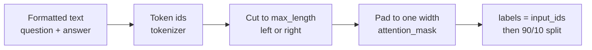

# M45.4 Theory: Data preparation

*[M45 theory](../README.md) · Lesson 45.4 · Notebooks: [`04a_data_preparation_lab.ipynb`](../../notebook/04_data_preparation/04a_data_preparation_lab.ipynb), [`04b_data_preparation_lecture.ipynb`](../../../optional/notebook/04_data_preparation/04b_data_preparation_lecture.ipynb) (optional) · [All theory pages](../../../../../THEORY.md)*
<!-- subtitle: Tokenize, truncate, pad, label and split, and the three choices in that pipeline that fail without an error -->

## Data preparation

> **What you'll learn**
>
> - **Explain** how a formatted example becomes one row of token ids in a rectangular batch.
> - **Trace** tokenizing, padding and truncation on real Pythia token ids.
> - **Diagnose** the three silent failures: a cut answer, a cut question and a missing end token.
> - **Check** a dataset for empty rows, duplicates, refusals and length before training on it.

Lesson 45.3 ended on a rule: decode the tokenized row, not the string. This page shows why. A Larkspur engineer sets a token limit of 48 to save memory, trains, and finds the assistant now stops the refund answer mid-sentence. Nothing raised an error. The limit cut the end off every long answer before the model ever saw it.

**Data preparation turns each formatted example into one row of token ids, makes the rows fit a length limit and a common width, and holds some rows back for evaluation.** A model trains on token ids, in rectangular batches, and every step below exists to produce one:

*Figure 1: The preparation pipeline, from formatted text to a split, labelled dataset.*

### Tokenize, pad and truncate

The notebook loads the `EleutherAI/pythia-70m` tokenizer, the one its model was trained with. Text and tokens are different units: the first `lamini_docs` example is 358 characters and 77 tokens. On a short sentence the three operations look like this:

| Operation | Input | Result |
|---|---|---|
| Tokenize | "Hi, how are you?" | 6 ids: 12764, 13, 849, 403, 368, 32; decoding returns the same string |
| Pad to the longest row | "Hi, how are you?", "I'm good", "Yes" (6, 3 and 1 tokens) | Three rows of 6, the short ones filled with id 0 on the right |
| Truncate right, `max_length` 3 | "Hi, how are you?" | 12764, 13, 849 ("Hi, how") |
| Truncate left, `max_length` 3 | "Hi, how are you?" | 403, 368, 32 (" are you?") |

*Table 1: Pythia tokenizer operations on the notebook's sample sentences, checked against the tokenizer in the scratchpad.*

**Padding** exists because a batch is one tensor, so its rows need one width. Pythia's tokenizer has its own `<|padding|>` token (id 1), but the notebook sets the pad token to the end-of-text token. Padding therefore uses id 0, the end-of-text id. `attention_mask` marks real tokens with 1 and padding with 0, and attention skips the padding. **Truncation** caps every row at `max_length`; the default cuts from the right, and the notebook switches the tokenizer to cut from the left.

### Label and split

For a causal language model the target is the input itself, shifted by one inside the model. The notebook adds `labels` as a copy of `input_ids`. A shuffled split with 10% held out and seed 123 then turns the 1,400 rows into 1,260 for training and 140 held out. The fixed seed gives the same split on every run, which is what lets lesson 45.6 compare models on the same 140 questions.

### Three failures that raise no error

Each choice above changes what the model learns, and three of them fail silently:

| Planted failure | What reaches the model | What it learns |
|---|---|---|
| **Cut answer**: right truncation on a long row | The question and the start of the answer; the end, and any end token, are gone | Answers that stop mid-sentence |
| **Cut question**: left truncation on a long row | The answer, with the `### Question:` header and the start of the question gone | Answers to questions it cannot see |
| **No end token**: the Pythia tokenizer appends nothing | A question and an answer with no marker after the answer | Nothing about where an answer stops |

*Table 2: Three silent failures in data preparation, one row per guard.*

The guards follow from the table. Append the tokenizer's end-of-text token to each training text. Since padding reuses id 0 and `labels` copies it, set padded positions in `labels` to -100 so the loss ignores them. And choose `max_length` from measured lengths, not from a memory budget alone.

The [interactive lab](interactive/truncation-padding-lab.html) builds a three-example Larkspur batch (refund, reboot and export questions in the `### Question:` template) with the real Pythia tokens. At `max_length = 48` right truncation cuts 11 answer tokens from the 59-token refund example. Left truncation keeps that answer but cuts the 4-token header and 7 question tokens instead. Padding to the longest row pads the two shorter examples by 15 and 3 tokens, 13% of the batch. With the end token appended and padding to a fixed `max_length` of 64, the batch carries 52 padding positions, 27%. No row ends with `<|endoftext|>` until you append it.

<!-- lab: interactive/truncation-padding-lab.html -->

Those counts depend on the batch, so the next question is what limit this dataset needs:

| Statistic over the 1,400 `lamini_docs` rows | Tokens |
|---|---|
| Median | 75 |
| 90th percentile | 128 |
| Longest | 479 |
| The notebook's cap | 2,048 |

*Table 3: Token lengths of question plus answer, measured with the Pythia tokenizer in the scratchpad.*

In the notebook the limit never bites: no row comes near 2,048. Measure your own length distribution before choosing `max_length`: set it just above the longest rows you want to keep whole, and decide on purpose what happens to the rest.

Two notebook details matter before you reuse its approach. Its tokenizing function reads only the first item of each batch it receives. It works only because the dataset is mapped one example at a time. And with one example per batch there is nothing to pad: the training run in lesson 45.5 never pads at all.

Tokenizing checks none of the content, which is the job of the next section.

## Checking the rows

Tokenizing does not check the data. Read the rows before you train on them; in `lamini_docs.jsonl` a short pass finds four things:

| Check | What it finds in the 1,400 rows | Why it matters |
|---|---|---|
| Empty rows | 1 row with a blank question and a blank answer | It tokenizes to zero ids; lesson 45.5's custom trainer has a guard that skips empty inputs |
| Duplicate questions | 3 extra copies of questions already in the file | Duplicates weigh a behaviour twice, and one copy can land in the test split while the other trains |
| Refusals | 39 answers that ask to "keep the discussion relevant to Lamini" | These rows are what teach the model to decline off-topic questions such as *What do you think of Mars?* |
| Length | 0 rows over 2,048 tokens; the longest is 479 | Sets `max_length`, and with it memory and step time |

*Table 4: Row checks on `lamini_docs.jsonl`, counted in the scratchpad.*

The refusal rows show how a behaviour gets in: the model declines off-topic questions because 39 training answers do. A Larkspur dataset needs its own share of those rows, written in the house style, or the fine-tuned assistant will answer *What do you think of Mars?* as cheerfully as the base model. We call that gap **missing refusals**: a behaviour the team wants but no training row shows.

The duplicates point to an ordering rule. **Split leakage** happens when one copy of a question trains and another sits in the test split, and evaluation rewards memory. Deduplicate before you split, and check that no test question also appears in training.

## Key Takeaways

- Data preparation is tokenize, truncate, pad, copy `input_ids` to `labels`, then split with a fixed seed. Right truncation cuts the answer's end and left truncation cuts the question, both without an error.
- Append the end token to every training text and set padded label positions to -100. Measure the length distribution before you choose `max_length`.
- Read the rows before training. Remove empty rows, deduplicate before the split, and include refusal rows in the house style, because the model only declines what its training answers decline.

## Check yourself

1. The Pythia tokenizer appends no end token, and padding reuses the end-of-text id. What do you add to each training text, and what do you set at padded label positions?

Append the end-of-text token to each training text: every row then shows the model where an answer stops. Then set the padded positions in `labels` to -100: padding uses id 0 and `labels` copies `input_ids`, so without that step the loss would train on the padding.

2. In the lab's Larkspur batch at max_length 48, what does each truncation side remove from the refund example?

Right truncation cuts 11 answer tokens from the end, and the model trains on an answer that stops mid-sentence. Left truncation keeps the answer but cuts the `### Question:` header and 7 question tokens. The model trains on an answer to a question it cannot fully see. Neither raises an error.

3. A fine-tuned Larkspur assistant answers What do you think of Mars? as cheerfully as the base model. What was missing from its training data?

Refusal rows. In `lamini_docs.jsonl` the model learns to decline off-topic questions because 39 training answers ask to keep the discussion relevant to Lamini. A Larkspur dataset needs its own share of those rows, written in the house style.

---
*Previous: [45.3 Instruction tuning](../03_instruction_tuning/README.md). Next: [45.5 Training](../05_training/README.md).*
