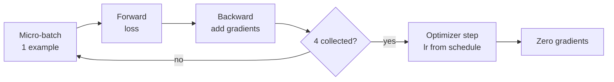

# M45.5 Theory: Training

*[M45 theory](../README.md) · Lesson 45.5 · Notebooks: [`05a_training_lab.ipynb`](../../notebook/05_training/05a_training_lab.ipynb), [`05b_training_lecture.ipynb`](../../../optional/notebook/05_training/05b_training_lecture.ipynb) (optional) · [All theory pages](../../../../../THEORY.md)*
<!-- subtitle: What the Trainer does on each update, and the arithmetic that shows a three-step run trains on under 1% of the data -->
<!-- format: approved -->

## Start with a run that only looks trained

> **What you'll learn**
>
> - **Explain** the loop the Hugging Face `Trainer` runs, and what gradient accumulation does to memory and batch size.
> - **Read** a `TrainingArguments` configuration setting by setting.
> - **Calculate** examples seen, share of an epoch and the learning rate of each update for a short run.
> - **Diagnose** a run that reports steps but trained on almost nothing.

Lesson 45.4 produced 1,260 tokenised training rows. A Larkspur engineer runs the notebook's training cell on rows like these, sees a loss logged at every step, and reports "fine-tuned". The run made three updates. One of them had a learning rate of zero, and the loss stored in the trainer's history was smoothed so heavily that it could not have moved. We call that the **step-count illusion**: a run that looks like training in the log and changes almost nothing in the weights.

This page takes the run apart in the order the trainer executes it: the loop, the settings, the three updates one at a time, and then how to size a run that trains.

## Trainer

**The Hugging Face `Trainer` runs the training loop you would otherwise write by hand**: batch the data, run the model forward, compute the loss, run it backward, step the optimiser and the learning-rate schedule, evaluate, log and save checkpoints. `TrainingArguments` holds every setting. The notebook trains `EleutherAI/pythia-70m` (70,426,624 parameters, about 0.28 GB of weights in 32-bit floats) on `lamini/lamini_docs` with these:

| Argument | Value | What it does |
|---|---|---|
| `learning_rate` | `1.0e-5` | Peak step size, reached after warmup |
| `max_steps` | `3` | Optimiser updates to run; overrides `num_train_epochs` |
| `per_device_train_batch_size` | `1` | Examples per forward pass |
| `gradient_accumulation_steps` | `4` | Forward passes summed into one update |
| `warmup_steps` | `1` | Updates spent ramping the learning rate up from 0 |
| `optim` | `"adafactor"` | An optimiser that stores less state per weight than Adam |
| `eval_steps`, `save_steps` | `120` | Evaluate and checkpoint every 120 updates |
| `logging_steps` | `1` | Log after every update |
| `load_best_model_at_end` | `True` | Reload the checkpoint with the lowest `eval_loss` when training ends |

*Table 1: The notebook's training settings, from the `TrainingArguments` cell of `05a`.*

One optimiser step, with a batch of 1 and four accumulation steps, runs like this:

<!-- animated: diagrams/training-step.anim.html -->

*Figure 1: One optimiser update with gradient accumulation. Four forward and backward passes feed a single step.*

**Gradient accumulation** gives the update of a batch of 4 while holding only one example in memory. After the gradients are zeroed, the next update starts again from a fresh micro-batch.

### The notebook's custom trainer

The notebook does not use the library `Trainer` directly. It imports a subclass from its `utilities.py` that adds three things:

- **An empty-input guard**: it skips a batch whose `input_ids` are empty. The training split has exactly one such row, the blank row lesson 45.4 found.
- **Speed logging**: it logs iteration time, floating-point operations per second and remaining time.
- **A smoothed loss**: before it appends a log entry to `state.log_history`, it replaces the loss with an exponential average that gives each new step a weight of 1/100.

The smoothing only touches the history. The progress output receives the raw loss, while the history that plots and later cells read holds the average. After three steps the stored value is still 98% the first step's loss (0.99 × 0.99 of its weight), whatever the model learned. Read the raw loss when you judge a short run.

The operations figure uses the rule the library's `Trainer.floating_point_ops` implements: 6 × tokens × non-embedding parameters. The notebook feeds it a dummy input of 2,048 tokens:

| Quantity | Value |
|---|---|
| Non-embedding parameters in pythia-70m (input embedding excluded) | 44,670,976 |
| Tokens per example in the notebook's dummy input | 2,048 |
| Examples per update | 4 |
| 6 × 2,048 × 4 × 44,670,976 | about 2.2 trillion operations |
| The same at the training rows' mean length of 80 tokens | about 86 billion operations |

*Table 2: The notebook's operations estimate per update, recomputed from the pythia-70m configuration with `transformers` 5.17. Row lengths are from the `lamini/lamini_docs` training split (median 75 tokens, longest 479).*

The estimate assumes every example fills the 2,048-token cap. The real rows are about 25 times shorter, so the operations-per-second figure the notebook logs overstates the work by the same factor.

### Version drift

On the `transformers` 5.17 this course pins, the notebook no longer runs as written. Four things changed under it:

| The notebook does | `transformers` 5.17 expects |
|---|---|
| Passes `evaluation_strategy` to `TrainingArguments` | `eval_strategy`; the old name raises `TypeError` |
| Calls `floating_point_ops` on the model | The method lives on the `Trainer` |
| Passes the parent's arguments to `__init__` by position | A new order (`processing_class`, `compute_loss_func`), so `compute_metrics`, `callbacks` and `optimizers` land in the wrong slots |
| Defines `training_step(model, inputs)` | An extra `num_items_in_batch` argument the loop now passes |

*Table 3: Where the notebook's trainer code meets the pinned library version, checked against the installed `transformers` 5.17.0 source.*

The mechanism the notebook teaches is unchanged. Only the names moved, which is why the next section reasons about the run in counts rather than code.

## Steps, examples and epochs

**A step is one optimiser update, not one example.** An **epoch** is one pass over every training row. The arithmetic for the notebook's run:

| | Value |
|---|---|
| Examples per update | 1 per batch × 4 accumulated = 4 |
| Updates | `max_steps` = 3 |
| Examples seen | 12 |
| Training rows | 1,260 |
| Share of one epoch | 0.95% |

*Table 4: Examples seen by the notebook's run.*

The learning rate is not constant either. With the default linear schedule, one warmup step and 3 steps in all, each update gets its own rate. Step through the run to see what each update does and what is left at the end:

The notebook's 3-step run, one update at a time. Learning rates come from the library's linear warmup schedule with 1 warmup step and 3 steps in all, rerun in <code>transformers</code> 5.17.

<button type="button" data-step="0" aria-pressed="false" aria-controls="run-step-0">1. Update 1</button><button type="button" data-step="1" aria-pressed="false" aria-controls="run-step-1">2. Update 2</button><button type="button" data-step="2" aria-pressed="false" aria-controls="run-step-2">3. Update 3</button><button type="button" data-step="3" aria-pressed="false" aria-controls="run-step-3">4. End of run</button>

<section id="run-step-0" class="step-panel" aria-labelledby="run-heading-0"><h4 id="run-heading-0">1. Update 1: warmup starts at 0</h4><dl><dt>Examples</dt><dd>Rows 1 to 4, one per forward pass</dd><dt>Learning rate</dt><dd>0</dd><dt>Effect on the weights</dt><dd>None: the gradients are computed and then multiplied by zero</dd></dl></section><section id="run-step-1" class="step-panel" aria-labelledby="run-heading-1"><h4 id="run-heading-1">2. Update 2: the peak</h4><dl><dt>Examples</dt><dd>Rows 5 to 8</dd><dt>Learning rate</dt><dd>1e-5, the configured peak</dd><dt>Effect on the weights</dt><dd>The first real step</dd></dl></section><section id="run-step-2" class="step-panel" aria-labelledby="run-heading-2"><h4 id="run-heading-2">3. Update 3: linear decay</h4><dl><dt>Examples</dt><dd>Rows 9 to 12</dd><dt>Learning rate</dt><dd>5e-6, halfway from the peak to 0</dd><dt>Stored loss</dt><dd>Still 98% the first step's value after smoothing</dd></dl></section><section id="run-step-3" class="step-panel" aria-labelledby="run-heading-3"><h4 id="run-heading-3">4. End of run: nothing to choose from</h4><dl><dt>Evaluations run</dt><dd>0: evaluation happens every 120 updates</dd><dt>Checkpoints saved</dt><dd>0 during training</dd><dt>Best model reloaded</dt><dd>None: <code>load_best_model_at_end</code> has no <code>eval_loss</code> to compare</dd></dl></section>

<button type="button" data-walk="previous">Previous</button>

<button type="button" data-walk="next">Next step</button>

| Update | Phase | Learning rate |
|---|---|---|
| 1 | Warmup starts at 0 | 0 |
| 2 | Peak | 1e-5 |
| 3 | Linear decay, halfway to 0 | 5e-6 |

*Table 5: The learning rate of each update in the 3-step run.*

The first of the three updates changes nothing. And because evaluation and checkpoints happen every 120 updates, this run never computes an `eval_loss`. We call that a **phantom checkpoint**: a setting that promises the best model and has nothing to choose from.

That is why the notebook calls its result "finetuned slightly" and then loads `lamini/lamini_docs_finetuned`, which its heading describes as the same model trained for two epochs: 2,520 examples against 12. A run that sees under 1% of the data, with one of its three updates at a learning rate of 0, shows the mechanics of training and almost none of its effect.

> **Pitfall: reading `max_steps` as examples.** Three steps sounds small but plausible until you multiply by the examples per update and divide by the rows. Do that sum before the run, not after it.

### Sizing a real Larkspur run

The fix for the step-count illusion is to plan in examples and derive the steps, in this order:

1. Decide how many epochs the data supports; a small dataset seen too many times starts to memorise.
2. Multiply by the training rows and divide by examples per update to get the number of updates.
3. Set warmup as a fraction of those updates, not a fixed count.
4. Put `eval_steps` and `save_steps` well inside the run. The held-out loss is then tracked while it trains, and the best-checkpoint setting has something to choose.

As an illustration with the notebook's own data: two epochs of 1,260 rows at 4 examples per update is 630 updates. A 10% warmup is 63 updates, and evaluating and saving every 63 updates gives ten held-out losses to choose from.

The held-out loss tells you the model fits unseen rows of the same kind. It does not yet tell you the model does the Larkspur job, which is the next lesson.

## Limits of this evidence

- No training ran here. The schedule, the parameter counts and the operations estimate were recomputed with `transformers` 5.17.0 and the cached `lamini/lamini_docs` dataset; the notebook's own logged losses are not reproduced.
- The smoothing figure follows from the `update_history` code in `utilities.py`. How much a real 3-step run moves the raw loss depends on the rows drawn.
- The two-epoch description of `lamini/lamini_docs_finetuned` comes from the notebook heading, not from the model's training record.

## References

- Hugging Face `transformers`: [Trainer](https://huggingface.co/docs/transformers/main_classes/trainer) and [Optimisation schedules](https://huggingface.co/docs/transformers/main_classes/optimizer_schedules), on `TrainingArguments` and the linear warmup schedule.
- Biderman et al. (2023), [Pythia](https://arxiv.org/abs/2304.01373), the suite of research models pythia-70m belongs to; the model card for [`EleutherAI/pythia-70m`](https://huggingface.co/EleutherAI/pythia-70m).
- Shazeer and Stern (2018), [Adafactor: Adaptive Learning Rates with Sublinear Memory Cost](https://arxiv.org/abs/1804.04235).
- Kaplan et al. (2020), [Scaling Laws for Neural Language Models](https://arxiv.org/abs/2001.08361), the source of the 6 × parameters × tokens operations estimate.

## Key Takeaways

- `Trainer` runs the loop and `TrainingArguments` holds every setting. Gradient accumulation gives the update of a larger batch while holding only one micro-batch in memory.
- A step is one optimiser update, not one example. Work out examples seen, share of an epoch and the learning rate per step before you judge a run.
- Size a real run in examples: choose the epochs, derive the updates, set warmup as a fraction of them, and put `eval_steps` inside the run. Read the raw loss, since the notebook's smoothed history barely moves on short runs.

## Check yourself

1. With a batch size of 1 and 4 gradient-accumulation steps, how does the trainer produce one optimiser update?

It runs four micro-batches of one example each forward and backward, adding their gradients. Once four are collected it steps the optimiser at the learning rate from the schedule and zeroes the gradients. The update matches a batch of 4 while only one example is held in memory.

2. In the lesson 45.5 run, what learning rates do the three updates get, and what share of an epoch does the model see?

0, 1e-5 and 5e-6, from the linear schedule with one warmup step. The first update changes nothing. Three updates of 4 examples each see 12 of the 1,260 training rows: 0.95% of one epoch.

3. Why does load_best_model_at_end have no checkpoint to choose in the lesson 45.5 run, and how should a real Larkspur run be set?

Evaluation and checkpoints happen every 120 updates and the run has 3, so it never computes an `eval_loss`. Size a real run in examples: decide the epochs the data supports, derive the number of updates (two epochs of 1,260 rows at 4 per update is 630), set warmup to a fraction of them, and put `eval_steps` well inside the run.

---
*Previous: [45.4 Data preparation](../04_data_preparation/README.md). Next: [45.6 Evaluation](../06_evaluation/README.md).*
