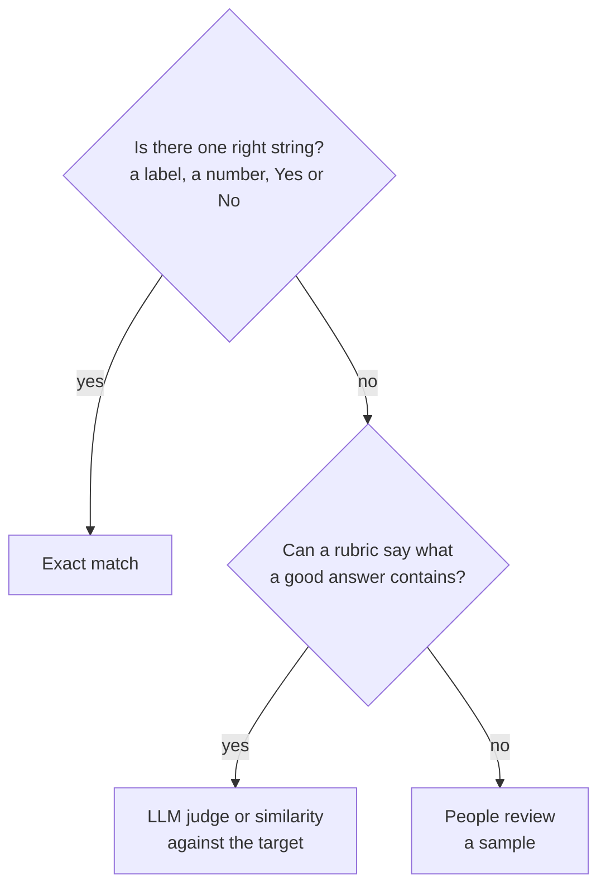
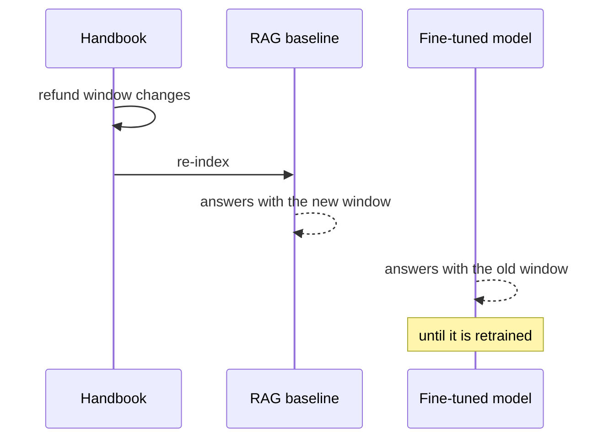

# M45.6 Theory: Evaluation

*[M45 theory](../README.md) · Lesson 45.6 · Notebooks: [`06a_evaluation_lab.ipynb`](../../notebook/06_evaluation/06a_evaluation_lab.ipynb), [`06b_evaluation_lecture.ipynb`](../../../optional/notebook/06_evaluation/06b_evaluation_lecture.ipynb) (optional) · [All theory pages](../../../../../THEORY.md)*
<!-- subtitle: Exact match, a stored evaluation set and a benchmark each answer a different question, and a fine-tune is judged against the RAG baseline it would replace -->
<!-- format: approved -->

## Start with a score that answers the wrong question

> **What you'll learn**
>
> - **Compare** exact match, a stored evaluation set and a general benchmark by what each one can and cannot tell you.
> - **Diagnose** an evaluation that could not succeed: a generation limit shorter than the target.
> - **Read** a stored evaluation set for the runaway answer that a missing end token causes.
> - **Design** a comparison between a fine-tuned model and the M10 RAG baseline on the same questions.

Lesson 45.5 ended with a held-out loss, and a loss says the model fits unseen rows of the same kind. The Larkspur support lead asks a different question: does the fine-tuned assistant answer better than the one in production? A team that answers with "0 exact matches" has measured something, but not that. This page shows what each method measures, and why the first failure in this notebook is visible by reading one answer.

## Evaluation

**Evaluation asks whether the model does the job on rows it never saw, and whether it still does the jobs it could do before.** The notebook tries three methods on `lamini/lamini_docs_finetuned`, from strictest to broadest:

| Method | What it compares | What it can tell you |
|---|---|---|
| Exact match | The stripped generated answer against the stripped target | Whether the model reproduces the target string |
| Stored evaluation set | 139 saved predictions against their targets | How the trained model behaves across many questions |
| Benchmark | Multiple-choice general questions (ARC Easy) | Whether fine-tuning cost the model general ability |

*Table 1: The notebook's three evaluation methods.*

### Exact match, and a limit that blocks it

The exact-match function strips both strings and compares them. The notebook generates answers for the test split and counts matches. Two details limit what that count can say:

| Detail | Effect |
|---|---|
| The loop breaks once its counter passes 10 | It scores 12 of the 140 test questions |
| Generation uses a `max_length` of 100, a limit on prompt plus answer | For 42 of the 140 test pairs, question and target answer together exceed 100 tokens, 3 of them among the 12 scored |

*Table 2: Why the notebook's exact-match count is bounded. Token counts measured with the Pythia tokeniser on the cached `lamini/lamini_docs` test split.*

For those 42 questions the model could not produce the target even if it knew it word for word. We call that an **impossible target**: a test the generation settings guarantee will fail. Set the limit on new tokens (`max_new_tokens`), not on the total, and check it against the longest target before you read any score.

### The stored evaluation set

`lamini/lamini_docs_evaluation` holds 139 predicted answers next to their targets. Scored the notebook's way on the cached dataset:

| Measure | Value |
|---|---|
| Exact matches | 0 of 139 |
| Predictions that repeat a sentence of more than 20 characters | 127 of 139 |
| Median prediction length | 5,128 characters |
| Median target length | 304 characters |

*Table 3: The stored evaluation set, rescored offline.*

The failure is visible in the text before any score. The first prediction says "Yes, Lamini can generate technical documentation or user manuals for software projects" and then repeats "Additionally, Lamini can be trained on specific technical questions…" until it is cut off. We call this the **runaway answer**. Its cause is upstream: none of the 1,260 `lamini/lamini_docs` training rows carries an end token (lesson 45.4), so the model has no example of an answer stopping.

### A benchmark

The last cell runs ARC Easy through EleutherAI's evaluation harness. A benchmark of general questions does not measure the fine-tuned task. It checks that fine-tuning did not cost the model what it could already do. Run it on the base and the fine-tuned model and compare the two.

The cell will not run as written. It calls `main.py` in a local checkout of the harness that the course does not include, with the model type `hf-causal`. The current release (`lm-eval` 0.4.13) is installed as a package, runs as `lm_eval`, and names the type `hf`.

### One prediction, three methods

The three methods disagree about the same model because they read different things. Pick a method to see what it reports for the first stored prediction:

The first row of <code>lamini/lamini_docs_evaluation</code>: the target opens "Yes, Lamini can generate technical documentation and user manuals for software projects", and the 5,502-character prediction opens almost the same way, then repeats itself until it is cut off.

<button type="button" data-mode="exact" aria-pressed="false" aria-controls="method-exact">Exact match</button>
<button type="button" data-mode="read" aria-pressed="false" aria-controls="method-read">Read the row</button>
<button type="button" data-mode="bench" aria-pressed="false" aria-controls="method-bench">Benchmark</button>

<section id="method-exact" class="mode-panel" data-announcement="Exact match selected. False, with no reason given."><h4>Exact match: <code>False</code></h4>
The stripped strings differ, as they do for all 139 rows. The score says the answer is wrong and nothing about why: a near miss and a runaway look the same.
</section>
<section id="method-read" class="mode-panel" data-announcement="Read the row selected. The answer is right, then repeats."><h4>Read the row: right, then runaway</h4>
The opening sentence agrees with the target. The rest repeats a sentence until generation stops. The diagnosis points upstream to the missing end token, which a score cannot do.
</section>
<section id="method-bench" class="mode-panel" data-announcement="Benchmark selected. This row is not scored."><h4>Benchmark: not scored</h4>
ARC Easy never sees this question. It reports multiple-choice accuracy on general science, which tells you whether fine-tuning damaged general ability, not whether the Larkspur answers are good.
</section>

### Picking the method

Pick the method by what a correct answer looks like:

*Figure 1: Choose the metric from the shape of a correct answer.*

Most fine-tunes need more than one. For the Larkspur assistant, whether an answer opens with *Yes* or *No* is a string check. Whether its policy sentence matches the handbook needs a judge or a reviewer, and a benchmark run before and after guards general ability. Whatever the metric, read the failures by hand: the runaway answer shows up in the first prediction, long before any score.

Each of these measures the fine-tuned model alone. The decision the support lead needs is a comparison.

## Against the RAG baseline

The module lab asks for one comparison: the M10 RAG baseline and a small fine-tuned model, on the same questions. Run both on M10's golden questions plus the off-topic probe, and record for each answer:

| Column | Measured by | Which side it tends to favour |
|---|---|---|
| Correct and current fact | Judge or reviewer against the handbook | RAG, which reads the current policy |
| Cites its source | Presence of a chunk id | RAG; a fine-tuned model has nothing to cite |
| Opens with Yes or No | String check | Fine-tuning, if the training answers do |
| Declines *What do you think of Mars?* | String check or judge | Fine-tuning, if the data has refusal rows |
| Latency and cost per call | Timer and token count | Fine-tuning: a short prompt and a small model |

*Table 4: The comparison sheet for the M45 lab, one row per column to record.*

Then plant the failure that separates the two. Change one handbook fact, say the refund window, and run both again without retraining:

*Figure 2: One changed fact. RAG follows the handbook after a re-index; the fine-tuned model keeps its baked-in answer.*

This is the **baked-in staleness** from lesson 45.1, measured instead of argued. For Larkspur the sheet points to both: fine-tune for the style and the refusals, retrieve the facts, and evaluate the combination against the same baseline. Lesson 45.7 shows how to run that fine-tune on a model large enough to serve.

> **Pitfall: scoring the fine-tune alone.** A good exact-match or judge score on the fine-tuned model says nothing about whether it beats what is already in production. Score both on the same questions, in the same sheet.

## Limits of this evidence

- No model generated text here. The token counts, the stored-set figures and the first prediction come from the cached `lamini/lamini_docs` and `lamini/lamini_docs_evaluation` datasets, rescored offline with the Pythia tokeniser in `transformers` 5.17.0.
- "Repeats a sentence" counts predictions in which a sentence longer than 20 characters occurs twice after splitting on full stops, question marks and exclamation marks. A different split gives a slightly different count.
- The comparison sheet and the planted fact change are a design for the module lab; no comparison results are reported on this page.

## References

- Hugging Face `transformers`: [Generation](https://huggingface.co/docs/transformers/main_classes/text_generation), on `max_length` against `max_new_tokens`.
- Datasets: [`lamini/lamini_docs`](https://huggingface.co/datasets/lamini/lamini_docs) and [`lamini/lamini_docs_evaluation`](https://huggingface.co/datasets/lamini/lamini_docs_evaluation).
- EleutherAI: [lm-evaluation-harness](https://github.com/EleutherAI/lm-evaluation-harness), the `lm_eval` command and its `hf` model type.
- Clark et al. (2018), [Think you have Solved Question Answering? Try ARC, the AI2 Reasoning Challenge](https://arxiv.org/abs/1803.05457).

## Key Takeaways

- Pick the metric by what a correct answer looks like: exact match for one right string, a judge or similarity for a rubric, people for the rest. Most fine-tunes need more than one.
- Check that generation limits leave room for the target, and read failures by hand. Repetition from missing end tokens shows in the first prediction, long before any score.
- Run a general benchmark on the base and fine-tuned models to catch lost ability, and compare against the RAG baseline on the same questions, including after a fact changes.

## Check yourself

1. What does running ARC Easy after fine-tuning tell you, and how do you use it?

It does not measure the fine-tuned task. It checks that fine-tuning did not cost the model what it could already do. Run it on the base model and the fine-tuned model and compare the two.

2. The stored evaluation set scores 0 exact matches in 139. What do the predictions show, and what caused it?

Runaway answers: 127 of the 139 predictions repeat a sentence of more than 20 characters, and the median prediction is 5,128 characters against a median target of 304. None of the `lamini/lamini_docs` training rows carries an end token, so the model never saw an answer stop.

3. You change the Larkspur refund window and rerun the RAG baseline and the fine-tuned model without retraining. What happens, and what design does that suggest?

RAG gives the new window after a re-index; the fine-tuned model keeps answering with the old one until it is trained again. Fine-tune for the style and the refusals, retrieve the facts, and evaluate the combination against the same baseline.

---
*Previous: [45.5 Training](../05_training/README.md). Next: [45.7 Fine-tuning Llama 2 with AutoTrain](../../../optional/theory/07_fine_tuning_llama_2_with_autotrain/README.md).*
