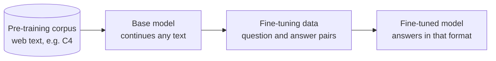
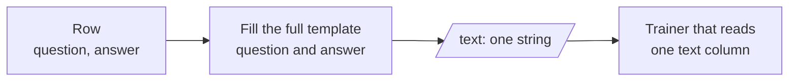
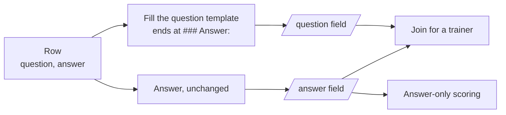

# M45.2 Theory: Where fine-tuning fits

*[M45 theory](../../../mandatory/theory/README.md) · Lesson 45.2 · Notebooks: [`02a_where_finetuning_fits_in_lab.ipynb`](../../notebook/02_where_finetuning_fits/02a_where_finetuning_fits_in_lab.ipynb) (optional), [`02b_where_finetuning_fits_in_lecture.ipynb`](../../notebook/02_where_finetuning_fits/02b_where_finetuning_fits_in_lecture.ipynb) (optional) · [All theory pages](../../../../../THEORY.md)*
<!-- subtitle: Pre-training and fine-tuning share one objective; the data decides what each stage teaches, and how you store it decides what you can score -->
<!-- format: approved -->

## Start with a plan to train on the handbook

> **What you'll learn**
>
> - **Explain** why pre-training and fine-tuning, which share one training objective, teach such different things.
> - **Compare** a web-scale pre-training corpus with a curated fine-tuning set by size, labels and who runs each stage.
> - **Choose** between the text-only and the question-and-answer storage formats for a training example.
> - **Spot** the characters a careless join drops between a stored question and its answer.

Lesson 45.1 showed a base model continuing *Tell me how to train my dog to sit* with more requests, and a chat model with the same architecture answering it. This page places those two models on one timeline. A Larkspur engineer who has read that comparison sometimes concludes the house style needs a model trained from scratch on the handbook. The comparison below shows why that is the wrong stage.

## Pre-training, then fine-tuning

**Both stages train the same way: show the model text and adjust the weights so it predicts each next token better.** What differs is the data each stage feeds in:

*Figure 1: One objective, two datasets. Pre-training produces the base model; fine-tuning reshapes it.*

The notebook prints both kinds side by side. It streams the first five rows of C4, a web-crawl corpus. Each row is a scraped page with three fields, `text`, `timestamp` and `url`, and the first one begins "Beginners BBQ Class Taking Place in Missoula!". Nothing in it says what a good answer looks like. The fine-tuning file, `lamini_docs.jsonl`, has 1,400 rows, each a `question` and an `answer` about one company's product. Pre-training gives the model language and general knowledge from a huge, unlabelled corpus. Fine-tuning shows it, in a small labelled one, what a good response looks like:

| | Pre-training | Fine-tuning |
|---|---|---|
| Data | Raw text, unlabelled, web scale | Curated pairs, labelled, hundreds to thousands of rows (1,400 here) |
| What the model learns | Language, facts, patterns of text | A format, a task, a tone, when to decline |
| Who runs it | Model labs, once per model | You, whenever the behaviour needs to change |

*Table 1: The two stages compared. Only the data and the operator differ; the objective is the same.*

The Larkspur house style is a format and a tone, which puts it in the right-hand column. A few hundred curated answers in that style, trained on top of an existing base model, do the job that a from-scratch run on the handbook could not. The handbook alone is far too small to teach language, and it contains policy text, not examples of good support answers.

> **Key distinction:** pre-training decides what the model knows how to say; fine-tuning decides which of those things it says when a request arrives.

Once the rows exist, the next decision is how to store them.

## Two ways to store an example

The notebook formats every `lamini_docs` row two ways with one `### Question:` / `### Answer:` template. Both forms are common, and each feeds a different later step.

### Text only

The whole example sits in one `text` field, headers included. Trainers that take a single text column, such as AutoTrain in lesson 45.7, expect this.

*Figure 2: Text only. One field per example, ready for a single-column trainer.*

### Question and answer

The prompt sits in one field, from `### Question:` up to `### Answer:`, and the answer in another. Keeping them apart lets you score only the answer at evaluation time, and mask the prompt out of the loss if you choose.

*Figure 3: Question and answer. Two fields per example; the answer can be scored alone.*

The notebook builds both lists in memory but writes only the question-and-answer list to disk, as `lamini_docs_processed.jsonl`: JSON Lines, one example per line, which the dataset loader in lesson 45.4 reads. Here is one Larkspur example in both forms:

Store the same Larkspur example both ways and compare the fields each form writes.

<button type="button" data-mode="text" aria-pressed="false" aria-controls="store-text">Text only</button><button type="button" data-mode="qa" aria-pressed="false" aria-controls="store-qa">Question and answer</button>

<section id="store-text" class="mode-panel"><h4>One text field</h4><dl><dt><code>text</code></dt><dd><code>### Question:</code>, then <em>Can I export my data after I cancel my plan?</em>, a blank line, <code>### Answer:</code>, a line break and the answer</dd><dt>Fits</dt><dd>A trainer that reads one text column</dd><dt>Cannot do</dt><dd>Score the answer on its own without parsing the string</dd></dl></section>
<section id="store-qa" class="mode-panel"><h4>Two fields</h4><dl><dt><code>question</code></dt><dd><code>### Question:</code>, the question, a blank line and <code>### Answer:</code>, ending at the colon</dd><dt><code>answer</code></dt><dd><em>Yes, for 30 days. After that the data is permanently deleted, so export it from Settings, then Data, first.</em></dd><dt>Fits</dt><dd>Answer-only scoring and prompt masking; join the two for a trainer</dd></dl></section>

The 30-day window comes from the Larkspur handbook's data export page.

### The join is part of the format

The two forms are not interchangeable by default. The text-only template puts a line break after `### Answer:`. The question template stops at the colon. Joining the two fields with plain string addition gives `### Answer:Yes, for 30 days…`, a different string from the text-only form. The notebook's first formatting cell goes further and joins the bare question and bare answer with no template at all. A model learns whichever characters its training rows contain, which is where lesson 45.3 starts.

Picking a form is a choice about the later steps:

| You need to | Store it as |
|---|---|
| Train with a tool that reads one text column | Text only |
| Score only the answer, or mask the prompt from the loss | Question and answer |
| Both | Question and answer, and join them for the trainer with the same separator the template uses |

*Table 2: Which storage form each later step needs.*

The third row is the common case. Keeping the fields apart costs nothing, and the join is one line in the data script, as long as that line writes the same separator every time.

The notebook ends by loading `lamini/lamini_docs` from the Hugging Face Hub: the same 1,400 rows, already split 1,260 and 140 and already tokenized.

## Limits of this evidence

- The notebook's C4 cell calls `load_dataset("c4", "en")`. With the course's `datasets` 5.0.1 that name fails ("Dataset scripts are no longer supported"); the C4 row above was streamed from `allenai/c4`, the dataset's current name on the Hub.
- The join mismatch was found by formatting the first `lamini_docs` row with the notebook's two templates and comparing the strings. Its effect on a trained model is not measured here.
- The Larkspur row is illustrative; the notebook's rows are about Lamini's product.

## References

- Raffel et al. (2019), [Exploring the Limits of Transfer Learning with a Unified Text-to-Text Transformer](https://arxiv.org/abs/1910.10683): the paper that introduced C4.
- [allenai/c4](https://huggingface.co/datasets/allenai/c4) and [lamini/lamini_docs](https://huggingface.co/datasets/lamini/lamini_docs) on the Hugging Face Hub.
- [JSON Lines](https://jsonlines.org/): one JSON value per line.

## Key Takeaways

- Pre-training and fine-tuning use the same next-token objective. Only the data differs: web-scale raw text for language and knowledge, a few hundred to a few thousand labelled pairs for a format, task or tone.
- Model labs pre-train once per model. You fine-tune whenever the behaviour needs to change.
- Store examples as JSON Lines, either as one `text` field for trainers that read a single text column or as separate prompt and answer fields so you can score only the answer. A join has to write the template's own separator.

## Check yourself

1. Pre-training and fine-tuning both train the model to predict each next token. What makes their results differ?

The data. Pre-training uses a huge, unlabelled corpus of raw web text such as C4, and gives the model language, facts and patterns of text. Fine-tuning uses a small, curated, labelled set (1,400 question and answer rows in `lamini_docs.jsonl`) and teaches a format, a task, a tone and when to decline.

2. You will train the Larkspur examples with AutoTrain, and at evaluation time you want to score only the answer. Which form does each step need?

AutoTrain reads a single text column, so training needs the text-only form: one `text` field with `### Question:` and `### Answer:` inside it. Scoring only the answer needs the question-and-answer form, with the prompt and the answer in separate fields. Store the second form and join the fields for the trainer.

3. A data script joins the stored question field and answer field with plain string addition. How does the result differ from the text-only form?

The question field ends at the colon of `### Answer:`, while the text-only template puts a line break there. Plain addition gives `### Answer:Yes, for 30 days…`, a different string. The join has to write the template's own separator, or the training text no longer matches the format you meant to teach.

---
*Previous: [45.1 Why fine-tune](../../../mandatory/theory/01_why_fine_tune/README.md). Next: [45.3 Instruction tuning](../../../mandatory/theory/03_instruction_tuning/README.md).*
