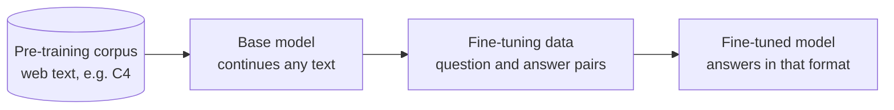

# M45.2 Theory: Where fine-tuning fits

*[M45 theory](../../../mandatory/theory/README.md) · Lesson 45.2 · Notebooks: [`02a_where_finetuning_fits_in_lab.ipynb`](../../notebook/02_where_finetuning_fits/02a_where_finetuning_fits_in_lab.ipynb) (optional), [`02b_where_finetuning_fits_in_lecture.ipynb`](../../notebook/02_where_finetuning_fits/02b_where_finetuning_fits_in_lecture.ipynb) (optional) · [All theory pages](../../../../../THEORY.md)*
<!-- subtitle: Pre-training and fine-tuning share one objective; the data decides what each stage teaches, and how you store it decides what you can score -->

## Pre-training, then fine-tuning

> **What you'll learn**
>
> - **Explain** why pre-training and fine-tuning, which share one training objective, teach such different things.
> - **Compare** a web-scale pre-training corpus with a curated fine-tuning set by size, labels and who runs each stage.
> - **Choose** between the text-only and the question-and-answer storage formats for a training example.

Lesson 45.1 showed a base model continuing *Tell me how to train my dog to sit* with more questions, and a chat model with the same architecture answering it. This page places those two models on one timeline. A Larkspur engineer who has read that comparison sometimes concludes the house style needs a model trained from scratch on the handbook. The comparison below shows why that is the wrong stage.

**Both stages train the same way: show the model text and adjust the weights so it predicts each next token better.** What differs is the data each stage feeds in:

*Figure 1: One objective, two datasets. Pre-training produces the base model; fine-tuning reshapes it.*

The notebook prints both kinds side by side. The first rows it streams from C4, a web-crawl corpus, are scraped pages: whatever text was on the page, in whatever order. The fine-tuning file, `lamini_docs.jsonl`, has 1,400 rows, each a `question` and an `answer` about one company's product. Pre-training gives the model language and general knowledge from a huge, unlabelled corpus. Fine-tuning shows it, in a small labelled one, what a good response looks like:

| | Pre-training | Fine-tuning |
|---|---|---|
| Data | Raw text, unlabelled, web scale | Curated pairs, labelled, hundreds to thousands of rows (1,400 here) |
| What the model learns | Language, facts, patterns of text | A format, a task, a tone, when to decline |
| Who runs it | Model labs, once per model | You, whenever the behaviour needs to change |

*Table 1: The two stages compared. Only the data and the operator differ; the objective is the same.*

The Larkspur house style is a format and a tone, which puts it in the right-hand column. A few hundred curated answers in that style, trained on top of an existing base model, do the job that a from-scratch run on the handbook could not: the handbook alone is far too small to teach language, and it contains policy text, not examples of good support answers.

> **Key distinction:** pre-training decides what the model knows how to say; fine-tuning decides which of those things it says when a request arrives.

Once the rows exist, the next decision is how to store them.

## Two ways to store an example

The notebook formats the same `lamini_docs` rows two ways, and both are common:

- **Text only**: one `text` field holding the whole example, `### Question:` and `### Answer:` included. Trainers that take a single text column, such as AutoTrain in lesson 45.7, expect this.
- **Question and answer**: the prompt in one field (`### Question:` up to `### Answer:`) and the answer in another. Keeping them apart lets you score only the answer at evaluation time, and mask the prompt out of the loss if you choose.

Both are written to JSON Lines, one example per line, which the dataset loader in lesson 45.4 reads. Here is one Larkspur example in the second form, field by field:

| Field | Value | What it decides |
|---|---|---|
| `question` | `### Question:` + *Can I export my data after I cancel my plan?* + `### Answer:` | The prompt the model sees, template headers included |
| `answer` | *Yes, for 30 days. After that the data is permanently deleted, so export it from Settings, then Data, first.* | The tokens the loss rewards, and the only part an answer-only metric scores |

*Table 2: A Larkspur example in the question-and-answer form (the 30-day window comes from the Larkspur handbook's data export page).*

In the text-only form the same example is a single `text` value: the question field and the answer field joined. That join is where the next lesson starts, because the exact characters between them, and after the answer, are what the model learns to reproduce.

Picking a form is a choice about the later steps:

| You need to | Store it as |
|---|---|
| Train with a tool that reads one text column | Text only |
| Score only the answer, or mask the prompt from the loss | Question and answer |
| Both | Question and answer, and join them for the trainer |

*Table 3: Which storage form each later step needs.*

The third row is the common case. Keeping the fields apart costs nothing, and a join is one line in the data script.

## Key Takeaways

- Pre-training and fine-tuning use the same next-token objective. Only the data differs: web-scale raw text for language and knowledge, a few hundred to a few thousand labelled pairs for a format, task or tone.
- Model labs pre-train once per model. You fine-tune whenever the behaviour needs to change.
- Store examples as JSON Lines, either as one `text` field for trainers that read a single text column or as separate prompt and answer fields so you can score only the answer.

## Check yourself

1. Pre-training and fine-tuning both train the model to predict each next token. What makes their results differ?

The data. Pre-training uses a huge, unlabelled corpus of raw web text such as C4, and gives the model language, facts and patterns of text. Fine-tuning uses a small, curated, labelled set (1,400 question and answer rows in `lamini_docs.jsonl`) and teaches a format, a task, a tone and when to decline.

2. You will train the Larkspur examples with AutoTrain, and at evaluation time you want to score only the answer. Which of the two formats does each step need?

AutoTrain reads a single text column, so training needs the text-only form: one `text` field with `### Question:` and `### Answer:` inside it. Scoring only the answer needs the question-and-answer form, with the prompt and the answer in separate fields. Store the second form and join the fields for the trainer.

3. A teammate proposes pre-training a model on the Larkspur handbook to teach it the house style. Why does the comparison point to fine-tuning instead?

Pre-training needs web-scale raw text and is run by model labs once per model; it teaches language and general knowledge, which the handbook is far too small to teach. Fine-tuning needs hundreds to thousands of curated pairs, you run it whenever the behaviour needs to change, and a tone or format is what it teaches.

---
*Previous: [45.1 Why fine-tune](../../../mandatory/theory/01_why_fine_tune/README.md). Next: [45.3 Instruction tuning](../../../mandatory/theory/03_instruction_tuning/README.md).*
