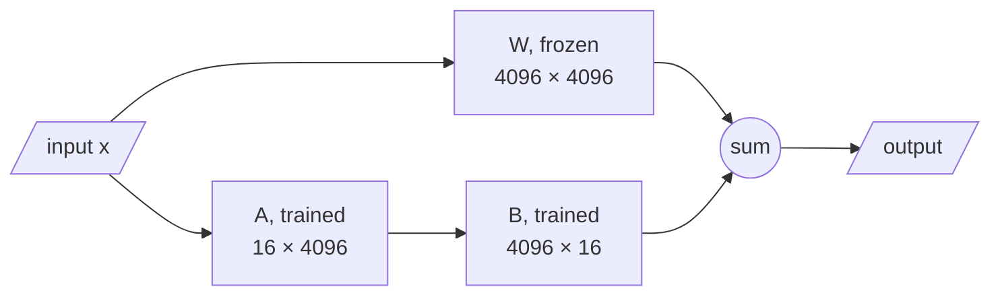

# M45.7 Theory: Fine-tuning Llama 2 with AutoTrain

*[M45 theory](../../../mandatory/theory/README.md) · Lesson 45.7 · Notebooks: [`07a_3_ways_fine_tuning_llama_2_with_autotrain.ipynb`](../../notebook/07_llama2_autotrain/07a_3_ways_fine_tuning_llama_2_with_autotrain.ipynb) (optional) · [All theory pages](../../../../../THEORY.md)*
<!-- subtitle: LoRA and 4-bit loading bring a 7-billion-parameter fine-tune onto one GPU, and the notebook's AutoTrain command needs new flag names and a sane learning rate -->

## LoRA and 4-bit loading

> **What you'll learn**
>
> - **Explain** how LoRA trains a small low-rank update beside each frozen weight matrix.
> - **Calculate** LoRA's trainable parameters for one layer and for a whole Llama 2 7B model.
> - **Explain** what 4-bit loading stores, and why LoRA plus 4-bit loading (QLoRA) fits one GPU.
> - **Diagnose** the notebook's AutoTrain command: outdated flags and a learning rate far too high.

Lessons 45.3 to 45.6 update every weight of a 70-million-parameter model. The Larkspur team now wants the same house style on a model large enough to serve customers, with one 24 GB GPU. Llama 2 7B has 6,738,415,616 parameters: 13.5 GB in 16-bit floats before any gradients or optimizer state, so a full fine-tune does not fit. The notebook fine-tunes it with two settings that change what is stored and what is trained: parameter-efficient fine-tuning and 4-bit loading.

**LoRA (low-rank adaptation, the PEFT method used here) freezes every original weight matrix `W` and trains two small matrices beside it, `A` and `B`, whose product is added to the layer's output.** With rank `r`, a layer of shape `d_out × d_in` gains `r × (d_in + d_out)` trainable parameters:

*Figure 1: A LoRA layer. The input goes through the frozen weight and through the trained low-rank pair, and the two results are summed.*

The intuition: the change fine-tuning makes to a layer is assumed to need far fewer dimensions than the layer itself. Rank 16 says "the update can be described by 16 directions", and the two thin matrices hold exactly that much.

For the attention query projection of Llama 2 7B at rank 16, the arithmetic is small enough to do by hand:

| Quantity | Value |
|---|---|
| Frozen weights, 4,096 × 4,096 | 16,777,216 |
| Trained, 16 × (4,096 + 4,096) | 131,072 |
| Trained as a share of the layer | 0.78% |

*Table 1: LoRA at rank 16 on one 4,096 by 4,096 projection.*

Across the model, with the settings AutoTrain uses by default (rank 16, every linear layer):

| Setup | Trainable parameters | Share of the model |
|---|---|---|
| Full fine-tuning | 6,738,415,616 | 100% |
| LoRA, rank 16, every linear layer | 39,976,960 | 0.59% |
| LoRA, rank 16, query and value projections only | 8,388,608 | 0.12% |

*Table 2: Trainable parameters for Llama 2 7B. The LoRA rows are `r × (d_in + d_out)` summed over the targeted layers of the 32-layer model; `peft` 0.20 gives the same counts on a weightless copy of the model.*

**4-bit loading** stores the frozen weights in 4 bits instead of 16, about 3.4 GB for 6.74 billion weights before quantization overhead, while the LoRA matrices train in higher precision. LoRA on top of 4-bit weights is **QLoRA**, one of the "3 ways" the notebook's title refers to:

| | Full fine-tune, 16-bit | QLoRA, rank 16 |
|---|---|---|
| Base weights in memory | 13.5 GB, all trained | about 3.4 GB, frozen |
| Parameters with gradients and optimizer state | 6,738,415,616 | 39,976,960 |
| Saved artifact | A full 13.5 GB model | An adapter of about 80 MB in 16-bit floats |

*Table 3: Full fine-tuning against QLoRA for Llama 2 7B. Gradients and optimizer state exist only for the trained parameters, which is what brings the fine-tune within reach of one GPU.*

The adapter is saved on its own. You can merge it into the base model for serving, or keep one base model and load a different adapter per task, for instance a Larkspur support adapter and a separate one for an internal tool.

> **Pitfall: the oversized learning rate.** LoRA trains few parameters, but they still need a small step size; AutoTrain's default is 3e-5. The notebook's command sets a value thousands of times larger, which is its second problem.

## The AutoTrain command today

The notebook's first cell is one AutoTrain call. It fine-tunes a sharded 16-bit copy of Llama 2 7B on `timdettmers/openassistant-guanaco`, a dataset whose `text` column holds each whole conversation (the text-only form from lesson 45.2), with supervised fine-tuning, and pushes the result to the Hugging Face Hub. Its settings, flag by flag:

| Setting | The notebook's flag and value | Name in `autotrain-advanced` 0.8.36 |
|---|---|---|
| Train LoRA adapters | `--use_peft` | `--peft` |
| 4-bit base weights | `--use_int4` | `--quantization int4` (the default) |
| Learning rate | `--learning_rate 0.4` | `--lr` (default 3e-5) |
| Batch size | `--train_batch_size 3` | `--batch-size` |
| Epochs | `--num_train_epochs 2` | `--epochs` |
| Text column | `--text_column text` | unchanged |
| Context length | `--model_max_length 1048`, `--block_size 1048` | unchanged (underscore and hyphen forms both accepted) |
| Hub destination | `--push_to_hub --repo_id …` | `--push-to-hub` with `--username` |

*Table 4: The notebook's AutoTrain flags against the parameter names of `autotrain-advanced` 0.8.36, checked in that release's source.*

Two problems follow from the table:

- **Flag drift.** In 0.8.36 the command-line arguments are generated from its parameter model, and the CLI parses them strictly. The old names `--use_peft`, `--use_int4`, `--learning_rate`, `--train_batch_size`, `--num_train_epochs` and `--repo_id` stop it with an error before training starts.
- **A runaway learning rate.** `0.4` is more than 13,000 times AutoTrain's default of `3e-5`, and 40,000 times lesson 45.5's `1e-5`. Keep the default unless a measured run says otherwise.

AutoTrain's other defaults are worth reading too:

| Default in 0.8.36 | Value | Why it matters here |
|---|---|---|
| Gradient accumulation | 4 steps | The same accumulation as lesson 45.5 |
| Warmup | 10% of the run | Warmup as a fraction, the rule lesson 45.5 recommends |
| `model_max_length` | 2,048 tokens | The cap lesson 45.4 measured against |
| Append end token | On | The step lessons 45.4 and 45.6 show the M45 data missing |

*Table 5: AutoTrain defaults that line up with earlier lessons.*

The last row is the one to notice. AutoTrain's default trainer appends the end token to each training text, which is the guard against the runaway answer from lesson 45.6.

The notebook's other two cells sketch the other two of the "3 ways": one through a hosted model runner and one through `trl`'s `SFTTrainer`. Both use names the notebook never defines (the base model, the PEFT configuration and the training arguments, among others), and they do not run as written. Read them as outlines of the same pipeline: a base model, LoRA settings, training arguments and a text column.

## Key Takeaways

- LoRA freezes the original weights and trains small low-rank matrices beside them, adding `r × (d_in + d_out)` parameters per layer. At rank 16 on every linear layer of Llama 2 7B, 0.59% of the model trains.
- 4-bit loading cuts the frozen weights from 13.5 GB to about 3.4 GB. Combined with LoRA it is QLoRA, and the saved adapter is about 80 MB.
- Check CLI flag names against the installed AutoTrain version, and keep its default learning rate of `3e-5` unless a measured run says otherwise.

## Check yourself

1. Why does LoRA with 4-bit loading bring a 7B fine-tune within reach of one GPU?

LoRA freezes every original weight matrix and trains small `A` and `B` matrices beside it, so at rank 16 on every linear layer only 39,976,960 parameters (0.59%) train, and gradients and optimizer state exist only for those. 4-bit loading stores the frozen weights in about 3.4 GB instead of 13.5 GB in 16-bit floats. Together this is QLoRA.

2. How many trainable parameters does rank-16 LoRA add to a 4096 by 4096 query projection, and what share of the layer is that?

`r × (d_in + d_out)` = 16 × (4,096 + 4,096) = 131,072 trainable parameters, beside 16,777,216 frozen ones: 0.78%.

3. You run the notebook's AutoTrain command on autotrain-advanced 0.8.36 and it stops with an error. Why, and what else would you change?

Flag drift: its flag names are from an older AutoTrain, and the CLI parses arguments strictly. Use `--peft`, `--quantization int4`, `--lr`, `--batch-size`, `--epochs`, and `--username` with `--push-to-hub`. Also drop the learning rate of `0.4`, which is more than 13,000 times the default `3e-5`; keep the default unless a measured run says otherwise.

---
*Previous: [45.6 Evaluation](../../../mandatory/theory/06_evaluation/README.md). Next: [M45 interview questions](../../../mandatory/theory/README.md#interview-spotlight-5-questions-you-might-get-asked).*
