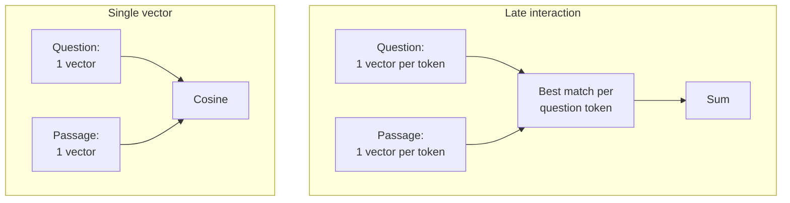
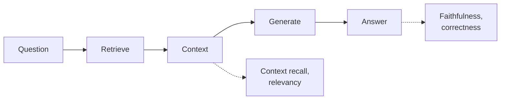

# M46.2 Theory: End-to-end RAG ecosystem walkthrough (incl. ColBERT and RAGAS)

*[M46 theory](../README.md) · Lesson 46.2 · Notebooks: [`02a_rag_ecosystem.ipynb`](../../notebook/02a_rag_ecosystem.ipynb) · [All theory pages](../../../../../THEORY.md)*
<!-- subtitle: The whole RAG stack in one notebook, one retrieval upgrade that adds no model calls, and the stage metrics that say which part failed -->
<!-- format: approved -->

## Start with a wrong answer nobody can place

> **What you'll learn**
>
> - **Place** each part of the ecosystem notebook on the course map, and see which parts it teaches and which it only points to.
> - **Explain** late interaction: one vector per token, scored with MaxSim, between a bi-encoder and a cross-encoder.
> - **Compute** what ColBERT stores per passage against one dense vector.
> - **Diagnose** a wrong answer with stage metrics: retrieval, generation or the whole pipeline.

Lesson 46.1 put every architecture on one map and priced it in model calls. This lesson walks the stack those architectures share and adds the two pieces a design review still needs: one more retrieval option and a way to score a whole pipeline.

Start with the failure that makes evaluation necessary. Larkspur's assistant gives a wrong answer to *What happens if my server goes down?*, and a reviewer marks it wrong. That verdict alone cannot say whether retrieval missed the outage chunks or the model misread good ones, and the fix differs for each.

## The stack in one notebook

The lesson's notebook walks the whole RAG stack in one place. Its recap note says what is new: the early parts are a refresher of earlier modules, the parts it owns are RAPTOR, ColBERT and agentic self-correction, and the evaluation sections are pointers. Of those three, only ColBERT runs as code; RAPTOR and self-correction are described and linked out. Its parts map onto the course like this:

| Notebook part | What it builds | Taught in depth |
|---|---|---|
| Basic RAG | load, split, embed, retrieve, generate | [M10](../../../../../p04_rag_foundations/m10_rag_lifecycle/mandatory/theory/README.md) |
| Query transformations | multi-query, RAG-Fusion, decomposition, step-back, HyDE | [M17](../../../../../p05_retrieval_quality_and_rag_apps/m17_query_transformation/mandatory/theory/README.md) |
| Routing and query construction | logical and semantic routing, a metadata filter written from the question | [M17](../../../../../p05_retrieval_quality_and_rag_apps/m17_query_transformation/mandatory/theory/README.md), [M30](../../../../../p08_agentic_rag/m30_adaptive_rag_routing/mandatory/theory/README.md) |
| Indexing | multi-representation indexing, RAPTOR (described), ColBERT | [M15](../../../../../p04_rag_foundations/m15_advanced_indexing/mandatory/theory/README.md), [M42](../../../../../p12_knowledge_graphs_and_graph_rag/m42_hierarchical_memory_rag/mandatory/theory/README.md), below |
| Retrieval and generation | Cohere reranking, CRAG and Self-RAG (described), long context | [M18](../../../../../p05_retrieval_quality_and_rag_apps/m18_reranking_post_retrieval/mandatory/theory/README.md), [M29](../../../../../p08_agentic_rag/m29_crag_and_self_rag/mandatory/theory/README.md) |
| Evaluation | judges written from scratch, deepeval, grouse, RAGAS | below |

*Table 1: The notebook's six parts and the modules that teach each one in depth.*

The notebook ships without outputs. Sentences such as "The output is remarkable" after the rerank cell, or "`faithfulness` and `context_recall` are perfect" after the RAGAS cell, describe a run that is not saved with it. We call these **unsaved verdicts**: claims about results nobody can see. Treat them as expectations to check on your own run.

Its long-context section argues for the hybrid the earlier modules reach as well: retrieval picks the few passages that matter, and a long-context model reads them. M10's interview questions cover when sending the whole corpus instead is right and when it breaks.

Of the parts the notebook owns, ColBERT is the one that changes retrieval without adding a model call.

## Late interaction (ColBERT)

**Late interaction scores a question against a passage token by token, after both have been encoded separately.** A single-vector retriever (M13) turns a passage into one embedding and the question into another, and scores the pair with cosine similarity. The notebook calls this a "bag-of-words" approach, but the embedding model reads the tokens in context and pools them, so word order and phrasing count. What a single vector loses is which part of the passage matched. A 180-token passage that mentions the answer once is one point in space, pulled toward everything else it says. Call that the **one-point blur**.

ColBERT (Khattab and Zaharia, SIGIR 2020) keeps a contextual vector for every token of the passage and every token of the question. The score is MaxSim: for each question token, take its highest similarity with any passage token, then sum over the question tokens. The two scoring paths side by side:

*Figure 1: Late interaction keeps every token vector and sums each question token's best match; a single-vector retriever compares one pooled vector per side.*

A small trace shows MaxSim at work on the outage question against two handbook passages. The similarities are made up to show the arithmetic:

| Question token | Best match in `incidents` | Similarity | Best match in `sizing` | Similarity |
|---|---|---|---|---|
| server | server | 0.92 | server | 0.90 |
| goes | outage | 0.48 | scale | 0.30 |
| down | outage | 0.81 | reduce | 0.42 |
| **MaxSim score** | | **2.21** | | **1.62** |

*Table 2: MaxSim on two passages (illustrative). Both match "server"; the outage passage wins on the tokens that carry the question's meaning.*

Each question token finds its own best partner, so "down" can match "outage" even when the rest of the passage is about something else. A pooled vector would have averaged that match away.

The name places ColBERT between the two retrieval models the course already uses. Choose one to see where it spends its work:

Choose a retrieval model to see what it computes at index time and at query time.

<button type="button" data-mode="bi" aria-pressed="false" aria-controls="retriever-bi">Bi-encoder</button>
<button type="button" data-mode="late" aria-pressed="false" aria-controls="retriever-late">Late interaction</button>
<button type="button" data-mode="cross" aria-pressed="false" aria-controls="retriever-cross">Cross-encoder</button>

<section id="retriever-bi" class="mode-panel" data-announcement="Bi-encoder selected. One vector per passage."><h4>Bi-encoder (dense, M13)</h4><ul><li>Index time: one vector per passage.</li><li>Query time: one vector for the question, one cosine per passage.</li><li>Loses which part of the passage matched.</li></ul></section>
<section id="retriever-late" class="mode-panel" data-announcement="Late interaction selected. One vector per passage token."><h4>Late interaction (ColBERT)</h4><ul><li>Index time: one vector per passage token.</li><li>Query time: one vector per question token, then a maximum and a sum.</li><li>Keeps which token matched, at a storage cost.</li></ul></section>
<section id="retriever-cross" class="mode-panel" data-announcement="Cross-encoder selected. Nothing at index time."><h4>Cross-encoder reranker (M18)</h4><ul><li>Index time: nothing.</li><li>Query time: the model reads every question and passage pair together.</li><li>Too slow for a whole index; used to rerank a short candidate list.</li></ul></section>

[M20](../../../../../p05_retrieval_quality_and_rag_apps/m20_multimodal_rag/optional/theory/03_page_image_retrieval_with_colpali/README.md#late-interaction) uses the same scoring on page images, where every image patch gets a vector.

The notebook runs ColBERT on a Wikipedia page about Hayao Miyazaki, fetched at run time. It loads the pretrained ColBERTv2 model, splits the page into passages of up to 180 tokens and indexes every token, then asks *What animation studio did Miyazaki found?* for the top three passages. It finally wraps the index as a LangChain retriever, which shows the point for architecture: the rest of a chain does not change when the retriever does.

The cost moves into storage. ColBERTv2 stores 128 dimensions per token vector (Santhanam et al., NAACL 2022). The arithmetic for one passage:

| Representation | Vectors per passage | Dimensions | Numbers stored |
|---|---|---|---|
| One `text-embedding-3-small` vector | 1 | 1,536 | 1,536 |
| ColBERTv2, 180-token passage | up to 180 | 128 | up to 23,040 |

*Table 3: Storage per passage before compression. 23,040 is 15 times 1,536.*

ColBERTv2 shrinks each vector to a centroid id plus a residual of 1 or 2 bits per dimension. Pages in M20 are larger still: ColSmol stores 1,139 vectors of 128 dimensions per page.

On the architecture map, late interaction is an entry-level change. It replaces the retriever and keeps one retrieval and one model call per question. Weigh it against the other retrieval upgrades on the same golden set: BM25 in a hybrid ([M16](../../../../../p05_retrieval_quality_and_rag_apps/m16_retrievers_hybrid_search/mandatory/theory/README.md)) already catches exact codes, where dense retrieval ranked the E-4021 chunk 5th, and a cross-encoder reranks a wide candidate list at a measured latency.

Choosing among those upgrades takes a score for each, which is where evaluation comes in.

## End-to-end evaluation

**End-to-end evaluation scores the whole pipeline on a fixed question set, with a metric for each stage as well as for the final answer.** The notebook names three properties of a good RAG answer:

- **Faithfulness**: the answer can be derived from the retrieved context.
- **Correctness**: the answer matches a reference answer.
- **Contextual relevancy**: the retrieved context fits the question.

Each one judges a different stage, which is what makes them useful for choosing an architecture. An end-to-end score says the outage answer is wrong; a stage score says whether retrieval or generation made it wrong:

*Figure 2: Retrieval metrics read the context; generation and end-to-end metrics read the answer. Faithfulness compares the answer with the context, correctness with a reference.*

The notebook measures these properties three ways:

- **Judges written from scratch.** A strong chat model, asked for structured output, returns a score from 0 to 1. The correctness prompt compares the answer with a reference; the faithfulness prompt asks whether the answer can be deduced from the context, with few-shot examples.
- **deepeval.** A correctness judge and a faithfulness metric run over two test cases. A contextual relevancy metric is imported and never used. grouse cannot share this environment and needs a separate one; the setup guide its cell's comment mentions is [the original repository's setup notes](../../../../../docs/source/09/setup.md).
- **RAGAS.** Three questions, each with a generated answer, the retrieved contexts and a reference answer, are scored on four metrics. With the locked `ragas` 0.4.3 and `langchain-community` 0.4.2 the cell cannot start: `import ragas` raises `ModuleNotFoundError: No module named 'langchain_community.chat_models.vertexai'`.

The from-scratch faithfulness judge plants a useful edge case. The answer "6" to *what is 3+3?*, with the context "6", is unfaithful under its rule, because the context states the number but not the sum. That is stricter than "the context does not contradict it". Two tools can both report "faithfulness" and mean different tests, a failure we call **definition drift**. Write down which definition each score uses before comparing two architectures on it.

| Metric | Stage it judges | Needs a reference answer |
|---|---|---|
| `context_recall` (RAGAS) | retrieval | yes |
| `ContextualRelevancyMetric` (deepeval) | retrieval | no |
| `faithfulness` (RAGAS, deepeval, from scratch) | generation, against the retrieved context | no |
| `answer_relevancy` (RAGAS) | the answer, against the question | no |
| `answer_correctness` (RAGAS), GEval correctness | the whole pipeline | yes |

*Table 4: Each metric, the stage it reads and whether it needs a labelled reference.*

For an architecture decision, run every candidate over the same golden set and record one row each: the stage metrics, model calls and retrievals per question, and latency. Retrieval metrics such as recall@k need no judge; the M10 baseline row is computed from the golden set's labelled evidence chunks. The judged metrics cost model calls at evaluation time, one or more per metric per question. That is a reason to keep the golden set fixed and small enough to run on every change.

Report per question as well as the mean. A mean over a few questions can hide one question that changed completely, a failure we call the **blurred mean**.

## In practice: the outage answer

Back to the wrong outage answer. The M46 lab records what each retriever returned for it, and those counts are enough to locate the fault:

Locate the fault in the wrong outage answer one stage at a time. Rankings and recall are the M46 lab's recorded counts.

<button type="button" data-step="0" aria-pressed="false" aria-controls="diagnosis-step-0">1. End to end</button><button type="button" data-step="1" aria-pressed="false" aria-controls="diagnosis-step-1">2. Retrieval</button><button type="button" data-step="2" aria-pressed="false" aria-controls="diagnosis-step-2">3. Generation</button><button type="button" data-step="3" aria-pressed="false" aria-controls="diagnosis-step-3">4. Fix the stage</button><button type="button" data-step="4" aria-pressed="false" aria-controls="diagnosis-step-4">5. Re-run the set</button>

<section id="diagnosis-step-0" class="step-panel" aria-labelledby="diagnosis-heading-0"><h4 id="diagnosis-heading-0">1. End-to-end verdict</h4><dl><dt>Result</dt><dd>The answer is wrong</dd><dt>What it tells you</dt><dd>Nothing yet about where</dd></dl></section><section id="diagnosis-step-1" class="step-panel" aria-labelledby="diagnosis-heading-1"><h4 id="diagnosis-heading-1">2. Retrieval metric</h4><dl><dt>TF-IDF top 2</dt><dd><code>reboot</code> and <code>sizing</code></dd><dt>Recall</dt><dd>0.00: neither evidence chunk reached the model</dd><dt>Why</dt><dd>The handbook says "outage", the question says "goes down"</dd></dl></section><section id="diagnosis-step-2" class="step-panel" aria-labelledby="diagnosis-heading-2"><h4 id="diagnosis-heading-2">3. Generation metric</h4><dl><dt>Faithfulness</dt><dd>Beside the point here</dd><dt>Why</dt><dd>A faithful answer to the wrong chunks is still wrong</dd></dl></section><section id="diagnosis-step-3" class="step-panel" aria-labelledby="diagnosis-heading-3"><h4 id="diagnosis-heading-3">4. Fix the failing stage</h4><dl><dt>Change</dt><dd>Dense retrieval</dd><dt>Top 2</dt><dd><code>incidents</code> and <code>sla</code>, recall 1.00</dd><dt>Cost</dt><dd>The same single retrieval and single model call</dd></dl></section><section id="diagnosis-step-4" class="step-panel" aria-labelledby="diagnosis-heading-4"><h4 id="diagnosis-heading-4">5. Re-run the whole golden set</h4><dl><dt>Export question</dt><dd>Dense recall falls to 0.50 at k = 2: <code>cancel</code> outranks <code>export</code></dd><dt>Lesson</dt><dd>Only per-question rows show the swap helped one question and hurt another</dd></dl></section>

<button type="button" data-walk="previous">Previous</button>

<button type="button" data-walk="next">Next step</button>

> **Interview tip:** when asked how you would evaluate a RAG change, name a retrieval metric, a generation metric and an end-to-end metric, and say you report them per question on a fixed golden set.

Lesson 46.3 uses exactly this pattern, failing stage first, to choose between architectures.

## Limits of this evidence

- **No saved outputs.** Every result the notebook describes is an unsaved verdict until you run it.
- **Not on Larkspur.** The ColBERT cells use a Wikipedia page and the RAGAS cells three questions about a novel. Neither measures retrieval on the handbook.
- **RAGAS does not import** in the course environment as locked, and grouse needs its own environment.
- **Table 2 is illustrative.** Its similarities are made up; only the MaxSim arithmetic is real.

## References

- Khattab and Zaharia, [ColBERT: Efficient and Effective Passage Search via Contextualized Late Interaction over BERT](https://arxiv.org/abs/2004.12832), SIGIR 2020.
- Santhanam et al., [ColBERTv2: Effective and Efficient Retrieval via Lightweight Late Interaction](https://arxiv.org/abs/2112.01488), NAACL 2022.
- Es et al., [Ragas: Automated Evaluation of Retrieval Augmented Generation](https://arxiv.org/abs/2309.15217), 2023, and the [RAGAS metrics list](https://docs.ragas.io/en/stable/concepts/metrics/available_metrics/).
- deepeval documentation: [Faithfulness](https://deepeval.com/docs/metrics-faithfulness) and [Contextual Relevancy](https://deepeval.com/docs/metrics-contextual-relevancy).
- [RAGatouille](https://github.com/AnswerDotAI/RAGatouille), the library the notebook uses to load ColBERTv2.

## Key Takeaways

- ColBERT keeps a vector per token and scores with MaxSim, which tells it which part of a passage matched. It still costs one retrieval and one model call, but stores about 15 times more numbers before compression.
- Use stage metrics to locate a failure: context recall and relevancy judge retrieval, faithfulness judges generation, and correctness judges the whole pipeline.
- Run every candidate on the same fixed golden set, report per question as well as the mean, and write down which faithfulness definition a judge uses.

## Check yourself

1. What does a single-vector retriever lose that ColBERT's late interaction keeps?

Which part of the passage matched. A 180-token passage that mentions the answer once becomes one point, pulled toward everything else it says. ColBERT keeps a contextual vector for every token and scores with MaxSim: for each question token, its best similarity with any passage token, summed over the question tokens.

2. How many numbers does ColBERTv2 store for a 180-token passage before compression, against one text-embedding-3-small vector?

180 × 128 = 23,040 numbers, against 1,536: 15 times as many. ColBERTv2 then shrinks each token vector to a centroid id plus a residual of 1 or 2 bits per dimension.

3. An end-to-end correctness score says the outage answer is wrong. Which metrics tell you whether retrieval or generation caused it?

The stage metrics. Context recall (it needs a reference answer) and contextual relevancy judge retrieval; recall@k needs no judge at all, only the labelled evidence chunks. Faithfulness judges generation against the retrieved context. With TF-IDF the outage recall is 0.00, which puts the fault in retrieval.

---
*Previous: [46.1 The agentic RAG architecture map](../01_the_agentic_rag_architecture_map/README.md). Next: [46.3 Decision framework: picking the simplest architecture that works](../03_decision_framework_picking_the_simplest_architecture_that_works/README.md).*
