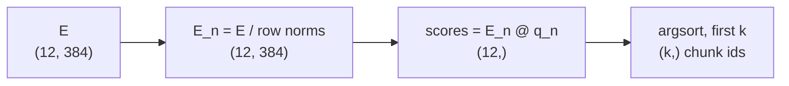
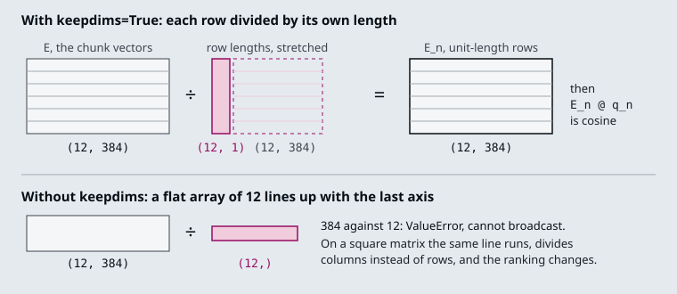

# M01.3 Theory: NumPy, pandas and Matplotlib

*[M01 theory](../README.md) · Lesson 1.3 · Notebooks: [`03a_numpy_basics.ipynb`](../../../../course/p01_ai_engineering_foundations/m01_python_data_refresher/notebooks/03a_numpy_basics.ipynb), [`03b_pandas_basics_for_data_analysis.ipynb`](../../../../course/p01_ai_engineering_foundations/m01_python_data_refresher/notebooks/03b_pandas_basics_for_data_analysis.ipynb), [`03c_matplotlib_basics.ipynb`](../../../../course/p01_ai_engineering_foundations/m01_python_data_refresher/optional/03c_matplotlib_basics.ipynb) (optional) · [All theory pages](../../../README.md)*

## NumPy arrays

A NumPy array holds numbers of one dtype in a fixed shape, so arithmetic runs on the whole array in compiled code instead of a Python loop. The notebook covers creation (`np.array`, `np.zeros`, `np.arange`, `np.linspace`), indexing and boolean masks, `reshape` and `.T`, ufuncs, aggregation along an `axis`, broadcasting, `@` for matrix products and `np.linalg`. Retrieval code uses a handful of these on one object: the embedding matrix.

An index of the twelve Larkspur handbook chunks, embedded with a 384-dimension model, is an array `E` of shape `(12, 384)`: one row per chunk, one column per dimension. A question embeds to a vector `q` of shape `(384,)`. Cosine similarity is the dot product of unit-length vectors, so retrieval is three lines:



With three chunks and three dimensions you can check every number by hand:

```python
E = np.array([[0.9, 0.1, 0.0],    # refund-window
              [0.7, 0.3, 0.1],    # refund-timing
              [0.0, 0.2, 0.9]])   # sla
q = np.array([0.8, 0.2, 0.1])     # "How long does a refund take?"

E_n = E / np.linalg.norm(E, axis=1, keepdims=True)
scores = E_n @ (q / np.linalg.norm(q))   # [0.984, 0.987, 0.170]
top = np.argsort(-scores)[:2]            # [1, 0]: refund-timing, then refund-window
```

`keepdims=True` is what makes the division correct. `np.linalg.norm(E, axis=1)` returns the row lengths as a flat array of shape `(3,)`. Broadcasting lines shapes up from the last axis, so a flat `(3,)` divides each *column* by a different row's length. On this toy matrix that runs without an error and gives scores of 0.989, 0.852 and 0.180, which puts `refund-window` first. With `keepdims=True` the norms have shape `(3, 1)` and stretch across the columns, one length per row. On the real `(12, 384)` matrix the flat version fails with `ValueError: operands could not be broadcast together with shapes (12,384) (12,)`, which is the better outcome, because square test data hides the bug.



Three more habits from the notebook pay off later:

- **Check `.shape`, `.ndim` and `.dtype` before you trust a result.** A `(384,)` query gives scores of shape `(12,)`; the same query as a `(384, 1)` column gives `(12, 1)`, and `np.argsort` on that sorts each one-element row instead of the twelve scores.
- **Choose the dtype for memory.** `astype` converts it. A million 1,536-dimension vectors take 6,144,000,000 bytes (6.1 GB) as `float32` and twice that as `float64`, the default for arrays built from Python floats. Most vector libraries, FAISS among them, expect `float32`.
- **Top-k does not need a full sort.** `np.argsort` sorts all `n` scores. On millions of rows, `np.argpartition(-scores, k)[:k]` finds the `k` best without ordering the rest; sort only those `k` afterwards.

## pandas DataFrames

A DataFrame is a table of named columns, each a Series with its own dtype, plus an index that labels the rows. NumPy holds the vectors; pandas holds everything around them: chunk ids and text, metadata, golden questions, and the results of every evaluation run.

The notebook opens with `pd.read_csv('../assets/churn_prediction.csv')`. Run `df.info()` on it before anything else: it has 15,929 rows and 21 columns, and `dependents` and `city` load as `float64` although they hold whole numbers, because 1,348 and 460 of their values are missing and `NaN` is a float. `gender` has 288 missing values, `occupation` 47, and `last_transaction` stays a string column (`object`) until `pd.to_datetime` converts it. The same thing happens to chunk metadata loaded from a CSV: a page-number column with one blank becomes floats, and a date column stays text.

The operations the notebook teaches map onto evaluation work directly:

- **Select and filter:** `df[df["recall"] < 1]` lists the questions that missed evidence; `.loc` selects by label, `.iloc` by position.
- **Add columns:** `df["tokens"] = df["text"].str.len() / 4` for a rough token count; `.apply` and `.map` for anything a vectorised expression cannot do.
- **Join:** `pd.merge(results, chunks, on="chunk_id")` brings chunk text next to the scores. Merge on an id, never on row order.
- **Group and pivot:** the baseline row is a `groupby`.

M11's top-k lab scores three golden questions at four values of `k`. As a long table, one row per question and `k`, its baseline is one line:

```python
runs.groupby("k")[["recall", "precision"]].mean().round(2)
```

| `k` | Mean recall | Mean precision |
|---|---|---|
| 1 | 0.33 | 0.67 |
| 2 | 0.50 | 0.50 |
| 5 | 0.50 | 0.20 |
| 12 | 0.50 | 0.08 |

`runs.pivot_table(index="question", columns="k", values="recall")` turns the same table into one row per question, which shows where the mean comes from: the export question reaches 1.0 at `k = 2`, the refund question stays at 0.5 and the outage question at 0.0. `runs.groupby("k")["recall"].mean().plot(marker="o")` draws the curve through Matplotlib, which the optional notebook covers.

Missing values deserve a check of their own. `mean()` skips `NaN` by default. If the outage question errors at `k = 2` and its recall is recorded as `NaN`, mean recall@2 becomes 0.75 instead of 0.50, with no warning. Compare `count()` (2) with `size()` (3) per group, and record failures in a status column instead of a missing number.

## Check yourself

<details>
<summary>1. Why does dividing E by np.linalg.norm(E, axis=1) without keepdims run silently on a 3 by 3 matrix but fail on a (12, 384) one?</summary>

Without `keepdims=True` the norms are a flat `(n,)` array, and broadcasting lines shapes up from the last axis, so each column is divided by a different row's length. On the square toy matrix the shapes happen to match: it runs and gives 0.989, 0.852 and 0.180, which puts `refund-window` first. On `(12, 384)` a `(12,)` array cannot line up with 384 columns, so it raises `ValueError`. With `keepdims=True` the norms have shape `(12, 1)` and give one length per row.

</details>

<details>
<summary>2. You plan to store a million 1,536-dimension vectors. How much memory do they need as float32, and what happens if you build the array from Python floats?</summary>

6,144,000,000 bytes (6.1 GB) as `float32`. An array built from Python floats defaults to `float64`, which doubles that. Convert it with `astype`, since most vector libraries, FAISS among them, expect `float32`.

</details>

<details>
<summary>3. Mean recall@2 over the three golden questions reads 0.75, but the baseline says 0.50. What do you check first?</summary>

Compare `count()` with `size()` per group. `mean()` skips `NaN`, so if the outage question errored at `k = 2` and its recall was stored as `NaN`, the mean covers only two questions and becomes 0.75 with no warning. Record failures in a status column instead of a missing number.

</details>

---
*Previous: [M01 overview](../README.md). Next: [1.4 Databases from Python: SQLite, MySQL, PostgreSQL](../04_databases_from_python_sqlite_mysql_postgresql/README.md).*
