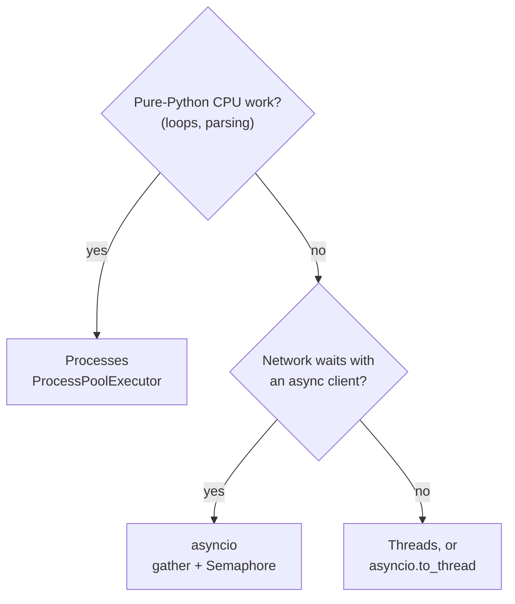
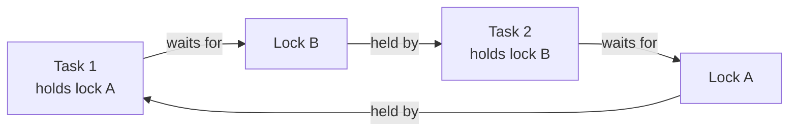

# M01.6 Theory: Concurrency: threads, processes, the GIL and asyncio (22 runnable scripts)

*[M01 theory](../README.md) · Lesson 1.6 · Notebooks: [`06a_concurrency_scripts`](../../../../course/p01_ai_engineering_foundations/m01_python_data_refresher/optional/06a_concurrency_scripts) (optional) · [All theory pages](../../../README.md)*

## asyncio

A coroutine, written `async def`, is a function that can pause. Each `await` is a pause point: while one coroutine waits for a network reply, the event loop runs another. One thread and one loop can keep many waits overlapping. Scripts 13 to 18 build this up:

- **13:** `asyncio.run(brew_chai())` starts an event loop and runs one coroutine to completion.
- **14:** `asyncio.gather` runs three coroutines that each `await asyncio.sleep(3)`; the waits overlap, so the three take about 3 s instead of 9.
- **15:** the same pattern with real HTTP: three `aiohttp` requests to an endpoint that delays 2 s overlap in one `ClientSession`.
- **16 and 17:** `loop.run_in_executor` hands a blocking function to a `ThreadPoolExecutor`, or CPU-bound work to a `ProcessPoolExecutor`, and awaits the result without stopping the loop.
- **18:** a daemon thread keeps logging while the loop runs a coroutine.

A model call is a network wait of a second or more, and RAG work is full of independent ones: a golden-set evaluation, a batch of embedding requests, one question sent to several retrievers. `gather` starts them together. A `Semaphore` caps how many are in flight, because every provider enforces a rate limit:

```python
sem = asyncio.Semaphore(2)

async def ask(question):
    async with sem:                          # waits here while two calls are in flight
        return await llm.ainvoke(question)

async def main(questions):
    return await asyncio.gather(*(ask(q) for q in questions))
```

With eight Larkspur handbook questions and a semaphore of 2, each queued call starts the moment a slot frees up:

```mermaid
gantt
    title Eight calls through asyncio.Semaphore(2)
    dateFormat x
    axisFormat %-S s
    tickInterval 1second
    section Slot 1
    Refund time         :0, 1200
    Export after cancel :1200, 2200
    Support speed       :2200, 3700
    Server size         :crit, 3700, 5600
    section Slot 2
    Annual billing      :0, 800
    Server down         :800, 3400
    Reboot and IP       :3400, 4300
    Promo credits       :4300, 5400
```


<!-- animated: diagrams/semaphore.anim.html -->

The call times are representative; the schedule is what asyncio does with them. The [interactive lab](interactive/asyncio-concurrency-lab.html) runs that schedule for every limit from 1 to 8. Its JavaScript scheduler matches real `asyncio.gather` with `asyncio.Semaphore` (Python 3.12, on a virtual clock) on all 128 call intervals (eight calls at eight limits, with each client), start and end within 1e-15 s:

| Semaphore limit | Wall time | Faster than one at a time |
|---|---|---|
| 1 | 11.0 s | 1.0× |
| 2 | 5.6 s | 2.0× |
| 3 | 4.5 s | 2.4× |
| 4 | 3.1 s | 3.5× |
| 7 or 8 | 2.6 s | 4.2× |
| Any, with a sync client | 11.0 s | 1.0× |

Three things follow from the table:

- **A semaphore of 1 is a for loop.** The wall time is the sum of the calls, 11.0 s.
- **The slowest call sets the floor.** *What happens if my server goes down?* takes 2.6 s, so no limit beats 2.6 s, and from 7 on a higher limit changes nothing. Going from 4 to 8 saves 0.5 s; going from 1 to 2 saved 5.4 s. Pick the limit from the provider's rate limit, then measure.
- **A call that never awaits blocks everything.** `llm.invoke`, `requests.get` and `time.sleep` inside `async def` hold the event loop until they return, so no other coroutine starts and the eight calls run one after another at any limit. Use the async method (`ainvoke`, `aiohttp`), or move the sync call to a thread with `await asyncio.to_thread(llm.invoke, question)`, which is what script 16 does with `run_in_executor`.

<!-- lab: interactive/asyncio-concurrency-lab.html -->

Two more rules for production runs. `gather` raises the first exception to the caller while the other calls keep running; pass `return_exceptions=True` to get every result and every error back in order, so one failed question does not hide the other seven. And in a Jupyter notebook an event loop is already running, so `asyncio.run(main())` raises `RuntimeError`; write `await main()` in the cell instead.

## Threads, processes and the GIL

CPython's global interpreter lock (GIL) lets one thread execute Python bytecode at a time. A thread gives up the GIL while it sleeps or waits on I/O, so threads overlap waiting (scripts 01 and 05 to 07: brewing, toasting, three downloads) but not pure-Python computation. Script 03 runs two threads that each count to 100 million and script 04 runs the same count in two processes; time both on your machine. Each process has its own interpreter and its own GIL, so the processes can use two cores.

Processes cost more. Each starts a new interpreter, its arguments are pickled across, and it shares no memory by default: script 11 sends a result back through a `multiprocessing.Queue`, and script 12 shares one counter through a `Value`. On macOS and Windows a new process imports your script again, which is why scripts 02, 04 and 10 put their start-up code under `if __name__ == "__main__":`.

Scripts 09 and 10 make the same comparison, but 10 counts to a billion per process against 10 million per thread in 09, a hundred times the work. Compare 03 with 04 instead.



Daemon threads (script 19) are killed when the main program exits, which suits a background logger; a regular thread (script 20) keeps the process alive until it returns, so one stuck in a loop keeps the program from ever exiting.

## Races and deadlocks

A race happens when two flows of control read shared state, one changes it, and the other writes back a value computed from the stale read. Script 21 has two threads each run `chai_stock += 1` 100,000 times. On CPython 3.12 it printed 200,000 in all three runs on the machine these pages were written on: the interpreter rarely switches threads inside `+=`, which hides the race without removing it. Put `time.sleep(0)` between the read and the write and two threads of 1,000 increments ended at 1,075 and 1,030 of 2,000.

asyncio has the same bug in a form that never hides. Code between two `await`s runs without interruption, so a race needs an `await` between the read and the write, and a model call is exactly that:

```python
spent = 0

async def ask(cost):
    global spent
    v = spent
    await asyncio.sleep(0.01)                # the model call
    spent = v + cost                         # writes back a stale total
```

Eight of these under `gather` leave `spent` at 1, not 8, on every run: all eight read 0 before any of them writes. Updating after the `await` (`spent += cost` on one line) gives 8; an `asyncio.Lock` around the read and the write also works.

For threads the fix is a lock around the read-modify-write. Script 08 wraps the increment in `with lock:` and ten threads of 100,000 reach exactly 1,000,000; script 12 does the same across four processes with `counter.get_lock()` and reaches 400,000.

Locks bring the opposite failure. In script 22, task 1 holds lock A and waits for B while task 2 holds B and waits for A, so both wait forever:



Acquire locks in one fixed order everywhere (A before B), hold one lock at a time where you can, or use `lock.acquire(timeout=5)` so a thread fails with a visible error instead of hanging.

## Key Takeaways

- Run independent model calls with `gather` and cap them with a `Semaphore`. The slowest call sets the floor, so pick the limit from the provider's rate limit, then measure.
- A sync call inside `async def` holds the event loop and turns any limit into a for loop. Use `ainvoke` or `asyncio.to_thread`, and use processes for pure-Python CPU work, since the GIL runs one thread at a time.
- A race needs a read, a switch and a stale write-back; in asyncio one `await` between them is enough. Lock the read-modify-write, and acquire locks in one fixed order to avoid deadlock.

## Check yourself

<details>
<summary>1. Two threads each count to 100 million in pure Python. Why can they not use two cores, and what can?</summary>

CPython's GIL lets one thread execute Python bytecode at a time, so threads overlap waiting but not pure-Python computation. Processes can, because each has its own interpreter and its own GIL (script 04, or a `ProcessPoolExecutor`). They cost more: a new interpreter per process, pickled arguments and no shared memory by default.

</details>

<details>
<summary>2. The eight Larkspur calls run under Semaphore(4), but the code calls llm.invoke inside async def. What wall time do you expect, and what is the fix?</summary>

About 11.0 s, the same as one call at a time. A call that never awaits holds the event loop until it returns, so the calls run one after another at any limit. Use the async method (`ainvoke`) or `await asyncio.to_thread(llm.invoke, question)`; with an async client, a limit of 4 gives 3.1 s.

</details>

<details>
<summary>3. Eight coroutines under gather each add 1 to a shared spent total around an awaited model call, and spent ends at 1. What went wrong?</summary>

Each coroutine read `spent` into `v`, awaited the model call, then wrote `v + cost`. All eight read 0 before any of them wrote, so every write was `0 + 1`. Do the update after the `await` in one line (`spent += cost`), or hold an `asyncio.Lock` around the read and the write.

</details>

---
*Previous: [1.4 Databases from Python: SQLite, MySQL, PostgreSQL](../04_databases_from_python_sqlite_mysql_postgresql/README.md). Next: [M01 interview questions](../README.md#interview-spotlight-5-questions-you-might-get-asked).*
