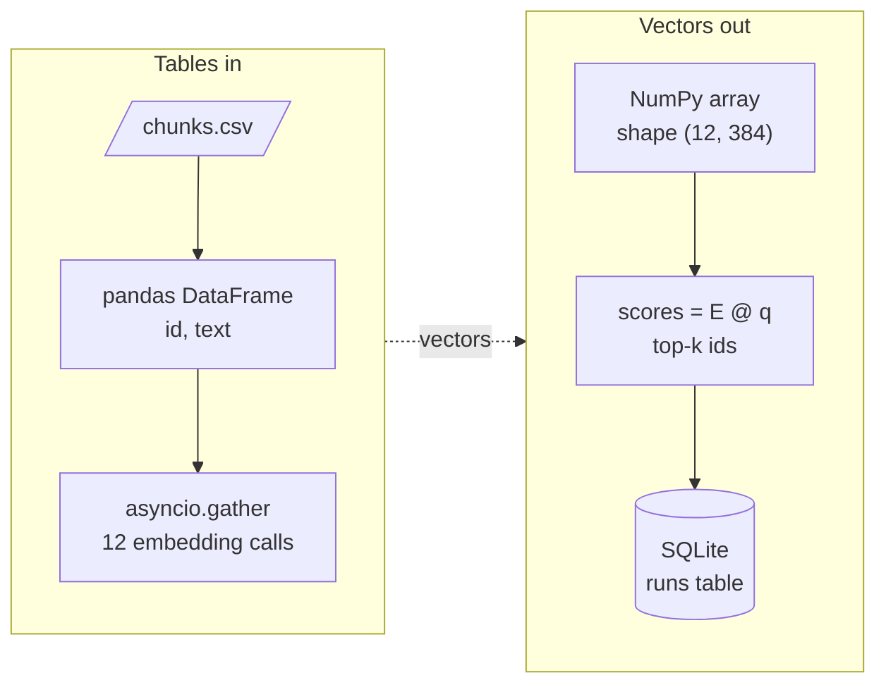

# M01 Theory: Python and data toolkit refresher

*Part I · AI Engineering Foundations · [Module README](../../../course/p01_ai_engineering_foundations/m01_python_data_refresher/README.md) · [All theory pages](../../README.md)*

Every RAG and agent notebook in this course moves data through the same few Python tools. Chunks arrive as rows in a table, become rows of a float matrix, get scored with one matrix product, and the results land back in a table you can query. The model calls in between are slow network waits, so they run concurrently. The M01 notebooks build on four ideas: NumPy arrays, pandas DataFrames, SQL from Python, and asyncio for concurrent calls. Each idea has a page in the folder of the lesson that teaches it, listed under [Lessons](#lessons). This page has the overview, the interview questions and the takeaways.

The running example is the Larkspur Cloud handbook that M11 to M13 index: twelve chunks on pricing, refunds, exports, outages and server sizing. Here the chunks sit in a DataFrame and a NumPy matrix, M11's baseline numbers sit in a SQLite table, and the lab sends eight handbook questions to a model at once.

## TL;DR

- An embedding index is a 2-D NumPy array, one row per chunk. Normalise the rows with `keepdims=True` and one matrix product gives every cosine score. Without `keepdims`, a square toy matrix divides columns instead of rows and the ranking flips.
- `float32` halves the memory of `float64`: a million 1,536-dimension vectors take 6.1 GB instead of 12.3 GB.
- The baseline row every later module compares against is a `groupby`: M11's mean recall is 0.33, 0.50, 0.50 and 0.50 at `k` = 1, 2, 5 and 12. `mean()` skips `NaN`, so a question that errored silently raises the average.
- Pass values to SQL as parameters (`?` in `sqlite3`, `%s` in PyMySQL and psycopg2), never through an f-string. A plan name of `starter' OR '1'='1` returns every plan when the query is built from a string.
- In the lab, eight model calls take 11.0 s one at a time, 5.6 s with a semaphore of 2, 3.1 s with 4, and 2.6 s from a limit of 7, the time of the slowest call. A sync client inside `async def` keeps it at 11.0 s at any limit.

## Mental model

<!-- animated: diagrams/toolkit.anim.html -->

Each tool holds the data in the shape the next step needs. pandas keeps labelled rows and columns, NumPy keeps one dtype in a fixed shape so arithmetic runs on whole arrays, SQL keeps results you can filter and group later, and asyncio keeps the slow calls from waiting on each other. Most bugs in the later modules are a shape, a dtype or a blocked event loop at one of these handoffs.

## Lessons

| Lesson | Topic | Theory |
|---|---|---|
| 1.1 | Python essentials: variables, operators, control flow, functions | *planned* |
| 1.2 | Python best practices | *planned* |
| 1.3 | NumPy, pandas and Matplotlib | [NumPy arrays](03_numpy_pandas_and_matplotlib/README.md#numpy-arrays) [pandas DataFrames](03_numpy_pandas_and_matplotlib/README.md#pandas-dataframes) |
| 1.4 | Databases from Python: SQLite, MySQL, PostgreSQL | [SQL from Python](04_databases_from_python_sqlite_mysql_postgresql/README.md#sql-from-python) |
| 1.5 | Serving data with Flask APIs | *planned* |
| 1.6 | Concurrency: threads, processes, the GIL and asyncio (22 runnable scripts) | [asyncio](06_concurrency_threads_processes_the_gil_and_asyncio_22_runnable_scripts/README.md#asyncio) [Threads, processes and the GIL](06_concurrency_threads_processes_the_gil_and_asyncio_22_runnable_scripts/README.md#threads-processes-and-the-gil) [Races and deadlocks](06_concurrency_threads_processes_the_gil_and_asyncio_22_runnable_scripts/README.md#races-and-deadlocks) |

## Interactive lab

[**Concurrent calls with asyncio**](06_concurrency_threads_processes_the_gil_and_asyncio_22_runnable_scripts/interactive/asyncio-concurrency-lab.html): open the file in a browser. Slide the semaphore from 1 to 8 and watch the wall time fall from 11.0 s to 2.6 s, then stop falling at 7. Then switch the client to `llm.invoke` and move the slider again; nothing changes, because a sync call never hands the event loop back.

## How it connects

- **Before:** nothing. M01 is the first module; skim the lessons you know.
- **Next:** [M02](../m02_llm_apis_and_model_selection/README.md) makes the model calls this module runs concurrently. NumPy scoring returns in [M11](../../p04_rag_foundations/m11_rag_lifecycle/README.md) (TF-IDF nearest neighbours) and [M14](../../p05_ingestion_and_indexing/m14_embeddings/README.md) (embeddings). SQL becomes a retriever in [M27](../../p08_agent_foundations/m27_human_approval_applied_agents/README.md) (text-to-SQL) and a memory store in [M34](../../p10_memory_and_multi_agent/m34_long_term_agentic_memory/README.md). asyncio drives LangGraph's async nodes in M10 and the parallel agents of [M36](../../p10_memory_and_multi_agent/m36_collaboration_parallel_agents/README.md).

## Interview Spotlight: 5 Questions You Might Get Asked

*Production questions of the kind asked in applied AI engineering interviews.*

### 1. Larkspur's nightly evaluation sends 200 golden questions to the model. A teammate rewrote it with `asyncio.gather` to make it faster, and it takes exactly as long as before. What do you look for?

**What a strong answer covers:**
- Checks whether the coroutine calls a sync client (`llm.invoke`, `requests.get`, `time.sleep`); a call that never awaits holds the event loop, so the tasks run one after another
- Fixes it with the async method (`ainvoke`, `aiohttp`) or by moving the sync call to a thread with `asyncio.to_thread`
- Confirms with timestamps per call: overlapping start times mean it is concurrent, back-to-back ones mean it is not
- Adds a semaphore sized to the provider's rate limit before the fix sends 200 requests at once

### 2. You need to embed 50,000 handbook chunks through a hosted embeddings API. Threads, processes or asyncio, and what limits the speed?

**What a strong answer covers:**
- The work is network waiting, so asyncio (or threads with a sync SDK) fits; processes add cost and solve a CPU problem this job does not have
- Sends several chunks per request when the API accepts a list, which cuts the number of calls before concurrency matters
- Caps in-flight requests with a semaphore at the provider's rate limit, and retries 429 and 5xx responses with backoff
- Measures throughput at a few limits and stops raising it when wall time stops falling, as it does at 7 in the lab

### 3. Retrieval scores computed in a notebook with NumPy disagree with the cosine scores the vector store returns for the same Larkspur chunks. How do you find out which is wrong?

**What a strong answer covers:**
- Asserts that every row norm is 1.0 after normalising (`np.allclose(np.linalg.norm(E_n, axis=1), 1)`)
- Checks the shape of the norms: without `keepdims=True` a square matrix divides columns and gives wrong scores with no error
- Compares a few rows against `sklearn.metrics.pairwise.cosine_similarity` and checks whether the store reports distance or similarity
- Checks dtypes and that the same embedding model and dimension built both indexes

### 4. The support assistant looks up a customer's support response time with `SELECT support_hours FROM plans WHERE name = '{plan}'`, where `plan` comes from the account record. What is wrong, and what else would you change?

**What a strong answer covers:**
- String-built SQL is injectable: `starter' OR '1'='1` returns every row; pass the value as a parameter (`?` in `sqlite3`, `%s` in psycopg2)
- Opens the connection read-only or with a user that can only `SELECT` from the tables the assistant needs
- Reads credentials from the environment, never from a notebook cell
- Handles the no-row case (`fetchone()` returns `None`) with a fallback answer instead of an exception

### 5. The weekly report shows mean recall@2 rising from 0.50 to 0.75 after a retriever change. Before celebrating, what do you check in the results DataFrame?

**What a strong answer covers:**
- Compares `count()` with `size()` per group: `mean()` skips `NaN`, so a question that errored drops out and lifts the average
- Checks that both runs used the same golden questions (a merge on question id, not on row order)
- Looks at per-question rows with `pivot_table`, since one question type can regress while the mean improves
- Records failures as an explicit status column so the next report counts them

## Key Takeaways

- Keep vectors in one 2-D array of a fixed dtype; check `.shape` and `.dtype` before you trust a score.
- Make the baseline a `groupby` over a long results table, and compare `count()` with `size()` before you read the mean.
- Every value that reaches SQL from outside goes in as a parameter, and every credential comes from the environment.
- Use asyncio for many slow network calls, cap them with a semaphore, and make sure every call inside `async def` is awaited.

---
*Previous: none, M01 opens the course. Next: [M02 LLM provider APIs and model selection](../m02_llm_apis_and_model_selection/README.md).*
