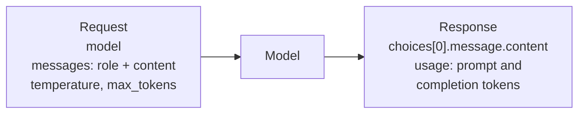

# M02.1 Theory: Calling commercial LLM APIs: OpenAI and Gemini

*[M02 theory](../README.md) · Lesson 2.1 · Notebooks: [`01a_using_chatgpt_or_google_gemini.ipynb`](../../../../course/p01_ai_engineering_foundations/m02_llm_apis_and_model_selection/notebooks/01a_using_chatgpt_or_google_gemini.ipynb) · [All theory pages](../../../README.md)*

## Chat completions

A chat completion is one HTTP call. The request names a model and carries the conversation as a list of messages, each a `role` and a `content`; the response carries the model's reply and a count of the tokens it used. The notebook's OpenAI call is the whole pattern:

```python
response = openai.chat.completions.create(
    model="gpt-4o",
    messages=[{"role": "user", "content": prompt}],
    temperature=0.1,  # degree of randomness of the model's output
)
response.choices[0].message.content
```



Four parts of the request and response matter on every call:

- **Roles.** `system` sets standing instructions, `user` is the question, `assistant` is an earlier reply. For the Larkspur generator the system message says to answer only from the handbook excerpts, and the user message holds the excerpts and the customer's question.
- **The call is stateless.** The API remembers nothing between calls. A follow-up question works only if you send the earlier turns again, so every turn of a long conversation pays for all the turns before it.
- **Sampling parameters.** `temperature` controls randomness; the notebook uses 0.1 for repeatable answers. `max_tokens` caps the reply; lesson 2.2's notebook sets 1,000. Reasoning models are stricter: [M25's routing page](../../../p08_agent_foundations/m25_agentic_workflow_patterns/02_routing_by_handler_and_by_model_tier/README.md#routing-by-model-tier) records that o-series models reject a custom temperature.
- **`usage`.** `prompt_tokens` and `completion_tokens` are what the provider bills. In the installed `openai` 2.54.0, `usage.completion_tokens_details.reasoning_tokens` reports how many of the completion tokens were hidden reasoning. Lesson 2.3 is about that field.

The notebook reads the key with `getpass` and sets `openai.api_key`, the SDK's module-level client. Lessons 2.3 and 2.4 create `OpenAI()` instead, which reads `OPENAI_API_KEY` from the environment loaded from `.env`. Either way the key stays out of the code and out of the notebook's saved state.

## Two SDKs, two shapes

The notebook calls Gemini through Google's `google-generativeai` package, and the two SDKs disagree on almost every part of the call:

| | OpenAI | Gemini (`google-generativeai`) |
|---|---|---|
| Set the key | `openai.api_key = key` | `genai.configure(api_key=key)` |
| Pick the model | `model="gpt-4o"` on each call | `genai.GenerativeModel("gemini-2.5-pro")` |
| Send | `messages`, a list of role and content | `generate_content(prompt)`, a string |
| Read the reply | `response.choices[0].message.content` | `response.text` |

The notebook hides the difference behind one function, `get_completion(prompt, model)`, which branches on the model name. The rest of the code calls one function, so switching provider is a one-argument change. Two details of the notebook's version are worth fixing before you copy it:

- **It fails quietly.** Any model name other than exactly `"gpt-4o"` or `"gemini-2.5-pro"` returns the string `"LLM not configured! ..."` as if it were an answer. A typo such as `"gpt-4o-mini"` prints that sentence where the model's reply should be. A wrapper you own should raise on a model it does not know.
- **The Gemini package is retired.** The installed `google-generativeai` 0.8.6 describes itself as deprecated and legacy, with all support ended on November 30, 2025; its successor is `google-genai`, which this repository also installs. The notebook's Gemini cells still show the shape of a second SDK, which is their point here.

LangChain (M07) is the general version of `get_completion`: one chat-model interface over many providers, so a RAG chain does not change when the generator does.

---
*Previous: [M02 overview](../README.md). Next: [2.2 Open-source LLMs via Hugging Face Inference and locally](../02_open_source_llms_via_hugging_face_inference_and_locally/README.md).*
