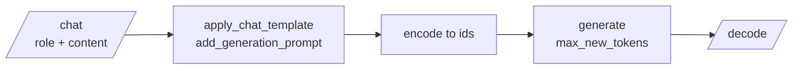

# M02.2 Theory: Open-source LLMs via Hugging Face Inference and locally

*[M02 theory](../README.md) · Lesson 2.2 · Notebooks: [`02a_open_source_llms_via_hugging_face_inference_api.ipynb`](../../../../course/p01_ai_engineering_foundations/m02_llm_apis_and_model_selection/notebooks/02a_open_source_llms_via_hugging_face_inference_api.ipynb), [`02b_open_source_llms_locally.ipynb`](../../../../course/p01_ai_engineering_foundations/m02_llm_apis_and_model_selection/optional/02b_open_source_llms_locally.ipynb) (optional) · [All theory pages](../../../README.md)*

## Inference endpoints

An inference endpoint is a server that holds a model's weights and answers calls to it. For an open model you choose who runs that server. The notebooks show two of the three options:

| | Where the weights run | The call | What you manage |
|---|---|---|---|
| Vendor API (lesson 2.1) | The vendor's servers | `openai.chat.completions.create(...)` | A key and a budget |
| Hugging Face Inference (02a) | A provider Hugging Face routes to | `InferenceClient(...).chat.completions.create(...)` | A token, and which provider serves the model |
| Local (02b) | Your GPU | `model.generate(...)` or a `pipeline` | Memory, the chat template, generation settings |

The 02a notebook calls `meta-llama/Llama-3.1-8B-Instruct`, an 8B-parameter instruction-tuned model, and `deepseek-ai/DeepSeek-V3-0324` with the same messages and `max_tokens=1000`. The client mirrors the OpenAI call on purpose: `client.chat.completions.create(model=..., messages=...)` and `completion.choices[0].message.content`. Code written against the OpenAI shape moves to an open model by changing the client and the model id.

Two details of the hosted path decide what you are actually calling:

- **The model id names the weights, not the server.** In the installed `huggingface_hub` 1.16.1, a chat call with no `provider` argument defaults to server-side auto routing: Hugging Face picks a provider that hosts the model. Latency and price can differ by provider, so a production client passes `provider=` explicitly and records it with each answer.
- **The notebook's "client without API key" still sends one.** It creates `InferenceClient()` with no token, after setting `HF_TOKEN` in the environment. With `token=None` the library falls back to `HF_TOKEN`, so both of the notebook's clients are authenticated; `build_hf_headers(token=None)` returns the bearer token from the environment. To send no token at all, pass `token=False`.

The notebooks price only the OpenAI models, so this module has no per-answer figure for the open ones. Measure them the same way lesson 2.4 measures `o4-mini`: from `usage` where the provider returns it, or from GPU hours when you host the model.

## Running a model locally

The optional 02b notebook loads `google/recurrentgemma-2b-it` with `transformers` in `bfloat16` on a CUDA device, and states that it needs at least 5 GB of GPU memory. Running locally exposes the steps a hosted endpoint does for you:

- **The chat template.** Each chat model was trained on its own markup around roles. `tokenizer.apply_chat_template(chat, tokenize=False, add_generation_prompt=True)` writes that markup, and the notebook encodes the result with `add_special_tokens=False` because the template already added them. A hosted endpoint applies the template on the server; locally a wrong template gives fluent but off-format replies.
- **Generation settings.** `max_new_tokens` caps the reply (150 in the first call); `max_length` caps prompt plus reply, so the notebook uses one or the other. `do_sample=False` is greedy decoding, the same answer every run; `do_sample=True, temperature=0.5` samples.
- **What comes back.** `model.generate` returns the prompt's token ids followed by the new ones, so `tokenizer.decode(outputs[0])` prints the template and the question before the answer. The `pipeline("text-generation", ...)` call with `return_full_text=False` returns only the new text.

The notebook's markdown calls the model "Google Gemma 2B IT" while the code loads RecurrentGemma, a recurrent variant that the notebook says needs less memory than Gemma on long sequences. The model id in the code is the one that runs.

## Check yourself

1. Why should a production client pass provider explicitly when it calls an open model through Hugging Face Inference?

The model id names the weights, not the server. With no `provider` argument, `huggingface_hub` 1.16.1 uses server-side auto routing and Hugging Face picks a provider that hosts the model, and latency and price can differ by provider. Passing `provider=` and recording it with each answer tells you what you actually called.

2. You create InferenceClient() with no token to test an unauthenticated call, after the notebook set HF_TOKEN. Is the call unauthenticated?

No. With `token=None` the library falls back to `HF_TOKEN` from the environment, so the client sends the bearer token anyway; `build_hf_headers(token=None)` shows it. Pass `token=False` to send no token at all.

3. Running RecurrentGemma locally, decoding the first output of model.generate prints the chat template and the question before the answer. Is something wrong?

No. `model.generate` returns the prompt's token ids followed by the new ones, so decoding the whole output prints both. The `pipeline("text-generation", ...)` call with `return_full_text=False` returns only the new text.

---
*Previous: [2.1 Calling commercial LLM APIs: OpenAI and Gemini](../01_calling_commercial_llm_apis_openai_and_gemini/README.md). Next: [2.3 Reasoning vs non-reasoning models](../03_reasoning_vs_non_reasoning_models/README.md).*
