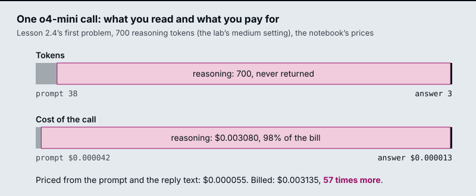
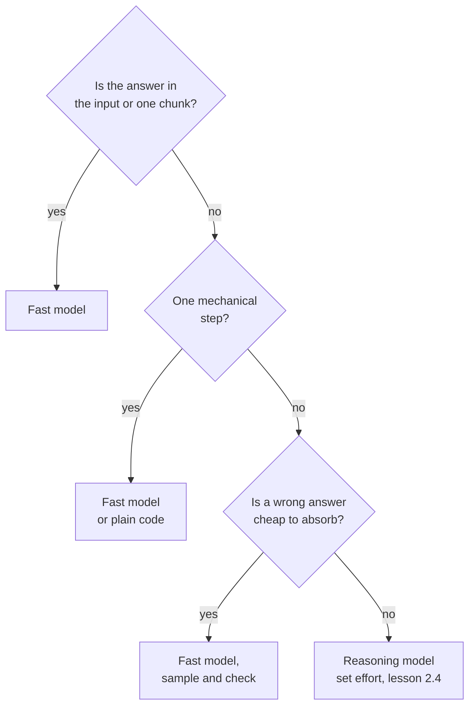

# M02.3 Theory: Reasoning vs non-reasoning models

*[M02 theory](../README.md) · Lesson 2.3 · Notebooks: [`03a_Reasoning_vs_NonReasoning.ipynb`](../../../../course/p01_ai_engineering_foundations/m02_llm_apis_and_model_selection/notebooks/03a_Reasoning_vs_NonReasoning.ipynb) · [All theory pages](../../../README.md)*

## Reasoning models

"Think step by step" is a prompt: you ask an ordinary model to write its working into the answer, and you can read every word. A reasoning model is trained to work before it answers. It produces reasoning tokens internally, decides how many to spend, and returns only the conclusion. The notebook sums up the difference in three rows:

| | Non-reasoning | Reasoning |
|---|---|---|
| Who decides how much thinking happens | You, through the prompt | The model |
| Can you read the reasoning | Yes, it is in the response | Usually no |
| What you are billed for | What you can see | What you can see, plus what you cannot |

The notebook runs the same prompt through `gpt-4o-mini` (fast) and `o4-mini` (reasoning) and records four numbers per call: seconds, output tokens, reasoning tokens and whether the answer was right. Its `PRICING` constants, which it tells you to replace with today's prices, are USD per million tokens:

| Model | Input | Output |
|---|---|---|
| `gpt-4o-mini` | 0.15 | 0.60 |
| `o4-mini` | 1.10 | 4.40 |

At those prices `o4-mini` costs 7.3 times as much per token, in and out, before it spends a single reasoning token. The two tasks are chosen to land on opposite sides of the decision:

- **Task A, a constraint puzzle.** Five services deploy Monday to Friday; `auth` before `billing`, `search` the day after `billing`, `notify` on Monday, `reporting` not on Friday. Which deploys on Friday? Only `search` fits, but getting there means holding four constraints at once, and a wrong early step gives a confident wrong answer. The notebook warns that the fast model is often right only some of the time, so a single happy-path test can pass it.
- **Task B, an extraction.** Pull `order_id` and `total` out of "Order #A-4417 shipped 2026-03-02, 3 items, total $148.20, customer 88213" as JSON. The answer is in the input and both models should get it. The reasoning model is slower and dearer, and still spends reasoning tokens deciding there was nothing to decide.

## The invisible bill

`completion_tokens` is what you are charged for at the output rate. `reasoning_tokens`, under `usage.completion_tokens_details`, is the part of it you never receive. The notebook's cost function makes that explicit:

```python
# reasoning tokens are already inside completion_tokens; they bill at the output rate
cost = (prompt_tokens / 1e6) * input_price + (completion_tokens / 1e6) * output_price
visible = completion_tokens - reasoning_tokens
```

On a short answer the hidden part is almost all of the bill. The figure prices one `o4-mini` call on the first problem of lesson 2.4: 38 prompt tokens counted with `o200k_base`, a three-token answer (`12:25`), and 700 reasoning tokens, the lab's representative medium setting.



Two habits follow:

- **Never estimate spend from the reply text.** Priced from its prompt and reply, that call costs $0.000055; the bill says $0.003135. Log `usage` per request and sum it.
- **Check that reasoning tokens move.** The fast model reports 0. If a reasoning model also reports 0, or the count stays flat while you raise the effort in lesson 2.4, the parameter never reached the model, and any conclusion about effort is drawn from a test that never ran.

## When reasoning pays

The notebook reduces the choice to one question: does the task have a step where being wrong is expensive and pattern-matching is not enough? As a chain:



For the Larkspur generator:

- ***How long does a refund take?*** The answer is one sentence of the `refund-timing` chunk. This is Task B's shape, and a reasoning model only adds latency and cost.
- ***Can I get a refund after 45 days?*** The model has to combine the 30-day window, the plan type and the proration rule. A wrong amount turns into a support ticket, so this is Task A's shape.
- **Benchmark both kinds.** Run your own hard case and your own easy case through both models. A benchmark of hard cases alone recommends the reasoning model for everything, including the lookups that make up most of the traffic.

Sending each question to the right model at run time is routing by model tier, built in [M25 lesson 25.2](../../../p08_agent_foundations/m25_agentic_workflow_patterns/02_routing_by_handler_and_by_model_tier/README.md#routing-by-model-tier).

## Check yourself

<details>
<summary>1. Why can a reasoning model's bill be much larger than its visible reply suggests?</summary>

Reasoning tokens sit inside `completion_tokens` and bill at the output rate, but you never receive them; `usage.completion_tokens_details.reasoning_tokens` reports how many there were. In the page's `o4-mini` call, 700 reasoning tokens make 98% of a $0.003135 bill, while the prompt and the three-token reply alone would cost $0.000055. Log `usage` per request instead of estimating from the reply.

</details>

<details>
<summary>2. Which Larkspur question suits a reasoning model: how long a refund takes, or whether a refund is possible after 45 days?</summary>

The 45-day question. It combines the 30-day window, the plan type and the proration rule, and a wrong amount turns into a support ticket: Task A's shape. The refund time is one sentence of the `refund-timing` chunk, Task B's shape, where a reasoning model only adds latency and cost.

</details>

<details>
<summary>3. You raise the effort on a reasoning model and reasoning_tokens stays at 0 on every call. What does that tell you?</summary>

The parameter never reached the model. Only the fast model should report 0 reasoning tokens; a reasoning model that reports 0, or a count that stays flat as effort rises, means any conclusion about effort comes from a test that never ran. Fix the request before you compare settings.

</details>

---
*Previous: [2.2 Open-source LLMs via Hugging Face Inference and locally](../02_open_source_llms_via_hugging_face_inference_and_locally/README.md). Next: [2.4 Reasoning-effort levers and cost](../04_reasoning_effort_levers_and_cost/README.md).*
