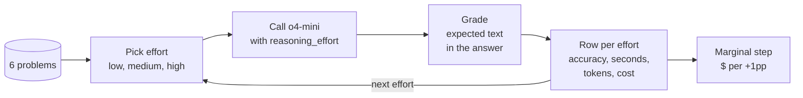
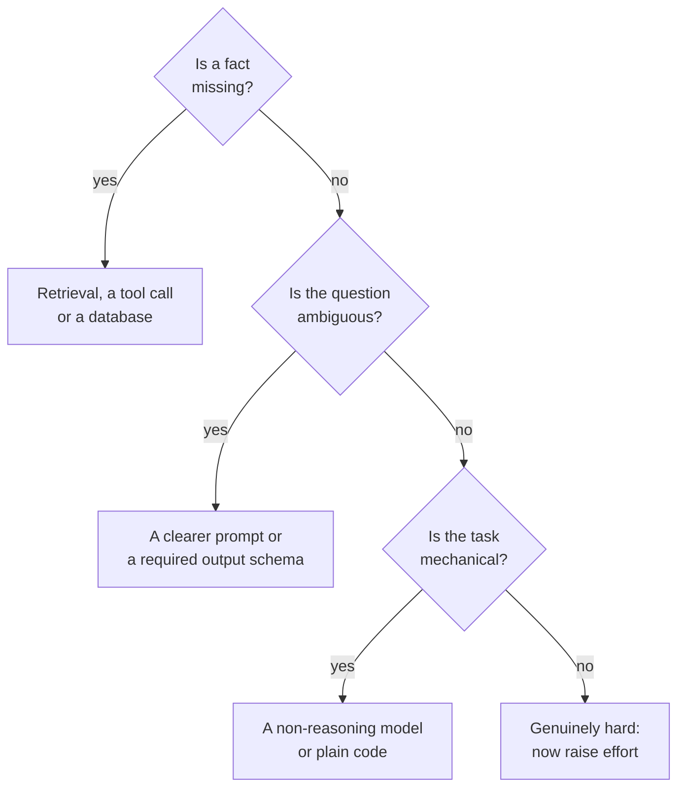

# M02.4 Theory: Reasoning-effort levers and cost

*[M02 theory](../README.md) · Lesson 2.4 · Notebooks: [`04a_Reasoning_Effort_Levers.ipynb`](../../../../course/p01_ai_engineering_foundations/m02_llm_apis_and_model_selection/notebooks/04a_Reasoning_Effort_Levers.ipynb) · [All theory pages](../../../README.md)*

## Cost vs accuracy

`reasoning_effort` changes one thing: how many reasoning tokens the model is willing to spend before it commits to an answer. The model, the prompt and the output format stay the same. More reasoning tokens mean more latency and more cost at the output rate, and a better answer only when the task had something to deliberate about. The notebook sweeps `o4-mini` at `low`, `medium` and `high`; the installed `openai` 2.54.0 also types `none`, `minimal`, `xhigh` and `max`, and the notebook says to trim the list to what your model accepts.

The sweep is six problems at three levels with `TRIALS = 1`: 18 calls, a few cents. The problems mix easy and hard on purpose (a train arrival time, retry backoff, the deployment puzzle from lesson 2.3, LRU eviction, a syllogism, a coin-weighing puzzle), because one question gives a coin flip, not a measurement.


<!-- animated: diagrams/effort-sweep.anim.html -->

Each step up the dial gets one line in the notebook's marginal table:

```
$ per +1pp = (cost of this level - cost of the level below) / (accuracy gain * 100)
```

A step with no accuracy gain reads `no gain`, and the notebook's rule is that every step after one is pure cost. The knee is the last step whose price per point you would pay. The usual shape, in the notebook's words, is "a step then a plateau": a real gain from `low` to `medium`, much less from `medium` to `high`, while cost and latency keep climbing.

The [interactive lab](interactive/effort-knee-lab.html) prices that sweep with the notebook's own cost and marginal code, adds `gpt-4o-mini` from lesson 2.3 as the first rung, and scales each figure to 10,000 answers. The notebooks save no outputs, so the accuracy and reasoning-token inputs are representative: 3, 4, 5 and 5 problems right, and 250, 700 and 1,800 reasoning tokens per call. The prompt and answer tokens are counted from the notebook's six problems. With those inputs:

| Setting | Correct of 6 | Hidden share of output | Per 10,000 answers | Step up from the row above |
|---|---|---|---|---|
| `gpt-4o-mini` | 3 | 0.0% | $0.06 | |
| `o4-mini`, low | 4 | 99.5% | $11.44 | +17 points, $0.68 per point |
| `o4-mini`, medium | 5 | 99.8% | $31.24 | +17 points, $1.19 per point |
| `o4-mini`, high | 5 | 99.9% | $79.64 | no gain |

<!-- lab: interactive/effort-knee-lab.html -->

Three things to take from the table:

- **The knee depends on what a point is worth to you.** At $2 per point per 10,000 answers the lab stops at medium. Below $1.19 it stops at low, and below $0.68 the fast model wins. Going to high costs $48.40 more per 10,000 answers than medium for nothing.
- **Six problems make a coarse ruler.** Each problem is 17 points, so one flipped answer moves the knee. The notebook's `TRIALS` raises the count at linear cost; a production sweep wants 20 or more questions drawn from real traffic.
- **Audit the grader before the dial.** The notebook grades by substring: the expected text must appear in the answer. Its LRU problem expects `c`, but in a 4-entry LRU cache with accesses `A B C D A E`, inserting `E` evicts `B`; `C` goes only when `B` comes back. A model that answers `B` is marked wrong at every level and caps at 5 of 6, while a wrong `C`, or any reply containing the letter c such as "B is evicted", earns the point.

## When effort is the wrong lever

The notebook's last task cannot be solved by thinking: *What was the total refund value processed by our EU billing service last Tuesday?*, with the instruction to reply `INSUFFICIENT DATA` when the data is missing. Every level should reach the same reply, and the higher levels pay more reasoning tokens to get there. Flat accuracy with climbing reasoning tokens is the signature of the wrong lever; the lab's *Wrong lever* shape shows its bill.

The notebook's table of real fixes, as a chain:



Only the last box is an effort problem. For the Larkspur assistant, *How much was my last refund?* is the first box: the amount lives in the billing system, so the fix is a tool call to the account API (M23), and *Can I get a refund after 45 days?* is the last box, where effort is worth sweeping.

## Check yourself

<details>
<summary>1. How does the notebook price each step up the effort dial, and when does a step count as pure cost?</summary>

Each step's price is the cost of that level minus the cost of the level below, divided by the accuracy gain times 100: dollars per extra percentage point. A step with no accuracy gain reads `no gain`, and every step after it is pure cost. The knee is the last step whose price per point you would pay.

</details>

<details>
<summary>2. Using the lab's table, which setting do you pick if one extra accuracy point is worth $1 per 10,000 answers?</summary>

`o4-mini` at low. The step from `gpt-4o-mini` to low costs $0.68 per point, which is under $1; the step to medium costs $1.19 per point, which is over it. High adds no gain and costs $48.40 more per 10,000 answers than medium.

</details>

<details>
<summary>3. Across low, medium and high, accuracy stays flat while reasoning tokens climb. What does that signal for a question such as last Tuesday's EU refund total?</summary>

Effort is the wrong lever: the fact is missing, so every level reaches `INSUFFICIENT DATA` and the higher ones pay more to get there. Fix it with retrieval, a tool call or a database, such as a tool call to the account API (M23) for a customer's last refund. Raise effort only for a task that is genuinely hard.

</details>

---
*Previous: [2.3 Reasoning vs non-reasoning models](../03_reasoning_vs_non_reasoning_models/README.md). Next: [M02 interview questions](../README.md#interview-spotlight-5-questions-you-might-get-asked).*
