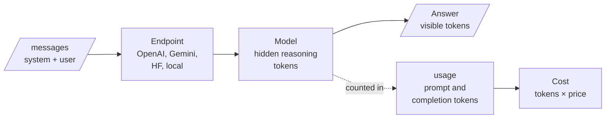

# M02 Theory: LLM provider APIs and model selection

*Part I · AI Engineering Foundations · [Module README](../../../course/p01_ai_engineering_foundations/m02_llm_apis_and_model_selection/README.md) · [All theory pages](../../README.md)*

Every RAG answer ends in a model call: a list of messages goes to an endpoint, and an answer and a token count come back. The M02 notebooks build on four ideas: the chat completion as the unit of work, the endpoints that serve hosted and open models, reasoning models that think in tokens you never see, and the trade between accuracy and what each answer costs. Each idea has a page in the folder of the lesson that teaches it, listed under [Lessons](#lessons). This page has the overview, the interview questions and the takeaways.

The running example is the generator of the Larkspur Cloud support assistant from M11 to M13: the call that turns retrieved handbook chunks into an answer. *How long does a refund take?* has its answer in one chunk. *Can I get a refund after 45 days?* needs proration arithmetic. Those two questions decide which model and how much thinking the assistant pays for. The notebooks run their own tasks (a deployment-order puzzle, an order-line extraction, a six-problem sweep) and save no outputs, so every figure on these pages is one the notebooks state, one counted from their code, or one the lab computes.

## TL;DR

- A chat completion is one stateless call: role-tagged messages and parameters in, `choices[0].message.content` and a `usage` object out. OpenAI and the Hugging Face `InferenceClient` share that shape; the Gemini SDK in lesson 2.1 takes a prompt string and returns `response.text`.
- An open model is reached through a hosted endpoint or run on your own GPU. With no `provider` set, the installed `huggingface_hub` 1.16.1 sends chat calls to server-side auto routing; locally you apply the chat template yourself and need the memory (at least 5 GB of GPU memory for `recurrentgemma-2b-it`, per the notebook).
- A reasoning model spends hidden reasoning tokens before it answers. They are counted inside `completion_tokens` and billed at the output rate. At the notebooks' prices `o4-mini` costs 7.3 times `gpt-4o-mini` per token, before it thinks at all.
- `reasoning_effort` buys deliberation, which helps only when the failure was too little thinking. In the lab's step-then-plateau sweep, medium answers 5 of 6 for $31.24 per 10,000 answers and high answers the same 5 for $79.64.
- Pick a setting with the marginal number, dollars per extra accuracy point, measured on a mixed task set that contains your easy traffic as well as your hard cases.

## Mental model

<!-- animated: diagrams/model-call.anim.html -->

The answer is the only part you read, and it is the smallest part you pay for. A fast model goes straight from messages to answer; a reasoning model spends tokens in the middle box first, and `usage` is the only place they show up. Lessons 2.3 and 2.4 are about deciding when that middle box is worth paying for.

## Lessons

| Lesson | Topic | Theory |
|---|---|---|
| 2.1 | Calling commercial LLM APIs: OpenAI and Gemini | [Chat completions](01_calling_commercial_llm_apis_openai_and_gemini/README.md#chat-completions) [Two SDKs, two shapes](01_calling_commercial_llm_apis_openai_and_gemini/README.md#two-sdks-two-shapes) |
| 2.2 | Open-source LLMs via Hugging Face Inference and locally | [Inference endpoints](02_open_source_llms_via_hugging_face_inference_and_locally/README.md#inference-endpoints) [Running a model locally](02_open_source_llms_via_hugging_face_inference_and_locally/README.md#running-a-model-locally) |
| 2.3 | Reasoning vs non-reasoning models | [Reasoning models](03_reasoning_vs_non_reasoning_models/README.md#reasoning-models) [The invisible bill](03_reasoning_vs_non_reasoning_models/README.md#the-invisible-bill) [When reasoning pays](03_reasoning_vs_non_reasoning_models/README.md#when-reasoning-pays) |
| 2.4 | Reasoning-effort levers and cost | [Cost vs accuracy](04_reasoning_effort_levers_and_cost/README.md#cost-vs-accuracy) [When effort is the wrong lever](04_reasoning_effort_levers_and_cost/README.md#when-effort-is-the-wrong-lever) |

## Interactive lab

[**Where effort stops paying**](04_reasoning_effort_levers_and_cost/interactive/effort-knee-lab.html): open the file in a browser. Start on *Step, then plateau* and drag the threshold from $2.0 down to $1.0: the knee drops from medium to low, because the step from low to medium costs $1.19 per accuracy point per 10,000 answers. Then pick *Wrong lever* and raise the reasoning tokens at high: the bill climbs and the accuracy column does not move.

## How it connects

- **Before:** [M01](../m01_python_data_refresher/README.md) sets up the Python and data tools these notebooks run on.
- **Next:** [M03](../m03_hugging_face_models/README.md) takes lesson 2.2's local pipeline further with Hugging Face models and Gradio demos. M05 turns these calls into prompt patterns; its chain-of-thought lesson is the prompt-side version of what a reasoning model does in training. M07 wraps the same provider SDKs behind one LangChain chat-model interface. [M11](../../p04_rag_foundations/m11_rag_lifecycle/README.md) records cost per question in its baseline row, and [M25](../../p08_agent_foundations/m25_agentic_workflow_patterns/README.md) routes each request to a cheap or a reasoning tier at run time, which is lessons 2.3 and 2.4 applied per request.

## Interview Spotlight: 5 Questions You Might Get Asked

*Production questions in the style of OpenAI, Anthropic and Google interviews for applied AI roles.*

### 1. Larkspur moves its answer generator from `gpt-4o-mini` to `o4-mini`. The monthly bill triples, yet the answers in the transcripts are the same length as before. Where did the money go, and how do you show it?

**What a strong answer covers:**
- Reads `usage.completion_tokens_details.reasoning_tokens` per call: those tokens are inside `completion_tokens`, billed at the output rate, and never appear in the reply
- Recomputes cost from `usage` (prompt tokens times input price plus completion tokens times output price), never from the length of the reply text
- Splits spend by question type and finds how much of the traffic is lookups such as *How long does a refund take?*, where reasoning buys nothing
- Proposes routing (M25) or a lower effort for lookups, and logs reasoning tokens per request so the next change shows up in a dashboard instead of an invoice

### 2. The product team wants one model for every Larkspur question. You have a fast model and a reasoning model. Which questions go where, and how do you defend the split?

**What a strong answer covers:**
- A lookup with the answer in one retrieved chunk goes to the fast model; a multi-step question such as proration after 45 days is the reasoning model's case
- Benchmarks both models on the team's own hard case and own easy case, since a hard-only benchmark teaches "always use the strong one"
- Weighs what a wrong answer costs (a wrong refund amount becomes a support ticket) against latency and price per answer
- Names the router's costly error, a hard question sent to the cheap tier, and makes the router err toward the reasoning tier for billing questions

### 3. Your effort sweep on 20 golden questions shows high scoring one question more than medium at more than twice the cost. Do you ship high, and how do you know the sweep measured anything?

**What a strong answer covers:**
- Checks that mean reasoning tokens climb across the levels; if they do not, `reasoning_effort` never reached the model
- Converts the result to dollars per extra accuracy point at production volume and compares it with what a wrong answer costs
- Treats one question out of 20 as five points of noise: re-runs with more trials, and reads which question flipped and whether it flips back
- Audits the golden labels: lesson 2.4's notebook expects `c` for an LRU question whose correct answer is B, which caps a model that answers correctly at 5 of 6

### 4. A customer asks “How much was my last refund?” The assistant, at high effort, spends many reasoning tokens and still answers wrongly. An engineer proposes raising the effort further. What do you do instead?

**What a strong answer covers:**
- Recognises a missing fact: the amount lives in the account system, not in the handbook or the model, so no amount of thinking finds it
- Adds a tool call to the billing API (M23) or retrieval over account data, and an explicit "I don't have that" path when the data is absent
- Points to the signature in lesson 2.4: flat accuracy while reasoning tokens climb means the wrong lever
- Caps reasoning spend per request and alerts when reasoning tokens rise with no change in the quality metric

### 5. To cut cost, the team proposes moving the generator to an open model through the Hugging Face `InferenceClient`, or running it on a GPU in-house. What changes, and what do you check before switching?

**What a strong answer covers:**
- The call shape barely changes (`client.chat.completions.create` with the same messages), so the code diff is small and the risk is in behaviour
- With no `provider` set, the hosted call goes to auto routing; pins a provider so the served model, latency and price stay reproducible
- In-house means owning GPU memory, the model's chat template, generation settings (`max_new_tokens`, sampling) and uptime
- Re-runs the golden set and compares accuracy, latency and cost per answer against the current model's baseline row before moving any traffic

## Key Takeaways

- Read cost from `usage`, never from the reply. Reasoning tokens are billed and never returned.
- Keep provider calls behind one function you own, and make it fail loudly on a model it does not know.
- Use a reasoning model where a wrong intermediate step is expensive, and a fast model or plain code where the answer is already in the input.
- Choose an effort level with dollars per extra accuracy point on a mixed set, and fix missing facts, vague prompts and wrong labels before you turn the dial.

---
*Previous: [M01 Python and data toolkit refresher](../m01_python_data_refresher/README.md). Next: [M03 Hugging Face models and Gradio demos](../m03_hugging_face_models/README.md).*
