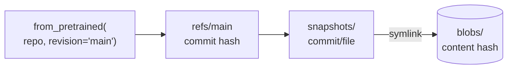

# M03.1 Theory: Hub setup, datasets and models

*[M03 theory](../README.md) · Lesson 3.1 · Notebooks: [`01a_hf_setup.ipynb`](../../../../course/p01_ai_engineering_foundations/m03_hugging_face_models/notebooks/01a_hf_setup.ipynb), [`01b_hf_basics.ipynb`](../../../../course/p01_ai_engineering_foundations/m03_hugging_face_models/notebooks/01b_hf_basics.ipynb) · [All theory pages](../../../README.md)*

## Hub & cache

The Hugging Face Hub stores models, datasets and Spaces as git repositories named `owner/name`, such as `sentence-transformers/all-MiniLM-L6-v2`. Every change to a repo is a commit with a 40-character hash, and branch names such as `main` point to the latest one. Notebook `01a` logs in with `notebook_login()`, which saves an access token; scripts and servers read the same token from the `HF_TOKEN` environment variable. Public models download without a token, but gated models need one, and anonymous requests get lower rate limits (the library prints a warning saying so).

The first `from_pretrained` or `pipeline` call for a repo downloads its files into a local cache. Every later call reads the files from disk. This is the entry for the embedding model M14 and M17 use, as it sits in a cache on disk:

```
~/.cache/huggingface/hub/models--sentence-transformers--all-MiniLM-L6-v2/
├── refs/main                       40 bytes: the commit hash 1110a243…
├── blobs/                          each file once, named by the hash of its content
│   ├── 53aa5117…                   90,868,376 bytes (the weights)
│   ├── cb202bfe…                   466,247 bytes (tokenizer.json)
│   └── …
├── snapshots/1110a243…/            the repo as it was at that commit
│   ├── model.safetensors  -> ../../blobs/53aa5117…
│   ├── tokenizer.json     -> ../../blobs/cb202bfe…
│   └── …                           every file is a symlink into blobs/
└── .no_exist/                      files the library asked for that the repo does not have
```



Three consequences follow from that layout:

- **A name is not a version.** `main` moves when the owner pushes. Pass `revision=` with a commit hash to load the same weights in every environment, which is how `transformers` pins its own default models (lesson 3.2).
- **Revisions share files.** Two snapshots of one repo point at the same blob when a file did not change, so a new commit downloads only what changed. Old revisions stay on disk until you remove them.
- **The cache is a folder you can move.** `HF_HOME` (default `~/.cache/huggingface`) or `HF_HUB_CACHE` (default `$HF_HOME/hub`) relocate it, for example to a volume shared by several containers; `HF_HUB_OFFLINE=1` makes the library read only from it and never call the Hub.

To see what the cache holds, `scan_cache_dir()` in `01a` returns an `HFCacheInfo` object with every repo, revision and size. The notebook also suggests `huggingface-cli scan-cache`; in `huggingface_hub` 1.16.1, the version this course locks, that command prints "`huggingface-cli` is deprecated and no longer works". Use `hf cache ls` to list repos and sizes, `hf cache rm` to delete one, and `hf cache prune` to remove revisions no branch points to.

Datasets use the same Hub and their own cache. Notebook `01b` calls `load_dataset('rotten_tomatoes', cache_dir='rotten_tomatoes_data')`; the relative `cache_dir` writes a data folder next to the notebook instead of into the shared cache. The dataset has three splits (8,530 training, 1,066 validation and 1,066 test reviews), and the notebook divides its correct predictions by a hard-coded 1066. Write `len(test_df)` instead, so the accuracy stays right if the split changes. The Hub now lists the dataset as `cornell-movie-review-data/rotten_tomatoes`; if the short name stops resolving, use the full id.

## Key Takeaways

- Hub repos are git repositories, and a branch such as `main` moves when the owner pushes. Pin `revision=` to a commit hash to load the same weights in every environment.
- The cache stores each file once as a content-hashed blob and links snapshots to it, so a new commit downloads only what changed. Clear old revisions with `hf cache prune`.
- Relocate the cache with `HF_HOME` or `HF_HUB_CACHE` and set `HF_HUB_OFFLINE=1` on servers that must never call the Hub. Compute accuracy from `len(test_df)`, never a hard-coded count.

## Check yourself

<details>
<summary>1. Why does loading a model with revision main not guarantee the same weights in every environment?</summary>

A name is not a version. `main` is a branch that moves when the owner pushes, and `refs/main` holds whichever commit hash it points to now. Pass `revision=` with a commit hash to load the same weights everywhere, which is how `transformers` pins its own default models.

</details>

<details>
<summary>2. The owner of all-MiniLM-L6-v2 pushes a commit that changes only tokenizer.json. What does your next load of main download, and what stays on disk?</summary>

Only the new `tokenizer.json`. The new snapshot's `model.safetensors` symlink points at the same 90,868,376-byte blob, because that file did not change. The old revision stays on disk until you remove it; `hf cache prune` removes revisions no branch points to.

</details>

<details>
<summary>3. Several containers share one model cache, and the servers must never call the Hub. Which settings do you use?</summary>

Point `HF_HOME` or `HF_HUB_CACHE` at the shared volume, and set `HF_HUB_OFFLINE=1` so the library reads only from the cache. Pin each model with `revision=` and a commit hash so every container loads the same snapshot.

</details>

---
*Previous: [M03 overview](../README.md). Next: [3.2 Pipelines, tokenization and pretrained models](../02_pipelines_tokenization_and_pretrained_models/README.md).*
