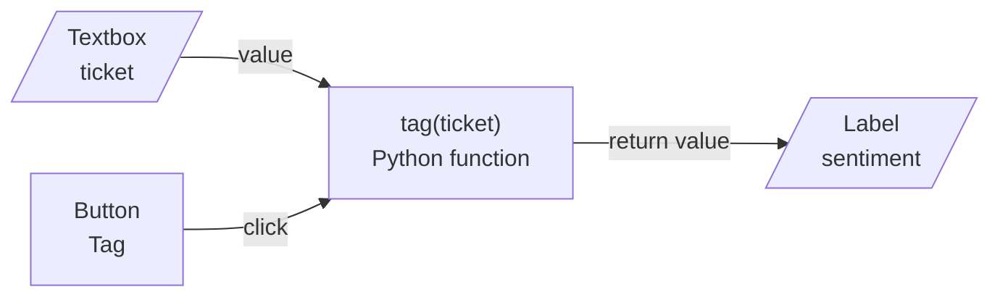

# M03.5 Theory: Building demos with Gradio

*[M03 theory](../README.md) · Lesson 3.5 · Notebooks: [`05a_gradio_introduction.ipynb`](../../../../course/p01_ai_engineering_foundations/m03_hugging_face_models/notebooks/05a_gradio_introduction.ipynb), [`05b_gradio_layout.ipynb`](../../../../course/p01_ai_engineering_foundations/m03_hugging_face_models/optional/05b_gradio_layout.ipynb) (optional), [`05c_gradio_interactions.ipynb`](../../../../course/p01_ai_engineering_foundations/m03_hugging_face_models/optional/05c_gradio_interactions.ipynb) (optional), [`05d_gradio_image_ml_integration.ipynb`](../../../../course/p01_ai_engineering_foundations/m03_hugging_face_models/optional/05d_gradio_image_ml_integration.ipynb) (optional), [`05e_gradio_text_ml_integration.ipynb`](../../../../course/p01_ai_engineering_foundations/m03_hugging_face_models/optional/05e_gradio_text_ml_integration.ipynb) (optional), [`05f_gradio_modals_errors.ipynb`](../../../../course/p01_ai_engineering_foundations/m03_hugging_face_models/optional/05f_gradio_modals_errors.ipynb) (optional), [`05g_gradio_styling_and_themes.ipynb`](../../../../course/p01_ai_engineering_foundations/m03_hugging_face_models/optional/05g_gradio_styling_and_themes.ipynb) (optional) · [All theory pages](../../../README.md)*

## Gradio Blocks

Gradio turns a Python function into a web page. The function stays ordinary Python; Gradio draws an input component for each argument, an output component for each return value, and calls the function when the user acts. `launch()` serves the page at `http://localhost:7860`, or the next free port above it.

Gradio has two ways to build that page:

- **`gr.Interface(fn, inputs, outputs)`** builds a form around one function: the input components, a Submit button and the outputs. Notebook `05a` wraps an adder, a text reverser, a greyscale filter and a classifier this way, and `05d` sets `live=True` so the function reruns on every change instead of on Submit. Interface also adds a Flag button; in Gradio 6.31 flagged examples go to `.gradio/flagged`, not the `flagged` folder `05a` names.
- **`gr.Blocks()`** is a context manager in which you place components yourself, inside `gr.Row()`, `gr.Column(scale=…)`, `gr.Tab()`, `gr.Accordion()` and `gr.Group()` (`05b`). Blocks adds no button and calls nothing by itself. You connect each event to a function (`05c`): `button.click(fn, inputs, outputs)` runs on a click, `slider.change(...)` on every change of value. One page can hold many components and many events, each with its own function.



The event names its inputs and outputs by component, and Gradio passes values between the browser and the function. This is the Larkspur ticket tagger as a Blocks app, with the ticket box and button in a wide column and the result beside them:

```python
import gradio as gr
from transformers import pipeline

clf = pipeline("sentiment-analysis",
               model="distilbert/distilbert-base-uncased-finetuned-sst-2-english",
               revision="714eb0f")                       # loaded once, when the app starts

def tag(ticket):
    if not ticket.strip():
        raise gr.Error("Paste a ticket first.")          # stops here and shows the message
    r = clf(ticket)[0]
    return {r["label"]: r["score"]}                      # gr.Label shows a label with its confidence

with gr.Blocks() as demo:
    with gr.Row():
        with gr.Column(scale=2):
            ticket = gr.Textbox(label="Ticket", lines=4)
            go = gr.Button("Tag")
        with gr.Column(scale=1):
            label = gr.Label(label="Sentiment")
    go.click(fn=tag, inputs=ticket, outputs=label)

demo.launch()
```

Three habits from the notebooks carry over to every demo:

- **Load the model once, outside the function.** `05e` builds its sentiment pipeline at the top of the notebook and only calls it inside `predict_sentiment`. A pipeline built inside the event function would reload the weights on every click.
- **Fail with a message.** `raise gr.Error("…")` stops the function and shows the message in the page; `gr.Warning("…")` shows a notice and lets the function finish (`05f`).
- **Style through `launch()` in Gradio 6.** `05g` passes `theme=` to `gr.Interface` and `css=` to `gr.Blocks`. Gradio 6.31, the version this course locks, still accepts both but warns "The parameters have been moved from the Blocks constructor to the launch() method in Gradio 6.0"; pass them as `demo.launch(theme=…, css=…)`.

Notebook `05e`'s last cell, `gr.load("distilbert-base-uncased-finetuned-sst-2-english", src=…)`, runs the model on Hugging Face's servers instead of locally. In the course copy its `src` points at a GitHub folder URL, which `gr.load` does not accept; the source notebook has `src="models"`, which loads the model by its Hub name.

A demo is a tool for trying a model with people who do not run notebooks, such as the Larkspur support lead. It has no login, rate limit or monitoring unless you add them, so in production the model runs behind a service with those controls, and the demo stays a way to try it.

## Check yourself

<details>
<summary>1. What does gr.Blocks leave you to do that gr.Interface does for you?</summary>

`gr.Interface` builds a form around one function: input components, a Submit button, the outputs and a Flag button. `gr.Blocks` adds no button and calls nothing by itself: you place the components in rows, columns and tabs, and connect each event to a function, such as `button.click(fn, inputs, outputs)`. In return one page can hold many components and events.

</details>

<details>
<summary>2. In the Larkspur ticket tagger, the support lead clicks Tag with an empty ticket box. What does the page show, and does the classifier run?</summary>

The page shows "Paste a ticket first." and the classifier does not run. `tag` checks for an empty ticket first, and `raise gr.Error(...)` stops the function there and shows the message. `gr.Warning` would show a notice and let the function finish.

</details>

<details>
<summary>3. Every click in a colleague's Gradio demo reloads the model weights. Where did they build the pipeline, and where should it go?</summary>

Inside the event function, so each call builds the pipeline again. Build it once outside the function, when the app starts, as `05e` and the ticket tagger do, and only call it inside the function.

</details>

---
*Previous: [3.2 Pipelines, tokenization and pretrained models](../02_pipelines_tokenization_and_pretrained_models/README.md). Next: [M03 interview questions](../README.md#interview-spotlight-5-questions-you-might-get-asked).*
