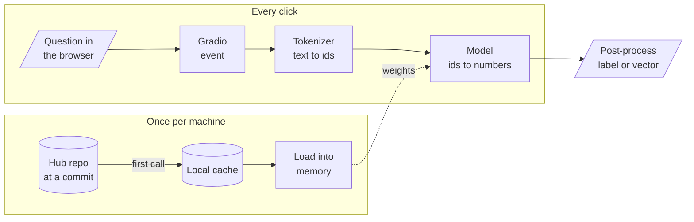

# M03 Theory: Hugging Face models and Gradio demos

*Part I · AI Engineering Foundations · [Module README](../../../course/p01_ai_engineering_foundations/m03_hugging_face_models/README.md) · [All theory pages](../../README.md)*

M02 called models that run on someone else's servers. This module runs open models from the Hugging Face Hub on your own machine: the same kind of model that embeds chunks in M14 and reranks them in M19. The M03 notebooks build on four ideas: where a downloaded model lives and how to pin it, what a pipeline does between your string and its answer, why every limit and price is counted in tokens, and how to put a web page in front of a Python function. Each idea has a page in the folder of the lesson that teaches it, listed under [Lessons](#lessons). This page has the overview, the interview questions and the takeaways.

The running example is the Larkspur Cloud support team, which uses the handbook from M11 to M14. They want three things from open models: a sentiment label on incoming tickets such as *My refund took three weeks.*, a vector for every handbook answer so that *Can I export my data after I cancel my plan?* finds the right one, and a demo page the support lead can try without opening a notebook.

## TL;DR

- `from_pretrained` and `pipeline` download a model once into `~/.cache/huggingface/hub` and read it from disk after that. The cache holds files by content hash under `blobs/` and links them from `snapshots/<commit>/`, so a model is pinned by its commit, not by its name.
- `pipeline(task)` runs three steps: the tokenizer turns text into ids, the model turns ids into numbers, and post-processing turns those numbers into a label and a score. Without `model=`, the task picks a default model, and the defaults change between `transformers` releases.
- Models read tokens, not characters. On the handbook's FAQ page GPT-2 counts 308 tokens and `all-MiniLM-L6-v2` 291, both near M11's four characters per token. Rare words cost more: the notebook's *Preposterous, I'm flabbergasted!* runs at 2.29 characters per MiniLM token.
- Every model has a token limit, and text past it is cut without an error. `all-MiniLM-L6-v2` reads 256 tokens; embed the whole FAQ page and the last 35 tokens, the support and promotional-credit answers, are not in the vector.
- `gr.Interface` wraps one function in a form. `gr.Blocks` lays components out in rows, columns and tabs, and wires each event (`click`, `change`) to a function by naming its inputs and outputs.

## Mental model

<!-- animated: diagrams/hub-to-demo.anim.html -->

Only the first call touches the network; every later call reads the cache, and a running app loads the model once and keeps it in memory. The tokenizer and the model come from the same repo and must stay together, because the ids mean nothing to any other model. Gradio adds nothing to the model; it calls the same Python function on every click.

## Lessons

| Lesson | Topic | Theory |
|---|---|---|
| 3.1 | Hub setup, datasets and models | [Hub & cache](01_hub_setup_datasets_and_models/README.md#hub--cache) |
| 3.2 | Pipelines, tokenization and pretrained models | [Pipelines](02_pipelines_tokenization_and_pretrained_models/README.md#pipelines) [Tokenization](02_pipelines_tokenization_and_pretrained_models/README.md#tokenization) [From logits to text](02_pipelines_tokenization_and_pretrained_models/README.md#from-logits-to-text) |
| 3.3 | Images, diffusion and video generation | *planned* |
| 3.4 | Audio: data, classification, transcription, generation | *planned* |
| 3.5 | Building demos with Gradio | [Gradio Blocks](05_building_demos_with_gradio/README.md#gradio-blocks) |

## Interactive lab

[**Tokens and the limit**](02_pipelines_tokenization_and_pretrained_models/interactive/token-limit-lab.html): open the file in a browser. It opens on the FAQ page under MiniLM at its real limit of 256: the support and promotional-credit answers are struck through. Switch to *Refunds section* and press 128: the cut lands inside the sentence that M13's golden question needs, after "100 GB of out". Then pick *The product name* and compare the two tokenizers' pieces of "Larkspur".

## How it connects

- **Before:** [M02](../m02_llm_apis_and_model_selection/README.md) calls hosted models and counts their tokens on the bill; this module runs open ones locally and counts tokens against the model's limit. M01 covers the Python and NumPy the notebooks use.
- **Next:** [M04](../m04_fine_tuning_fundamentals/README.md) trains these models instead of only running them. [M13](../../p05_ingestion_and_indexing/m13_chunking/README.md) sizes chunks, and the token limit here is the ceiling for that size. [M14](../../p05_ingestion_and_indexing/m14_embeddings/README.md) loads `all-MiniLM-L6-v2` with sentence-transformers, and [M19](../../p06_retrieval_quality/m19_reranking_post_retrieval/README.md) loads cross-encoder rerankers from the same cache.

## Interview Spotlight: 5 Questions You Might Get Asked

*Production questions of the kind asked in applied AI engineering interviews.*

### 1. Larkspur indexes each handbook page as one chunk with `all-MiniLM-L6-v2`. Support says "How fast does support answer a ticket?" never finds the FAQ page, though the answer is on it. What do you check?

**What a strong answer covers:**
- Tokenizes the page with the model's own tokenizer and compares the count with `max_seq_length` (256 here); the FAQ page is 291 tokens, so the support answer is past the cut
- Proves it by embedding the page and its first 1,231 characters: the two vectors are identical (cosine 1.0000), so the tail never mattered
- Fixes it at chunking time (M13), with chunk sizes counted in the embedding model's tokens, not characters
- Adds a check at indexing time that logs or rejects any chunk over the limit, since the library raises no error

### 2. A teammate's service calls `pipeline("sentiment-analysis")` with no model argument to tag tickets. Is that ready to ship?

**What a strong answer covers:**
- The task name picks a default model (`distilbert-base-uncased-finetuned-sst-2-english` in `transformers` 5.17.0) and the default can change in any release; `text-generation` now defaults to `SmolLM3-3B`, and the question-answering and translation tasks the notebook uses are gone in 5.x
- Pins `model=` and `revision=` (a commit hash) so the same weights run in every environment
- Checks the model fits the data: SST-2 is movie reviews with two labels, while tickets need categories such as billing or outage
- Measures it on labelled tickets before trusting the score, as notebook 01b does with the 1,066 Rotten Tomatoes test reviews

### 3. Finance asks what the ticket tagger will cost and how slow it is. How do you estimate it before launch?

**What a strong answer covers:**
- Counts tokens with the model's own tokenizer on a sample of real tickets; characters divided by four is close on prose and off by almost half on names and odd words (2.29 characters per token on the notebook's sentence)
- Measures latency per batch on the target hardware, with the model loaded once, not per request
- Separates the one-time costs (download, about 268 MB for the SST-2 model, and load) from the per-call cost
- Tracks token counts and latency percentiles in production, because ticket length drifts

### 4. The tagger runs in containers on a cluster with no internet access. The first deploy fails at startup. Why, and how do you ship models there?

**What a strong answer covers:**
- `from_pretrained` tries to download on a cache miss; with no network it fails, and every new pod would download again even with network
- Builds the cache into the image or a mounted volume (`HF_HOME` or `HF_HUB_CACHE`), at a pinned revision
- Sets `HF_HUB_OFFLINE=1` so the library reads the cache and never calls the Hub
- Watches disk use with `hf cache ls` and removes revisions no branch points to with `hf cache prune`; their blobs stay on disk until then

### 5. The support lead's Gradio demo takes several seconds per click, though the model alone answers in a fraction of that. Where does the time go?

**What a strong answer covers:**
- Looks for the model being loaded inside the event function; load the pipeline once at module level and call it in the function
- Checks whether `share=True` routes traffic through a tunnel, and whether many users queue behind one worker
- Times each step (tokenize, model, post-process, network) instead of guessing
- Treats the demo as a demo: authentication, rate limits and monitoring belong to the real service, not to `launch()`

## Key Takeaways

- Pin every model by name and commit. A task default or a moving `main` branch changes your results without changing your code.
- Count tokens with the model's own tokenizer, and keep every input under its limit; truncation is silent.
- A pipeline is tokenizer, model and post-processing. When its output is wrong, check each of the three before blaming the model.
- Load models once and call them many times, in notebooks, services and Gradio demos alike.

---
*Previous: [M02 LLM provider APIs and model selection](../m02_llm_apis_and_model_selection/README.md). Next: [M04 Fine-tuning fundamentals](../m04_fine_tuning_fundamentals/README.md).*
