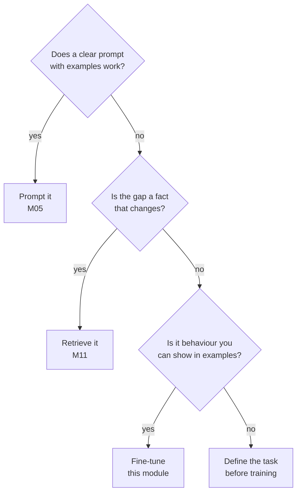

# M04.1 Theory: Why fine-tune

*[M04 theory](../README.md) · Lesson 4.1 · Notebooks: [`01a_why_finetuning_lab.ipynb`](../../../../course/p01_ai_engineering_foundations/m04_fine_tuning_fundamentals/notebooks/01_why_finetune/01a_why_finetuning_lab.ipynb), [`01b_why_finetuning_lecture.ipynb`](../../../../course/p01_ai_engineering_foundations/m04_fine_tuning_fundamentals/optional/01_why_finetune/01b_why_finetuning_lecture.ipynb) (optional) · [All theory pages](../../../README.md)*

## When to fine-tune

Fine-tuning updates the model’s weights with your examples. Prompting changes only the input, and RAG (M11) changes only what the input contains. Each fixes a different gap:

| | Prompting | RAG | Fine-tuning |
|---|---|---|---|
| What changes | The instructions and examples in each call | The evidence pasted into each call | The weights |
| Good for | Format and tone you can describe in a few lines | Facts that change, private documents, citations | Behaviour too long or subtle to describe: a house style, a narrow task, consistent refusals |
| Cost of a change | Edit the prompt | Re-index a document | Rebuild the dataset and retrain |
| Per-call cost | Grows with every instruction and example | Retrieval plus a few chunks | Lowest: the behaviour is in the weights |
| Main risk | Long prompts, drift between calls | Retrieval misses the evidence | Stale facts, lost general ability, no citations |

For the Larkspur support assistant the split is clear. *How long does a refund take?* has an answer that the policy team will change, so it stays in the index. Leading every answer with *Yes* or *No* and declining *What do you think of Mars?* is behaviour, and a fine-tune can carry it on a smaller, cheaper model. Most production systems that fine-tune also retrieve.

If you cannot write a few hundred examples of the behaviour you want, you cannot fine-tune for it, and you cannot evaluate it either.

## Base and chat models

The lesson 4.1 notebook sends the same prompts to `meta-llama/Llama-2-7b-hf`, a base model, and `meta-llama/Llama-2-7b-chat-hf`, the same model after instruction tuning and preference training. The outputs it prints are recorded in the notebook’s `llama.py`:

| Prompt | Base model | Chat model |
|---|---|---|
| Tell me how to train my dog to sit | “Tell me how to train my dog to stay. Tell me how to teach my dog to come. …” | “on command. Training your dog to sit is a basic obedience command …” followed by numbered steps |
| `[INST]`Tell me how to train my dog to sit`[/INST]` | Echoes the prompt unchanged | The numbered steps, without the “on command” fragment |
| What do you think of Mars? | “I think it’s a great planet. I think it’s a good planet. …” for 30 lines | A paragraph about Mars |

The base model does what pre-training taught it: continue the text with something that looks like more of the same, here a list of similar questions. The chat model treats the text as a request. The `[INST]` row shows the second lesson: the chat model was trained with that wrapper, and with it the answer starts cleanly; without it, the model first completes the sentence (“on command.”). A fine-tuned model expects the format it was trained on, which lesson 4.3 comes back to.

The weights changed and the architecture did not. Everything that separates the two columns came from the training data, which is why the rest of this module is about the data.

---
*Previous: [M04 overview](../README.md). Next: [4.2 Where fine-tuning fits](../02_where_fine_tuning_fits/README.md).*
