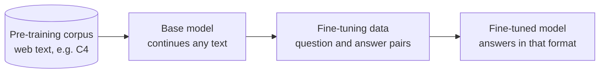

# M04.2 Theory: Where fine-tuning fits

*[M04 theory](../README.md) · Lesson 4.2 · Notebooks: [`02a_where_finetuning_fits_in_lab.ipynb`](../../../../course/p01_ai_engineering_foundations/m04_fine_tuning_fundamentals/optional/02_where_finetuning_fits/02a_where_finetuning_fits_in_lab.ipynb) (optional), [`02b_where_finetuning_fits_in_lecture.ipynb`](../../../../course/p01_ai_engineering_foundations/m04_fine_tuning_fundamentals/optional/02_where_finetuning_fits/02b_where_finetuning_fits_in_lecture.ipynb) (optional) · [All theory pages](../../../README.md)*

## Pre-training, then fine-tuning

Both stages train the same way: show the model text and adjust the weights so it predicts each next token better. What differs is the data.



The lesson 4.2 notebook prints both kinds side by side. The first rows it streams from C4 (`load_dataset("c4", "en", streaming=True)`) are scraped web pages: whatever text was on the page, in whatever order. The fine-tuning file, `lamini_docs.jsonl`, has 1,400 rows, each a `question` and an `answer` about one product. Pre-training gives the model language and general knowledge from a huge, unlabelled corpus; fine-tuning shows it, in a small labelled one, what a good response looks like.

| | Pre-training | Fine-tuning |
|---|---|---|
| Data | Raw text, unlabelled, web scale | Curated pairs, labelled, hundreds to thousands of rows (1,400 here) |
| What the model learns | Language, facts, patterns of text | A format, a task, a tone, when to decline |
| Who runs it | Model labs, once per model | You, whenever the behaviour needs to change |

The notebook then formats the same rows two ways, and both are common:

- **Text only:** one `text` field holding the whole example, `### Question:` and `### Answer:` included. Trainers that take a `text_column`, such as AutoTrain in lesson 4.7, expect this.
- **Question and answer:** the prompt in one field (`### Question:` up to `### Answer:`) and the answer in another. Keeping them apart lets you score only the answer at evaluation time, and mask the prompt out of the loss if you choose.

Both are written to JSON Lines, one example per line, which is what `datasets.load_dataset("json", …)` reads in lesson 4.4.

A Larkspur example in the second form:

```json
{"question": "### Question:\nCan I export my data after I cancel my plan?\n\n### Answer:", "answer": "Yes, for 30 days. After that the data is permanently deleted, so export it from Settings, then Data, first."}
```

---
*Previous: [4.1 Why fine-tune](../01_why_fine_tune/README.md). Next: [4.3 Instruction tuning](../03_instruction_tuning/README.md).*
