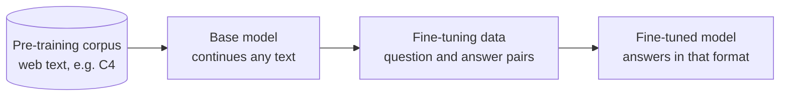

# M04.2 Theory: Where fine-tuning fits

*[M04 theory](../README.md) · Lesson 4.2 · Notebooks: [`02a_where_finetuning_fits_in_lab.ipynb`](../../../../course/p01_ai_engineering_foundations/m04_fine_tuning_fundamentals/optional/02_where_finetuning_fits/02a_where_finetuning_fits_in_lab.ipynb) (optional), [`02b_where_finetuning_fits_in_lecture.ipynb`](../../../../course/p01_ai_engineering_foundations/m04_fine_tuning_fundamentals/optional/02_where_finetuning_fits/02b_where_finetuning_fits_in_lecture.ipynb) (optional) · [All theory pages](../../../README.md)*

## Pre-training, then fine-tuning

Both stages train the same way: show the model text and adjust the weights so it predicts each next token better. What differs is the data.



The lesson 4.2 notebook prints both kinds side by side. The first rows it streams from C4 (`load_dataset("c4", "en", streaming=True)`) are scraped web pages: whatever text was on the page, in whatever order. The fine-tuning file, `lamini_docs.jsonl`, has 1,400 rows, each a `question` and an `answer` about one product. Pre-training gives the model language and general knowledge from a huge, unlabelled corpus; fine-tuning shows it, in a small labelled one, what a good response looks like.

| | Pre-training | Fine-tuning |
|---|---|---|
| Data | Raw text, unlabelled, web scale | Curated pairs, labelled, hundreds to thousands of rows (1,400 here) |
| What the model learns | Language, facts, patterns of text | A format, a task, a tone, when to decline |
| Who runs it | Model labs, once per model | You, whenever the behaviour needs to change |

The notebook then formats the same rows two ways, and both are common:

- **Text only:** one `text` field holding the whole example, `### Question:` and `### Answer:` included. Trainers that take a `text_column`, such as AutoTrain in lesson 4.7, expect this.
- **Question and answer:** the prompt in one field (`### Question:` up to `### Answer:`) and the answer in another. Keeping them apart lets you score only the answer at evaluation time, and mask the prompt out of the loss if you choose.

Both are written to JSON Lines, one example per line, which is what `datasets.load_dataset("json", …)` reads in lesson 4.4.

A Larkspur example in the second form:

```json
{"question": "### Question:\nCan I export my data after I cancel my plan?\n\n### Answer:", "answer": "Yes, for 30 days. After that the data is permanently deleted, so export it from Settings, then Data, first."}
```

## Key Takeaways

- Pre-training and fine-tuning use the same next-token objective. Only the data differs: web-scale raw text for language and knowledge, a few hundred to a few thousand labelled pairs for a format, task or tone.
- Model labs pre-train once per model. You fine-tune whenever the behaviour needs to change.
- Store examples as JSON Lines, either as one `text` field for trainers that take a `text_column` or as separate prompt and answer fields so you can score only the answer.

## Check yourself

<details>
<summary>1. Pre-training and fine-tuning both train the model to predict each next token. What makes their results differ?</summary>

The data. Pre-training uses a huge, unlabelled corpus of raw web text such as C4, and gives the model language, facts and patterns of text. Fine-tuning uses a small, curated, labelled set (1,400 question and answer rows in `lamini_docs.jsonl`) and teaches a format, a task, a tone and when to decline.

</details>

<details>
<summary>2. You will train the Larkspur examples with AutoTrain, and at evaluation time you want to score only the answer. Which of the two formats does each step need?</summary>

AutoTrain takes a `text_column`, so training needs the text-only form: one `text` field with `### Question:` and `### Answer:` inside it. Scoring only the answer needs the question-and-answer form, with the prompt and the answer in separate fields. The notebook formats the same rows both ways and writes both to JSON Lines.

</details>

<details>
<summary>3. A teammate proposes pre-training a model on the Larkspur handbook to teach it the house style. Why does the comparison point to fine-tuning instead?</summary>

Pre-training needs web-scale raw text and is run by model labs once per model; it teaches language and general knowledge. Fine-tuning needs hundreds to thousands of curated pairs, you run it whenever the behaviour needs to change, and a tone or format is what it teaches.

</details>

---
*Previous: [4.1 Why fine-tune](../01_why_fine_tune/README.md). Next: [4.3 Instruction tuning](../03_instruction_tuning/README.md).*
