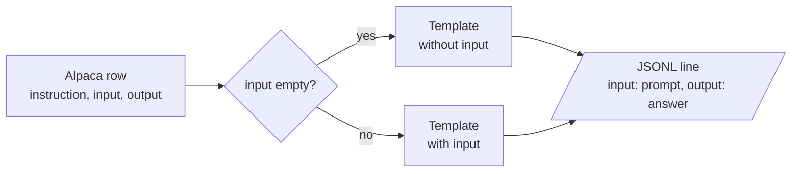

# M04.3 Theory: Instruction tuning

*[M04 theory](../README.md) · Lesson 4.3 · Notebooks: [`03a_instruction_tuning_lab.ipynb`](../../../../course/p01_ai_engineering_foundations/m04_fine_tuning_fundamentals/notebooks/03_instruction_tuning/03a_instruction_tuning_lab.ipynb), [`03b_instruction_tuning_lecture.ipynb`](../../../../course/p01_ai_engineering_foundations/m04_fine_tuning_fundamentals/optional/03_instruction_tuning/03b_instruction_tuning_lecture.ipynb) (optional) · [All theory pages](../../../README.md)*

## Instruction tuning

Instruction tuning is fine-tuning on pairs of a request and a good response. It is the first step that turned the base Llama 2 of lesson 4.1 into the chat model. What it teaches is a pattern: text shaped like a request is followed by text shaped like an answer, and then the answer ends.

The lesson 4.3 notebook streams the first five rows of `tatsu-lab/alpaca`, an instruction dataset where every row has three fields: `instruction` (the request), `input` (optional context, empty in all five rows shown) and `output` (the answer). A prompt template turns each row into training text, and the notebook keeps two:

```text
Below is an instruction that describes a task, paired with an input that provides further context. Write a response that appropriately completes the request.

### Instruction:
{instruction}

### Input:
{input}

### Response:
```

The second template is the same without the `### Input:` block, for rows whose `input` is empty. Filling a template with a row’s values is what the notebook calls *hydrating* the prompt:



The result is written to `alpaca_processed.jsonl` with one `{"input": …, "output": …}` object per line. The same shape works for Larkspur: the instruction is the customer’s question, the input is empty, and the output is an answer in the house style.

The notebook ends by asking the same test question from `lamini/lamini_docs` to two models with the same architecture and tokenizer: the base `EleutherAI/pythia-70m`, and `lamini/lamini_docs_finetuned`, which is pythia-70m after fine-tuning on that dataset. Any difference between the two answers comes from the training rows alone. The notebook ships without saved outputs, so run it to see them.

## The template at inference

A model learns the exact surface form of its training text, so the prompt at inference has to match it. Lesson 4.1 showed the cost: the Llama 2 chat model, given a request without its `[INST]` wrapper, first finished the sentence (“on command.”) before answering.

The M04 notebooks are a useful warning. Lesson 4.4 builds `### Question:` / `### Answer:` prompts, but the `lamini/lamini_docs` copy that lesson 4.5 trains on carries none: in all 1,260 training rows `input_ids` is the bare question followed immediately by the bare answer (`…from Lamini models?There are several metrics…`), with no separator and no end token. The `inference` helper then sends the bare question, which matches that training text, so the two stay consistent by accident. Change either side alone and the model sees a format it was never trained on.

Three rules keep training and inference in step:

- **One template, in code, used by both.** Write the formatting function once and import it in the data script and the serving code.
- **Mark where the answer starts and where it ends.** A header such as `### Answer:` tells the model to start answering; an end token (`<|endoftext|>` for Pythia) tells it, and your decoder, that the answer is over.
- **Check the tokenized row, not the string.** Decode a few prepared rows before training; [the lab in lesson 4.4](../04_data_preparation/README.md#data-preparation) shows what to look for.

## Key Takeaways

- Instruction tuning trains on request and response pairs. A prompt template turns each row into training text, with a variant for rows that have no `input`.
- A model learns the exact surface form of its training text, so the inference prompt must match it. Changing the training format or the serving prompt alone breaks the match.
- Write one formatting function that the data script and the serving code both import, mark where the answer starts and ends, and decode a few tokenised rows before training.

## Check yourself

<details>
<summary>1. What pattern does instruction tuning teach a base model?</summary>

That text shaped like a request is followed by text shaped like an answer, and then the answer ends. It is fine-tuning on pairs of a request and a good response, and it was the first step that turned base Llama 2 into the chat model.

</details>

<details>
<summary>2. An Alpaca row has an empty input field. Which template does the notebook fill, and what does the output line look like?</summary>

The second template, without the `### Input:` block, filled with the row's `instruction`. The notebook writes one `{"input": ..., "output": ...}` object per line to `alpaca_processed.jsonl`: the hydrated prompt as `input` and the answer as `output`. A Larkspur row has the same shape, with the customer's question as the instruction.

</details>

<details>
<summary>3. The lesson 4.5 model trained on the bare question followed by the bare answer. You add a ### Answer: header to the serving prompt only. What goes wrong?</summary>

The model now sees a format it was never trained on. Training and inference matched only by accident, and changing either side alone breaks that. Keep one formatting function in code that both the data script and the serving code import, and mark where the answer starts and ends.

</details>

---
*Previous: [4.2 Where fine-tuning fits](../02_where_fine_tuning_fits/README.md). Next: [4.4 Data preparation](../04_data_preparation/README.md).*
