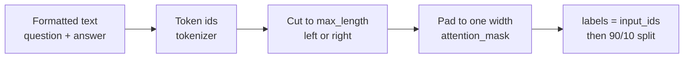

# M04.4 Theory: Data preparation

*[M04 theory](../README.md) · Lesson 4.4 · Notebooks: [`04a_data_preparation_lab.ipynb`](../../../../course/p01_ai_engineering_foundations/m04_fine_tuning_fundamentals/notebooks/04_data_preparation/04a_data_preparation_lab.ipynb), [`04b_data_preparation_lecture.ipynb`](../../../../course/p01_ai_engineering_foundations/m04_fine_tuning_fundamentals/optional/04_data_preparation/04b_data_preparation_lecture.ipynb) (optional) · [All theory pages](../../../README.md)*

## Data preparation

A model trains on token ids, in rectangular batches. Data preparation turns each formatted example into one row of ids, makes the rows fit a length limit and a common width, and holds some rows back for evaluation.

**Tokenize.** The notebook loads the `EleutherAI/pythia-70m` tokenizer, the one its model was trained with. `"Hi, how are you?"` becomes six ids, `[12764, 13, 849, 403, 368, 32]`, and `decode` turns them back into the same string. Text and tokens are different units: the first `lamini_docs` example is 358 characters and 77 tokens.

**Pad.** A batch is one tensor, so its rows need one width. Pythia’s tokenizer has its own `<|padding|>` token, but the notebook sets `tokenizer.pad_token = tokenizer.eos_token`, so padding uses id 0, the end-of-text id. With `padding=True`, `["Hi, how are you?", "I'm good", "Yes"]` (6, 3 and 1 tokens) become three rows of 6, the short ones filled with 0 on the right. `attention_mask` marks real tokens with 1 and padding with 0, so attention skips the padding.

**Truncate.** `max_length` with `truncation=True` caps every row. The default cuts from the right; the notebook switches to `truncation_side = "left"`. At `max_length=3` the first sentence keeps `[12764, 13, 849]` (“Hi, how”) from the right cut and `[403, 368, 32]` (“ are you?”) from the left.

**Label and split.** For a causal language model the target is the input itself, shifted by one inside the model, so the notebook adds `labels` as a copy of `input_ids`. `train_test_split(test_size=0.1, shuffle=True, seed=123)` then turns the 1,400 rows into 1,260 for training and 140 held out; the fixed seed gives the same split on every run.

Each of these choices changes what the model learns, and three of them fail silently:

- **Right truncation** cuts the end of the answer, and the end token with it. The model trains on answers that stop mid-sentence.
- **Left truncation** cuts the start: the `### Question:` header first, then the question. The model trains on answers to questions it cannot see.
- **No end token.** The Pythia tokenizer appends nothing, so a question-plus-answer row never shows the model where an answer stops. Append `tokenizer.eos_token` to each training text. Since padding reuses id 0 and `labels` copies it, set padded positions in `labels` to -100 so the loss ignores them.

The [interactive lab](interactive/truncation-padding-lab.html) builds a three-example Larkspur batch with the real Pythia tokens. At `max_length = 48` right truncation cuts 11 answer tokens from the refund example, and left truncation cuts the header and 7 question tokens from it instead. Padding to the longest row adds 18 pad tokens, 13% of the batch; padding to a fixed `max_length` of 64 with the end token appended adds 52, 27%. No row ends with `<|endoftext|>` until you append it.

<!-- lab: interactive/truncation-padding-lab.html -->

In the notebook itself the limit never bites. Its `tokenize_function` caps rows at 2,048 tokens, and the longest of the 1,400 `lamini_docs` rows is 479 (median 75, 90th percentile 128). Measure your own length distribution before choosing `max_length`: set it just above the longest rows you want to keep whole, and decide on purpose what happens to the rest.

Two notebook details are worth knowing before you reuse the code. `tokenize_function` reads only item `[0]` of each batch it receives, so it works only because `map` is called with `batch_size=1`. And with one example per batch there is nothing to pad: the training run in lesson 4.5 never pads at all.

## Checking the rows

Tokenizing does not check the data. Read the rows before you train on them; in `lamini_docs.jsonl` a short pass finds:

| Check | What it finds in the 1,400 rows | Why it matters |
|---|---|---|
| Empty rows | 1 row with a blank question and a blank answer | It tokenizes to zero ids; lesson 4.5’s custom `Trainer` has a guard that skips empty inputs |
| Duplicate questions | 3 extra copies of questions already in the file | Duplicates weigh a behaviour twice, and one copy can land in the test split while the other trains |
| Refusals | 39 answers that ask to “keep the discussion relevant to Lamini” | These rows are what teach the model to decline off-topic questions such as *What do you think of Mars?* |
| Length | 0 rows over 2,048 tokens; the longest is 479 | Sets `max_length`, and with it memory and step time |

The refusal rows show how a behaviour gets in: the model declines off-topic questions because 39 training answers do. A Larkspur dataset needs its own share of those rows, written in the house style, or the fine-tuned assistant will answer *What do you think of Mars?* as cheerfully as the base model. Deduplicate before you split, and check that no test question also appears in training.

## Check yourself

1. The Pythia tokenizer appends no end token, and padding reuses the end-of-text id. What do you add to each training text, and what do you set at padded label positions?

Append `tokenizer.eos_token` to each training text, so every row shows the model where an answer stops. Then set the padded positions in `labels` to -100: padding uses id 0 and `labels` copies `input_ids`, so without that step the loss would train on the padding.

2. In the lab's Larkspur batch at max_length 48, what does each truncation side remove from the refund example?

Right truncation cuts 11 answer tokens from the end, so the model trains on an answer that stops mid-sentence. Left truncation keeps the answer but cuts the `### Question:` header and 7 question tokens, so the model trains on an answer to a question it cannot fully see. Neither raises an error.

3. A fine-tuned Larkspur assistant answers What do you think of Mars? as cheerfully as the base model. What was missing from its training data?

Refusal rows. In `lamini_docs.jsonl` the model learns to decline off-topic questions because 39 training answers ask to keep the discussion relevant to Lamini. A Larkspur dataset needs its own share of those rows, written in the house style.

---
*Previous: [4.3 Instruction tuning](../03_instruction_tuning/README.md). Next: [4.5 Training](../05_training/README.md).*
