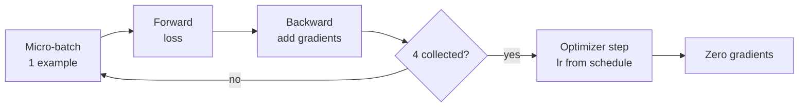

# M04.5 Theory: Training

*[M04 theory](../README.md) · Lesson 4.5 · Notebooks: [`05a_training_lab.ipynb`](../../../../course/p01_ai_engineering_foundations/m04_fine_tuning_fundamentals/notebooks/05_training/05a_training_lab.ipynb), [`05b_training_lecture.ipynb`](../../../../course/p01_ai_engineering_foundations/m04_fine_tuning_fundamentals/optional/05_training/05b_training_lecture.ipynb) (optional) · [All theory pages](../../../README.md)*

## Trainer

The Hugging Face `Trainer` runs the training loop you would otherwise write by hand: batch the data, run the model forward, compute the loss, run it backward, step the optimizer and the learning-rate schedule, evaluate, log and save checkpoints. `TrainingArguments` holds every setting. The lesson 4.5 notebook trains `EleutherAI/pythia-70m` (70.4 million parameters, about 0.28 GB of weights in 32-bit floats) on `lamini/lamini_docs` with these:

| Argument | Value | What it does |
|---|---|---|
| `learning_rate` | `1.0e-5` | Peak step size, reached after warmup |
| `max_steps` | `3` | Optimizer updates to run; overrides `num_train_epochs` |
| `per_device_train_batch_size` | `1` | Examples per forward pass |
| `gradient_accumulation_steps` | `4` | Forward passes summed into one update |
| `warmup_steps` | `1` | Updates spent ramping the learning rate up from 0 |
| `optim` | `"adafactor"` | An optimizer that stores less state per weight than Adam |
| `eval_steps`, `save_steps` | `120` | Evaluate and checkpoint every 120 updates |
| `logging_steps` | `1` | Log after every update |
| `load_best_model_at_end` | `True` | Reload the checkpoint with the lowest `eval_loss` when training ends |

One optimizer step, with a batch of 1 and four accumulation steps:

<!-- animated: diagrams/training-step.anim.html -->

Gradient accumulation gives the update of a batch of 4 while holding only one example in memory. After the gradients are zeroed, the next step starts again from a fresh micro-batch.

The notebook does not use `transformers.Trainer` directly. It imports a subclass from its `utilities.py` that adds three things: it skips a batch whose `input_ids` are empty (the blank row lesson 4.4 found), it logs iteration time, FLOPs per second and remaining time, and it smooths the logged loss. That smoothing is an exponential average that gives each new step a weight of 1/100, so in a 3-step run the logged loss barely moves from the first value. Read the raw loss when you judge a short run.

The FLOPs figure uses the rule `Trainer.floating_point_ops` implements: 6 × tokens × non-embedding parameters. Pythia-70m has 44,670,976 non-embedding parameters, so the notebook’s estimate for a 2,048-token row times 4 accumulation steps is about 2.2 trillion operations per update.

On the `transformers` 5.17 this course pins, the notebook no longer runs as written. `TrainingArguments` rejects `evaluation_strategy` (now `eval_strategy`); the model has no `floating_point_ops` method (the `Trainer` does); and the subclass is written against an older `Trainer`: it passes arguments to `__init__` by position, which no longer lines up, and its `training_step` lacks the `num_items_in_batch` argument the loop now passes.

## Steps, examples and epochs

A step is one optimizer update, not one example. The arithmetic for the lesson 4.5 run:

| | Value |
|---|---|
| Examples per update | 1 per batch × 4 accumulated = 4 |
| Updates | `max_steps` = 3 |
| Examples seen | 12 |
| Training rows | 1,260 |
| Share of one epoch | 0.95% |

The learning rate is not constant either. With the default linear schedule, `warmup_steps=1` and 3 steps in all, `transformers`’ `get_linear_schedule_with_warmup` gives the three updates learning rates of 0, 1e-5 and 5e-6. The first of the three updates changes nothing. And because evaluation and checkpoints happen every 120 updates, this run never computes an `eval_loss`, so `load_best_model_at_end` has no checkpoint to choose.

That is why the notebook calls its result “finetuned slightly” and then loads `lamini/lamini_docs_finetuned`, the same base model trained for two epochs: 2,520 examples against 12. A run that sees under 1% of the data, with one of its three updates at a learning rate of 0, shows the mechanics of training and almost none of its effect.

For a real Larkspur run, size it in examples: decide how many epochs the data supports, derive the number of updates, set warmup to a fraction of them, and put `eval_steps` well inside the run so the held-out loss is tracked while it trains.

## Key Takeaways

- `Trainer` runs the loop and `TrainingArguments` holds every setting. Gradient accumulation gives the update of a larger batch while holding only one micro-batch in memory.
- A step is one optimizer update, not one example. Work out examples seen, share of an epoch and the learning rate per step before you judge a run.
- Size a real run in examples: choose the epochs, derive the updates, set warmup as a fraction of them, and put `eval_steps` inside the run. Read the raw loss, since a smoothed one barely moves on short runs.

## Check yourself

1. With a batch size of 1 and 4 gradient-accumulation steps, how does the trainer produce one optimizer update?

It runs four micro-batches of one example each forward and backward, adding their gradients. Once four are collected it steps the optimizer at the learning rate from the schedule and zeroes the gradients. The update matches a batch of 4 while only one example is held in memory.

2. In the lesson 4.5 run, what learning rates do the three updates get, and what share of an epoch does the model see?

0, 1e-5 and 5e-6, from the linear schedule with `warmup_steps=1`, so the first update changes nothing. Three updates of 4 examples each see 12 of the 1,260 training rows: 0.95% of one epoch.

3. Why does load_best_model_at_end have no checkpoint to choose in the lesson 4.5 run, and how should a real Larkspur run be set?

Evaluation and checkpoints happen every 120 updates and the run has 3, so it never computes an `eval_loss`. Size a real run in examples: decide the epochs the data supports, derive the number of updates, set warmup to a fraction of them, and put `eval_steps` well inside the run.

---
*Previous: [4.4 Data preparation](../04_data_preparation/README.md). Next: [4.6 Evaluation](../06_evaluation/README.md).*
