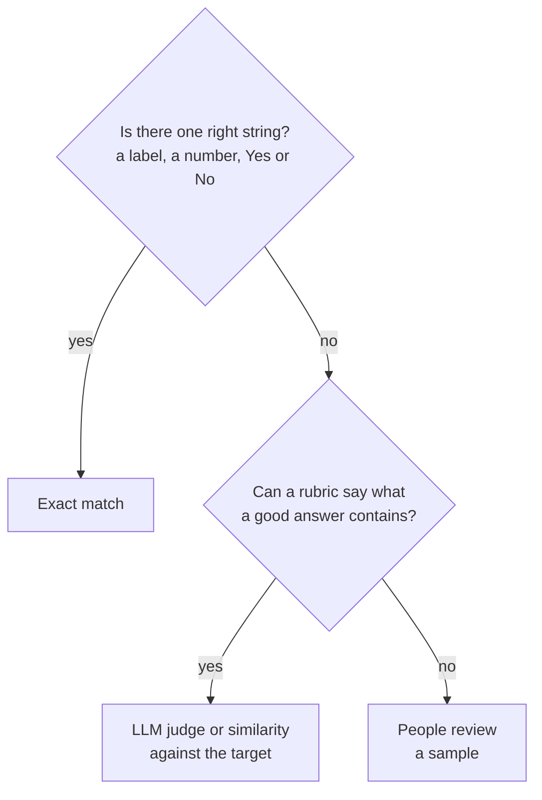

# M04.6 Theory: Evaluation

*[M04 theory](../README.md) · Lesson 4.6 · Notebooks: [`06a_evaluation_lab.ipynb`](../../../../course/p01_ai_engineering_foundations/m04_fine_tuning_fundamentals/notebooks/06_evaluation/06a_evaluation_lab.ipynb), [`06b_evaluation_lecture.ipynb`](../../../../course/p01_ai_engineering_foundations/m04_fine_tuning_fundamentals/optional/06_evaluation/06b_evaluation_lecture.ipynb) (optional) · [All theory pages](../../../README.md)*

## Evaluation

Training loss tells you the model fits its training rows. Evaluation asks whether it does the job on rows it never saw, and whether it still does the jobs it could do before. The lesson 4.6 notebook tries three methods on `lamini/lamini_docs_finetuned`, from strictest to broadest.

**Exact match.** `is_exact_match(a, b)` strips both strings and compares them. The notebook generates answers for the test split and counts matches. Two details limit what that count can say:

- The loop breaks once `i > n` with `n = 10`, so it scores 12 of the 140 test questions.
- `inference` calls `generate` with `max_length=100`, a limit on prompt plus answer. For 42 of the 140 test pairs, question and target answer together are longer than 100 tokens, 3 of them among the 12 scored, so the model could not produce the target even if it knew it word for word.

**A stored evaluation set.** `lamini/lamini_docs_evaluation` holds 139 predicted answers next to their targets. Scoring it the notebook’s way gives 0 exact matches in 139. The failure is visible in the text: 127 of the 139 predictions repeat a sentence of more than 20 characters, and the median prediction is 5,128 characters against a median target of 304. The first one says “Yes, Lamini can generate technical documentation or user manuals for software projects” and then repeats “Additionally, Lamini can be trained on specific technical questions…” until it is cut off. The `lamini/lamini_docs` training rows carry no end token (lesson 4.4), so the model has no example of an answer stopping.

**A benchmark.** The last cell runs ARC Easy through EleutherAI’s `lm-evaluation-harness`. A benchmark of general questions does not measure the fine-tuned task; it checks that fine-tuning did not cost the model what it could already do. Run it on the base and the fine-tuned model and compare. The cell calls `lm-evaluation-harness/main.py`, a checkout the course does not include, so install the harness first.

Pick the method by what a correct answer looks like:

Most fine-tunes need more than one. For the Larkspur assistant, whether an answer opens with *Yes* or *No* is a string check; whether its policy sentence matches the handbook needs a judge or a reviewer; and a benchmark run before and after guards general ability. Whatever the metric, read the failures by hand: the repetition above shows up in the first prediction, long before any score.

## Against the RAG baseline

The module lab asks for one comparison: the M11 RAG baseline and a small fine-tuned model, on the same questions. Run both on M11’s golden questions plus the off-topic probe, and record for each answer:

| Column | Measured by | Which side it tends to favour |
|---|---|---|
| Correct and current fact | Judge or reviewer against the handbook | RAG, which reads the current policy |
| Cites its source | Presence of a chunk id | RAG; a fine-tuned model has nothing to cite |
| Opens with Yes or No | String check | Fine-tuning, if the training answers do |
| Declines *What do you think of Mars?* | String check or judge | Fine-tuning, if the data has refusal rows |
| Latency and cost per call | Timer and token count | Fine-tuning: a short prompt and a small model |

Then change one handbook fact, say the refund window, and run both again without retraining. RAG picks up the change after a re-index; the fine-tuned model answers with the old window until it is trained again. For Larkspur that points to both: fine-tune for the style and the refusals, retrieve the facts, and evaluate the combination against the same baseline.

## Key Takeaways

- Pick the metric by what a correct answer looks like: exact match for one right string, a judge or similarity for a rubric, people for the rest. Most fine-tunes need more than one.
- Check that generation limits leave room for the target, and read failures by hand. Repetition from missing end tokens shows in the first prediction, long before any score.
- Run a general benchmark on the base and fine-tuned models to catch lost ability, and compare against the RAG baseline on the same questions, including after a fact changes.

## Check yourself

1. What does running ARC Easy after fine-tuning tell you, and how do you use it?

It does not measure the fine-tuned task. It checks that fine-tuning did not cost the model what it could already do. Run it on the base model and the fine-tuned model and compare the two.

2. The stored evaluation set scores 0 exact matches in 139. What do the predictions show, and what caused it?

127 of the 139 predictions repeat a sentence of more than 20 characters, and the median prediction is 5,128 characters against a median target of 304. The `lamini/lamini_docs` training rows carry no end token, so the model never saw an answer stop.

3. You change the Larkspur refund window and rerun the RAG baseline and the fine-tuned model without retraining. What happens, and what design does that suggest?

RAG gives the new window after a re-index; the fine-tuned model keeps answering with the old one until it is trained again. Fine-tune for the style and the refusals, retrieve the facts, and evaluate the combination against the same baseline.

---
*Previous: [4.5 Training](../05_training/README.md). Next: [4.7 Fine-tuning Llama 2 with AutoTrain](../07_fine_tuning_llama_2_with_autotrain/README.md).*
