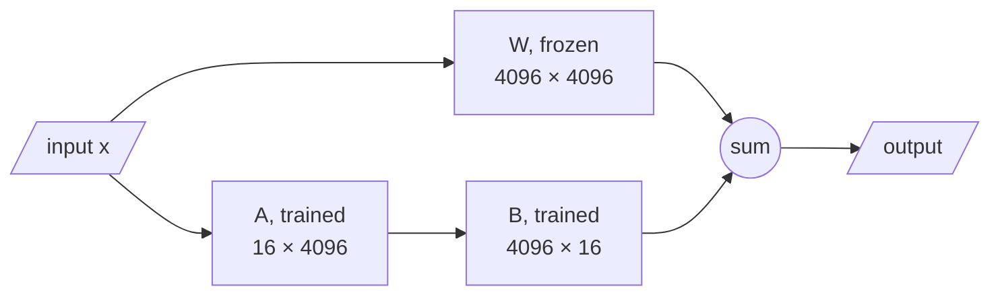

# M04.7 Theory: Fine-tuning Llama 2 with AutoTrain

*[M04 theory](../README.md) · Lesson 4.7 · Notebooks: [`07a_3_ways_fine_tuning_llama_2_with_autotrain.ipynb`](../../../../course/p01_ai_engineering_foundations/m04_fine_tuning_fundamentals/optional/07_llama2_autotrain/07a_3_ways_fine_tuning_llama_2_with_autotrain.ipynb) (optional) · [All theory pages](../../../README.md)*

## LoRA and 4-bit loading

Lessons 4.3 to 4.6 update every weight of a 70-million-parameter model. That does not scale to a 7-billion-parameter one on a single GPU. Llama 2 7B has 6,738,415,616 parameters: 13.5 GB in 16-bit floats before any gradients or optimizer state. The lesson 4.7 notebook fine-tunes it with two flags that change what is stored and what is trained, `--use_peft` and `--use_int4`.

**LoRA** (low-rank adaptation, the method behind PEFT here) freezes every original weight matrix `W` and trains two small matrices beside it, `A` and `B`, whose product is added to the layer’s output. With rank `r`, a layer of shape `d_out × d_in` gains `r × (d_in + d_out)` trainable parameters:



For the attention query projection of Llama 2 7B at rank 16, that is 131,072 trainable parameters beside 16,777,216 frozen ones, 0.78%. Across the model, with the settings AutoTrain uses by default (`lora_r` 16, `target_modules` `"all-linear"`):

| Setup | Trainable parameters | Share of the model |
|---|---|---|
| Full fine-tuning | 6,738,415,616 | 100% |
| LoRA, rank 16, every linear layer | 39,976,960 | 0.59% |
| LoRA, rank 16, query and value projections only | 8,388,608 | 0.12% |

These counts come from `peft` 0.20 wrapping a Llama 2 7B-shaped model built on PyTorch’s meta device, so no weights were downloaded; they match `r × (d_in + d_out)` summed over the targeted layers.

**4-bit loading** stores the frozen weights in 4 bits instead of 16, about 3.4 GB for 6.74 billion weights before quantization overhead, while the LoRA matrices train in higher precision. Combined, this is QLoRA, one of the “3 ways” the notebook’s title refers to. Gradients and optimizer state exist only for the 0.59%, which is what brings a 7B fine-tune within reach of one GPU.

The adapter is saved on its own: 39,976,960 parameters, about 80 MB in 16-bit floats. You can merge it into the base model for serving, or keep one base model and load a different adapter per task.

## The AutoTrain command today

The notebook’s command is one CLI call:

```bash
autotrain llm --train --project_name "llama2-autotrain-openassitant" \
  --model TinyPixel/Llama-2-7B-bf16-sharded --data_path timdettmers/openassistant-guanaco \
  --text_column text --use_peft --use_int4 --learning_rate 0.4 --train_batch_size 3 \
  --num_train_epochs 2 --trainer sft --model_max_length 1048 --block_size 1048 \
  --push_to_hub --repo_id trojrobert/llama2-autotrain-openassistant > training.log
```

It reads a `text` column in which each row holds a whole conversation (the text-only format from lesson 4.2), trains with supervised fine-tuning, and pushes the result to the Hugging Face Hub. Two things to know before you run it:

- **The flag names are from an older AutoTrain.** In `autotrain-advanced` 0.8.36, the arguments are generated from its `LLMTrainingParams`: `--peft`, `--quantization int4` (the default), `--lr`, `--batch-size`, `--epochs`, and `--username` with `--push-to-hub`. The CLI parses arguments strictly, so `--use_peft`, `--use_int4`, `--learning_rate`, `--train_batch_size`, `--num_train_epochs` and `--repo_id` stop it with an error.
- **The learning rate is far too high.** `0.4` is more than 13,000 times AutoTrain’s default of `3e-5`, and 40,000 times lesson 4.5’s `1e-5`. Keep the default unless a measured run says otherwise.

Its other defaults are worth reading too: 4 gradient-accumulation steps, warmup over 10% of the run, a 2,048-token `model_max_length`, and an `add_eos_token` setting, on by default, that appends the end token in its default trainer, the step lessons 4.4 and 4.6 show the M04 data missing.

The notebook’s other two cells sketch Lamini’s `BasicModelRunner` and `trl`’s `SFTTrainer`, but use names the notebook never defines (`base_model`, `peft_config`, `training_arguments`, among others), so they do not run as written.

---
*Previous: [4.6 Evaluation](../06_evaluation/README.md). Next: [M04 interview questions](../README.md#interview-spotlight-5-questions-you-might-get-asked).*
