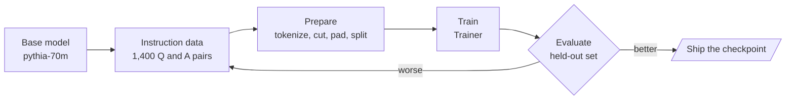

# M04 Theory: Fine-tuning fundamentals

*Part I · AI Engineering Foundations · [Module README](../../../course/p01_ai_engineering_foundations/m04_fine_tuning_fundamentals/README.md) · [All theory pages](../../README.md)*

Fine-tuning changes a model’s weights with your own examples, so the change travels with the model instead of sitting in every prompt. It is good at behaviour (a format, a tone, a refusal, one narrow task) and poor at facts that change. The M04 notebooks build on four ideas: how instruction data turns a text predictor into an assistant, how that data becomes token tensors, what the Hugging Face `Trainer` does with them, and how to tell whether the result is better. Each idea has a page in the folder of the lesson that teaches it, listed under [Lessons](#lessons). This page has the overview, the interview questions and the takeaways.

The notebooks fine-tune `EleutherAI/pythia-70m` on `lamini_docs`, 1,400 questions and answers about one company’s product. These pages run the same steps on the Larkspur Cloud support assistant from M11 to M13: the support team wants answers that lead with *Yes* or *No*, state the policy in a sentence, and decline questions that are not about Larkspur. The examples reuse M11’s golden questions (*How long does a refund take?*, *Can I export my data after I cancel my plan?*, *What happens if my server goes down?*) and add the notebooks’ off-topic probe, *What do you think of Mars?*

## TL;DR

- **Fine-tune for behaviour, retrieve for facts.** The notebooks’ clearest result is a format change: the base Llama 2 continues “Tell me how to train my dog to sit” with more questions, and the chat model answers it. A fact that changes next month belongs in the M11 index.
- **The training text is all the model learns from.** The `lamini/lamini_docs` copy that lesson 4.5 trains on joins each question to its answer with no template and no end token, in all 1,260 training rows. A model trained that way never learns where an answer stops.
- **Truncation and padding decide what survives.** In the lab, `max_length = 48` cuts 11 answer tokens from the refund example with right truncation, or the header and 7 question tokens with left truncation. Padding the batch to its longest row adds 18 pad tokens, 13% of the batch.
- **Count examples, not steps.** The lesson 4.5 run is `max_steps = 3` with a batch of 1 and 4 accumulation steps: 12 of 1,260 training examples, under 1% of one epoch, and the first update runs at learning rate 0.
- **Exact match fails on free text.** The notebooks’ evaluation set has 0 exact matches in 139 answers, and 127 predicted answers repeat a sentence. Measure the behaviour you trained for, on held-out questions, against the prompted or RAG baseline.

## Mental model

<!-- animated: diagrams/finetune-loop.anim.html -->

When evaluation shows a problem, the fix is usually in the examples or in how they were prepared (a missing end token, a truncated answer, a template the model never sees at inference), and the loop goes back to the data before it goes back to the training settings.

## Lessons

| Lesson | Topic | Theory |
|---|---|---|
| 4.1 | Why fine-tune | [When to fine-tune](01_why_fine_tune/README.md#when-to-fine-tune) [Base and chat models](01_why_fine_tune/README.md#base-and-chat-models) |
| 4.2 | Where fine-tuning fits | [Pre-training, then fine-tuning](02_where_fine_tuning_fits/README.md#pre-training-then-fine-tuning) |
| 4.3 | Instruction tuning | [Instruction tuning](03_instruction_tuning/README.md#instruction-tuning) [The template at inference](03_instruction_tuning/README.md#the-template-at-inference) |
| 4.4 | Data preparation | [Data preparation](04_data_preparation/README.md#data-preparation) [Checking the rows](04_data_preparation/README.md#checking-the-rows) |
| 4.5 | Training | [Trainer](05_training/README.md#trainer) [Steps, examples and epochs](05_training/README.md#steps-examples-and-epochs) |
| 4.6 | Evaluation | [Evaluation](06_evaluation/README.md#evaluation) [Against the RAG baseline](06_evaluation/README.md#against-the-rag-baseline) |
| 4.7 | Fine-tuning Llama 2 with AutoTrain | [LoRA and 4-bit loading](07_fine_tuning_llama_2_with_autotrain/README.md#lora-and-4-bit-loading) [The AutoTrain command today](07_fine_tuning_llama_2_with_autotrain/README.md#the-autotrain-command-today) |

## Interactive lab

[**Truncation and padding**](04_data_preparation/interactive/truncation-padding-lab.html): open the file in a browser. Start at `max_length = 48` with right truncation and watch the refund answer lose its last 11 tokens; switch to left truncation and the `### Question:` header goes instead. Then set the end token to *Appended*, slide to 64 so every row ends with it, and pick *To max_length* to see padding rise to 27% of the batch.

## How it connects

- **Before:** [M03](../m03_hugging_face_models/README.md) loads Hugging Face models and tokenizers, which every M04 notebook uses. M02 covers choosing a hosted or open model, the decision that comes before fine-tuning one.
- **Next:** [M05](../../p02_prompt_engineering/m05_prompt_engineering_patterns/README.md) gets as far as prompting can go, which is the first thing to try before fine-tuning. [M11](../../p04_rag_foundations/m11_rag_lifecycle/README.md) puts facts in an index instead of the weights, and its baseline is what the M04 lab compares a fine-tuned model against.

## Interview Spotlight: 5 Questions You Might Get Asked

*Production questions of the kind asked in applied AI engineering interviews.*

### 1. Larkspur fine-tuned a small model on 2,000 support transcripts. In testing it answers the refund question correctly, then keeps going: it repeats the policy sentence until the response hits its token limit. What do you check?

**What a strong answer covers:**
- Decodes a few training rows and checks that each ends with the tokenizer’s end-of-text token; the Pythia tokenizer does not append one, so a model trained on raw question-plus-answer text never sees an answer end
- Checks that truncation did not cut the end token off long examples, and that padding with the same id is masked to -100 in `labels`
- Confirms generation stops on that token (`eos_token_id`) and sets `max_new_tokens` rather than a total `max_length` that includes the prompt
- Adds answer length and repeated-sentence rate to the evaluation, since exact match never shows this failure

### 2. The support lead wants to fine-tune the assistant “so it knows the new refund policy and answers in our house style”. What do you build?

**What a strong answer covers:**
- Splits the request: the policy is a fact that changes, so it goes in the M11 index and is cited; the house style is behaviour, which fine-tuning can carry
- Starts with a prompt that states the style and shows two examples, and fine-tunes only if that fails on a measured set or costs too many tokens per call
- Builds training examples whose answers follow the style but take their facts from retrieved context, so the model learns to use context rather than memorise the policy
- Plans for the next policy change: re-index, no retraining, and a golden question that checks the new window is cited

### 3. Your fine-tuned model’s training loss fell for two epochs. How do you decide whether it replaces the prompted model in production?

**What a strong answer covers:**
- Evaluates on a held-out split the model never trained on (the notebooks hold out 10%) plus the M11 golden questions, never on training loss
- Scores what was trained: the share of answers that lead with Yes or No, faithfulness to the retrieved policy, refusal rate on off-topic questions such as *What do you think of Mars?*
- Runs a general benchmark (lesson 4.6 uses ARC Easy) before and after, to catch lost general ability
- Compares against the prompted baseline on the same questions, with cost and latency per call, and reviews the regressions question by question

### 4. Ten percent of Larkspur’s transcripts are longer than the 512-token limit you can afford in training. What do you do with them?

**What a strong answer covers:**
- Measures the length distribution first; lesson 4.4’s `lamini_docs` rows peak at 479 tokens, well under the 2,048 the notebook allows, so its truncation never fires
- Knows the trade-off: right truncation cuts the end of the answer and its end token, left truncation cuts the question and the template header
- Prefers fixing the data (drop long greetings and signatures, split multi-turn threads into single exchanges) over silently cutting
- Logs how many rows were truncated on every run, so a change in the data shows up as a number

### 5. The team has one 24 GB GPU and wants to fine-tune a 7-billion-parameter model. Is that feasible, and with which settings?

**What a strong answer covers:**
- Does the arithmetic: Llama 2 7B has 6.74 billion parameters, 13.5 GB of weights in 16-bit before any gradients or optimizer state, so full fine-tuning does not fit
- Loads the base weights in 4 bits (about 3.4 GB) and trains LoRA adapters: at rank 16 on every linear layer that is 40.0 million trainable parameters, 0.59% of the model
- Uses a LoRA-sized learning rate; AutoTrain’s default is 3e-5, and the notebook’s 0.4 is more than 13,000 times that
- Keeps batch size small with gradient accumulation and gradient checkpointing, and merges or serves the adapter separately depending on how many variants are deployed

## Key Takeaways

- Try prompting first, put changing facts in retrieval, and fine-tune for behaviour you can describe and measure.
- Before training, decode a few prepared rows: check the template, the end token, what truncation removed and what padding added.
- Report training runs in examples and epochs, and read the learning-rate schedule for the steps you actually run.
- Evaluate the fine-tuned model on held-out questions, on the behaviour you trained for, against the baseline it is meant to replace.

---
*Previous: [M03 Hugging Face models](../m03_hugging_face_models/README.md). Next: [M05 Prompt engineering patterns](../../p02_prompt_engineering/m05_prompt_engineering_patterns/README.md).*
