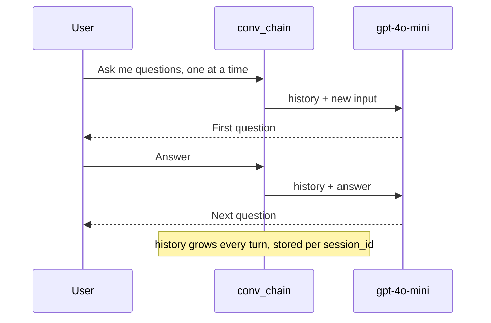

# M05.1 Theory: Core prompt patterns

*[M05 theory](../README.md) · Lesson 5.1 · Notebooks: [`01a_prompt_engineering_patterns.ipynb`](../../../../course/p02_prompt_engineering/m05_prompt_engineering_patterns/notebooks/01a_prompt_engineering_patterns.ipynb) · [All theory pages](../../../README.md)*

## Few-shot

An N-shot prompt puts N solved examples in front of the real input. Zero-shot gives only the instruction; one-shot adds one example; few-shot adds several. Notebook 01a runs all three on the same news classifier with `gpt-4o-mini` at temperature 0. Its prompts, counted with `tiktoken` in the `o200k_base` encoding that `gpt-4o-mini` uses:

| Prompt in 01a | Examples | Tokens sent |
|---|---|---|
| Zero-shot: four categories and one article | 0 | 31 |
| One-shot: one labelled headline, then the article | 1 | 55 |
| Few-shot: three labelled articles, then the article | 3 | 321 |

The examples teach three things the instruction leaves open:

- **The label set and its spelling.** The zero-shot prompt lists `sports, business, entertainment, technology` in lower case; the one-shot and few-shot prompts list them capitalised and show capitalised answers. Code that compares the reply against a fixed string depends on that detail.
- **The output shape.** Each example ends `OUTPUT: Sports` or `Category: Sports`, so the model learns to reply with the bare label and stop.
- **Where the boundaries are.** A phone launch is Technology; a company's revenue mix is Business. Examples near a boundary teach more than examples in the middle of a class.

They also cost tokens on every call. The few-shot classifier sends ten times the tokens of the zero-shot one, for one label. In a RAG grader that runs once per retrieved chunk, that multiplies again by `k`. And examples can leave gaps: the notebook's three cover Sports, Technology and Business, so Entertainment, the fourth label, has no example at all.

For Larkspur, a grading prompt decides whether a retrieved chunk answers the question. Both passages below are real chunks of the M11 handbook:

```text
Does the passage answer the question? Reply with yes or no.

Question: Can I export my data after I cancel my plan?
Passage: After a plan is cancelled, its data is kept for 30 days and then permanently deleted. Export it before that window closes.
Answer: yes

Question: Can I export my data after I cancel my plan?
Passage: You can reboot a server from the console. A reboot takes about a minute and does not change the server IP address.
Answer: no

Question: {question}
Passage: {passage}
Answer:
```

The two examples teach the format, and they teach an easy boundary: the "no" passage shares no topic with the question. The hard cases are a passage on a nearby topic that does not answer (the `billing` chunk, on when plans are charged, for *How long does a refund take?*) and a passage that answers in other words (*Refunds go back to the original payment method and take 5 to 10 business days to appear on your statement.*). Add one example of each, keep yes and no balanced, and measure the grader against your own labels, which is the M05 [lab brief](../../../../course/p02_prompt_engineering/m05_prompt_engineering_patterns/lab/README.md): three grading prompts, 30 labelled pairs, agreement for each.

## Five more patterns

Notebook 01a covers five more patterns, each a different way to constrain the reply:

- **Persona.** `Act as a marketing manager` before a phone fact sheet sets the vocabulary, the audience and what counts as important. For Larkspur, "Act as a Larkspur support agent who answers only from the handbook" sets both the tone and the boundary.
- **Flipped interaction.** The model asks the questions: `Ask me one question at a time` until it has enough to write a data science project plan. It needs memory, so the notebook wraps the chain in `RunnableWithMessageHistory`, one `ChatMessageHistory` per `session_id`. For Larkspur, a server-sizing assistant can ask about peak memory use before it recommends a plan.
- **Directional stimulus.** A hint steers the output without writing it: `Summarize the following article in 5 lines based on the following hints. Hint: Generative AI history, data modalities, tools, applications, concerns`. The hint list doubles as a checklist for grading the summary.
- **Template.** The prompt fixes the output fields: `ACTIVITY, TOPIC, RESOURCE, DIFFICULTY SCALE 1-5, NOTES`, returned as JSON. Downstream code can parse the reply only if the model keeps the template, so validate it before use.
- **Meta language.** The prompt defines a notation and then uses it: `Business_Understanding,3 -> Data_Understanding,5 -> …` means a step and its days, and the model expands each step into a day-by-day plan. A notation keeps a long instruction short, as long as the prompt explains it once.

The flipped interaction is the only pattern here with state. Each turn sends the whole history back to the model:



That history is also why the cost of a flipped interaction grows with every turn. The notebook stores the conversation in `store["unused"]`, the history for the session id it passes, so that is where to read the messages back.

## Key Takeaways

- Few-shot examples teach the label set, the output shape and the class boundaries. They are paid for on every call, so the classifier's three examples cost ten times the zero-shot tokens.
- Choose examples near the boundary, keep the labels balanced, cover every label, and measure the prompt against your own labelled pairs.
- Persona, flipped interaction, directional stimulus, template and meta language each constrain the reply in a different way. Validate templated output before code uses it, and expect a stateful conversation to cost more each turn.

## Check yourself

<details>
<summary>1. What do the few-shot examples teach the news classifier that its instruction leaves open, and what do they cost?</summary>

They teach the label set and its spelling, the output shape (the bare label, then stop) and where the boundaries between classes are. They cost tokens on every call: the few-shot prompt sends 321 tokens against the zero-shot prompt's 31. In a RAG grader that runs once per retrieved chunk, that cost multiplies again by `k`.

</details>

<details>
<summary>2. The Larkspur grading prompt has one yes example and one no example on an unrelated topic. Which two examples should you add?</summary>

A nearby passage that does not answer, labelled no: the `billing` chunk for *How long does a refund take?*. And a passage that answers in other words, labelled yes: the one saying refunds take 5 to 10 business days to appear on your statement. The current no example shares no topic with the question, so it only teaches an easy boundary; keep yes and no balanced and measure the grader against your own labels.

</details>

<details>
<summary>3. A flipped-interaction assistant gets more expensive with every question it asks. Why?</summary>

It is the only one of these patterns with state. Each turn sends the whole conversation history back to the model, stored per `session_id` by `RunnableWithMessageHistory`, so the prompt grows with every turn and so does the cost.

</details>

---
*Previous: [M05 overview](../README.md). Next: [5.2 Reasoning prompts: chain-of-thought, self-consistency, least-to-most, ReAct](../02_reasoning_prompts_chain_of_thought_self_consistency_least_to_most_react/README.md).*
