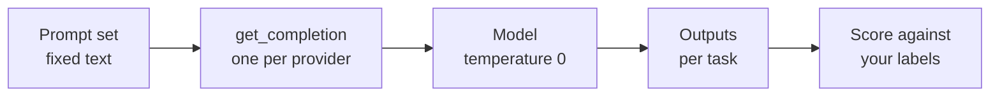

# M05.3 Theory: The same tasks across models

*[M05 theory](../README.md) · Lesson 5.3 · Notebooks: [`03a_openai_gpt_4o_mini.ipynb`](../../../../course/p02_prompt_engineering/m05_prompt_engineering_patterns/notebooks/03a_openai_gpt_4o_mini.ipynb), [`03b_google_gemini_1_5_flash.ipynb`](../../../../course/p02_prompt_engineering/m05_prompt_engineering_patterns/optional/03b_google_gemini_1_5_flash.ipynb) (optional), [`03c_meta_llama_3_2_90b_groq.ipynb`](../../../../course/p02_prompt_engineering/m05_prompt_engineering_patterns/optional/03c_meta_llama_3_2_90b_groq.ipynb) (optional), [`03d_meta_llama_3_2_1b_huggingface.ipynb`](../../../../course/p02_prompt_engineering/m05_prompt_engineering_patterns/optional/03d_meta_llama_3_2_1b_huggingface.ipynb) (optional) · [All theory pages](../../../README.md)*

## One prompt set across four APIs

The four notebooks run the same ten tasks: zero-shot and few-shot classification, Python and SQL generation, information extraction from a clinical note, closed-domain and open-domain question answering, summarisation, turning a fact sheet into an FAQ, and translation. Each notebook defines one function, `get_completion(prompt, model)`, and every task calls it. Only that function changes between notebooks:

| Notebook | Model | Client the notebook installs |
|---|---|---|
| 03a | `gpt-4o-mini` | `openai==1.55.3`, Chat Completions |
| 03b | `gemini-1.5-flash` | `google-generativeai==0.8.3`, `generate_content` |
| 03c | `llama-3.2-90b-vision-preview` | `groq==0.13.0`, Chat Completions |
| 03d | `meta-llama/Llama-3.2-1B-Instruct` | `huggingface_hub` `InferenceClient` |

All four set temperature 0, and 03d caps replies at `max_tokens=2048`. The prompt text is identical in 03a, 03c and 03d. 03b adds one prompt, a second LangGraph question ending *If you are not able to find the answer in your trained knowledge just say you don't know*, so for that task its run answers a different prompt.



The design keeps the prompt set as the fixed part and the wrapper as the swap point. Three practices make the comparison worth trusting:

- **Score, do not eyeball.** The notebooks print each reply. A comparison needs a check per task: exact match for the sentiment label, a line count for "limit the summary to 5 lines", valid JSON for a template, a labelled list of symptoms for the clinical note. That is the M05 [lab brief](../../../../course/p02_prompt_engineering/m05_prompt_engineering_patterns/lab/README.md) on a small scale.
- **Keep the model id in one place.** Provider ids are retired. Groq shut down `llama-3.2-90b-vision-preview` on 14 April 2025 and names `meta-llama/llama-4-scout-17b-16e-instruct` as the replacement ([Groq deprecations](https://console.groq.com/docs/deprecations)), so 03c and the Llama half of [notebook 04a](../../../../course/p02_prompt_engineering/m05_prompt_engineering_patterns/notebooks/04a_gpt_4o_and_llama_3_2_real_world_tasks.ipynb) fail until the id is changed. The 1B model in 03d is gated: the notebook asks you to request access from Meta on Hugging Face first.
- **Read the prompt as each model will.** Task 6, closed-domain QA, gives a survey report as context and asks the model to answer *to the best of your ability*. That wording invites the model's own knowledge. In a RAG pipeline the same prompt needs an instruction to answer only from the context and to say so when the context does not contain the answer, the line 03b adds to its extra prompt.

For Larkspur, the closed-domain prompt becomes the answer step of the pipeline:

```text
Answer the customer's question using only the handbook passages below.
If the passages do not contain the answer, reply "The handbook does not cover this."

Passages:
"""{passages}"""

Question: {question}
Answer:
```

Run it on each candidate model with the same golden questions and passages, and score each answer for whether it is supported by the passages. A model that answers *What happens if my server goes down?* from general knowledge when the passages hold only the reboot instructions fails this prompt, however fluent the answer is.

## Key Takeaways

- Keep the prompt set fixed and swap models behind one wrapper, so the model id lives in one place and a retired id is a one-line fix.
- Score each task with its own check, such as exact match, line count or valid JSON, instead of reading replies by eye.
- For a RAG answer step, tell the model to answer only from the passages and to say when they do not cover the question. Score answers for support by the passages, not fluency.

## Check yourself

<details>
<summary>1. Why is printing each model's reply not enough to compare the four models on the ten tasks?</summary>

Reading replies by eye gives an impression, not a comparison. Each task needs its own check: exact match for the sentiment label, a line count for the five-line summary, valid JSON for a template, a labelled list of symptoms for the clinical note. Scoring against your own labels is the M05 lab brief on a small scale.

</details>

<details>
<summary>2. The Larkspur answer prompt gets only the reboot passages for What happens if my server goes down? A model answers fluently from general knowledge. Does it pass?</summary>

No. The prompt tells the model to answer only from the handbook passages and to reply "The handbook does not cover this." when they do not contain the answer. Each answer is scored for whether the passages support it, however fluent it is.

</details>

<details>
<summary>3. Notebook 03c now fails on its first call although nobody changed its code. What is the likely cause, and what practice keeps the fix small?</summary>

The model id was retired: Groq shut down `llama-3.2-90b-vision-preview` on 14 April 2025 and names `meta-llama/llama-4-scout-17b-16e-instruct` as the replacement. Keep the model id in one place, inside the `get_completion` wrapper, so the fix is a one-line change.

</details>

---
*Previous: [5.2 Reasoning prompts: chain-of-thought, self-consistency, least-to-most, ReAct](../02_reasoning_prompts_chain_of_thought_self_consistency_least_to_most_react/README.md). Next: [5.4 Applied prompting on business tasks](../04_applied_prompting_on_business_tasks/README.md).*
