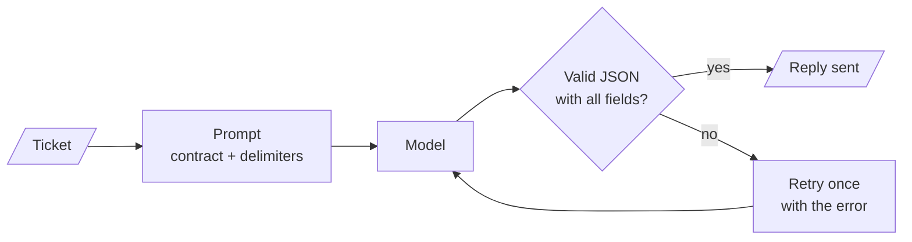

# M05.4 Theory: Applied prompting on business tasks

*[M05 theory](../README.md) · Lesson 5.4 · Notebooks: [`04a_gpt_4o_and_llama_3_2_real_world_tasks.ipynb`](../../../../course/p02_prompt_engineering/m05_prompt_engineering_patterns/notebooks/04a_gpt_4o_and_llama_3_2_real_world_tasks.ipynb) · [All theory pages](../../../README.md)*

## From a pattern to a production prompt

Notebook 04a sends each of five business tasks to `gpt-4o` and to Llama 3.2 90B on Groq, both at temperature 0. The prompts combine the patterns from lessons 5.1 and 5.2, and each task adds one technique that a production prompt needs:

- **Several instructions, one pass.** The review prompt asks for a summary of at most 3 lines, the positives and negatives, the overall sentiment, 3 to 5 emotions, and a reply email. The email instruction is conditional: thank the customer if the sentiment is positive or neutral, apologise if it is negative. One call returns every field, and they agree with each other because the model wrote them together.
- **Delimiters around the input.** Every task wraps its input in triple backticks (or triple quotes for the IT tickets), so the model can tell the instruction from the text it works on. Delimiters make an instruction hidden in a review easier to ignore; they do not guarantee it.
- **One source, several audiences.** The same paper abstract becomes a 10-line summary, an executive summary for a healthcare company with ethics pros and cons, and one for a generative AI company organised by text, image and structured data. Only the persona and the audience line change.
- **Refinement in steps.** The phone advert goes through three versions: a plain product description, then a fixed layout (product name, description, a two-column `Feature` and `Specification` table with exact numbers), then a version of at most 60 words on display and camera. The second step fixes the structure, the third the length and focus.
- **An output contract.** The IT support prompt asks for JSON with six fields: `orig_msg`, `orig_lang`, `category`, `trans_msg`, `response` and `trans_response`. The six tickets are in Portuguese, Italian, Japanese, Russian (two) and Turkish, so one prompt detects the language, classifies, translates and replies in the customer's language.
- **Synthetic examples.** The last task asks for five positive and five negative movie-review tweets of at most 250 characters, then three positive and three negative laptop reviews of at most 200 words with a sentiment and up to three key topics. Generated examples like these can seed a few-shot prompt or a test set, once a person has checked their labels.

Two details in the notebook are worth copying the other way round. The JSON contract lists its fields as `orig_msg: The original customer message` inside braces, which describes JSON without being JSON, and the notebook displays the reply as Markdown without parsing it. And `get_completion` returns the string `LLM not configured!` for an unknown model name, so a typo produces a plausible-looking reply instead of an error. A production version parses and validates every reply, and fails loudly:

If the retry also fails, the ticket goes to a person, not to the customer. For Larkspur, the same contract triages support tickets: `orig_lang`, a `category` from a fixed list (billing, refunds, exports, outages, server sizing), an English translation for the support team, and a draft reply in the customer's language that the answer step fills from the handbook. Fix the category list in the prompt, as the few-shot classifier in lesson 5.1 fixes its labels, so the reply can be routed by code.

## Key Takeaways

- One prompt can carry several instructions, including conditional ones, and return fields that agree because the model wrote them together. Wrap the input in delimiters to separate it from the instructions.
- Refine a prompt in steps: fix the structure first, then the length and focus. Change only the persona and audience line to reuse one source for several readers.
- Give structured output a contract with a fixed category list, parse and validate every reply, retry once with the error, and send a second failure to a person.

## Check yourself

1. Why do the notebook's prompts wrap each input in triple backticks, and what does that not guarantee?

Delimiters let the model tell the instruction from the text it works on, such as a review or an IT ticket. That makes an instruction hidden inside the input easier to ignore, but it does not guarantee the model ignores it.

2. You adapt the IT support JSON contract to triage Larkspur tickets. What fields does it need, and what makes the reply routable by code?

`orig_lang`, a `category`, an English translation for the support team, and a draft reply in the customer's language that the answer step fills from the handbook. The category must come from a fixed list in the prompt (billing, refunds, exports, outages, server sizing), as the few-shot classifier fixes its labels, so code can route on it.

3. A ticket's reply comes back as something that is not valid JSON with all six fields. What should the production pipeline do?

Parse and validate every reply, then retry once with the error. If the retry also fails, the ticket goes to a person, not to the customer. The notebook only displays the reply as Markdown, so a broken reply would pass unnoticed.

---
*Previous: [5.3 The same tasks across models](../03_the_same_tasks_across_models/README.md). Next: [M05 interview questions](../README.md#interview-spotlight-5-questions-you-might-get-asked).*
