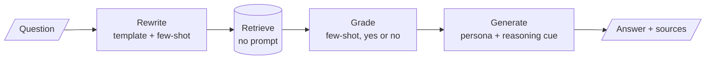

# M05 Theory: Prompt engineering patterns

*Part II · Prompt & Context Engineering · [Module README](../../../course/p02_prompt_engineering/m05_prompt_engineering_patterns/README.md) · [All theory pages](../../README.md)*

Every LLM step in a RAG pipeline is a prompt: the query rewrite, the relevance grade, the route and the final answer. A prompt pattern is a reusable way to write one of those steps. The M05 notebooks build on four ideas: showing the model worked examples, asking it to reason before it answers, sampling several reasoning paths and voting, and running a loop of thoughts and tool calls. Each idea has a page in the folder of the lesson that teaches it, listed under [Lessons](#lessons). This page has the overview, the interview questions and the takeaways.

The notebooks use their own material: news headlines, product reviews, phone fact sheets and an NFL game summary. These pages carry each pattern over to the Larkspur Cloud handbook from M11 to M13, as the prompts a support assistant over that handbook would run: grading whether a chunk answers *How long does a refund take?*, computing the refund for *Can I get a refund after 45 days?*, and searching the handbook for *Can I export my data after I cancel my plan?*

## TL;DR

- A few-shot prompt teaches the label set and the output format by example. Every example is sent on every call: the notebook's three-example news classifier is 321 tokens, against 31 for the zero-shot version.
- Chain-of-thought asks for the steps before the answer. In few-shot CoT the model copies the exemplar's reasoning, mistakes included; two of the notebook's exemplars contain a wrong step.
- Self-consistency samples several reasoning paths and keeps the most common answer. It helps when wrong answers scatter and hurts when they agree: at one-path accuracy 0.40, a 15-path vote reaches 0.780 with four distinct wrong answers and falls to 0.213 on a yes/no question.
- ReAct interleaves Thought, Action and Observation until the model can answer. With tool calling, the Action is a structured call the framework runs; the Thought and Action lines in the system prompt are guidance, not a format anything parses.
- A prompt set is a test asset. Keep it fixed, change the model, and score the outputs against your own labels.

## Mental model

<!-- animated: diagrams/prompt-steps.anim.html -->

Three of the four steps between the question and the answer are prompts, and each is assembled from the patterns in this module. When the pipeline gives a wrong answer, the fault sits in one of those prompts or in retrieval, and each can be tested on its own against a labelled set.

## Lessons

| Lesson | Topic | Theory |
|---|---|---|
| 5.1 | Core prompt patterns | [Few-shot](01_core_prompt_patterns/README.md#few-shot) [Five more patterns](01_core_prompt_patterns/README.md#five-more-patterns) |
| 5.2 | Reasoning prompts: chain-of-thought, self-consistency, least-to-most, ReAct | [Chain-of-thought](02_reasoning_prompts_chain_of_thought_self_consistency_least_to_most_react/README.md#chain-of-thought) [Self-consistency](02_reasoning_prompts_chain_of_thought_self_consistency_least_to_most_react/README.md#self-consistency) [ReAct format](02_reasoning_prompts_chain_of_thought_self_consistency_least_to_most_react/README.md#react-format) |
| 5.3 | The same tasks across models | [One prompt set across four APIs](03_the_same_tasks_across_models/README.md#one-prompt-set-across-four-apis) |
| 5.4 | Applied prompting on business tasks | [From a pattern to a production prompt](04_applied_prompting_on_business_tasks/README.md#from-a-pattern-to-a-production-prompt) |

## Interactive lab

[**Self-consistency: when a vote helps**](02_reasoning_prompts_chain_of_thought_self_consistency_least_to_most_react/interactive/self-consistency-vote-lab.html): open the file in a browser. Set one wrong answer (a yes/no grade) and a one-path accuracy of 0.60, then slide N from 1 to 15 and watch the vote creep from 0.600 to 0.787 while the calls climb to 16. Drop the accuracy to 0.40 and the same vote falls to 0.213. Then pick four wrong answers at 0.40 and the vote rises instead, to 0.780 at N = 15.

## How it connects

- **Before:** [M02](../../p01_ai_engineering_foundations/m02_llm_apis_and_model_selection/README.md) calls the provider APIs these prompts are sent through; [M04](../../p01_ai_engineering_foundations/m04_fine_tuning_fundamentals/README.md) covers fine-tuning, the alternative when a prompt cannot carry enough examples.
- **Next:** [M06](../m06_multimodal_prompting/README.md) applies the patterns to image inputs, and [M07](../../p03_langchain_and_langgraph/m07_langchain_core/README.md) turns them into LangChain prompt templates and output parsers. The rewrite prompt returns in [M18](../../p06_retrieval_quality/m18_query_transformation/README.md), the grading prompt in [M28](../../p09_agentic_rag/m28_retrieval_grading_rewriting/README.md), the ReAct loop in [M23](../../p08_agent_foundations/m23_agent_loop_and_tools/README.md) and [M24](../../p08_agent_foundations/m24_react_agents/README.md), and self-consistency with tree of thoughts in [M26](../../p08_agent_foundations/m26_planning_reflection_reasoning/README.md).

## Interview Spotlight: 5 Questions You Might Get Asked

*Production questions in the style of OpenAI, Anthropic and Google interviews for applied AI roles.*

### 1. Larkspur's relevance grader labels the `refund-timing` chunk "no" for "How long does a refund take?", so the assistant answers "I don't know". The grader is a few-shot prompt. How do you debug it?

**What a strong answer covers:**
- Reproduces the call with the exact rendered prompt, model and temperature, and reads what the grader saw
- Checks the examples first: do they cover a chunk that answers the question with different words ("Refunds" against "refund")? Are the yes and no examples balanced?
- Adds the case to a labelled grading set and measures agreement before and after the fix, so the change is not tuned to one question
- Considers a stricter output contract (one word, or a schema) so a hedged answer is not parsed as "no"

### 2. The team wants self-consistency on the grader: five samples and a vote on every chunk. What do you say?

**What a strong answer covers:**
- A yes/no grade has one wrong answer, so a vote amplifies the majority: it helps only when one sample is already right more than half the time
- Measures one-sample accuracy on labelled pairs before deciding; below 0.5 the vote makes the grader worse (0.40 becomes 0.317 at five samples in the lab)
- Counts the cost: five calls per chunk times `k` chunks per question, plus an aggregator call if an LLM merges the paths as in notebook 02a
- Prefers an odd number of samples, since an even split on two labels is a coin flip and adds a call for nothing

### 3. You are moving the support assistant from `gpt-4o-mini` to a cheaper open model. How do you decide whether the prompts still work?

**What a strong answer covers:**
- Freezes the prompt set and the labelled cases, and runs both models at temperature 0 through the same wrapper
- Scores each task with a metric that fits it: exact match for labels and JSON validity for extraction, an LLM or human judge for free text
- Compares per task, not on average: a model can match on classification and still fail the JSON format or the five-line limit
- Pins the model id in one config value, because provider ids are retired (Groq shut down the `llama-3.2-90b-vision-preview` id used in two M05 notebooks on 14 April 2025)

### 4. The ReAct support agent sometimes loops: it searches the handbook, gets the same chunks, and searches again. How do you find and stop this?

**What a strong answer covers:**
- Logs every Thought, tool call and Observation per run, and counts tool calls per question
- Sets a hard limit on iterations (`max_iterations` on `AgentExecutor`, a recursion limit in LangGraph) and a fallback answer when it is hit
- Checks whether the Observation can answer the question at all: repeated identical searches usually mean the evidence is not in the handbook, which should end in an "I don't know"
- Tracks the share of runs that hit the limit as a metric, alongside answer quality on the golden set

### 5. A product manager asks for one prompt that summarises a ticket, classifies it, detects the language and drafts a reply in that language. When is one prompt right, and when do you split it?

**What a strong answer covers:**
- One prompt with an output contract (named JSON fields, as in notebook 04a's IT support task) is cheaper and keeps the parts consistent with each other
- Splits it when a part needs its own model, its own evaluation or a human check, or when one field's failure should not discard the others
- Validates the output against a schema and retries or repairs on a parse failure, instead of trusting free-form JSON
- Labels a sample of tickets per field, so a regression in classification is visible even when the reply text still looks fine

## Key Takeaways

- Write each LLM step as a pattern you can name: examples, a reasoning cue, a template, a persona. A named pattern is easier to test and to change.
- Examples are part of the prompt's cost and its correctness. Check that they cover every label and that every worked step in them is right.
- Vote only on short answers that can be compared, and only when one sample is right more often than any single wrong answer.
- Freeze a labelled prompt set before you change the model, the prompt or the sampling, and judge every change against it.

---
*Previous: [M04 Fine-tuning fundamentals](../../p01_ai_engineering_foundations/m04_fine_tuning_fundamentals/README.md). Next: [M06 Multimodal prompting](../m06_multimodal_prompting/README.md).*
