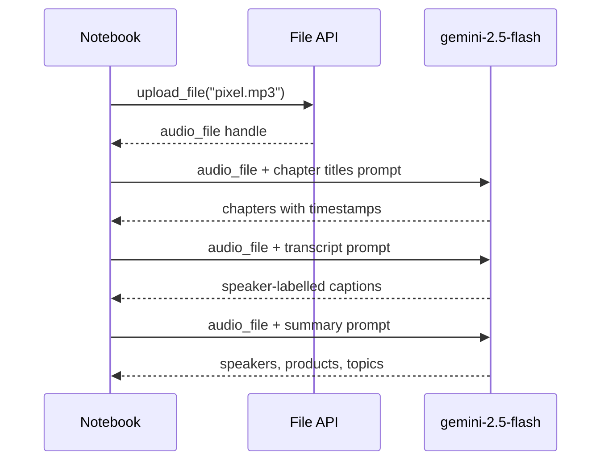

# M06.1 Theory: Multimodal prompting with Gemini

*[M06 theory](../README.md) · Lesson 6.1 · Notebooks: [`01a_multimodal_google_gemini.ipynb`](../../../../course/p02_prompt_engineering/m06_multimodal_prompting/notebooks/01a_multimodal_google_gemini.ipynb) · [All theory pages](../../../README.md)*

## Image prompts

The notebook loads `gemini-2.5-flash` through the `google-generativeai` SDK with `temperature=0`. Its Markdown cells still say Gemini 1.5 Flash; the code is what runs. An image prompt is a plain Python list: PIL images first, the question last.

```python
image1 = Image.open('image1.png')
image2 = Image.open('image2.png')

prompt = """
  Given the following images which can contain graphs, tables and text,
  analyze all of them to answer the following question:

  Tell me about the top 5 years with largest Wildfires
"""
response = gemini.generate_content([image1, image2, prompt])
```

The SDK sends the pictures inline with the request; nothing is uploaded first. Three choices in that prompt carry over to any image question:

- **It says what the images hold.** "Graphs, tables and text" tells the model to read the chart and the table, not to describe the picture.
- **It asks for all of them.** When the answer spans two pages, the prompt says so.
- **It asks one question per call.** The notebook asks about the top five years and about the acreage trend in two calls over the same images. The GPT-4o notebook asks both in one call. Separate calls pay for the images twice but are easier to grade one at a time.

For Larkspur, the same shape answers *How much outbound traffic does the starter plan include?* from a screenshot of the pricing page: the screenshot, then the question, then "If the value is not printed on the page, say so."

An image can also be the question. The notebook's last example sends a video, a still image and the prompt "When is the moment in the image happening in the video? Provide a timestamp." For a support team that is a customer's screenshot of an error, matched against a recorded walkthrough to find the step they are stuck on.

Images cost tokens like text. The Gemini API documentation (checked October 2026) counts an image of 384 pixels or less on both sides as 258 tokens, and tiles larger images into 768 by 768 tiles of 258 tokens each.

## PDF and audio input

PDFs, audio and video go through the File API. `genai.upload_file(path=...)` uploads the file and returns a handle, and the handle takes the image's place in the list: `contents = [pdf_ref, prompt]`. The notebook uploads a Congressional Research Service PDF on wildfire statistics (`IF10244.pdf`), an interview recording (`pixel.mp3`) and two videos the same way.

The upload happens once. The notebook reuses one audio handle for three prompts:



Each of the three prompts fixes the output shape and limits the model to what is in the recording:

- **Chapters:** "Provide chapter titles with timestamps, be concise and short", then "Do not make up any information that is not part of the audio".
- **Transcript:** the format `[timecode] - [speaker] : caption`, speakers named A, B and so on and mapped to real names at the start, one caption per speaker turn, and only the part of the conversation about the Pixel Watch.
- **Summary:** three headed lists: key speakers, products and features, other notable discussion.

For Larkspur, the transcript prompt turns a recorded support call into turns labelled Customer and Agent. A follow-up question such as "What refund window did the agent quote?" can then be checked against the handbook's 30 days.

What the File API inputs cost, from the Gemini API documentation (checked October 2026), with Larkspur sizes:

| Input | Gemini rate | Larkspur example | Tokens |
|---|---|---|---|
| PDF | 258 per page | 40-page handbook | 10,320 |
| Audio | 32 per second | 10-minute support call | 19,200 |

Gemini accepts PDFs up to 50 MB or 1,000 pages. A request that sends files inline is capped at 20 MB in total, prompt included; above that, or when the same file serves several prompts, upload it. Video goes in the same way, and Gemini samples it into frames itself; lesson 6.2 shows what that sampling decides.

---
*Previous: [M06 overview](../README.md). Next: [6.2 Multimodal prompting with GPT-4o](../02_multimodal_prompting_with_gpt_4o/README.md).*
