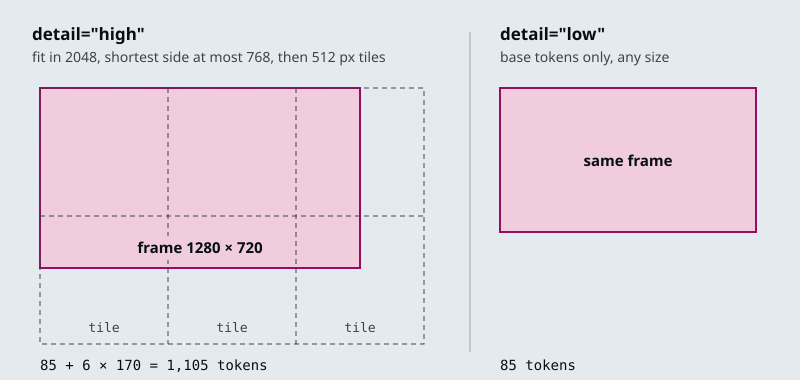
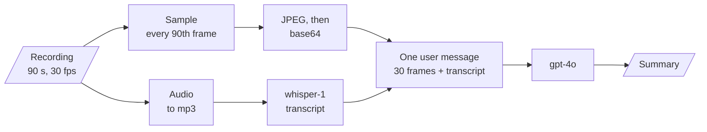

# M06.2 Theory: Multimodal prompting with GPT-4o

*[M06 theory](../README.md) · Lesson 6.2 · Notebooks: [`02a_multimodal_openai_gpt_4o.ipynb`](../../../../course/p02_prompt_engineering/m06_multimodal_prompting/optional/02a_multimodal_openai_gpt_4o.ipynb) (optional) · [All theory pages](../../../README.md)*

## Image content parts

In the Chat Completions API a user message's `content` can be a list of typed parts instead of a string. The notebook mixes one text part and one image part:

```python
{"role": "user", "content": [
    {"type": "text", "text": "What's the area of the triangle?"},
    {"type": "image_url", "image_url": {"url": f"data:image/png;base64,{base64_image}"}},
]}
```

The `url` field takes either of two forms, and the notebook sends the same scanned page both ways:

- **A base64 data URL.** `encode_image()` reads the file from disk and base64-encodes it. Use it for private files, such as a Larkspur customer's console screenshot. The request carries the bytes, and base64 makes them about a third larger (4 characters for every 3 bytes).
- **A public `https` URL.** The request stays small, but OpenAI has to fetch the image itself, so it only works for images anyone can reach.

The notebook saves one answer as Markdown. From a scanned page of *The Algebra of Mohammed Ben Musa* (al-Khwarizmi), the model read the triangle's sides as 6, 5 and 9 and applied Heron's formula: semi-perimeter 10, area √200 = 10√2, about 14.14.

The extraction prompts that follow share one shape: a role in the system message, a fixed output format, and an explicit escape for anything the model cannot read.

- **Clinical note:** a Markdown table `Symptoms | Present/Denies | Probability`, acronyms expanded in an appendix table, and "Do not make up terms, if something is not detectable leave it out."
- **Handwriting:** "Convert the handwritten document into text exactly as in the image", with `[NOT_EXTRACTED]` for any word the model cannot read.
- **Sales chart:** "summarize it briefly, give detailed statistics about the top 3 best performing salesmen".

Each image part also takes a `detail` setting, and it sets the price. OpenAI's images and vision guide gives the rule for `gpt-4o`: at `detail="low"` an image costs the base 85 tokens whatever its size. At `detail="high"` it is scaled to fit 2048 by 2048, its shortest side is scaled down to 768 if longer, and every 512-pixel tile covering the result adds 170 tokens.



So a 1280 by 720 frame costs 1,105 tokens at high and 85 at low, 13 times less. A 1920 by 1080 screenshot also costs 1,105, because it is scaled to 1365 by 768 before tiling. The notebook sends its video frames at `detail="low"`.

## Frame sampling

The notebook treats the GPT-4o API as taking text and images only, so a video has to be turned into those first. `process_video()` does it with OpenCV and moviepy:

```python
frames_to_skip = int(fps * seconds_per_frame)
curr_frame = 0
while curr_frame < total_frames - 1:
    video.set(cv2.CAP_PROP_POS_FRAMES, curr_frame)
    success, frame = video.read()
    _, buffer = cv2.imencode(".jpg", frame)
    base64Frames.append(base64.b64encode(buffer).decode("utf-8"))
    curr_frame += frames_to_skip
```

The soundtrack goes to an mp3 at a 32k bitrate and through `whisper-1` for a transcript. The notebook then writes three summaries of an OpenAI DevDay recap video: from the frames alone, from the transcript alone, and from both in one message. Its own conclusion is that the combined summary is the most accurate: the frames miss what the speaker says, and the transcript misses what is on screen.


<!-- animated: diagrams/frame-sampling.anim.html -->

`seconds_per_frame` is the setting that matters. It decides how many frames the model reads, so it sets the cost. It also decides which moments the model sees at all: something on screen for less time than the gap between frames may fall between two of them.

The [interactive lab](interactive/frame-sampling-lab.html) runs a port of `process_video` on a fictional 90-second Larkspur screen recording (30 fps, 1280 by 720) that walks through a data export in eight steps. Two of them are short: a 1.8 s confirm dialog and a 1.2 s "Export ready" toast, the only frame that shows the export finished. Its numbers:

| Gap (s) | Frames | Tokens, low | Tokens, high | Steps seen |
|---|---|---|---|---|
| 1 | 90 | 7,650 | 99,450 | 8 |
| 2, the notebook default | 45 | 3,825 | 49,725 | 7, toast missed |
| 2.5 | 36 | 3,060 | 39,780 | 8 |
| 3, the notebook example | 30 | 2,550 | 33,150 | 7, toast missed |
| 10 | 9 | 765 | 9,945 | 6 |

<!-- lab: interactive/frame-sampling-lab.html -->

- **Only a gap shorter than the shortest event guarantees a frame on it.** The toast lasts 1.2 s, so 1 s is the widest gap in the lab that always catches it. At 2.5 s the frames happen to land on both short steps; if the toast came 1.2 s later, the same gap would miss it.
- **Cost grows with the number of frames.** Halving the gap doubles the frames and the tokens. High detail multiplies the bill by 13 again.
- **The transcript is the other source.** A step the narrator mentions survives a missed frame; a silent toast does not.

Gemini takes the video file itself and samples it at 1 frame per second by default; a custom `fps` can be set in the request. Its documentation warns that "fast action sequences might lose detail due to the 1 FPS sampling rate". At 1 frame per second the lab's 1.2 s toast always gets a frame.

`process_video` has two sharp edges. `int(fps * seconds_per_frame)` truncates: at 29.97 fps and 3 s the step is 89 frames, so frames come every 2.97 s. And when `seconds_per_frame` is below one frame's duration the step is 0 and the `while` loop never ends; a stubbed run of the notebook's own function at 0.02 s and 30 fps confirms it. `max(1, round(fps * seconds_per_frame))` stops the hang and brings the 29.97 fps gap back to 3.003 s. The import `from moviepy.editor import VideoFileClip` needs moviepy 1.x, since moviepy 2 removed `moviepy.editor`; this repo pins `moviepy<2` for that reason.

---
*Previous: [6.1 Multimodal prompting with Gemini](../01_multimodal_prompting_with_gemini/README.md). Next: [6.3 Exercise: financial report analysis](../03_exercise_financial_report_analysis/README.md).*
