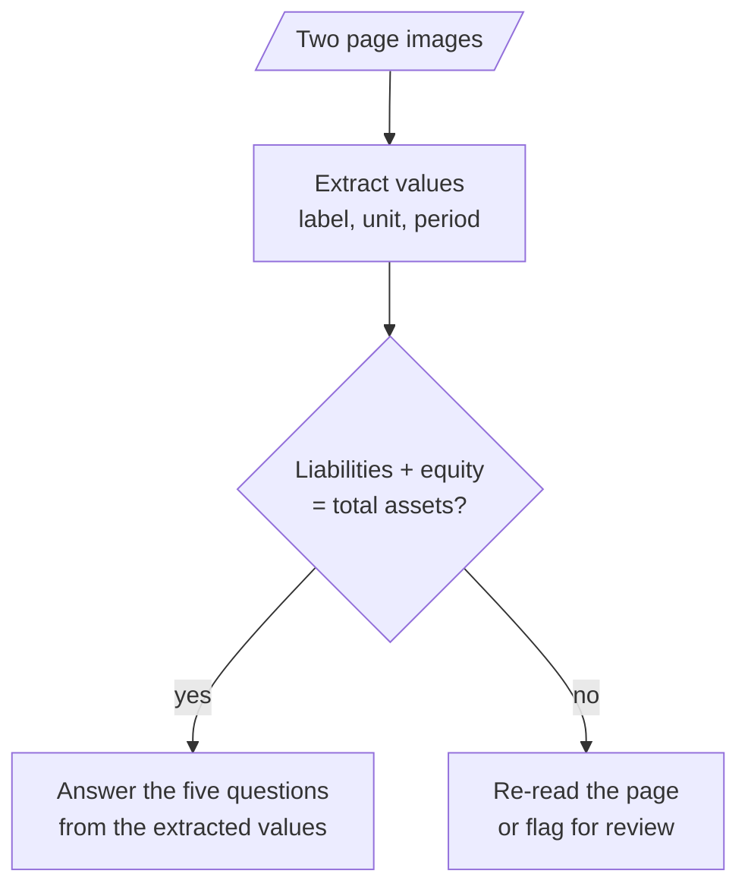

# M06.3 Theory: Exercise: financial report analysis

*[M06 theory](../README.md) · Lesson 6.3 · Notebooks: [`03a_financial_report_analysis.ipynb`](../../../../course/p02_prompt_engineering/m06_multimodal_prompting/exercises/03a_financial_report_analysis.ipynb) (optional) · [All theory pages](../../../README.md)*

## Questions about a report page

The exercise sends two page images from ABN AMRO's third-quarter 2024 report to `gemini-2.5-flash`:

- **`Balance_Sheet.png`** (779 by 597): the condensed statement of financial position at 30 September 2024, 30 June 2024 and 31 December 2023.
- **`Figure.png`** (860 by 1064): "Figures at a glance", nine bar charts from Q3 2023 to Q3 2024, each bar labelled with its value.

Its prompt asks for a six-part summary: key metrics, income and expenses, balance sheet, credit quality, strategy, outlook. A summary is hard to grade. The module lab brief asks for five questions instead, and five questions with values printed on the page can be graded line by line:

| Question | On the page |
|---|---|
| Net profit in Q3 2024 | EUR 690 million |
| Return on equity in Q3 2024 | 11.6%, target 9 to 10% |
| Cost/income ratio in Q3 2024 | 59.2%, target circa 60% |
| Total assets, 30 September 2024 | 403,771 million |
| Total equity, 30 September 2024 | 25,810 million |

Ask for extraction before interpretation. A prompt that first lists each value with its label, unit and period, then answers from that list, leaves a record you can check against the page. The balance sheet gives you a check for free: total liabilities 377,961 plus total equity 25,810 is 403,771, the printed total assets. Do that sum in code, not in the prompt, and most misread digits in any of the three show up.

Two more rules keep the answers honest:

- **Read labels, do not measure bars.** Every bar on "Figures at a glance" carries its value, so the model reads a number instead of estimating a height. For a chart without labels, ask for the axis range and an estimate, and grade with a tolerance.
- **Allow "not on the page".** A question whose answer is not printed should get that answer, not a guess from neighbouring figures.

Sent to `gpt-4o` at `detail="high"`, each of the two images costs 765 tokens: 2 by 2 tiles of 512 pixels, after `Figure.png` is scaled to 768 by 950. The same method reads a Larkspur pricing page: extract each plan's printed figures first, then answer from the extracted list.

## Check yourself

1. Why should the prompt extract each value with its label, unit and period before answering the five questions?

Extraction before interpretation leaves a record you can check against the page. It also lets code test the extracted values, such as whether the balance sheet adds up, before any answer is built on them.

2. The model extracts total liabilities of 377,961 million and total equity of 25,810 million at 30 September 2024. What check do you run, and where?

Add them in code, not in the prompt: 377,961 + 25,810 = 403,771, the printed total assets. If the sum does not match, re-read the page or flag it for review; most misread digits in any of the three values show up here.

3. A question asks for a figure the two report pages do not print, and another chart has no value labels. How should each be handled?

The first should get the answer that the figure is not on the page, not a guess from neighbouring figures. For a chart without labels, ask for the axis range and an estimate, and grade the answer with a tolerance.

---
*Previous: [6.2 Multimodal prompting with GPT-4o](../02_multimodal_prompting_with_gpt_4o/README.md). Next: [M06 interview questions](../README.md#interview-spotlight-5-questions-you-might-get-asked).*
