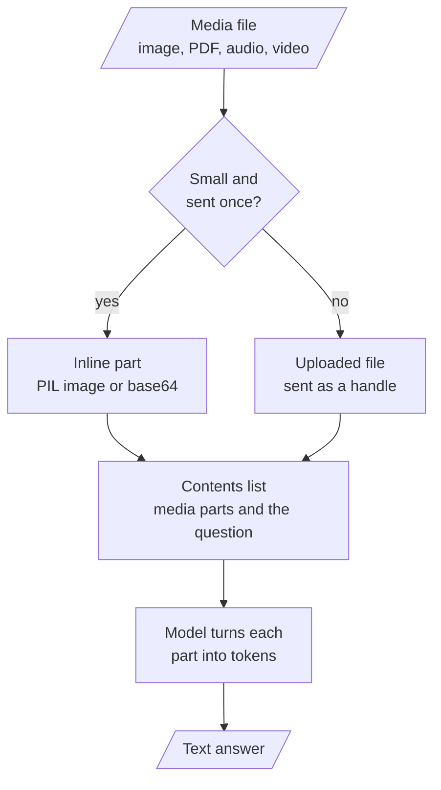

# M06 Theory: Multimodal Prompting

*Part II · Prompt & Context Engineering · [Module README](../../../course/p02_prompt_engineering/m06_multimodal_prompting/README.md) · [All theory pages](../../README.md)*

A multimodal model reads pictures, documents and sound in the same request as the question. The prompt becomes an ordered list of parts, and each part has a token price you can work out before you send it. The M06 notebooks build on three ideas: how an image goes into a prompt, how a PDF or an audio file goes in, and how a video becomes sampled frames plus a transcript. Each idea has a page in the folder of the lesson that teaches it, listed under [Lessons](#lessons). This page has the overview, the interview questions and the takeaways.

The running example is the Larkspur Cloud handbook from M11 to M13, in the forms a support team holds it: a pricing page as a screenshot, the handbook as a PDF, a recorded support call, and a 90-second screen recording of the data export. The M11 question *Can I export my data after I cancel my plan?* now has visual evidence as well: the export walkthrough, which the lab samples frame by frame.

## TL;DR

- A multimodal request is a list of parts. Gemini takes PIL images inline, and PDFs, audio and video by reference after `genai.upload_file`; GPT-4o takes `image_url` parts that hold a public URL or a base64 data URL.
- Every part has a price you can compute first. Gemini counts 258 tokens per PDF page and 32 per second of audio. `gpt-4o` counts 85 tokens per image at `detail="low"`, and 1,105 for a 1280 by 720 frame at `detail="high"`.
- The GPT-4o notebook sends no video file. It samples frames itself and transcribes the soundtrack with `whisper-1`, so the sampling gap sets both the cost and what the model can see.
- In the lab's 90-second walkthrough, the notebook's default gap of 2 s sends 45 frames and misses a 1.2 s toast. A 1 s gap sends 90 frames, 7,650 tokens at low detail, and catches all eight steps.
- A media prompt names what the media holds, what to extract, the output shape, and what to do with anything unreadable (`[NOT_EXTRACTED]`, "do not make up any information").

## Mental model

Whatever the provider, the request is a list of parts and the model reads every part as tokens. Decide how each file gets in by its size and by whether you will send it again, then count the tokens before you call: a 10-minute support call is 19,200 tokens before the question is read.

## Lessons

| Lesson | Topic | Theory |
|---|---|---|
| 6.1 | Multimodal prompting with Gemini | [Image prompts](01_multimodal_prompting_with_gemini/README.md#image-prompts) [PDF and audio input](01_multimodal_prompting_with_gemini/README.md#pdf-and-audio-input) |
| 6.2 | Multimodal prompting with GPT-4o | [Image content parts](02_multimodal_prompting_with_gpt_4o/README.md#image-content-parts) [Frame sampling](02_multimodal_prompting_with_gpt_4o/README.md#frame-sampling) |
| 6.3 | Exercise: financial report analysis | [Questions about a report page](03_exercise_financial_report_analysis/README.md#questions-about-a-report-page) |

## Interactive lab

[**Frame sampling**](02_multimodal_prompting_with_gpt_4o/interactive/frame-sampling-lab.html): open the file in a browser. Start at the notebook's default gap of 2 s and find the step no frame lands on. Drop to 1 s to catch all eight steps and read what that costs, then try 2.5 s, which catches all eight by luck. Switch to high detail to see the same frames cost 13 times as much.

## How it connects

- **Before:** [M05](../m05_prompt_engineering_patterns/README.md) taught prompt patterns such as few-shot and chain-of-thought on text; this module sends the same kind of instructions alongside images, documents and sound.
- **Next:** [M07](../../p03_langchain_and_langgraph/m07_langchain_core/README.md) wraps model calls in LangChain models, prompts and parsers. [M12](../../p05_ingestion_and_indexing/m12_document_ingestion/README.md) turns PDFs into text for an index instead of sending the pages to a model, and M21 retrieves images and pages before a multimodal model reads them.

## Interview Spotlight: 5 Questions You Might Get Asked

*Production questions of the kind asked in applied AI engineering interviews.*

### 1. Larkspur summarises recorded export walkthroughs with GPT-4o, sampling a frame every 3 seconds. A customer's summary says the export "may not have finished", but the recording shows an "Export ready" toast. What went wrong, and how do you fix it?

**What a strong answer covers:**
- Lists the timestamps of the frames sent and compares them with when the toast was on screen: a 1.2 s toast and a 3 s gap can miss each other
- States the rule: only a gap shorter than the shortest event you need guarantees a frame on it; 1 s does that here, at 90 frames instead of 30
- Considers cheaper options than a dense gap everywhere: extra frames on scene changes, or relying on the transcript for events the narrator mentions
- Adds the recording to a golden set with the question "Did the export finish?" so the fix is measured

### 2. The billing team wants answers from the 40-page handbook PDF. One engineer sends the whole PDF to Gemini on every question; another wants to extract the text and use RAG. How do you decide?

**What a strong answer covers:**
- Prices the first option: 40 pages at 258 tokens is 10,320 tokens on every call, before the question
- Uploads once and reuses the file handle if the whole document is sent, instead of re-sending bytes per call
- Notes what text extraction loses (charts, tables laid out as pictures) and what it gains (citations, smaller prompts, access control per chunk)
- Proposes a measured comparison on the golden questions, and page-level retrieval (M21) as the middle path

### 3. Support calls are transcribed and summarised with Gemini audio input. How do you measure transcript quality and catch the model putting words in the wrong speaker's mouth?

**What a strong answer covers:**
- Builds a small set of calls with human transcripts and measures word error rate and speaker attribution separately
- Checks timestamps against the audio, since chapter titles and captions carry timecodes the prompt asked for
- Spot-checks facts the agent quoted (the 30-day refund window) against the handbook, because a wrong policy in a summary is the costly error
- Tracks cost per call from duration: 32 tokens per second is 1,920 tokens a minute

### 4. A customer sends a screenshot of the pricing page and asks how much outbound traffic the starter plan includes. The chart on the page has bars but no printed values. What should the assistant do?

**What a strong answer covers:**
- Separates reading a printed value from estimating a bar height; only the first is an answer to quote
- Tells the model to say when a value is not printed rather than guess from the picture
- Answers from the handbook text instead, where the plan lists its included traffic
- Logs the case so the pricing page gets printed labels, which makes every later screenshot answerable

### 5. To cut cost, a teammate proposes `detail="low"` for every customer screenshot sent to `gpt-4o`. When is that safe?

**What a strong answer covers:**
- Quotes the difference: 85 tokens against 1,105 for a 1280 by 720 image at high, 13 times less, and the same 85 at any size
- Notes that a 1920 by 1080 screenshot also costs 1,105 at high, because it is scaled to 1365 by 768 first, so size alone does not drive the bill
- Tests both settings on real screenshots for the task that needs small text, such as reading an error code, and keeps high only where low fails
- Redacts secrets before sending, because a base64 image carries everything on the screen to the provider

## Key Takeaways

- Treat a multimodal prompt as a list of parts, and say in the text what the parts contain and what to extract from them.
- Price each part before you send it: pages, seconds of audio, frames and image tiles all have published token rates.
- When you sample video yourself, set the gap below the shortest event you need to see, and check what that costs.
- Give the model a way out for unreadable input (`[NOT_EXTRACTED]`, "not on the page") and grade answers on questions with known values.

---
*Previous: [M05 Prompt engineering patterns](../m05_prompt_engineering_patterns/README.md). Next: [M07 LangChain core](../../p03_langchain_and_langgraph/m07_langchain_core/README.md).*
