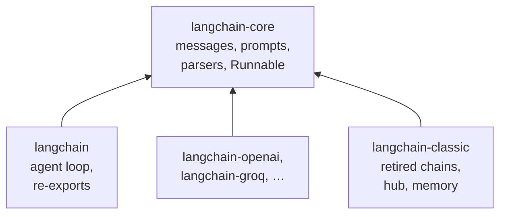

# M07.1 Theory: LangChain introduction and the 1.x package split

*[M07 theory](../README.md) · Lesson 7.1 · Notebooks: [`01a_LangChain_Introduction.ipynb`](../../../../course/p03_langchain_and_langgraph/m07_langchain_core/notebooks/01a_LangChain_Introduction.ipynb), [`01b_Package_Split_and_Imports_LangChain_v1.ipynb`](../../../../course/p03_langchain_and_langgraph/m07_langchain_core/notebooks/01b_Package_Split_and_Imports_LangChain_v1.ipynb) · [All theory pages](../../../README.md)*

## The 1.x package split

Through the 0.x releases, the `langchain` package held the whole ecosystem: chains, agents, memory, retrievers, every provider integration and the prompt hub. Installing it pulled in all of that, and a break in any one integration could break the import. Version 1.0 split the surface by how fast each part changes and by who owns it:

| Package | Holds | Changes |
|---|---|---|
| `langchain-core` | messages, documents, prompts, output parsers, `Runnable` | rarely, deliberately |
| `langchain` | the agent loop and short re-exports such as `init_chat_model` | with the agent API |
| `langchain-openai`, `langchain-groq`, … | one provider each | at that provider's pace |
| `langchain-classic` | retired chains, retrievers, indexing, the hub | frozen |

Everything else in this module comes from `langchain-core`: the prompt template classes, the message classes and all four output parsers. Only the model class comes from a partner package (`langchain_openai.ChatOpenAI`), or from `langchain.chat_models.init_chat_model` when the provider is named in a string.

The first notebook already shows the shape every later chain keeps: `prompt | llm | StrOutputParser()`, a template, a model and a parser joined with LCEL's `|`. M08 covers the pipe itself; the next pages of this module cover the three parts.

## Reading an import error

Old code fails on 1.x in two different ways, and the exception class says what moved. Checked against the course environment (`langchain` 1.4.7, `langchain-core` 1.7.0):

- `from langchain.chains import LLMChain` raises `ModuleNotFoundError: No module named 'langchain.chains'`. The module is gone, so the fix is a new path: `langchain_classic.chains`, or a rewrite as an LCEL chain (M08).
- `from langchain import hub` raises `ImportError: cannot import name 'hub' from 'langchain'`. The package still exists; it no longer exports the name. Import it from `langchain_classic` instead.
- `No module named 'langchain_classic'` is a third problem: the package is not installed in this environment. `uv add langchain-classic` declares it in `pyproject.toml` and installs it.

The short paths that `langchain` keeps are aliases. `langchain.messages.HumanMessage is langchain_core.messages.HumanMessage` returns `True`; the notebook reads a `False` as two LangChain installs on `sys.path`.

Memory is the one place where the moved class is not the recommended answer. `ConversationBufferMemory` still imports from `langchain_classic.memory`, but the 1.x replacement is a LangGraph checkpointer with a `thread_id` (M10, M33).

---
*Previous: [M07 overview](../README.md). Next: [7.2 Commercial LLMs natively and with LangChain](../02_commercial_llms_natively_and_with_langchain/README.md).*
